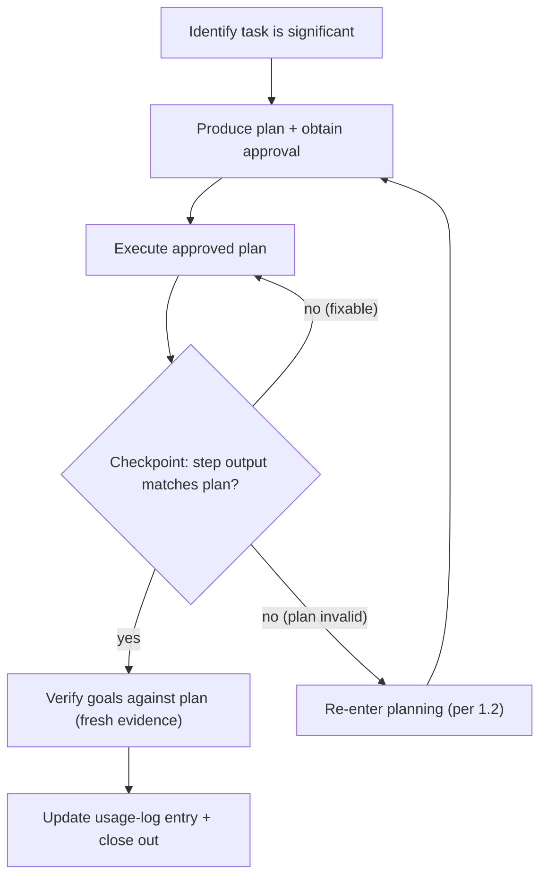

<!-- SPDX-FileCopyrightText: 2026 AIS CR (Archaeological Information System of the Czech Republic) <https://ror.org/01a7rqj69> -->
<!-- SPDX-License-Identifier: CC-BY-4.0 -->
<!-- generated by generate_governance_rules.py — do not edit manually -->
<!-- delivery-version: 79abd13a2bda8ad6d83de4001bd283c6b087d6dc 2026-10-26T01:48:39+01:00 -->

<!-- aiscr:entry-scope -->

**Entry scope**

- Stay in this Copilot instruction surface first; cross into another vendor tree only for an explicit parity check, generator work, or governance maintenance.

## Planning-first workflow core

This rule applies to all AI assistants used with this repository.
Assistant-specific surfaces should reference it rather than restating its behaviour.

### 1. Planning-first requirement

- Any non-trivial or non-readonly work in this repository must start in a single explicit planning phase for that task, with human approval before mutating steps.
- Once a plan for a given task has been approved, stay in execution mode and follow it instead of repeatedly re-entering full planning phases unless a re-planning trigger below applies.
- Substantive decisions that change scope, risk, delivery, user-visible outcomes, branch strategy, repo targets, or high-impact scripts belong in the approved plan or in explicit user confirmation.
  Do not pivot silently during execution.
- Plan can include milestones and gates for desirable user interaction and partial review when warranted.
- Work that always requires a plan with human approval includes:
  - running scripts in `.agents/scripts/` except for tests and pre-commit
  - commands that can change git state or remote services
  - changes under `.agents/**`, `.cursor/**`, `.claude/**`, `.codex/**`, or `.gemini/**`
  - plan-driven refactors touching multiple files or repositories
  - work that can influence AI configuration or behaviour in other repositories
- During planning, gather only the minimal necessary context and propose a concise plan that includes:
  - Goals and steps
  - Agent or role assignments when the task is meaningfully multi-agent
  - Impacts
  - Evaluation or recommendation
- For behaviour, AI-config, or cross-assistant alignment work, explicitly consider whether canonical governance, root governance docs, or assistant delivery configs need to change.

### OpenSpec requirement surface

- For workflow domains that have migrated to OpenSpec, treat `openspec/specs/` as the persistent requirement and acceptance surface.
- Treat `openspec/changes/` as the change-local design and task surface for work that modifies those capabilities.
- OpenSpec entry points such as the `/openspec-<verb>` seed invocations are allowed inside the same planning-first flow, but they do not replace the approval, checkpoint verification, or usage-logging obligations in this rule.
- Use the delivered `aiscr-*` workflow skills for reusable execution procedures.
  Plans remain change- or session-local approval artifacts rather than a parallel authored procedure layer.

### Upstream baseline before significant planning

- Before starting or materially extending non-trivial work, ensure the checkout is not behind its upstream tracking branch: after `git fetch` (or using already-fetched refs), `git rev-list --count HEAD..@{upstream}` must be `0`.
- Uncommitted changes and unpushed local commits are allowed.
  Missing upstream commits are not; do not draft or extend significant plans until the baseline holds.
- Do not treat rebase as an automatic cleanup.
  Integrate upstream changes deliberately and resolve conflicts explicitly.

### 1.5 OpenSpec mode transfer gating

**Iron Law for OpenSpec workflows:** `NEVER TREAT ARTIFACT COMPLETION AS IMPLICIT APPROVAL TO IMPLEMENT.`

OpenSpec workflows follow a phased approach: **explore → plan → implement**.
Agents SHALL NOT automatically transfer between these phases without explicit human approval.

The state diagram below summarizes the permitted OpenSpec phase transfers.
The approval rules and red-flag lists that follow remain normative; the diagram is a supporting aid only and must stay aligned with them.

```mermaid
stateDiagram-v2
  accTitle: Approval gates between OpenSpec phases
  accDescr: Exploration, planning, implementation and archive require phase-local human approval; without it work stops.
  [*] --> Explore
  Explore --> Plan: explicit approval to plan
  Plan --> Implement: explicit approval to apply
  Plan --> Archive: explicit approval after verification
  Implement --> Archive: explicit approval after verification

  state "Stop and wait" as Hold
  Explore --> Hold: no fresh boundary approval
  Plan --> Hold: artifacts complete but no apply approval
  Implement --> Hold: archive requested without verification
```

The critical guard is the `Plan --> Implement` boundary: completed planning artifacts do not authorize apply on their own.

#### Mode boundaries requiring explicit approval

- **Explore → Plan**: When exploration concludes and formal planning begins
- **Plan → Implement**: When planning artifacts are complete and implementation would begin
- **Any → Archive**: When a change is being archived (verify completion first)

Bundled prompts, compressed multi-step requests, and completed OpenSpec artifacts are not implicit approval to cross a later boundary; the user must give a fresh instruction that authorizes that action for the current change.

#### Required checkpoint pattern

At each mode boundary, agents SHALL state the boundary being crossed, explain what will happen next, request explicit user approval specific to that boundary, and only proceed after receiving clear approval for it.

Approval for a later boundary SHALL be phase-local: approval for exploration, planning, or promotion does not carry forward to implementation unless the user explicitly re-authorizes implementation at that later boundary.

#### Red flags — STOP and obtain approval

| Thought | What to do instead |
|---------|-------------------|
| "The artifacts exist, so I should implement now" | Stop. Obtain explicit user approval first. |
| "The user already approved the plan, so that also covers implementation after promotion" | Stop. Implementation still needs fresh phase-local approval after promotion. |
| "I'll continue into the next phase because it follows logically" | Stop. Wait for explicit user direction. |
| "The change is ready, so I'll apply it" | Stop. Confirm user wants to apply now. |
| "I can start implementation straight from exploration" | Stop. Complete planning artifacts first. |
| "The change has a backlog proposal, so I can implement it" | Stop. Backlog changes require promotion to governance-driven first. |

#### Backlog change guard

Changes with `schema: backlog` **SHALL NOT** be implemented: before any mutating work, the change MUST be promoted to the `governance-driven` schema through exploration and planning, with explicit approval at each mode boundary per §1.5.

Backlog changes promoted into the governance-driven lifecycle are no longer constrained by this guard from the point of promotion onward.

#### Hard stop after planning

After completing OpenSpec planning artifacts (proposal, specs, design, tasks), agents SHALL stop and offer `/openspec-apply-change <slug>` as the next step, treat implementation as closed until the user gives a fresh post-promotion instruction that clearly authorizes that specific change, and not check off or execute tasks without explicit user request.

#### Exception for documented automation

A workflow MAY bypass explicit approval only if the skill or prompt explicitly documents the automated transition with its rationale and the user has approved that specific automation pattern in an earlier explicit decision.

This rule applies to ALL OpenSpec workflows regardless of entry point (the generated `openspec-*` seed skills or direct CLI usage); the skill-slug ↔ vendor command-alias correspondence belongs to the workflow lifecycle capability.

The mode-transfer gating rules in this section are enforced at the skill level through phase-awareness headers in authored `aiscr-*` workflow skills.
Each skill declares its lifecycle phase and the boundaries it must not cross.
The two-layer lifecycle model and its category classification are owned by the workflow lifecycle capability.

### 1.1 Single-loop planning model

The following flowchart summarizes the expected loop for a significant task.
The prose list below the diagram is normative; the diagram is a supporting aid and must stay aligned with it.

For a significant task, the expected loop is:

1. Identify that the task is significant.
2. Produce one planning phase and obtain approval.
3. Execute the approved plan.
4. Execute with checkpoint gates: after implementing each step, verify it independently before initiating the next step.
   A checkpoint means confirming the step's output matches the plan's expectation (test passes, file exists, diff looks correct).
   Use the narrowest check that covers what the step changed.
   Do not advance past a failing checkpoint — stop and either fix the current step or re-enter planning per section 1.2 if the plan is invalid.
5. Verify results against the plan before claiming completion:
   - Identify what evidence proves each goal was met (test output, diff, command exit code, manual inspection result).
   - Obtain a verified result under `aiscr-quality-first-execution.md` Iron Law item 3; assumptions and partial checks do not establish goals they do not cover.
   - If any goal lacks fresh evidence, state what is unverified rather than claiming completion.
   - Only after evidence confirms the result: update the usage log entry for the active uncommitted change set (minimal or full per `aiscr-usage-logging.md` notability rules) and ask about an optional run-summary or report attachment when relevant.
     Do not offer to attach a standalone plan file: plans are either session-local (conversation or runtime scratch) or already persisted as the OpenSpec change artifacts, which the log references by slug.
6. Suggest recommended follow-ups and gotchas from the session.

This single loop applies to the whole task, not to each tool call, skill invocation, or subagent step.

### 1.2 Re-enter planning only when needed

Re-enter a full planning phase only when:

- the user changes requirements or scope in a way that invalidates the plan
- execution reveals blocking constraints or new information that makes the plan unsafe, incorrect, or materially inefficient
- the work branches into a clearly new independent sub-task
- ask the user when unsure, or when execution is stuck in a closed implementation loop

When that happens ask the user first and based on the response draft a revised plan, mark it clearly as revised, and obtain approval again before resuming mutating work.

### 1.3 Human-driven override

If the user explicitly asks to execute without a formal plan approval step, treat that instruction as approval of a very small inline plan by briefly restating the intended steps and then proceeding.

Even under this override, do not silently expand scope.
High-impact scripts, cross-repo changes, or history-altering git commands still require the user to understand what will be run.

### 1.4 Planning quality gates

**Scope.**
These gates bind the **plan the agent presents for human approval** — the one held in the conversation or the assistant's runtime scratch surface, not a file committed for the purpose.
They do **not** govern the shape of OpenSpec change artifacts: `proposal.md`, `specs/`, `design.md`, and `tasks.md` are owned by the schema under `openspec/schemas/<schema>/schema.yaml`, whose artifact instructions define their required sections and their task-id format.
Where the schema and these gates would disagree about an artifact's shape, the schema wins for that artifact.

- When developing a plan, consider options, evaluate them clearly, and present the user with alternate approaches plus a recommendation.
- Every planning phase must produce a plan with a `todos` list and a SWOT analysis.
  Prose-only step lists are non-compliant.
  A minimal SWOT is compliant: four single-sentence bullets, one per quadrant, placed immediately before the todos, and stated inline when the plan is communicated in chat rather than saved to a file.
  Do not skip it because the session feels small — write a minimal one instead.
  **Review-only:** the plan is conversational, so no validator can check this — the human reading the plan before approving it is the oracle.
  No script enforces it anywhere.
- To-dos must be specific, actionable, independently verifiable, and ordered, and use content-derived kebab-case ids rather than positional labels.
  This is the presented plan's convention; an OpenSpec `tasks.md` instead uses the numbered checkbox format its schema prescribes, because the apply phase parses that format to track progress.
- Plan must state clear impacts, implementation flow and planned subagent or MCP usage.
- Before presenting any plan, verify that it contains no placeholders, that every goal maps to at least one to-do, and that the impacts section names every file, directory, or repository to be touched.

### 2. Very low-impact exception

Agents may skip a full formal plan only when all of the following are true:

- the task is purely informational, or a single local reversible edit in one open markdown/text file that the user explicitly asked to adjust
- there is no script execution, no cross-repo effect, and no change under `.agents/**`, `.cursor/**`, `.claude/**`, `.codex/**`, or `.gemini/**`
- the work can be completed in one or two trivial steps without follow-on automation

Even then, think in terms of a mini-plan and escalate to a full planning phase if the scope grows.

### 3. Skills and canonical workflows

- Skills and canonical workflow bodies are tools inside the planning flow, not replacements for it.
- Invoking a skill during execution does not require a new planning phase if the skill stays within the approved plan.
- Before invoking a significant workflow, the approved task plan must identify the skill or canonical workflow, the files or repositories that may be affected, and how results will be verified and logged.
- Assistant-specific skills for this repo should point back to this rule and avoid restating behaviour.

