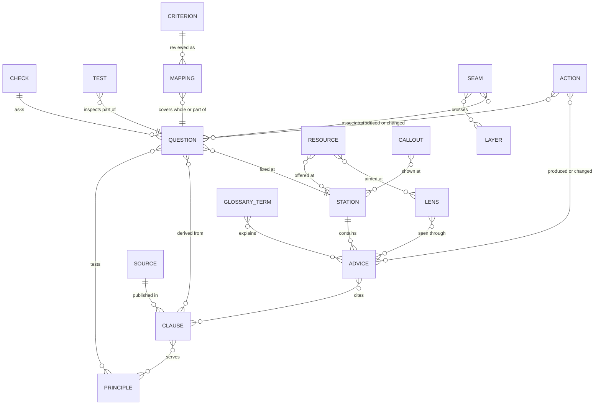

<!-- type: reference -->
# Content model

The [content how-to](how-to/edit-content.md) owns editing steps; this reference defines fields, identities and constraints.

The guide's content is authored in small TOML files under `content/`. A generator,
`scripts/build_crate.py`, turns them into the knowledge base `ro-crate-metadata.json` (RO-Crate 1.2) and the same
crate as scripts the page loads: `_site/assets/data/kb.js` with what every view needs, and `_site/assets/data/kb-standards.js`, `_site/assets/data/kb-fips.js`,
`_site/assets/data/kb-pages.js`, `_site/assets/data/kb-questions.js`, `_site/assets/data/kb-model.js` and `_site/assets/data/kb-advice.js` with the standards' requirements and guidance and the details
of provenance actions, the FIP Dashboard snapshot (profiles and resource records) and the KNAV catalogue's tools,
page texts, check questions, the conceptual implementation model with the life-cycle models, and L1-L3 advice text, loaded when a view
first needs them; `scripts/build_site.py` writes them with the page and the API into the site directory `_site/`,
which is not committed. View code that only one view needs loads with that view (`VIEW_SCRIPTS` in
`scripts/build_crate.py`; the catalogue's `assets/js/catalogue-view.js`). This document defines the entities and the
rules every content file follows. The design
behind it is in [design.md](design.md).

## Entities

A **station** is one step of the path. It contains **advice items**; each item belongs to one disclosure **level**,
is seen through one or more **lenses** (or all of them) and cites **clauses** of the ledger. Clauses come from published **sources** and serve
FAIR **principles**, identified by their published w3id IRIs. A **check** asks **questions**; each question tests
principles, derives from clauses and points to the station where a gap is fixed. A named **test** inspects part of
one question; an external evaluator's **criterion** relates to questions only through a reviewed **mapping** that
states whole or partial coverage. **Resources** are offered at stations for given lenses, carry a status with an
as-of date and link to published FER or FAIRsharing identifiers. **Glossary terms** come from Heslář. **Callouts**
are shared notes reused across stations. The implementation model's **seams** cross its **layers** and are
associated with questions and other items. **Provenance actions** record who produced or changed an item, with
which instruments and from which sources. This is the one maintained entity-relationship diagram; the design
document links here.

| Entity | What it is |
| --- | --- |
| Station | A step of the path. The steps follow the seven stages of the RDMkit research data life cycle (`lifecycleStage`); every step belongs to a stage, the check to reuse |
| Lens | One of four audiences: `V` researcher, `DS` data steward, `SR` repository administrator or curator, `K` community and FIP |
| Level | `L0` one sentence and one action; `L1` steps; `L2` why (principles, requirements); `L3` sources and paradata |
| Advice item | A piece of advice for one station and level, seen through one or more lenses or all of them |
| Clause | One requirement or statement from a published source, with a stable ID |
| Source | A published document, dataset or web page that clauses come from; the approved model manuscript is a narrowly scoped exception |
| Principle | A FAIR principle, identified by `https://w3id.org/fair/principles/terms/<ID>` |
| Check | A self-check for one lens or more, with its modes, profiles and questions |
| Question | A self-check item with a tier, principles, a fix location and an owner |
| Test | A named check of part of one question: a guide test run in the browser or a FAIR Champion test |
| Criterion | An external evaluator's native criterion, kept with its own identifier and wording |
| Mapping | A reviewed statement that a criterion covers a whole question or part of it, for named versions |
| Resource | A service, tool, standard, guide or repository the guide recommends |
| Glossary term | A term from Heslář, with its label and link |
| Callout | A shared note (sensitive data, identifier verification), defined once and ordered by lens |
| Provenance action | A record of who changed which items, with which tool and from which sources |
| Implementation layer | One of the model's six functional groups, independent of reader lenses and FAIR principles |
| Implementation seam | An information transfer across a responsibility boundary, within or across layers |
| Implementation example | An evidenced, dated observation about a precisely scoped component or connection |

## Rules for every content file

### Identifiers

Resources may carry `rdmkit = { id, biotools, fairsharing, tess }`, transcribed from the tool list at the
revision recorded by the `rdmkit` source. Join an existing resource by its address or its registry identifiers;
check that the record denotes the same service rather than a different national instance. A selected new tool
becomes one curated resource, linked to its KNAV or FIP Dashboard record where present. `id` links the RDMkit
record; bio.tools and FAIRsharing identifiers become identity links (`NA` is omitted). TeSS values are quoted
training searches, not identity links. The catalogue shows the RDMkit record and TeSS training under its sources.

An identifier becomes issued in the first official release. Before then it may change in place, without a
retirement entry or compatibility alias. An issued identifier names the same entry for good and is never reused.
Current classifications and source metadata may change without changing that identity.

`content/identifiers.toml` registers every identifier the guide has issued, by kind: lenses, stations, checks, check modes
and profiles (`<check>.<id>`, as share links carry them), pages, callouts and their items, advice, questions, local
tests, requirements, sources, resources, repositories, provenance actions, and the model's and life-cycle
models' entries (`issued_ids` in `scripts/check_content.py` is the complete list). The content checks report
an entry whose identifier is not registered, a registered identifier no entry has (an entry renamed or removed
without retiring it) and a retired identifier in use again. `python scripts/register_ids.py` registers the
identifiers of new entries and never removes one; retiring is a deliberate edit of the register's `[retired]` table.

An identifier says where an entry belongs, not what it says:

- **Nested, with a serial.** Advice is `<station>.<nn>` and a check question `<check>.<nn>`: its station's or check's
  ID and a two-digit serial in order of creation. What an item is for (lens, level, kind, tier, block) lives in its
  fields, which can change without touching its identifier. A question shows by its number inside its check (`04` in
  the dataset check); the page keys its elements by the identifier with a hyphen for the dot (`item-dataset-04`).
- **Adopted where the source is consistent.** A requirement is `<source code>.<local part>`. The local part is the
  source's own label where the source labels its items consistently (`A.F1.N1` in the FAIR analysis, `CTS.R06`,
  `NRP.M5`, `CDIF.REQ1`, a section of a law `LAW-328-2025.83.2`), and a two-digit serial otherwise
  (`OS3-RULES.24`). A source's code is its declared `code` (the FAIR analysis `A`, `NRP`, `CTS`, `CDIF`) or else its
  ID in capitals without a version suffix (`os3-rules` gives `OS3-RULES`). Where a source falls short (no labels, or
  labels it does not keep), the guide's own serial takes over.
- **One primary per record.** Every normalized catalogue record stores its Guide-owned `id`. There is no
  second primary or separate slug override. A model uses `id = "layers-seams"`; a question uses
  `id = "software.04"`. Previously authored IDs were corrected in place before release, without aliases.
- **Genuine source alternatives.** Imported records store `alternateIds = [{ scheme = "knav", value = "github" }]`
  or the corresponding `heslar`, `re3data`, `nkr`, `fip-dashboard`, `fair-champion` or evaluator scheme. Values
  come directly from that source's identifier field. An obsolete Guide slug never becomes an alternate.
  The build rejects missing, untyped, empty or competing source identifiers. Published records carry every
  identifier as one `schema:identifier` value: the Guide primary as its own value and each genuine source
  identifier as a `PropertyValue` typed by its issuing scheme (a DataCite repository ID included). The compact
  catalogue address is a separate Guide-issued `dcterms:identifier`.
- **Stable identity through refresh.** `guideRoute` stores the frozen compact kind/type prefix. Refresh joins
  through the typed source identifier or an unambiguous authoritative URL, retains `id` and `guideRoute`, and
  updates source metadata. Names alone never merge records; ambiguous joins and splits require review.
  New records take a short local ID once. Removed IDs stay reserved across subsequent refreshes, without routes
  or aliases, so they cannot be assigned to a different record.
- **External identities keep their roles.** Source IDs and authoritative IRIs remain record metadata; `url` is the
  landing page and `sameAs` is an equivalent identity. FAIR principle records declare their published `iri`.
  Curated records link reviewed matches rather than duplicating the described thing. Native source labels,
  criterion IDs and quoted originals are preserved.
- **Plain names for the guide's own structure.** Stations, checks, check modes and profiles, pages, resources,
  repositories and sources have short lower-case English names in kebab case (`repository`, `dataset`,
  `core-system`, `live-check`, `zenodo`); lenses and levels short codes (`SR`, `L1`); provenance actions
  `<date>-<topic>`, except the `release-<version>` action that release preparation adds.
- **No reuse.** A new entry takes the next free serial; a serial left by a retired entry stays unused.

### Term classification

Every fact the crate records uses an established vocabulary where one expresses it; a guide-specific term is
introduced only for what no established term expresses. `scripts/build_crate.py` owns the one declaration:
`ESTABLISHED_TERMS` names each property key the graph carries as an established IRI (Dublin Core, schema.org,
DCAT, ADMS), and `GUIDE_TERMS` holds the terms the guide keeps in its own namespace, each with the broader
established term it specializes, its domain and its range (`GUIDE_TERM_SHAPES`) or the recorded reason none
exists (`GUIDE_TERM_REASONS`). The typing and status slots (`resourceType`, `repositoryKind`, `serviceStatus`
and their kin) specialize `dcterms:type`, `dcterms:subject`, `dcat:theme` or `adms:status` rather than
replacing it, because each is one slot of several over the same property that a shape targets individually. The
guide publishes its own vocabulary in every built site's `terms/` (a landing page and a Turtle document);
the namespace `<namespace>terms#` resolves to the production copy (see *Crate mapping*), and
`check_content` refuses a guide-specific term without a broader term or recorded reason and a published guide
term absent from that document.

The [crate mapping](#crate-mapping) defines the namespace prefixes used for semantic concepts. Authoring-file
tables retain serialized field names; a field's spelling alone does not identify its vocabulary.

### One entry per thing

One real-world thing has one entry, which carries every role it plays: a service the guide recommends and also cites
is one `[[resource]]` with a `[resource.citation]` table, and a repository it recommends is one `[[resource]]` with a
`[resource.repository]` table. A curated entry that matches a registry's record links it (`fipDashboard`, `re3data`)
instead of repeating it, and no two curated entries link one record. The guide says each thing once, too: no two
advice items, requirements or questions of one check share their words, and no check asks about one requirement twice.

`scripts/check_duplicates.py` enforces this as a check of its own, which every pull request must pass. It compares
every entry with the others of its kind (curated resources, repositories and sources with the FIP Dashboard's and
re3data's records; organisations with the dashboard's; terms; FIPs; tests; advice; each check's questions;
requirements) by address, DOI, re3data, ROR and FIP Dashboard ID, identifier, name and text, and names what to do
about each match: link the record, merge the entries or say it once. A group that only looks alike, or that a
registry itself lists twice, is accepted in `content/duplicates.toml` with its reason; the check reports any other
group, and an accepted group that no longer occurs. The content checks add that one ID names one entity and report
entries nothing uses as warnings.

A group the check can resolve without editorial judgement also carries a structured suggestion: the curated entry,
the registry record, `resolution = "link"`, `safe = true`, and the exact `file`, `table`, `field` and `value`. A
suggestion is safe only when exactly one curated entry and one registry record share an authoritative key (address,
DOI or registry identifier), the curated entry has no conflicting link, the field placement is known, and the group
is not accepted. Suggestions are written to `duplicates.json` under `CHECK_REPORT_DIR` in CI and with
`--report <path>` locally; otherwise the check only prints them.

Different candidate values for one entry's link field make the target ambiguous, even when each pair shares an
authoritative key. Existing keys, including empty values, require review. The fixer checks the whole parsed table
and parses the proposed TOML before writing it; it returns nonzero when no safe change was applied.
Ownership is checked across all curated entries: a record already linked by another entry, or proposed for
several owners, cannot supply a safe link. The producer and Python consumers share exact entry/file/table/field
placements; the independently trusted Node validator is checked against the same domain, including invalid
combinations of individually known values. Ambiguous groups remain for manual review.

`python scripts/check_duplicates.py --fix` applies only safe suggestions to the working tree together with one
provenance action and that action's identifier registration, as the `/fix-duplicates` command does. The action
names the responsible person, the `duplicate-fix` instrument, the consulted registry source and the linked
results. The person is the reviewed `[[person]]` given with `--person <id>`, or else the single person whose
`commitNames` or `github` matches `git config user.name`. The output says how the person was found. An unknown
or ambiguous identity writes nothing and names both `--person` and the reviewed-identity procedure; the command
never invents a person. After writing, it rechecks duplicates and the content contract. A repair that adds a
content error, for example a missing registration, is rolled back, while errors that existed before it are left
to the contributor. The unified diff is printed only after those rechecks pass. Each target is replaced atomically
from a temporary sibling. A handled application or recheck failure restores earlier changes to their original
bytes; a target changed concurrently is refused, and a restoration failure names the affected file. This is
per-file atomicity, not a multi-file crash transaction. It does not commit. For the PR 82 case, a new
re3data record for `datarepo.eosc.cz` and the curated `datarepo` resource produce a suggestion for
`content/resources.toml`, `[resource.repository]`, `re3data = "r3d100014970"`; applying it joins the records instead
of creating a second entry. A lookalike group, a group with several curated entries or records, an existing
conflicting link, or a record with no known link field remains a human review, not a suggestion.

### Languages

Every user-facing text is a table with a `cs` and an `en` value. Czech is the primary language. The page sets the
`lang` attribute where it shows another language: a name or title with its own `inLanguage`, and a value that
falls back to the other language. No markup yet marks a phrase in another language inside a text.

### References in text

Catalogue addresses belong to the Guide: `<kind-code>/<type-code>/<id>`, omitting type where unneeded.
`scripts/catalogue_identity.py` owns the compact vocabulary; `catalogue_addresses()` in `scripts/build_crate.py`
projects the stored record identity once. Examples: `res/tool/github`, `repo/gen/zenodo`, `q/software.04`.
Slugs contain no articles, prepositions or conjunctions. Prefer a recorded official abbreviation, then specific
words from the source URL; skip generic registry/resolver and interface paths. Where neither is useful, choose
short meaningful name words without particles or cut-off words. These are one-time local assignments; later
title, abbreviation or URL changes do not rename a record. Symbolic parts of official abbreviations remain intact.
The API, routes, references and exports consume the emitted address; chips display its compact last segment.
There is no `[catalogue]` full-address register, old-route alias table or duplicate API compatibility document.
The complete address remains available through the chip link/title. `guideRoute` is frozen for issued records,
so a classification edit does not move a published address.

A canonical prose reference is `[[res/tool/github|GitHub]]`: any allowed published catalogue entry can be named by
its compact address. Current short forms for authored resources/sources, pages, stations, clauses and the model
are convenient content references, not compatibility routes. New imported records receive their own primary `id`
during snapshot refresh; source changes never regenerate existing Guide IDs from names or external identifiers.

Optional `linkNames = { cs = ["reviewed inflected phrase"], en = ["specific alternate name"] }` adds reviewed
editorial matching forms to an owning record. Snapshot refresh preserves this local metadata. The advisory also
learns forms from authored references, suppresses generic/self/already-linked mentions, prefers longer phrases
and marks unresolved ambiguity for review. Its proposed markup and excerpt are hints; they never rewrite prose
or fail content integrity checks. Do not add broad noun stems to force matches.

A text that names a resource, a source or a glossary term marks the name as a reference: `[[id|phrase]]`, where
`id` is the resource's or source's ID, the emitted `term/<Guide ID>` for a glossary term, `page:<id>` for a page of the guide,
`infrastructure:<id>` for a large research infrastructure (`infrastructures` for their catalogue),
`clause:<id>` for a ledger clause (such as a CoreTrustSeal requirement) or `profile` for the guide's profile, and
`phrase` is the words that name it
in that language, inflected as the sentence needs (`v [[nma|Národním metadatovém adresáři]]`). Mark the first
time a text names the entry; a button label is already a link and carries no reference. The Czech and the English
text of one item refer to the same entries. The generator writes the text without the markup and records each
entry as mentioned by the item; the page links the phrase quietly to the entry in the catalogue, or to the page. The content
checks refuse a reference that is not well formed, one to an unknown entry, and texts whose languages refer to
different entries.

### Advisory wording

Guidance recommends actions and explains their reasons. "Must" (Czech "musí") is reserved for an actual NRP
condition and names that condition. DOI is recommended; other persistent, resolvable and managed identifiers
are acceptable. Automated evidence never certifies a person, FAIRness or NRP admission.

### Sources

Every advice item and every check cites at least one clause ID in `sources`. Every clause names a published
source: an entry of `sources.toml`, or a resource that carries its citation. The sole approved exception is
`layers-seams-manuscript`, an article source with `preparationStatus = "in-preparation"`, its authentic
title and authors and `inLanguage = "en"`. It may support the conceptual model and scoped observations;
it cannot supply a ledger clause. It has no invented DOI, publication date, publisher, journal, year or licence.
Other unpublished working material is not cited.

### Layers-and-Seams model

`content/model.toml` is the single authoring home. These associations add functional context without
renaming original requirements, replacing their published sources or implying that they are fulfilled.

| Table | Fields |
| --- | --- |
| `[model]` | `id = "layers-seams"`, manuscript `source`, bilingual `name`, `description`, `introduction`, `ordering`, `feedback` |
| `[model.workedExample]` | Bilingual `name`, `description`, ordered `steps` of existing content IDs; recorded revisions use `action:<id>` |
| `[[layer]]` | Stable `id`, bilingual `name`, `description`; the six IDs are `policy`, `community`, `infrastructure`, `planning`, `support`, `evaluation` |
| `[[seam]]` | Stable `id`, bilingual `name`, `description`, `transfer`, `sender`, `recipient`, `carrier`, `maintainers`; `layers` references layer IDs |
| `[[example]]` | Stable `id`, `seam`, bilingual `name`, `description`, `scope`, `status`, `asOf`, and `evidence` source IDs |
| `[[association]]` | One existing content `target` and reviewed `layers` and/or `seams` IDs; tests use `test:<id>` |
| `[[context]]` | Existing `station` and `lens`, bilingual `text`, and relevant `seams`; one explanation per station and lens |

Definitions are `schema:DefinedTerm` records in `#implementation-model` (`schema:DefinedTermSet`, identifier
`layers-seams`); a layer or seam carries its primary `id` as `identifier` and its issued `layer.<id>` or
`seam.<id>` as `termCode`. An example is a `schema:CreativeWork` with its primary `id` as `identifier`, linked
to its seam through `schema:isPartOf`; the seam lists examples in `schema:hasPart`. Role-specific contexts are
`schema:CreativeWork` records with station/lens references and `context.<station>.<lens>` identifiers.
The optional worked example uses `#model-worked-example`, linked by the model's `schema:workExample` and its
inverse `schema:exampleOfWork`. Its ordered parts resolve existing requirements, questions, test definitions
and revision actions after those actions exist; it creates no fabricated live test run.
The ID register and provenance use `model:layers-seams`, `layer.<id>`, `seam.<id>`, `example.<id>`
and `context:<station>:<lens>`. New definitions, examples, contexts and association changes require paradata.

The crate's `implementationLayers` and `implementationSeams` properties decorate only explicitly
reviewed targets. Selecting a seam reuses its endpoint layers as layer associations. No association is
inferred from all cited sources, neighbouring questions or the
fact that an artifact is a test. Changing an association enters the target's provenance fingerprint.
Each seam's `maintainers` describes actors implementing or maintaining the connection, without claiming
formal interface ownership. The model's ordering is functional, not a time sequence or maturity scale.

Only examples carry `serviceStatus` and `statusAsOf`; generic definitions carry neither. Examples retain
`YYYY-MM` observation precision when the manuscript supplies only a month. This narrow allowance does
not relax the full-date requirements for existing resource and service statuses. `evidence` must resolve
to cited sources. Statuses describe the named scope; a catalogue component and reuse of it in planning
are separate observations even when they concern the same seam.

The static API exposes the model at `_site/api/model/layers-seams.json` and its layers, seams and examples at
`api/model/layer/<id>.json`, `api/model/seam/<id>.json` and `api/model/ex/<id>.json`, with language maps and
links to source evidence. Contexts are embedded in the station records. The deferred
`model` data part contains definitions and observations plus association patches for core entities;
questions and standards retain their reviewed associations with their own deferred entities. Loading
parts in parallel therefore cannot lose a mapping. The complete crate, API and exports retain all fields.
Offline health checks inventory model records and associations; passing integrity checks does not
establish live operation of a connection.

Clause ID prefixes:

| Prefix | Source |
| --- | --- |
| `A.<principle>.<kind><n>` | FAIR analysis, chapter 3 (principle table). Kinds: `N` NRP, `R` repository, `F` FIP, `X` other |
| `A.K2.*`, `A.K4.*`, `A.K5.*`, `A.K6` | FAIR analysis, other chapters |
| `A.P1`, `A.G` | FAIR analysis, appendix 1 and glossary |
| `A.MIN<n>`, `A.REC<n>` | FAIR analysis, summary: minimum and recommended steps |
| `NRP.*` | NRP conditions for creating repositories |
| Source-specific prefixes, such as `NRP-DOCS-NMA-ACCESS.*`, `POLICY-MANUAL.*`, `CTS.*`, `CDIF.*`, `FDO.*` and `FRSM.*` | Other published requirements and findings; each clause records its actual source |

These are examples of the issued families, not an instruction to derive new IDs from names. The actual clause
IDs and source links live in `content/ledger.toml`, with their issued identifiers reserved in `content/identifiers.toml`.

### Life-cycle models

`content/lifecycle/` holds the research data life-cycle models the path is mapped to: one file per model
(`<position>-<id>.toml`) and `crosswalk.toml`. The path follows the model `rdmkit` (`PATH_LIFECYCLE` in
`scripts/build_crate.py`); a station names its stage in `lifecycleStage`.

| Table | Fields |
| --- | --- |
| `[lifecycle]` | `id`, `position`, `source` (source ID), optional `czechSource` (the source of Czech names and definitions), bilingual `name`, optional `url` (the page that publishes the model; the landing links the path's model there) |
| `[[stage]]` | `id`, bilingual `name`, `translated` (languages in which the name is the Guide's translation), `definition` (a string quoted from `source`, in its language), `translation` (for a stage of the path's model only: the Guide's Czech translation of `definition`, sentence for sentence), `czechDefinition` (a string quoted from `czechSource` with its stage label, "Plánování: …", for every stage of a model that has one), `locator`, optional `note` (quoted from `source`) |
| `[[correspondence]]` in `crosswalk.toml` | Guide-owned `id`, frozen `guideRoute` (`life/xw`), `stages` (two `<model>.<stage>`: one of the path's model, one of another), `basis` (`published`, `reviewed`, `unconfirmed`), `source` and `locator` for a published or unconfirmed one, bilingual `note` saying why for a reviewed or unconfirmed one |

A definition is quoted in its source's language. So that both languages state the same definition, a stage of the
path's model also carries the Guide's Czech translation, which the page marks as a translation; the Czech source's
own wording follows it as a quotation that keeps its stage label. Other models' definitions are shown only in their
source's language. A file quoting a source under another licence keeps that licence in `REUSE.toml`, as the KNAV tools
catalogue's steps keep GPL-3.0. The content checks require every stage of the path's model to correspond to a stage
of each other model.

A stage is a `schema:DefinedTerm` `#lifecycle-<model>.<stage>` in its model's `schema:DefinedTermSet` `#lifecycle-<model>`, with
`schema:description` (its definition, language-tagged), `guide:descriptionTranslation` (the languages in which the description is
the Guide's translation), `guide:quotedDefinition` (the Czech source's wording), `schema:citation`, `schema:license` (its sources'
licences) and `guide:nameTranslation`. A correspondence is a `schema:CreativeWork` `#crosswalk-<id>` in `#lifecycle-crosswalk`,
with `schema:about` (both stages), `guide:mappingBasis`, `schema:citation` and `schema:description` (the note). `#path` names the path's model
in `schema:isBasedOn`. The names of the path's stages stay in `_site/assets/data/kb.js`, because the rail groups the steps under them and the
landing's journey lists them; their definitions, the other models and the crosswalk load with `_site/assets/data/kb-model.js`. The
stage a reader is in is derived from the step and never stored. The API lists every model, stage and
correspondence in `_site/api/lifecycle.json`, each at its catalogue address (`_site/api/life/rdmkit.json`,
`_site/api/life/rdm/plan.json`, `_site/api/life/xw/rdm-plan-mld-plan.json`); the register and provenance use `lifecycle:<model>`,
`<model>.<stage>` and `crosswalk:<id>`. The correspondence ID is stored, not recomputed from its stages.

### Paradata

Every item that needs paradata (`provenance_items` in `scripts/check_content.py`: the guide's metadata, clauses,
advice, questions, resources, sources, pages, curated repositories, callouts and their namespaced items, tests,
organisations, infrastructures, the EOSC CZ Node, provider criteria, the model and the life-cycle models)
is covered by a provenance action following the
Process Run Crate profile: `schema:agent` (person, ORCID where available), `schema:instrument` (tools, naming any AI model),
`schema:object` (sources consulted), `schema:result` (items produced or changed) and `schema:endTime`. A changed item needs an action
added since the point where the branch left the compared base, or an existing action extended there with a later
`endTime`. The check reads this from history, so a base that moves on after the work ended, as in the merge queue,
leaves the action valid and its `endTime` true to when the work finished.

One action per pull request is the default, covering all changed entities and the actual responsible person,
instruments and consulted sources. Separately attributable work may use finer actions. The initial public state
consolidates unreleased preparation into one action; quoted and imported records retain their original attribution.

Callouts use `callout:<id>` and their items use `callout.<id>.<item>` in the identifier register and provenance
results. Page results use `page:<id>`; curated repositories and sources keep their content IDs. The retrospective
coverage records review of existing records without attributing their original authorship to that review.

The health JSON/API, dashboard and summary expose `missing_links`: ranked, specific name matches in authored prose that
may need a catalogue reference. Each item retains its text path, language, text, matched entry and Guide address.
Original source passages and labels are excluded; existing references to the same entity are respected. These
suggestions are advisory and never fail a check or change prose automatically.

`content/link-reviews.toml` records individually reviewed unlinked mentions. Each `[[review]]` names the exact
language-specific `path`, suggested catalogue `address`, SHA-256 of the complete UTF-8 field text, ISO `reviewed`
date and an editorial `reason`. Wildcards, duplicate decisions, missing reasons and malformed dates/hashes fail
health integrity. Decisions never exempt a whole term, page or language. A changed field or target reopens the
suggestion and makes its old decision stale; new occurrences remain eligible for suggestions.

The health report keeps unresolved suggestions in `missing_links` and exposes current decisions with their
reasons in `missing_link_review.reviewed`, plus obsolete decisions in `missing_link_review.stale`. Dashboard and
summary display the counts separately. Zero unresolved suggestions means the current candidates have been
dispositioned, not that every possible useful link has been found. Remove obsolete decisions or review their
new context explicitly; do not refresh hashes automatically. The register is editorial metadata and does not
alter the source prose or add a catalogue entity.

### Statuses

A service or resource status uses the five-level vocabulary and always carries an `asOf` date:

| Value | Czech label | English label |
| --- | --- | --- |
| `operational` | provozní | operational |
| `pilot` | pilotní | pilot |
| `in-development` | ve vývoji | in development |
| `planned` | plánováno | planned |
| `prospective` | výhledové | prospective |

### Links and text

- Links use HTTPS, and prefer DOIs and other persistent identifiers.
- Text is plain text; raw HTML is not allowed.
- Live services are called only through the connectors, and only for hosts on the allowlist.

## Files

| File | Holds |
| --- | --- |
| `content/guide.toml` | Guide metadata, people, organisations, instruments, lenses, levels, vocabularies, help routes, landing tasks |
| `content/principles.toml` | The fifteen FAIR principles with their CoreTrustSeal and CDIF links |
| `content/sources.toml` | Published sources |
| `content/ledger.toml` | Clauses |
| `content/stations/NN-<id>.toml` | One station and its advice items |
| `content/checks/<id>.toml` | One self-check and its items |
| `content/lifecycle/*.toml` | Research data life-cycle models and the crosswalk between them |
| `content/resources.toml` | Resources |
| `content/repositories.toml` | The curated repository list |
| `content/infrastructures.toml` | The large research infrastructures of the national roadmap |
| `content/eosc-node.toml` | The EOSC CZ Node, its state and its members |
| `content/snapshots/*.toml` | Dated snapshots of sources a browser cannot query or that change slowly (re3data, the FIP Dashboard, NKR, the KNAV catalogue); FAIRsharing and DataCite snapshots hold `[[annotation]]` rows that join a listed repository by `re3data` or `url` and add its `fairsharing` record (with `fairsharingName`) or its `datacite` repository |
| `content/glossary.toml` | Glossary terms |
| `content/callouts.toml` | Shared callouts |
| `content/live.toml` | Connectors, the FAIR Champion test set and its health |
| `content/provenance.toml` | Provenance actions |
| `content/pages.toml` | The Guide's own pages, such as About, the accessibility statement, the AI overview and the machine interfaces |
| `content/model.toml` | The layers-and-seams model: layers, seams, examples, associations and role-specific contexts |
| `content/corrections.toml` | Reviewed local corrections to verbatim snapshot text (see below) |
| `content/ui.toml` | Interface strings |
| `content/icons.toml` | Interface icons |
| `content/identifiers.toml` | The register of the identifiers the guide has issued |
| `content/duplicates.toml` | Entries that look alike but are kept apart, each with its reason |
| `content/link-reviews.toml` | Exact dated decisions to leave a suggested mention unlinked, with reasons and text fingerprints |

A bilingual text is written as an inline table: `text = { cs = "…", en = "…" }`. Paragraphs inside one text
are separated by a blank line (`\n\n`). Names and titles of external works are proper names, given in their
original language with `inLanguage`. Every name readers see has an English form: a name that is not
language-neutral (an organisation's Czech name, the title of a Czech work) is a table with both languages, in
which the work's own language holds its original title and the other a translation. In the other language the page
shows a work the guide only cites as its original title followed by the translation in brackets. A publisher that
is a curated organisation is cited by its ID. The content checks refuse a plain name with Czech letters and a
publisher named like a curated organisation.

### `guide.toml`

| Table | Field | Type | Meaning |
| --- | --- | --- | --- |
| `[guide]` | `version` | string | Semantic version, the same as in `CHANGELOG.md` and `CITATION.cff` |
| `[guide]` | `genericGuideUses` | list of strings | Uses of "průvodce" and "guide" that do not mean this Guide and stay in lower case; the content check accepts a lower-case form only inside one of them |
| | `releaseStatus` | — | Not authored. The build reads the Tag release input `release_status` recorded in the annotated tag under the [deployment status contract](deployment.md#release-status); local/dirty/preview builds always use `testing` |
| | `testingNotice` | text | The notice shown on every view while the status is `testing` |
| | `datePublished` | date | Date of the version |
| | `name`, `description` | text | Name and description of the guide |
| | `keywords` | list of text | Keywords |
| | `url` | URL | The source-code repository; the crate's `codeRepository` and the profile's source link |
| | `baseUrl` | URL | The explicit HTTPS publication location for local and offline builds, currently the GitHub Pages site. A deployment replaces it with the actual Pages location in `FAIR_GUIDE_BASE_URL` before checks and packaging. It gives the page's recorded address (used by exports and shared links from a local file), the sitemap and, at an origin root, `robots.txt` |
| | `namespace` | URL | The reviewed HTTPS namespace of the Guide's own terms (`<namespace>terms#`) and RO-Crate profile (`<namespace>profile/<profileVersion>`), which the build also writes into the profile's shapes. It does not follow the publication location; changing it renames every Guide term and is a breaking change. Content without it used its `baseUrl`; see [deployment](deployment.md#publication-location-and-guide-namespace) |
| | `profileVersion` | string | Version of the guide's RO-Crate profile; it ends the profile's IRI |
| | `doi` | string | The guide's DOI once it has one; the page head and the linkset then name it as `cite-as` |
| | `freshnessDays` | integer | Age after which a status is reported as stale |
| | `editors` | list of IDs | People who compile and develop the guide; the guide's citation names them as editors (at least one) |
| | `reviewers`, `contributors` | list of IDs | People who review the texts, and other contributors |
| | `publisher`, `funder` | ID | Organisations from `[[organization]]` |
| | `isBasedOn` | list of IDs | Sources the guide refreshes (the FAIR analysis) |
| | `acknowledgement`, `aiStatement` | text | Mandatory NRP acknowledgement; statement on AI use |
| `[[person]]` | `id`, `name`, `orcid`, `affiliation`, `github`, `commitNames`, `orcidOptOut` | | A person; `orcid` is the full ORCID URL, `affiliation` a list of organisation IDs. `github` (account name) and `commitNames` (exact names the person commits under) are reviewed identities that `scripts/contributors.py` matches commits against; `orcidOptOut = true` records that the person asked not to list an ORCID iD, so none is stored or suggested |
| `[[organization]]` | `id`, `name`, `url`, `ror`, `identifier`, `funder`, `fipDashboard` | | An organisation or project; all but `id` and `name` are optional; a Czech `name` is a table with its English name (from ROR where it has one); `fipDashboard` links the matching organisation of the FIP Dashboard snapshot |
| `[[instrument]]` | `id`, `name`, `version`, `url`, `kind` | | A tool used in provenance actions; `kind` is `ai-model`, `software` or `service` |
| `[[lens]]` | `id`, `name`, `description`, `icon` | | `V`, `DS`, `SR`, `K` |
| `[[level]]` | `id`, `name`, `description`, `icon` | | `L0`–`L3`; the icon leads the level's heading on a station |
| `[[actor]]` | `id`, `name`, `role` | | Who a clause addresses (`role = "clause"`) or who fixes a gap (`role = "owner"`) |
| `[[status]]` | `id`, `name` | | The five-level status vocabulary |
| `[[tier]]` | `id`, `name`, `description` | | Self-check tiers; the description completes the first view's sentence on what its tier means |
| `[[resourceType]]` | `id`, `name`, `fipDashboard`, `citation` | | Resource types, one vocabulary for the catalogue: `fipDashboard` lists the FIP Dashboard types and `citation` the citation forms (`type` of a `[[source]]` or a citation) that the type covers; each of them belongs to exactly one type, and a cited source or FIP Dashboard record carries it as `guideType` |
| `[[repositoryKind]]` | `id`, `name` | | Repository kinds: domain, institutional, general-purpose |
| `[[help]]` | `id`, `name`, `url`, `lenses` | | Routes to human help shown on every station; `url` may be `mailto:` |
| `[[task]]` | `lens`, `label`, `href`, `icon` | | A shortcut on the landing view for one lens; `href` is an in-page target (`#station-<id>`, `#check-<id>`, `#page-<id>`, `#repositories`, `#resources`) or an HTTPS link. Tasks are listed in path order |

### `principles.toml`

`[[principle]]`: `id` (`F1` … `R1.3`), `statement` (text: the principle), `label` (text: a short label),
`cts` (list of CoreTrustSeal requirement numbers of the 2026–2028 edition, such as `R12`, each naming the ledger
clause `CTS.<number>`; the FAIR analysis numbers them mostly by the 2020–2022 edition, so each link follows what
the analysis says the requirement is about), `cdif` (list of CDIF 1.1 profiles, such as `Core`, each naming the
ledger clause `CDIF.<profile>`; the analysis names the 2023 CDIF recommendations, so each link follows what the
recommendation is about). The IRI is
`https://w3id.org/fair/principles/terms/<id>`.

### `sources.toml`

Published works the guide cites but does not recommend as a resource (a cited resource carries its citation in
`resources.toml`). A source is the work that originally states what its clauses record; a page that relays,
summarises or links that work is cited only for what it adds itself. `[[source]]`: `id`, `code` (optional: the code its requirements' identifiers start with, where it is not the ID in capitals without a version suffix; see Identifiers), `type` (`report`, `article`, `dataset`, `webpage`, `document`, `standard`, `software`,
`presentation`), `title` (a string, or a table whose `inLanguage` value is the original title), `short` (optional:
the short name shown where the source is named often, as next to each requirement it holds), `version`,
`inLanguage`, `url`, `doi` (without the resolver), `publisher` (an organisation ID, or a language-neutral name),
`authors`, `datePublished` or `dateAccessed`, `dateModified` (when the publisher records an update), `license`
(URL). An author is a person ID from `guide.toml`, which
puts the person (with their ORCID iD) into the crate, or a plain name.

### `ledger.toml`

`[[clause]]`: `id` (`<source code>.<local part>`; see Identifiers), `source` (source ID), `locator` (chapter, table row or section), `principles` (list),
`actor` (actor ID with `role = "clause"`), `kind` (`requirement`, `recommendation`, `fulfilment`, `statement`),
`text`, `status` (`current`, `refresh`, `superseded`), `note` (text: what has changed since the source was
published), `noteSources` (clause or source IDs that support the note), `supersededBy` (clause or source ID),
`title` (text: a requirement's own title, when its source gives one) and `guidance` (a string: the guidance its
source publishes with it, quoted as published; paragraphs and lists with `-` markers as in page text), and optional
`guidanceLanguage` (`cs` or `en`, default `en`). Optional `terms` lists existing Heslář IDs whose catalogue cards
also disclose this attributed original passage; it never replaces their glossary definitions. Originals keep their own language; the guide's bilingual
statement and explanation remain separate. Use only fitting published passages with permitted reuse,
their version, source attribution and licence. PDF layout joins and omitted footnote markers do not
change wording; retain a footnote when it determines the requirement's meaning. The
CoreTrustSeal Requirements 2026–2028 are clauses `CTS.R0` (the context an application gives) and `CTS.R01` to
`CTS.R16`, with the statement in English as published and in the guide's Czech translation. CDIF 1.1 is clauses
`CDIF.REQ1`–`REQ6`, `CON1`–`CON3`, `REC1`–`REC14` and `MET1`–`MET3` (the content requirements of the basic
discovery metadata content model, numbered by the guide in the book's order) and `CDIF.<profile>` for its nine
profiles, each with a title and short definition in English as published and in Czech, and its full text as
guidance.

### `stations/NN-<id>.toml`

`[station]`: `id`, `position`, `lifecycleStage` (the stage of the path's life-cycle model the step belongs to;
every step names one, the check `reuse`), `name` (short label), `title`, `icon` (shown in the station header
and on the rail), `principles`, `minutes`, `glossary` (term IDs).

`[[advice]]`:

| Field | Type | Meaning |
| --- | --- | --- |
| `id` | string | `<station>.<nn>`: the station's ID and a serial (see Identifiers) |
| `lens` | string or list | One lens, a list of lenses, or `"*"` for all |
| `level` | string | `L0`, `L1` or `L2`; L3 is generated |
| `position` | integer | Order within the station, lens and level |
| `text` | text | The advice |
| `steps` | list of text | Sub-steps shown as a list under the item |
| `action` | table or list | L0 only and required there: one action, or a list of at most two (the next step and one related tool). Each has `label` (text) and `href`: an HTTPS URL, or an in-page target naming a crate entity (`#repositories`, `#ledger`, `#resources`, `#check-<id>`, `#station-<id>`, `#page-<id>`, `#resource-<id>`) |
| `kind` | string | `ai` for the AI-in-FAIRification overlay; `key` for the station's key point, its one core idea shown at the top of the how-to (an L1 item without steps, exactly one per station and lens); omitted otherwise |
| `check` | text | AI items only, required: what to check after following the tip |
| `prompt` | text | AI items only, required: a short prompt to copy; parts the reader fills in are written `[…]` |
| `sources` | list | Clause IDs; at least one |

### `checks/<id>.toml`

`[check]`: `id` (`dataset`, `gate`, `maturity`, `fip`, `institution`, `coretrustseal`, `cdif`, `software`, `fdo`), `name`, `icon` (shown on its card in the
self-check overview), `description`, `lenses`, `minutes`, `modes` (dataset check: `before`, `after`),
`[[check.profile]]` (`id`, `label`; gate check: the deployment profiles `core-system`, `nrp-infrastructure` and `independent`; dataset check: the programme that funded the
output), `defaultProfile` (the profile a check starts with; dataset check: `none`, no programme; the profile question
then shows only in a mode where some item names profiles). `[[block]]` (`id`, `name`, optional `icon`): the blocks a check is organised in,
in order; when a check declares blocks, every item names its `block`, and the list, summary and result group by
block instead of by principle or path step.

`[[item]]`:

| Field | Type | Meaning |
| --- | --- | --- |
| `id` | string | `<check>.<nn>`: the check's ID and a serial (`dataset.04`, `coretrustseal.01`; see Identifiers) |
| `requirement` | string | A ledger clause the item asks about; it supplies the statement, the first source and the principles the item does not state |
| `tier` | string | `minimum`, `recommended`, `advanced`; the gate uses `required` and `recommended`; the checks built on a standard start with `standard` (the CoreTrustSeal check has only that tier, the CDIF check adds `recommended` and `advanced`) |
| `principles` | list | Principle IDs; empty only for an item that serves no single principle, such as some gate and institution items |
| `statement` | text | The statement the user answers |
| `help` | text | A short explanation |
| `context` | boolean | Source context instead of an answerable criterion; preserves the issued identifier, source, position and historical answers without including them in outcomes or pre-fill |
| `sources` | list | Clause IDs; at least one |
| `fixAt` | string | Station ID where a gap is addressed |
| `owner` | list | Actor IDs (`role = "owner"`) who can fix a gap |
| `modes` | list | Dataset check: modes the item appears in |
| `profiles` | list | Gate and dataset check: profiles the item applies to |
| `providedByNrp` | list | Gate check: profiles for which NRP provides the item |
| `allowNotApplicable` | boolean | Whether "not applicable" is an allowed answer |
| `note` | text | An extra remark shown with the item |
| `prefill` | table | Sources that can answer the item: `datacite`, `nkr`, `re3data` (the re3data snapshot), `champion`, `fip` (lists of fields, tests or FIP questions), `resolver` (boolean). A field is `name`, `list[].name`, `list[key=value]`, `list[key=value].name`, or `name=value` for a list that contains a value (case-insensitive). `@steward` in `datacite` looks for the data steward the user names by ORCID iD among the record's creators and contributors: found answers yes, not found no; without an ORCID iD a data curator or data manager contributor answers partly |
| `prefillLevel` | string | `partly` when the evidence can only partly prove the statement; a pre-filled answer then never exceeds "partly" |
| `championEvidenceOnly` | boolean | With named Champion tests, treat them as covering only part of the question: they suggest Partly when that part is met and No when it fails, and other sources' evidence about the whole question outranks them. Use when the tests inspect only a narrower part of the question; explain that limit in the bilingual help. |
| `lookup` | string | Key of a link in `[links]` of `live.toml` where the user can find out the answer; shown with a "don't know" task |

### `resources.toml`

`[[resource]]`: `id`, `name` (text, or a string for a proper name), `description`, `url`, `type` (a
`[[resourceType]]` of `guide.toml`: `service`, `tool`, `registry` (repository or registry), `guide`, `document`,
`publication`, `standard`, `vocabulary`, `licence`, `policy`, `data`, `community`, `project`, `course`), `fipClass` (FAIR-enabling resource classes of the FIP ontology, such as `Identifier-service` or
`Metadata-schema`), `fipDashboard` (the resource's ID in the FIP Dashboard), `knav` (the tool's ID in the KNAV
Data Management Tools Catalogue), `status`, `asOf`, `lenses`, `stations`, `languages`, `sameAs` (FER nanopublication IRIs, FAIRsharing DOIs). A `course` at a station is that
step's training: the station lists it among the help routes as "Školení k tomuto kroku", not as a resource card.

`[resource.citation]` (when the guide also cites the resource): the fields of a `[[source]]` except `id`, `code` and
`url`, which come from the resource (a cited resource's `code` is a field of the `[[resource]]`); `title` is the work's title as published and becomes the entity's `alternateName` when
it differs from the guide's name. `[resource.repository]` (for a resource of type `registry`): `kind`, `subjects`,
`re3data`, `nkr`, `fairsharing` and `pidTypes`, as in `[[repository]]`; the resource is then the repository the
finder lists.

The FIP Dashboard owns the facts about FAIR-enabling resources. For a resource it holds, the guide keeps only what
the path needs (name, link, lenses, stations) and shows the qualification from the dashboard snapshot.

### `repositories.toml` and `snapshots/`

Curated repositories the guide does not recommend as a resource. `[[repository]]`: `id`, `name`, `url`, `kind`
(`domain`, `institutional`, `general`), `subjects` (text),
`re3data` (re3data ID), `nkr` (NKR handle), `fairsharing` (DOI), `fipDashboard` (the repository's ID in the FIP
Dashboard), `knav` (its ID in the KNAV tools catalogue), `datacite` (its repository ID in DataCite, such as
`cern.zenodo`, for a repository the re3data snapshot does not hold; also allowed in `[resource.repository]`), `pidTypes`,
`status`, `asOf`, and `abbreviation` (a table of the name's abbreviation in each language, `{ cs = "ČSDA", en = "CSDA" }`).
A `[[source]]` that the KNAV catalogue lists carries `knav` too.

A repository's name follows the reader's language with that language's abbreviation: a Czech page reads
"Český sociálněvědní datový archiv (ČSDA)", an English page "Czech Social Science Data Archive (CSDA)", the entry keeps
the other language's form among its details, and search matches every form. re3data tags names unevenly, so a curated
name corrects or completes them: the entry's own `name`, or the `name` of the record annotation that joins the re3data
record. Where re3data tags a Czech name for a record and a curated name is given, the content check requires its Czech
form (the Czech counterpart of the English-name rule). Without a curated name, the first name re3data tags as Czech
serves Czech readers.

`functions` on a repository or registry resource lists values of `[[repositoryFunction]]` in `guide.toml`:
`deposit-data`, `deposit-publications`, `preserve-software`, `find-metadata`, `find-standards`,
`find-repositories`, `find-support`.
The catalogue groups by meaning, irrespective of source; recommendation and verification remain separate facts.
Research-data repository records from re3data default to `deposit-data`. A registry is not a deposit destination
unless its stated functions include depositing.

`[[record]]` annotations in `repositories.toml` identify imported records by `re3data`, `fipDashboard` and/or `knav`,
carry their reviewed `functions` (for a repository or registry), a curated `name`, `abbreviation` and `url` taken from
the repository's own site (the `url` where the record's own address differs), and HTTPS `evidence`, and can join
records of the same thing across registries.
They create no new entry and do not edit source snapshots. The content check refuses missing or repeated records,
unknown functions and missing evidence; the duplicate check uses these identity links too. Similar names or hosts
alone never join entries. Both borrowed identifiers still open the same visible entry. Provenance results can
name annotated records by those borrowed identifiers.

`[[re3dataInclude]]` in `repositories.toml` names a repository hosted in the Czech Republic that re3data does not
tag with the country: `re3data` (its r3d identifier) and `reason` (why it belongs, with the evidence). The re3data
snapshot adds these records to the country listing and marks each with a comment.

Snapshots are generated by `scripts/refresh_snapshots.py` and never edited by hand. Each has a `[snapshot]` table
with `source`, `url` and `retrieved` (and `license` where the source states one):

A refresh reserves every primary and retired identifier already owned by content outside the snapshot being
replaced. A new record whose derived local ID is taken receives a non-colliding suffix; an identity collision
that still needs review rejects the replacement, leaving the previous snapshot byte-identical. Existing local
IDs continue to survive a refresh.
The reservation also covers retired IDs in the central `content/identifiers.toml` register.

- `snapshots/re3data.toml` lists `[[repository]]` entries with `id`, `name`, `namesCs` (the names re3data tags as
  Czech, its repository name first), `url` (the re3data record when the home
  page is not served over HTTPS), `kind`, `re3data`, `doi` (the DOI re3data registers for the record, by which
  DataCite finds the repository), `subjectsEn`, `pidTypes` and `languages`, and the facts the
  maturity check can be filled in from: `apis` (API types), `dataLicenses`, `certificates`, `metadataStandards`,
  `policies` (names, leaving out none, other and unknown), and `versioning` and `qualityManagement` (booleans);
- `snapshots/fip-dashboard.toml` adds `datasetName`, `datasetVersion`, `datasetUpdated` and, while the dashboard
  publishes one, `disclaimer`; it lists `[[resourceType]]`, `[[organization]]`, `[[resource]]` (with
  `verification`: verifier, level, date) and `[[fip]]` (with `declarations`: principle, resource, status, note);
- `snapshots/knav-tools.toml`, the KNAV Data Management Tools Catalogue at its last commit (`datasetVersion`,
  `datasetUpdated`), lists `[[tool]]` entries with `id`, `name`, `url` (or `httpUrl` for an address served only over
  plain HTTP, which the page does not link), `steps` (stages of the `knav-tools` life-cycle model), `disciplines`
  (the catalogue's discipline groups) and `description`. Like the catalogue, the file is licensed GPL-3.0
  (`REUSE.toml`), and so is each tool's entity in the crate (`#knav-<id>`, with `lifecycleStage` and `discipline`).
  A tool that a curated entry or a record annotation names is that entry (its entity's `sameAs`) and is listed once;
  any other tool is listed among the resources as `knav.<id>`, reaches the guide's steps through the life-cycle
  crosswalk, and is published in the API's `resources`.

A catalogue becomes a snapshot only when it offers an open API and terms that permit reuse; otherwise it is a
resource the guide links. The SSH Open Marketplace has an open API and is linked until a harvest is decided;
OpenDOAR is linked only: its [developer API](https://opendoar.ac.uk/help/developers) requires an active key on
Jisc's Open Policy Finder platform, which replaced the legacy Sherpa Services API, and on 26 October 2026 it was not
accepting requests for new keys. Infra Finder is also linked only; its publisher offers
[a copy of its data](https://investinopen.org/about-infra-finder/) through a request form. A decision to harvest and
reuse either catalogue remains separate.

### `infrastructures.toml` and `eosc-node.toml`

The large research infrastructures of the Roadmap of Large Research Infrastructures of the Czech Republic for
2023–2026 (2024 update) are a reviewed record of what the roadmap states, each fact cited by annex. The
roadmap is a PDF without a licence statement or a machine-readable export, so descriptions and coordinators' contact
details are not copied. `[infrastructures]`: `source` (the roadmap), `namesSource` (the portal whose pages give the
Czech names), `checked`. `[[infrastructure]]`: `id`, `acronym`, `name` (the English name of Annex 1, with the
Czech name from an official source), optional `namesSource` (overrides the collection's default for this entry,
for example IS VaVaI or the hosting institution's project page), `host` (the
hosting institution, the coordinator, as Annex 1 names it), `field`, `phase` and `character` (values of
`[[researchField]]`, `[[infrastructurePhase]]` and `[[infrastructureCharacter]]` in `guide.toml`), `included` (the year
of inclusion), `esfri` (`[[esfriStatus]]` values), `annex1` (its locator), `url` (its portal page),
`website` (its reviewed official site, emitted as `sameAs`), optional `logo` (an HTTPS image linked by that site,
or `false` when review finds no distinct usable mark), `fip` (the FIP of its
community in the FIP Dashboard snapshot, where it has one). `[[infrastructure.nodeOf]]`: `name` and `esfri` of a
European research infrastructure the infrastructure is the Czech node of (Annex 7). `[[infrastructure.eric]]`: `name`
of an ERIC it belongs to and `entry`, the year the Czech Republic entered it, or `expected` while the ERIC is being set
up (Annex 6). `[[infrastructure.operates]]`: a catalogue entry (`resource`, or `repository` by curated ID or re3data
record) it operates and the HTTPS `evidence` that states it; the relation is recorded only where a source states it.

The three relations stay distinct: being the national node of a European infrastructure, membership of an ERIC, and
operating a catalogue entry. Membership of the EOSC CZ Node is the entry's own. `eosc-node.toml` holds `[node]`
(`id`, `name`, `url`, `operator` (an infrastructure ID), `state` (`candidate`, `operational`), `stateDate`, `sources`, `checked`) and
`[[member]]` entries that name a catalogue entry (`resource` or `repository`) with its `role` (a `[[nodeRole]]`:
`service`, `repository`, `incubator`), the `milestone` by which a repository's integration is planned (`M6`, `M12`)
and the `locator` in the charter. The node's charter is the authoritative list until the node publishes a machine-readable
catalogue; an entry is added for a node service or repository only where a step's advice uses it. An entry's badge
names the node, the role, the milestone, the date checked and the charter, and claims no full federation membership.

A resource or repository may name its operator, `operator = { name, source }`, as its own page or document states it,
or, where its sources name developers and no operator, `developer = { name, source }` (MBDB). The catalogue shows the
infrastructures as a kind of their own, with facets for field, phase and ESFRI status; resources and repositories
gain a facet for node membership. The infrastructures load with the catalogue (the `fips` part); the node and its
memberships come with every view, so a step's resources show the badge.

### `glossary.toml`

`[glossary]`: `source`, `url`, `retrieved`, `license`. `[[term]]`: Guide-owned `id`, typed `alternateIds` for source-issued
identifiers such as Heslář's (`[{ scheme = "heslar", value = "100" }]`), frozen `guideRoute` (`term`), `label` (text),
`url`, and
`definition` (original text) and `definitionLanguage` (the source's language) only where the source's licence permits
copying. Heslář definitions are retained in Czech under CC BY 4.0 with attribution and source links; the English
labels are supplied by Heslář, and the Guide does not invent English definitions.

### `corrections.toml`

`[[correction]]` corrects verbatim glossary text without editing its source: `id`, `source` (the source record's
address), `term` (an existing glossary term), `field` (`definition` or `label`), `language` (`cs` or `en`), `find`
(text that occurs exactly once), `replace`, `reason` and `issue` (the tracking issue's address). The build applies
it to the loaded glossary; an absent or repeated finding stops the build. Remove the entry once the source is
corrected.

### `callouts.toml`

`[[callout]]`: `id`, `title`, `intro`, `stations`, `order` (table: lens → list of item IDs). `[[callout.item]]`:
`id`, `text`, `url`, `lenses`.

### `live.toml`

The identifier and citation helper share the deferred `helpers.script`. `helpers.pages` enables each
implemented page. `helpers.citation` configures the reviewed formatter connector, published style IDs
and locales, agency representation paths, byte limit and timeout. Paths resolve only against enrolled
connector origins. The citation helper checks the DOI's registration agency and record identity;
each format has its own outcome and source URL. External representations are rendered as plain text.

`[[connector]]`: `id`, `name`, `origin` (scheme and host), `purpose`, and `browserAccess = false` for a service
whose API does not admit the guide's origin yet (the page then uses its snapshot). The page calls no other host, and
the Content Security Policy is generated from this list. `[links]`: base URLs the page builds links to (the FIP
Dashboard, the NMA search, NKR, the DataCite Commons record page a dataset's evidence links to, a repository's DataCite
Commons page and Metadata Dashboard, and the EOSC CZ and OP JAK sites the header
and footer logos link to; the
ministry's logo links to the funder's organisation `url`); the page scripts contain no URLs of their own. `[champion]`: `endpoint`, `maxParallel`, `timeoutSeconds`.
`[[champion.test]]`: `id`, `principle`, `label`, `health` (`available`, `degraded`, `unavailable`), `asOf`.
`[dmpStatus]`: `path` of the DMP.eosc.cz status summary on the status connector. `[nanopub]`: `path` of the SPARQL endpoint, `fipIri` (the IRI forms of a FIP, with `{code}` for the
nanopublication's trusty URI code) and `query` (with `{fips}` where the page puts those IRIs).

`[providers]`: `script` (the deferred evaluator module) and `maxImportBytes` (the largest local report accepted).
`[[provider]]` is one optional external evaluator: `id`, `name`, `resource` (its entry in `resources.toml`), `mode`
(`service`, run from the browser through `connector` and the relative `path` with `{metric}` and `{target}`, bounded
by `maxParallel` up to 4, `timeoutSeconds` up to 60 and `maxBytes`, with the native `scoreMax`; or `import`, a report
the reader downloads from the provider and loads locally, with `maturityMax`, the top of its maturity scale, where
the provider grades results by level), `versionPath` (where a service states its API version),
`form`, `documentation`, `code`, `terms` (HTTPS links), `observed` (review date) and `reviewed` (the version
combinations the mappings were reviewed against, each a table such as `{ api = "1.0" }` or
`{ metric = "metrics_v0.8", specification = "https://doi.org/…" }`; an assessment matches only when it supplies every
named value). `[[provider.metric]]`: `id` and `name` exactly as the provider publishes them, an existing FAIR
`principle`, and the guide's bilingual `label`. `[[provider.mapping]]`: `metric`, `question`, `coverage` (`whole` or
`partial`) and a bilingual `note` saying what the criterion covers. Reviewed whole coverage suggests Yes, Partly or No
from the provider's native result; partial coverage suggests Partly when its part is met and No when it fails.
Unavailable, unestablished or unreviewed results suggest nothing. A metric without a mapping stays listed. Each criterion is a
provenance item, `provider:<provider>.<metric>`, together with its mappings and the reviewed versions.

### `provenance.toml`

`[[action]]`: `id`, `type` (`create`, `update`), `name`, `description`, `agent` (person ID), `instruments`
(instrument IDs), `objects` (clause and source IDs consulted), `results` (item IDs; a trailing `*` matches every
ID with that prefix), `endTime` (date-time with offset).

### `icons.toml`

Icons are [Font Awesome Free](https://fontawesome.com/) solid icons (CC BY 4.0), named by their Font Awesome
name. `[ui]` maps an interface role (`search`, `external`, `download`, `met`, `gap` and so on) to an icon; `[kind]`
gives each catalogue kind its icon, shown in a disc of the kind's colour (`--kind-<kind>` in `assets/css/tokens.css`)
in the kind facet and before an entry's title wherever the entry has no favicon of its own, while the entry's top
strip carries the kind's colour, and `[relation]` gives each labelled row its icon, the catalogue
card's rows and a model connection's detail rows alike; content files name their own icons in `icon` fields. A tool
or service (resource types `service`, `tool` and `registry`, repositories, KNAV catalogue tools and the self-check's
evaluators) is marked by one badge, the same in the catalogue, among a step's resources and in the self-check: the
service's own favicon wherever one could be obtained, otherwise its catalogue kind's icon on the kind's colour.
`scripts/vendor_favicons.py` asks each service's site for its favicon, normalises it once to a 48-pixel PNG
(`scripts/normalise_favicons.mjs`, in the Playwright browser; a light icon made for dark tabs is set on a dark tile)
and keeps only that, one per host, in `assets/favicons/` with `sources.toml` recording the address and date each was
taken from; a code-hosting platform's favicon stands only for its own home page, never for a tool hosted there.
Infrastructure marks use their reviewed official sites and optional own logos, keyed by infrastructure rather than
inferred from the national portal or a shared institutional host. `--infrastructures` refreshes only these marks
after verifying existing service files; their original retrieval dates remain. Identical normalized marks share
files, including existing service marks, while each infrastructure retains its source record. The
favicons stay outside the guide's licences (`LicenseRef-Service-Favicons`). `scripts/vendor_icons.py` copies exactly
the named icons from the
pinned npm package into `assets/icons/`, and the generator inlines them as one hidden SVG sprite. The content
check reports an icon that is named but not vendored.

### `pages.toml` and `ui.toml`

`[[page]]`: `id`, `title`, `menu` (`catalogue`, `tools` or `about`: the main-menu item the page sits under, or `header`: a
button with the page's title and icon beside the language switch, marked while the page is open; required, so every
page can be reached), `icon` and `description` (for a tools page, shown on its card in the tools view), `group` (for a
tools page, required: `tool` for an interactive helper or `guidance` for a how-to; the tools view shows the two as
separate sections, helpers first), `helper` (true
for a page that holds an interactive helper; until the page script provides it, the page says it is still being
built), `[[page.section]]` with `heading`, `body` (text; paragraphs are separated by a blank line, and a block
whose lines all start with a `-` and a space is shown as a list, an item's short lead before a colon in bold;
a rectangular pipe table with a separator row renders as a native table with column and first-column row headers,
inside a keyboard-focusable horizontal scroll region labelled by its top-left heading), an optional `id` and an optional `action` (a `label` and an
`href`, as on an L0 advice item, shown as a button below the text); the section
`credits` on the about page carries the roles table, generated from the guide's metadata, and on the page for
machines `tasks`, `practice` and `endpoints` carry the table of what a reader wants and where it is, the guide's
own signposts and the API's endpoints; on the AI page `station-tips` gathers every station's AI tips. `ui.toml` holds interface strings
as nested tables of texts, for example `[nav] stations = { cs = "Zastávky", en = "Stations" }`. A text with a
count gives its plural forms separated by `|`: Czech one, few (2 to 4) and many, English one and other, for
example `{ cs = "{n} otázka|{n} otázky|{n} otázek", en = "{n} question|{n} questions" }`.

## Crate mapping

The generator writes a flattened JSON-LD graph that conforms to RO-Crate 1.2 and to the Process Run Crate
profile 0.5. Semantic types and properties below use the prefixes in this table; the IRI is the namespace plus
the local name. File-field tables elsewhere retain the actual TOML/JSON keys. Guide terms use the namespace
recorded by each artifact's own generated context, shown here as `<namespace>terms#`; this notation chooses no
host. Each build takes it from the reviewed `namespace` of its content, so a preview can name a newer namespace
than the release beside it; read the namespace from the artifact rather than from a hostname. They are defined in the graph
as `rdf:Property` entities with `rdfs:label` and `rdfs:comment`.

<!-- namespaces:start -->
| Prefix | Namespace IRI |
| --- | --- |
| `schema:` | `http://schema.org/` |
| `dcterms:` | `http://purl.org/dc/terms/` |
| `prov:` | `http://www.w3.org/ns/prov#` |
| `rdf:` | `http://www.w3.org/1999/02/22-rdf-syntax-ns#` |
| `rdfs:` | `http://www.w3.org/2000/01/rdf-schema#` |
| `ftr:` | `https://w3id.org/ftr#` |
| `fip:` | `https://w3id.org/fair/fip/terms/` |
| `sio:` | `https://semanticscience.org/resource/` |
| `skos:` | `http://www.w3.org/2004/02/skos/core#` |
| `dcat:` | `http://www.w3.org/ns/dcat#` |
| `adms:` | `http://www.w3.org/ns/adms#` |
| `xsd:` | `http://www.w3.org/2001/XMLSchema#` |
| `guide:` | `<namespace>terms#` |
<!-- namespaces:end -->

The [published RO-Crate 1.2 context](https://w3id.org/ro/crate/1.2/context) supplies the base mappings;
`scripts/build_crate.py` adds the Guide's extension. Keep the exact external IRI scheme: `schema:` is
`http://schema.org/`, even when vocabulary documentation is served over HTTPS. These serialized aliases do not
rename stored keys:

<!-- semantic-aliases:start -->
| Serialized key | Expanded term |
| --- | --- |
| `publisher` | `dcterms:publisher` |
| `attributedTo` | `prov:wasAttributedTo` |
| `isImplementationOf` | `sio:SIO_000233` |
| `abbreviation` | `schema:alternateName` |
| `catalogueAddress` | `dcterms:identifier` |
| `supersededBy` | `dcterms:isReplacedBy` |
| `relatedTo` | `dcterms:relation` |
| `operatorSource` | `dcterms:source` |
| `operatedBySource` | `dcterms:source` |
| `developerSource` | `dcterms:source` |
| `sourceLocator` | `dcterms:references` |
| `roadmapLocator` | `dcterms:references` |
| `alternateIdentifier` | `schema:identifier` |
| `descriptionTranslation` | `guide:descriptionTranslation` |
<!-- semantic-aliases:end -->

| Content | `@type` | `@id` | Main properties |
| --- | --- | --- | --- |
| Guide | `schema:Dataset` (root) | `./` | `schema:name`, `schema:description`, `schema:version`, `schema:datePublished`, `schema:license`, `schema:editor` (the Guide's editors), `dcterms:publisher`, `schema:funder`, `schema:isBasedOn`, `schema:mainEntity`, `schema:about`, `schema:mentions`, `dcterms:conformsTo` |
| Path | `schema:HowTo` | `#path` | `schema:step`, `schema:isBasedOn` (the life-cycle model it follows) |
| Station | `schema:HowToSection` | `#station-<id>` | `schema:name`, `schema:headline`, `schema:position`, `schema:about`, `schema:timeRequired`, `schema:itemListElement`, `schema:hasPart` (callouts), `schema:mentions` (resources, terms), `guide:lifecycleStage` |
| Advice item | `schema:HowToDirection` (other L0 and L1 items), `schema:HowToTip` (L2, the AI overlay and each key point) | `#advice-<id>` | `schema:text`, `schema:position`, `schema:audience`, `guide:disclosureLevel`, `schema:citation`, `schema:isPartOf`, `schema:potentialAction`, `guide:adviceKind`, `guide:checkAfter`, `guide:promptSample` |
| Lens | `schema:Audience` | `#lens-<id>` | `schema:name`, `schema:audienceType` |
| Level, tier, status, actor, profile, mode | `schema:DefinedTerm` | `#<set>-<id>` | `schema:name`, `schema:termCode`, `schema:inDefinedTermSet` |
| Principle | `schema:DefinedTerm` | `#principle-<id>` (its published FAIR IRI is `schema:sameAs`) | `schema:termCode`, `schema:name`, `schema:description` |
| Source | `schema:ScholarlyArticle`, `schema:Report`, `schema:WebPage`, `schema:DigitalDocument`, `schema:PresentationDigitalDocument` or `schema:CreativeWork`; a cited dataset or software is a `schema:CreativeWork` whose `schema:additionalType` is `schema:Dataset` or `schema:SoftwareSourceCode` | DOI URL, or `#source-<id>` | `schema:name`, `schema:url`, `dcterms:publisher`, `schema:datePublished`, `schema:license` |
| Clause | `schema:CreativeWork` | `#clause-<id>` | `schema:identifier`, `schema:name` (title), `schema:text`, `guide:guidance`, `schema:about`, `schema:audience`, `schema:isPartOf`, `guide:clauseKind`, `schema:creativeWorkStatus`, `guide:note`, `schema:citation` (note sources), `dcterms:isReplacedBy` |
| Check | `schema:Quiz` | `#check-<id>` | `schema:name`, `schema:description`, `schema:audience`, `schema:hasPart` |
| Check item | `schema:Question` | `#item-<id>` | `schema:text`, `schema:description`, `schema:about`, `schema:citation`, `guide:tier`, `guide:fixAt`, `guide:fixedBy`, `guide:appliesTo`, `guide:providedByNrpFor`, `guide:allowsNotApplicable`, `schema:additionalProperty` (pre-fill) |
| Resource | Schema.org class selected by resource type | `#resource-<id>` | `schema:name`, `schema:description`, `schema:url`, `schema:audience`, `schema:additionalType` (FIP class IRIs), `guide:resourceType`, `guide:serviceStatus`, `guide:statusAsOf`, `schema:inLanguage`, `schema:sameAs` |
| Infrastructure | `schema:Organization` | `#infrastructure-<id>` | `schema:name`, `schema:alternateName` (the acronym), `dcterms:publisher`, `guide:researchField`, `guide:infrastructurePhase`, `guide:infrastructureCharacter`, `guide:roadmapSince`, `guide:esfriStatus`, `guide:nationalNodeOf`, `schema:memberOf` (ERICs, with `guide:czechMembershipSince`), `guide:operates`, `schema:subjectOf` (its community's FIP), `dcterms:references`, `schema:isBasedOn` |
| EOSC CZ Node | `schema:Organization` | `#eosc-cz-node` | `schema:name`, `schema:url`, `guide:nodeState`, `guide:nodeStateSince`, `guide:operatedBy`, `schema:member` (`schema:OrganizationRole` entities with `schema:roleName`, `guide:nodeMilestone`, `guide:statusAsOf`, `schema:citation`, `schema:description`), `schema:isBasedOn`; a member entry carries `guide:nodeMembership` |
| Repository | `schema:DataCatalog` | `#repository-<id>` | `schema:name`, `schema:alternateName`, `schema:url`, `guide:repositoryKind`, `schema:identifier`, `schema:sameAs`, `schema:isBasedOn` (snapshot) |
| Glossary term | `schema:DefinedTerm` | `#term-<id>` (Guide-owned) | `schema:identifier`, `schema:name`, `schema:url`, `schema:termCode` (Heslář's number), `schema:license`, `schema:inDefinedTermSet` |
| Callout | `schema:CreativeWork` | `#callout-<id>` | `schema:headline`, `schema:text`, `schema:hasPart`, `guide:lensOrder` |
| FER (FIP Dashboard snapshot) | `schema:CreativeWork` with a FIP class as `schema:additionalType` | `#fer-<id>` | `schema:identifier`, `schema:name`, `schema:description`, `schema:url`, `guide:catalogueType`, `schema:about`, `schema:provider`, `schema:review` (verifications as `schema:Review`), `schema:sameAs`, `schema:isBasedOn` |
| FIP (FIP Dashboard snapshot) | `schema:CreativeWork` with `schema:additionalType` `fip:FAIR-Implementation-Profile` | `#fip-<id>` | `schema:name`, `schema:abstract`, `schema:version`, `schema:dateModified`, `schema:creativeWorkStatus`, `schema:author`, `schema:review`, `schema:hasPart` (declarations), `schema:isBasedOn` |
| Local criterion | `schema:CreativeWork` with `schema:additionalType` `ftr:Test` | `#test-<id>` | `schema:identifier`, `schema:name`, `schema:description`, `schema:url`, `sio:SIO_000233`, `schema:about`, `schema:citation`, `schema:hasPart`, `schema:subjectOf`, `schema:additionalProperty` |
| FAIR Champion test | `schema:CreativeWork` with `schema:additionalType` `ftr:Test` | `#test-<id>` | `schema:identifier`, `schema:url`, `schema:about`, `guide:healthStatus`, `guide:statusAsOf` |
| External evaluator criterion | `schema:CreativeWork` with `schema:additionalType` `ftr:Test` | `#criterion-<provider>-<metric>`; API `test/<provider code>/<metric>` | `schema:identifier`, `schema:name` (the provider's wording, `en`), `schema:alternateName` (the guide's label), `schema:about`, `schema:isPartOf` (the provider's resource), `schema:url` (invocation or form), `schema:subjectOf`, `guide:reviewedVersion`, `schema:hasPart` (mappings) |
| Criterion mapping | `schema:CreativeWork` | `#mapping-<provider>-<metric>-<question>` | `schema:about` (the question), `schema:isBasedOn` (the criterion), `guide:mappingCoverage`, `guide:reviewedVersion`, `schema:description` |
| Provenance action | `schema:CreateAction`, `schema:UpdateAction` | `#action-<id>` | `schema:name`, `schema:description`, `schema:agent`, `schema:instrument`, `schema:object`, `schema:result`, `schema:endTime`, `schema:actionStatus` |
| Instrument | `schema:SoftwareApplication` | `#instrument-<id>` | `schema:name`, `schema:version`, `schema:url`, `schema:applicationCategory` |
| Life-cycle model | `schema:DefinedTermSet` | `#lifecycle-<model>` | `schema:identifier`, `schema:name`, `schema:position`, `schema:citation`, `schema:hasDefinedTerm` |
| Life-cycle stage | `schema:DefinedTerm` | `#lifecycle-<model>.<stage>` | `schema:identifier`, `schema:termCode`, `schema:name`, `schema:description`, `guide:descriptionTranslation`, `guide:quotedDefinition`, `guide:nameTranslation`, `guide:note`, `schema:position`, `schema:inDefinedTermSet`, `schema:citation`, `schema:license` |
| Correspondence | `schema:CreativeWork` | `#crosswalk-<id>` | `schema:identifier`, `schema:name`, `schema:about`, `guide:mappingBasis`, `schema:citation`, `schema:description`, `schema:isPartOf` |

Language-dependent values are JSON-LD value objects with `@language`. A property with one value holds it
directly; with several, a list. The page reads the graph directly; it does not need a JSON-LD processor.

`#ledger`, `#sources`, `#resources` and `#repositories` list their entries in `schema:hasPart`. Every reference to one of
the crate's own entities names an entity the crate has; the content checks report one that does not.

The root declares conformance to Process Run Crate 0.5 and to the guide's own profile, whose identifier
(`<namespace>profile/<profileVersion>`) resolves at production: every build writes a landing page at
`profile/<profileVersion>/` that links the profile's description, its shapes and its specification. `ro-crate-preview.html` is a
generated copy of `index.html`, so the page is the crate's HTML preview.

## Static API

`scripts/build_api.py`, part of the site build, makes a read-only API from the crate in the site directory: a
list per collection (`api/<collection>.json`), a record per entity at its catalogue address
(`api/<catalogueAddress>.json`, such as `_site/api/q/software.04.json`), each question's manual test at
`api/tests/<question-id>.json`, the JSON-LD context `_site/api/context.jsonld`, `_site/api/meta.json`, the OpenAPI 3.1
description `openapi.json`, and its documentation `api/index.html`, which is the authored files in `api/` with the
pinned Swagger UI package. In `build_crate.py`, `api_records` decides what each collection lists and `API_FILES`
names the API's files; the page reads both from `_site/assets/data/ui.js` for its links.

| Collection | Records | Example record address under `_site/api/` |
| --- | --- | --- |
| `principles` | FAIR principles | `pr/F1` |
| `stations` | stations, with their advice and its steps | `step/plan` |
| `checks` | checks as FTR benchmarks (`Benchmark`, `hasAssociatedMetric`) | `check/cdif` |
| `metrics` | check questions as FTR metrics (`Metric`, `inDimension`, `hasBenchmark`, `hasImplementation`) | `q/cdif.01` |
| `tests` | each question's manual test (`ftr:Test`, serialized `isImplementationOf` = `sio:SIO_000233`, `dcat:landingPage`), the local tests, the curated FAIR Champion tests and the external evaluators' criteria | `tests/<question-id>`, `test/guide/guide-cdif-01`, `test/fc/fc-metadata-pid`, `test/fcx/F1A` |
| `resources` | curated resources, the FIP Dashboard resources no curated resource stands for, and the KNAV tools no curated resource stands for | `res/srv/dmp-eosc` |
| `sources` | cited works that are not also resources | `res/pub/layers-seams-manuscript` |
| `repositories` | the guide's repositories | `repo/gen/zenodo` |
| `clauses` | requirements and findings | `cl/A.F1.N1` |
| `terms` | glossary terms | `term/free-libre-open-source` |
| `organizations` | curated organisations and the EOSC CZ Node | `org/eosc-cz` |
| `fips` | FIP profiles from the dashboard snapshot, with their declarations | `fip/csda` |
| `changes` | provenance actions | `act/2026-10-16-initial-state` |
| `model` | the implementation model, its layers, seams and examples | `model/layer/policy` |
| `lifecycle` | life-cycle models, their stages and the crosswalk's correspondences | `life/rdmkit`, `life/rdm/plan`, `life/xw/rdm-plan-mld-plan` |
| `infrastructures` | reviewed research infrastructures | `ri/phys/auger-cz` |

A record is its crate entity with language maps (`{"cs": …, "en": …}`) in place of value lists. Links to other
records are paths relative to the record. A part without a record of its own (advice and its steps, callouts, FIP
declarations) is given in full in the record of its whole, under its fragment (`plan.json#advice-plan.01`). Small
terms (tiers, lenses, levels, actors, modes, profiles, organisations named in citations) are given in full; anything
else of the guide is named by its place in the crate, relative to the record (`../../ro-crate-metadata.json#tiers`),
and `sameAs` names the entity's own identifier the same way. No file of the API names the site's address, so the
site can move; only the context's vocabulary terms are absolute, as JSON-LD requires. A principle's record also lists
what is about it: `clauses`, the `advice` that cites them, `stations` and `metrics`, reverse properties in the
context. Paths end in `.json` because the site is static. The OpenAPI description gives each record its concrete
catalogue address; only collections whose records sit directly under the collection's name have a parameterised
path, currently `/api/tests/{test_id}.json` and `/api/model/{model_id}.json`. An exported self-check result names
each answer's test by the question's manual test record, at the address the page is served from. The `[api]` strings
in `ui.toml` title and describe the API, its collections and the manual tests: the OpenAPI description reads the
English, the machines page lists every collection in the reader's language.

The guide signposts itself (FAIR Signposting): `signposts` in `build_crate.py` is the one list of its links
(`describedby` the crate, `service-desc` and `service-doc` the API, `license`, `type`, `author` the editors,
`cite-as` the DOI once set, and `linkset`), written as link elements into the page head, as `linkset.json`
(RFC 9264, anchored at `./`) and into `_site/assets/data/ui.js` for the page for machines. Every view offers its content as data
under it where it has a record (a station, a principle, a check, the list of checks); a catalogue list saves as
CSV with each entry's record and as data in the shape of the API's lists (`ItemList` with the context, each
entry's record at the page's address). The whole crate is offered on the page for machines.

## Research practice additions

The software and FDO checks use the `basic` tier (Start here) and `advanced`. These are advisory
priorities, distinct from the analysis' NDI minimum and NRP conditions. Their block groups retain
software-specific metric identities and FDO layer responsibilities; they do not relabel data FAIR
principles. Source labels in FRSM 1.0 and FDO Proposed Recommendation 3.0 remain in clause identifiers.
All questions use the existing answer, uncertainty, result and portable export/import contracts.

Questions present the criterion and its necessary conditions before useful help and native answers.
Responsibility, lifecycle links and sources are labelled relations; original wording and technical
evidence have separate native disclosures. Source context in FDO questions 09, 29 and 32 remains
read-only. Old answers survive import as historical information.

Evidence retains up to eight observations per question with source, date, subject, representation,
commit, test identity and coverage. Supporting values keep up to 65,536 characters each, within a
131,072-character budget per observation; disclosures show these values in full in keyboard-accessible
scrollable areas. Probe logs keep up to 65,536 characters
per test and record, with a separate failure explanation. Suggestions never overwrite authored answers;
conflicting Yes/No observations leave the suggestion open. Replacing the last supported observation
with an unknown observation clears its automatic answer. Missing access or incomplete coverage is
unverified evidence; earlier observations keep their own dates and inspected subjects.

Portable results use format revision 3 when they contain assessments and revision 2 otherwise; revisions 1 and 2
remain loadable. They carry observations, sample records, per-record logs and software commit details. The import
limit is 8 MiB. Exceptionally large portable
payloads have a 384 KiB budget: older observations or long supporting text may be shortened with an
explicit bound marker, preserving answers and source links. Markdown and FTR use the same bounded
snapshot; the browser's working observations remain unchanged.

Object discovery and software inspection require an explicit user action. Resolver/registry records
remain attributable independently of landing representations. Discovery reads embedded JSON-LD and
Schema.org microdata, plus declared typed links and JSON or text linksets on origins enrolled in
`live.toml`; it never guesses a repository API endpoint. Microdata preserves nested item boundaries,
machine-readable values and `itemref`; unrelated subjects cannot contribute evidence. Detected RDFa
remains explicitly uninspected. Browser failures cannot distinguish CORS, redirects and network errors.
Reviewed origins generate the CSP too. Identity, vocabulary context and representation scope must fit
before a fact can support a suggestion. Profile declaration and profile validation are distinct.
Unavailable CORS, unsupported managed PIDs and unobserved infrastructure stay open for manual assessment.
Dataset and repository-sample lookups reuse discovery; samples remain limited to five objects and
cannot establish repository-wide compliance. FAIR Champion remains a separate action.

Software inspection supports only anonymous public GitHub.com and GitLab.com repositories, at a
resolved immutable commit. Request, tree, response and selected-file limits are configured in
`live.toml`. File text is inert: no cloning, installation, execution or badge issuance. A filename,
paper citation or commit history cannot establish complete dependencies, a software PID, successful
execution or archival preservation.

Source verification distinguishes the FRSM report version 1.1 from metric set 1.0. The added originals
come from the published FAIR analysis 1.2, NRP conditions 3.4, policy manual 0.1, FRSM report 1.1,
FDO Proposed Recommendation 3.0 and CODE. Existing CTS and CDIF originals remain. The analysis PDF
declares CC BY 4.0; its repository record's different licence is not substituted for the PDF's terms.
Further originals come from the Open Science III rules (version 1), the promulgated text of Act
328/2025, CESSDA's documentation guidance, the FORCE11 citation principles and the OSTrails CZ
pilot's published recommendations. Official statutory and administrative texts are reproduced with
their scope and attribution; no Creative Commons licence is assigned to them. The CoreTrustSeal
About page supplies a short attributed quotation about certification. CESSDA and FORCE11 excerpts
retain CC BY-SA 4.0; the pilot recommendations retain CC BY 4.0 and cite the specific deposited version.
OpenSSF's introduction is pinned to the 16 August 2024 source snapshot under CC BY 3.0. It is unchanged
in the current criteria introduction; later contributions have different terms. The application code's
MIT licence is not substituted for the prose licence.

Original-passage coverage is checked for each question. Two practical recommendations retain source
links without an invented original requirement: `institution.24` asks about institutional storage provision,
and `maturity.18` about registration in two independent registries. Their cited service and schema do not
prescribe those exact criteria. `REVIEWED_SOURCE_LINK_BASIS` in `scripts/check_health.py` records them.
Secondary service links need no extra quotation when an appropriate original already explains the
criterion. Guide recommendations remain separate from quoted requirements and examples.

Questions use their existing `principles` field to link to the guide's established FAIR vocabulary.
Local tests inherit the question's `about` links. Catalogue tags, the shared principle filter
(`p!F1`, for example), documentation and API records use those same links. No additional FAIR
categories or mapping properties are introduced. Original framework identifiers and wording remain
intact, and questions with no applicable principle retain no link.

`scripts/check_health.py` inventories original coverage separately for clauses, questions and station
advice. It distinguishes all citations covered, some citations covered, no original, and the two
reviewed source-link-only questions. Missing passages elsewhere remain review information; no reuse
permission or deliberate exemption is inferred. Its offline per-kind integrity checks and optional
previous-report comparison produce JSON, a self-contained HTML dashboard and a CI Markdown summary.
`check_all.py` adds actual job outcomes, including omitted jobs and build failures. Live availability
of the full external estate remains unchecked; separate optional live jobs report their actual subset.
Neither source coverage nor service availability is a FAIR verdict.
The same report is published at `_site/api/health.json`, linked from API metadata and described in OpenAPI.
A build-only inventory states that no check run has completed; the runner publishes its final result
only after a successful fresh build, leaving a stale site untouched when the build fails. This endpoint
is a dated content/check-run snapshot. The FIP Dashboard's `/health` instead reports its running
service status and collection counts.

Local criterion definitions are authored in `live.toml` `[[test]]`: stable issued `id`, `question`,
`family`, source `script`, callable `entryPoint`, `documentation`, bilingual `label` and `description`.
The source and documentation files are RO-Crate attachments. These Test records link their question,
its cited requirements and implementation; observations retain `testId`. Shared source files contain
the pure family mappings and named criterion selectors. External test records carry their actual POST
endpoint and published documentation; a per-test override is used when the service has a different
published endpoint. Saved executions record endpoint, method and inspected identifier. A displayed
endpoint link identifies the request address; it does not run a test by following the link.

Guide translations load by language, including deferred parts. Original source passages, original
titles and short published vocabulary labels retain their source language. Switching loads the other
language once and preserves answers; bilingual JSON export explicitly loads complete language maps.
Compact search aliases preserve cross-language matching without loading the other display texts.

A page section with `details = true` renders as native details/summary and remains closed initially.
Text references can name a lifecycle station as `[[station:<id>|phrase]]`, with the same target in both
languages. Pages can be named in provenance results as `page:<id>`.

The initial knowledge base keeps check descriptions and structural links. Question entities load from
`_site/assets/data/kb-questions.js` for checks, the catalogue, the explorer, a station or a search; returning visitors with
answers also load them before the landing renders its gaps. Full reconstruction still yields the crate.
Original passages and their source bylines load together for checks, the catalogue, principles and
individual stations. The guide's foundation citation keeps its authors in the initial data for the
landing and About page. Attribution does not depend on which view the reader visited first.

The crate describes the app as `#guide-software`, its source as `#guide-source` and the content dataset
as `./`, with separate identities and licences. docs/software-practice.md maps release evidence.
