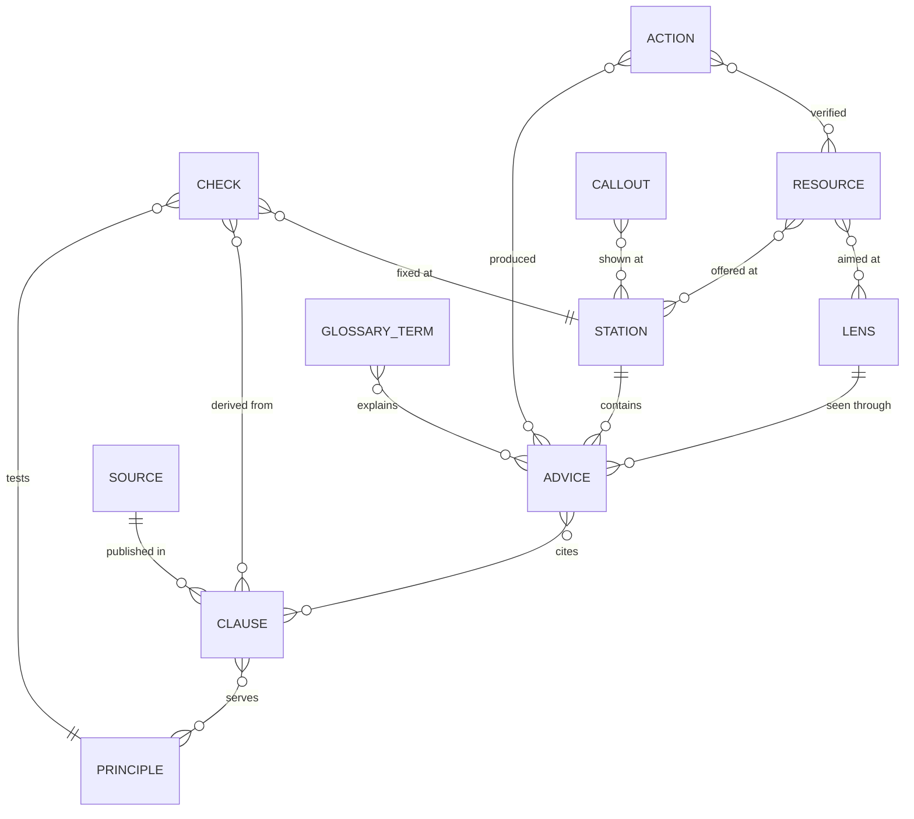

# Content model

The guide's content is authored in small TOML files under `content/`. A generator,
`scripts/build_crate.py`, turns them into the knowledge base `ro-crate-metadata.json` (RO-Crate 1.2) and
inlines the same crate into `index.html`. This document defines the entities and the rules every content file
follows. The design behind it is in [design.md](design.md).

## Entities

A **station** is one step of the path. It contains **advice items**; each item belongs to one **lens** and one
disclosure **level** and cites **clauses** of the ledger. Clauses come from published **sources** and serve
FAIR **principles**, identified by their published w3id IRIs. **Checks** test a principle, derive from
clauses and point to the station where a gap is fixed. **Resources** are offered at stations for given lenses,
carry a status with an as-of date and link to published FER or FAIRsharing identifiers. **Glossary terms**
come from Heslář. **Callouts** are shared notes reused across stations. **Provenance actions** record who
produced or verified an item, with which tool and from which sources.

| Entity | What it is |
| --- | --- |
| Station | One of nine steps: Plán, Práce, Repozitář, Popis, Licence a přístup, Publikace, Dohledatelnost, Citace a uznání, Kontrola |
| Lens | One of four audiences: `V` researcher, `DS` data steward, `SR` repository administrator or curator, `K` community and FIP |
| Level | `L0` one sentence and one action; `L1` steps; `L2` why (principles, requirements); `L3` sources and paradata |
| Advice item | A piece of advice for one station, lens and level |
| Clause | One requirement or statement from a published source, with a stable ID |
| Source | A published document, dataset or web page that clauses come from |
| Principle | A FAIR principle, identified by `https://w3id.org/fair/principles/terms/<ID>` |
| Check | A self-check item with a tier, a principle, a fix location and an owner |
| Resource | A service, tool, standard, guide or repository the guide recommends |
| Glossary term | A term from Heslář, with its label and link |
| Callout | A shared note (sensitive data, identifier verification), defined once and ordered by lens |
| Provenance action | A record of who changed which items, with which tool and from which sources |

## Rules for every content file

### Identifiers

Every entity has a stable `id`. IDs are never reused or renumbered; an entity that is no longer valid is
marked as superseded instead of deleted.

### Languages

Every user-facing text is a table with a `cs` and an `en` value. Czech is the primary language. A text that
contains a phrase in another language marks it, so the page can set the right `lang` attribute.

### Sources

Every advice item and every check cites at least one clause ID in `sources`. Every clause names a published
source. Unpublished working material is never cited.

Clause ID prefixes:

| Prefix | Source |
| --- | --- |
| `A.<principle>.<kind><n>` | FAIR analysis, chapter 3 (principle table). Kinds: `N` NRP, `R` repository, `F` FIP, `X` other |
| `K2.*`, `K4.*`, `K5.*`, `K6` | FAIR analysis, other chapters |
| `P1` | FAIR analysis, appendix 1 |
| `S.MIN<n>`, `S.REC<n>` | FAIR analysis, summary: minimum and recommended steps |
| `C.M<n>`, `C.R<n>`, `C.ROLE.*`, `C.CS`, `C.EXT` | NRP conditions for creating repositories |
| `DOC.*` | NRP documentation |
| `E.*` | Other published papers, datasets and pages |
| `G` | Glossary of the FAIR analysis |

### Paradata

Every change to an advice item, check or resource is covered by a provenance action following the Process
Run Crate profile: `agent` (person, ORCID where available), `instrument` (tools, naming any AI model), `object`
(sources consulted), `result` (items produced or changed) and `endTime`.

### Statuses

A service or resource status uses the five-level vocabulary and always carries an `asOf` date:

| Value | Czech label | English label |
| --- | --- | --- |
| `operational` | provozní | operational |
| `pilot` | pilotní | pilot |
| `in-development` | ve vývoji | in development |
| `planned` | plánováno | planned |
| `prospective` | výhledové | prospective |

### Links and text

- Links use HTTPS, and prefer DOIs and other persistent identifiers.
- Text is plain text; raw HTML is not allowed.
- Live services are called only through the connectors, and only for hosts on the allowlist.

## Files

| File | Holds |
| --- | --- |
| `content/guide.toml` | Guide metadata, people, organisations, instruments, lenses, levels, stages, vocabularies, help routes, landing tasks |
| `content/principles.toml` | The fifteen FAIR principles with their CoreTrustSeal and CDIF links |
| `content/sources.toml` | Published sources |
| `content/ledger.toml` | Clauses |
| `content/stations/NN-<id>.toml` | One station and its advice items |
| `content/checks/<id>.toml` | One self-check and its items |
| `content/resources.toml` | Resources |
| `content/repositories.toml` | The curated repository list |
| `content/snapshots/*.toml` | Dated snapshots of sources a browser cannot query (re3data, Heslář) |
| `content/glossary.toml` | Glossary terms |
| `content/callouts.toml` | Shared callouts |
| `content/live.toml` | Connectors, the FAIR Champion test set and its health |
| `content/provenance.toml` | Provenance actions |
| `content/pages.toml` | About page, accessibility statement and the AI overview |
| `content/ui.toml` | Interface strings |
| `content/icons.toml` | Interface icons |

A bilingual text is written as an inline table: `text = { cs = "…", en = "…" }`. Paragraphs inside one text
are separated by a blank line (`\n\n`). Names and titles of external works are proper names: they are given
once, in their original language, with `inLanguage`.

### `guide.toml`

| Table | Field | Type | Meaning |
| --- | --- | --- | --- |
| `[guide]` | `version` | string | Semantic version, the same as in `CHANGELOG.md` and `CITATION.cff` |
| | `releaseStatus` | string | `testing` until EOSC CZ agrees the guide, then `released`; drives the testing-phase notice |
| | `testingNotice` | text | The notice shown on every view while the status is `testing` |
| | `datePublished` | date | Date of the version |
| | `name`, `description` | text | Name and description of the guide |
| | `keywords` | list of text | Keywords |
| | `url` | URL | Home of the guide |
| | `pageUrl` | URL | Published address of the page; exports and shared links name it instead of a local file path |
| | `vocabularyBase` | URL | Namespace of the guide's own terms (see *Crate mapping*) |
| | `profile` | URL | IRI of the guide's RO-Crate profile in `profile/fair-guide/`; its version ends the IRI |
| | `freshnessDays` | integer | Age after which a status is reported as stale |
| | `editors` | list of IDs | People who compile and develop the guide; the guide's citation names them as editors (at least one) |
| | `reviewers`, `contributors` | list of IDs | People who review the texts, and other contributors |
| | `publisher`, `funder` | ID | Organisations from `[[organization]]` |
| | `isBasedOn` | list of IDs | Sources the guide refreshes (the FAIR analysis) |
| | `acknowledgement`, `aiStatement` | text | Mandatory NRP acknowledgement; statement on AI use |
| `[[person]]` | `id`, `name`, `orcid`, `affiliation` | | A person; `orcid` is the full ORCID URL, `affiliation` a list of organisation IDs |
| `[[organization]]` | `id`, `name`, `url`, `ror`, `identifier`, `funder` | | An organisation or project; all but `id` and `name` are optional |
| `[[instrument]]` | `id`, `name`, `version`, `url`, `kind` | | A tool used in provenance actions; `kind` is `ai-model`, `software` or `service` |
| `[[lens]]` | `id`, `name`, `description`, `icon` | | `V`, `DS`, `SR`, `K` |
| `[[level]]` | `id`, `name`, `description`, `icon` | | `L0`–`L3`; the icon leads the level's heading on a station |
| `[[stage]]` | `id`, `label`, `station`, `description`, `icon` | | An answer of the entry question, shown as a card, and the station it opens |
| `[[actor]]` | `id`, `name`, `role` | | Who a clause addresses (`role = "clause"`) or who fixes a gap (`role = "owner"`) |
| `[[status]]` | `id`, `name` | | The five-level status vocabulary |
| `[[tier]]` | `id`, `name`, `description` | | Self-check tiers; the description completes the first view's sentence on what its tier means |
| `[[resourceType]]` | `id`, `name` | | Resource types used by the finder |
| `[[repositoryKind]]` | `id`, `name` | | Repository kinds: domain, institutional, general-purpose |
| `[[help]]` | `id`, `name`, `url`, `lenses` | | Routes to human help shown on every station; `url` may be `mailto:` |
| `[[task]]` | `lens`, `label`, `href`, `icon` | | A shortcut on the landing view for one lens; `href` is an in-page target (`#station-<id>`, `#check-<id>`, `#page-<id>`, `#repositories`, `#resources`) or an HTTPS link. Tasks are listed in path order |

### `principles.toml`

`[[principle]]`: `id` (`F1` … `R1.3`), `statement` (text: the principle), `label` (text: a short label),
`cts` (list of CoreTrustSeal requirement IDs such as `R12`), `cdif` (list of CDIF profile names). The IRI is
`https://w3id.org/fair/principles/terms/<id>`.

### `sources.toml`

`[[source]]`: `id`, `type` (`report`, `article`, `dataset`, `webpage`, `document`, `standard`, `software`,
`presentation`), `title`, `version`, `inLanguage`, `url`, `doi` (without the resolver), `publisher` (name),
`authors`, `datePublished` or `dateAccessed`, `license` (URL). An author is a person ID from `guide.toml`, which
puts the person (with their ORCID iD) into the crate, or a plain name.

### `ledger.toml`

`[[clause]]`: `id`, `source` (source ID), `locator` (chapter, table row or section), `principles` (list),
`actor` (actor ID with `role = "clause"`), `kind` (`requirement`, `recommendation`, `fulfilment`, `statement`),
`text`, `status` (`current`, `refresh`, `superseded`), `note` (text: what has changed since the source was
published), `noteSources` (clause or source IDs that support the note), `supersededBy` (clause or source ID).

### `stations/NN-<id>.toml`

`[station]`: `id`, `position`, `name` (short label), `title`, `icon` (shown in the station header and on the rail),
`principles`, `minutes`, `glossary` (term IDs).

`[[advice]]`:

| Field | Type | Meaning |
| --- | --- | --- |
| `id` | string | `<station>.<lens>.<level>[.<n>]`; `<lens>` is `all` for items shared by every lens |
| `lens` | string or list | One lens, a list of lenses, or `"*"` for all |
| `level` | string | `L0`, `L1` or `L2`; L3 is generated |
| `position` | integer | Order within the station, lens and level |
| `text` | text | The advice |
| `steps` | list of text | Sub-steps shown as a list under the item |
| `action` | table | L0 only: `label` (text) and `href`: an HTTPS URL, or an in-page target naming a crate entity (`#repositories`, `#ledger`, `#resources`, `#check-<id>`, `#station-<id>`, `#page-<id>`, `#resource-<id>`) |
| `kind` | string | `ai` for the AI-in-FAIRification overlay; omitted otherwise |
| `sources` | list | Clause IDs; at least one |

### `checks/<id>.toml`

`[check]`: `id` (`dataset`, `gate`, `maturity`, `fip`, `institution`), `name`, `icon` (shown on its card in the
self-check overview), `description`, `lenses`, `minutes`, `modes` (dataset check: `before`, `after`),
`[[check.profile]]` (gate check: `id`, `label`).

`[[item]]`:

| Field | Type | Meaning |
| --- | --- | --- |
| `id` | string | `D01`, `P01`, `G01`, `S01`, `K01`, `I01`, … |
| `tier` | string | `minimum`, `recommended`, `advanced`; the gate uses `required` and `recommended` |
| `principles` | list | Principle IDs; empty only for gate items |
| `statement` | text | The statement the user answers |
| `help` | text | A short explanation |
| `sources` | list | Clause IDs; at least one |
| `fixAt` | string | Station ID where a gap is addressed |
| `owner` | list | Actor IDs (`role = "owner"`) who can fix a gap |
| `modes` | list | Dataset check: modes the item appears in |
| `profiles` | list | Gate check: profiles the item applies to |
| `providedByNrp` | list | Gate check: profiles for which NRP provides the item |
| `allowNotApplicable` | boolean | Whether "not applicable" is an allowed answer |
| `note` | text | An extra remark shown with the item |
| `prefill` | table | Sources that can answer the item: `datacite`, `nkr`, `re3data` (the re3data snapshot), `champion`, `fip` (lists of fields, tests or FIP questions), `resolver` (boolean). A field is `name`, `list[].name`, `list[key=value]`, `list[key=value].name`, or `name=value` for a list that contains a value (case-insensitive) |
| `prefillLevel` | string | `partly` when the evidence can only partly prove the statement; a pre-filled answer then never exceeds "partly" |
| `lookup` | string | Key of a link in `[links]` of `live.toml` where the user can find out the answer; shown with a "don't know" task |

### `resources.toml`

`[[resource]]`: `id`, `name` (text, or a string for a proper name), `description`, `url`, `type` (`service`,
`tool`, `registry`, `repository`, `guide`, `document`, `standard`, `vocabulary`, `community`, `project`,
`course`), `fipClass` (FAIR-enabling resource classes of the FIP ontology, such as `Identifier-service` or
`Metadata-schema`), `fipDashboard` (the resource's ID in the FIP Dashboard), `status`, `asOf`, `lenses`,
`stations`, `languages`, `sameAs` (FER nanopublication IRIs, FAIRsharing DOIs).

The FIP Dashboard owns the facts about FAIR-enabling resources. For a resource it holds, the guide keeps only what
the path needs (name, link, lenses, stations) and shows the qualification from the dashboard snapshot.

### `repositories.toml` and `snapshots/`

`[[repository]]`: `id`, `name`, `url`, `kind` (`domain`, `institutional`, `general`), `subjects` (text),
`re3data` (re3data ID), `nkr` (NKR handle), `fairsharing` (DOI), `pidTypes`, `status`, `asOf`.

Snapshots are generated by `scripts/refresh_snapshots.py` and never edited by hand. Each has a `[snapshot]` table
with `source`, `url` and `retrieved` (and `license` where the source states one):

- `snapshots/re3data.toml` lists `[[repository]]` entries with `id`, `name`, `url` (the re3data record when the home
  page is not served over HTTPS), `kind`, `re3data`, `subjectsEn`, `pidTypes` and `languages`, and the facts the
  maturity check can be filled in from: `apis` (API types), `dataLicenses`, `certificates`, `metadataStandards`,
  `policies` (names, leaving out none, other and unknown), and `versioning` and `qualityManagement` (booleans);
- `snapshots/fip-dashboard.toml` adds `datasetName`, `datasetVersion`, `datasetUpdated` and, while the dashboard
  publishes one, `disclaimer`; it lists `[[resourceType]]`, `[[organization]]`, `[[resource]]` (with
  `verification`: verifier, level, date) and `[[fip]]` (with `declarations`: principle, resource, status, note).

### `glossary.toml`

`[glossary]`: `source`, `url`, `retrieved`, `license`. `[[term]]`: `id`, `label` (text), `url`, `heslarId`, and
`definition` (text) only where the source's licence permits copying.

### `callouts.toml`

`[[callout]]`: `id`, `title`, `intro`, `stations`, `order` (table: lens → list of item IDs). `[[callout.item]]`:
`id`, `text`, `url`, `lenses`.

### `live.toml`

`[[connector]]`: `id`, `name`, `origin` (scheme and host), `purpose`, and `browserAccess = false` for a service
whose API does not admit the guide's origin yet (the page then uses its snapshot). The page calls no other host, and
the Content Security Policy is generated from this list. `[links]`: base URLs the page builds links to (the FIP
Dashboard, the NMA search, NKR, the DataCite Commons record page a dataset's evidence links to, and the EOSC CZ and OP JAK sites the header
and footer logos link to; the
ministry's logo links to the funder's organisation `url`); the page scripts contain no URLs of their own. `[champion]`: `endpoint`, `maxParallel`, `timeoutSeconds`.
`[[champion.test]]`: `id`, `principle`, `label`, `health` (`available`, `degraded`, `unavailable`), `asOf`.
`[dmpStatus]`: `path` of the DMP.eosc.cz status summary on the status connector. `[nanopub]`: `path` of the SPARQL endpoint, `fipIri` (the IRI forms of a FIP, with `{code}` for the
nanopublication's trusty URI code) and `query` (with `{fips}` where the page puts those IRIs). `[fairsharing]`:
`prefix`, the DOI prefix of FAIRsharing records, which the page searches in DataCite by a repository's re3data record
and address (FAIRsharing's own API needs a login); `[links]` `fairsharing` is where a failed search sends the user.

### `provenance.toml`

`[[action]]`: `id`, `type` (`create`, `update`), `name`, `description`, `agent` (person ID), `instruments`
(instrument IDs), `objects` (clause and source IDs consulted), `results` (item IDs; a trailing `*` matches every
ID with that prefix), `endTime` (date-time with offset).

### `icons.toml`

Icons are [Font Awesome Free](https://fontawesome.com/) solid icons (CC BY 4.0), named by their Font Awesome
name. `[ui]` maps an interface role (`search`, `external`, `download`, `met`, `gap` and so on) to an icon; content
files name their own icons in `icon` fields. `scripts/vendor_icons.py` copies exactly the named icons from the
pinned npm package into `assets/icons/`, and the generator inlines them as one hidden SVG sprite. The content
check reports an icon that is named but not vendored.

### `pages.toml` and `ui.toml`

`[[page]]`: `id`, `title`, `menu` (`tools` or `about`: the main-menu item the page sits under; required, so every
page can be reached), `icon` and `description` (for a tools page, shown on its card in the tools view), `helper` (true
for a page that holds an interactive helper; until the page script provides it, the page says it is still being
built), `[[page.section]]` with `heading`, `body` (text) and an optional `id`; the section
`credits` on the about page carries the roles table, generated from the guide's metadata. `ui.toml` holds interface strings
as nested tables of texts, for example `[nav] stations = { cs = "Zastávky", en = "Stations" }`. A text with a
count gives its plural forms separated by `|`: Czech one, few (2 to 4) and many, English one and other, for
example `{ cs = "{n} otázka|{n} otázky|{n} otázek", en = "{n} question|{n} questions" }`.

## Crate mapping

The generator writes a flattened JSON-LD graph that conforms to RO-Crate 1.2 and to the Process Run Crate
profile 0.5. Schema.org types and properties are used wherever they fit; the guide's own terms live under
`vocabularyBase` and are defined in the graph as `rdf:Property` entities with a label and a comment.

| Content | `@type` | `@id` | Main properties |
| --- | --- | --- | --- |
| Guide | `Dataset` (root) | `./` | `name`, `description`, `version`, `datePublished`, `license`, `author`, `contributor`, `publisher`, `funder`, `isBasedOn`, `mainEntity`, `about`, `mentions`, `conformsTo` |
| Path | `HowTo` | `#path` | `step` |
| Station | `HowToSection` | `#station-<id>` | `name`, `headline`, `position`, `about`, `timeRequired`, `itemListElement`, `hasPart` (callouts), `mentions` (resources, terms) |
| Advice item | `HowToDirection` (L0, L1), `HowToTip` (L2, AI overlay) | `#advice-<id>` | `text`, `position`, `audience`, `disclosureLevel`, `citation`, `isPartOf`, `potentialAction`, `adviceKind` |
| Lens | `Audience` | `#lens-<id>` | `name`, `audienceType` |
| Level, tier, status, actor, profile, mode | `DefinedTerm` | `#<set>-<id>` | `name`, `termCode`, `inDefinedTermSet` |
| Principle | `DefinedTerm` | w3id IRI | `termCode`, `name`, `description` |
| Source | `ScholarlyArticle`, `Report`, `WebPage`, `Dataset`, `CreativeWork` | DOI URL, or `#source-<id>` | `name`, `url`, `publisher`, `datePublished`, `license` |
| Clause | `CreativeWork` | `#clause-<id>` | `identifier`, `text`, `about`, `audience`, `isPartOf`, `clauseKind`, `creativeWorkStatus`, `note`, `citation` (note sources), `supersededBy` |
| Check | `Quiz` | `#check-<id>` | `name`, `description`, `audience`, `hasPart` |
| Check item | `Question` | `#item-<id>` | `text`, `description`, `about`, `citation`, `tier`, `fixAt`, `fixedBy`, `appliesTo`, `providedByNrpFor`, `allowsNotApplicable`, `additionalProperty` (pre-fill) |
| Resource | by `type` | `#resource-<id>` | `name`, `description`, `url`, `audience`, `additionalType` (FIP class IRIs), `resourceType`, `serviceStatus`, `statusAsOf`, `inLanguage`, `sameAs` |
| Repository | `DataCatalog` | `#repository-<id>` | `name`, `url`, `repositoryKind`, `identifier`, `sameAs`, `isBasedOn` (snapshot) |
| Glossary term | `DefinedTerm` | `#term-<id>` | `name`, `url`, `termCode`, `inDefinedTermSet` |
| Callout | `CreativeWork` | `#callout-<id>` | `headline`, `text`, `hasPart`, `lensOrder` |
| FER (FIP Dashboard snapshot) | `CreativeWork` with a FIP class as `additionalType` | `#fer-<id>` | `identifier`, `name`, `description`, `url`, `catalogueType`, `about`, `provider`, `review` (verifications as `Review`), `sameAs`, `isBasedOn` |
| FIP (FIP Dashboard snapshot) | `CreativeWork` with `additionalType` `fip:FAIR-Implementation-Profile` | `#fip-<id>` | `name`, `abstract`, `version`, `dateModified`, `creativeWorkStatus`, `author`, `review`, `hasPart` (declarations), `isBasedOn` |
| FAIR Champion test | `CreativeWork` with `additionalType` `ftr:Test` | `#test-<id>` | `identifier`, `url`, `about`, `healthStatus`, `statusAsOf` |
| Provenance action | `CreateAction`, `UpdateAction` | `#action-<id>` | `name`, `description`, `agent`, `instrument`, `object`, `result`, `endTime`, `actionStatus` |
| Instrument | `SoftwareApplication` | `#instrument-<id>` | `name`, `version`, `url`, `applicationCategory` |

Language-dependent values are JSON-LD value objects with `@language`. A property with one value holds it
directly; with several, a list. The page reads the graph directly; it does not need a JSON-LD processor.

The root declares conformance to Process Run Crate 0.5 and to the guide's own profile. `ro-crate-preview.html` is a
generated copy of `index.html`, so the page is the crate's HTML preview.
