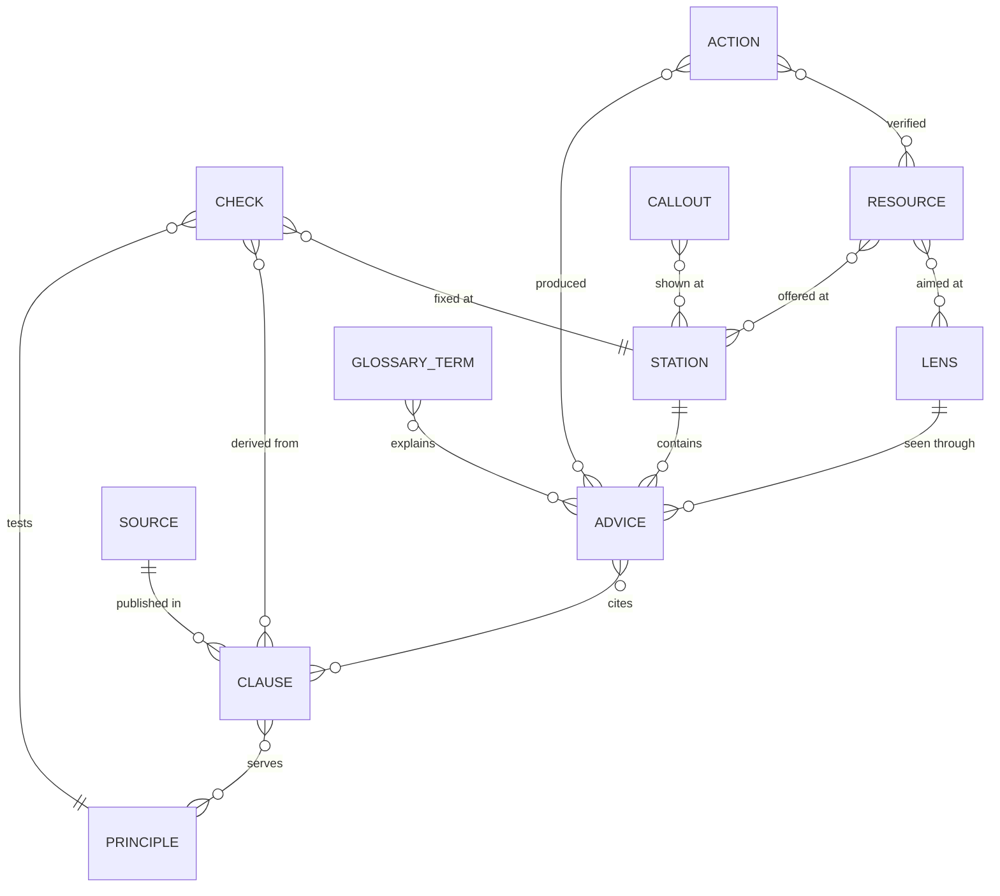

# Content model

The guide's content is authored in small TOML files under `content/`. A generator,
`scripts/build_crate.py`, turns them into the knowledge base `ro-crate-metadata.json` (RO-Crate 1.2) and
inlines the same crate into `index.html`. This document defines the entities and the rules every content file
follows. The design behind it is in [design.md](design.md).

## Entities

A **station** is one step of the path. It contains **advice items**; each item belongs to one **lens** and one
disclosure **level** and cites **clauses** of the ledger. Clauses come from published **sources** and serve
FAIR **principles**, identified by their published w3id IRIs. **Checks** test a principle, derive from
clauses and point to the station where a gap is fixed. **Resources** are offered at stations for given lenses,
carry a status with an as-of date and link to published FER or FAIRsharing identifiers. **Glossary terms**
come from Heslář. **Callouts** are shared notes reused across stations. **Provenance actions** record who
produced or verified an item, with which tool and from which sources.

| Entity | What it is |
| --- | --- |
| Station | One of nine steps: Plán, Práce, Repozitář, Popis, Licence a přístup, Publikace, Dohledatelnost, Citace a uznání, Kontrola |
| Lens | One of four audiences: `V` researcher, `DS` data steward, `SR` repository administrator or curator, `K` community and FIP |
| Level | `L0` one sentence and one action; `L1` steps; `L2` why (principles, requirements); `L3` sources and paradata |
| Advice item | A piece of advice for one station, lens and level |
| Clause | One requirement or statement from a published source, with a stable ID |
| Source | A published document, dataset or web page that clauses come from |
| Principle | A FAIR principle, identified by `https://w3id.org/fair/principles/terms/<ID>` |
| Check | A self-check item with a tier, a principle, a fix location and an owner |
| Resource | A service, tool, standard, guide or repository the guide recommends |
| Glossary term | A term from Heslář, with its label and link |
| Callout | A shared note (sensitive data, identifier verification), defined once and ordered by lens |
| Provenance action | A record of who changed which items, with which tool and from which sources |

## Rules for every content file

### Identifiers

Every entity has a stable `id`. IDs are never reused or renumbered; an entity that is no longer valid is
marked as superseded instead of deleted.

### Languages

Every user-facing text is a table with a `cs` and an `en` value. Czech is the primary language. A text that
contains a phrase in another language marks it, so the page can set the right `lang` attribute.

### Sources

Every advice item and every check cites at least one clause ID in `sources`. Every clause names a published
source. Unpublished working material is never cited.

Clause ID prefixes:

| Prefix | Source |
| --- | --- |
| `A.<principle>.<kind><n>` | FAIR analysis, chapter 3 (principle table). Kinds: `N` NRP, `R` repository, `F` FIP, `X` other |
| `K2.*`, `K4.*`, `K5.*`, `K6` | FAIR analysis, other chapters |
| `P1` | FAIR analysis, appendix 1 |
| `S.MIN<n>`, `S.REC<n>` | FAIR analysis, summary: minimum and recommended steps |
| `C.M<n>`, `C.R<n>`, `C.ROLE.*`, `C.CS`, `C.EXT` | NRP conditions for creating repositories |
| `DOC.*` | NRP documentation |
| `E.*` | Other published papers, datasets and pages |
| `G` | Glossary of the FAIR analysis |

### Paradata

Every change to an advice item, check or resource is covered by a provenance action following the Process
Run Crate profile: `agent` (person, ORCID where available), `instrument` (tools, naming any AI model), `object`
(sources consulted), `result` (items produced or changed) and `endTime`.

### Statuses

A service or resource status uses the five-level vocabulary and always carries an `asOf` date:

| Value | Czech label | English label |
| --- | --- | --- |
| `operational` | provozní | operational |
| `pilot` | pilotní | pilot |
| `in-development` | ve vývoji | in development |
| `planned` | plánováno | planned |
| `prospective` | výhledové | prospective |

### Links and text

- Links use HTTPS, and prefer DOIs and other persistent identifiers.
- Text is plain text; raw HTML is not allowed.
- Live services are called only through the connectors, and only for hosts on the allowlist.
