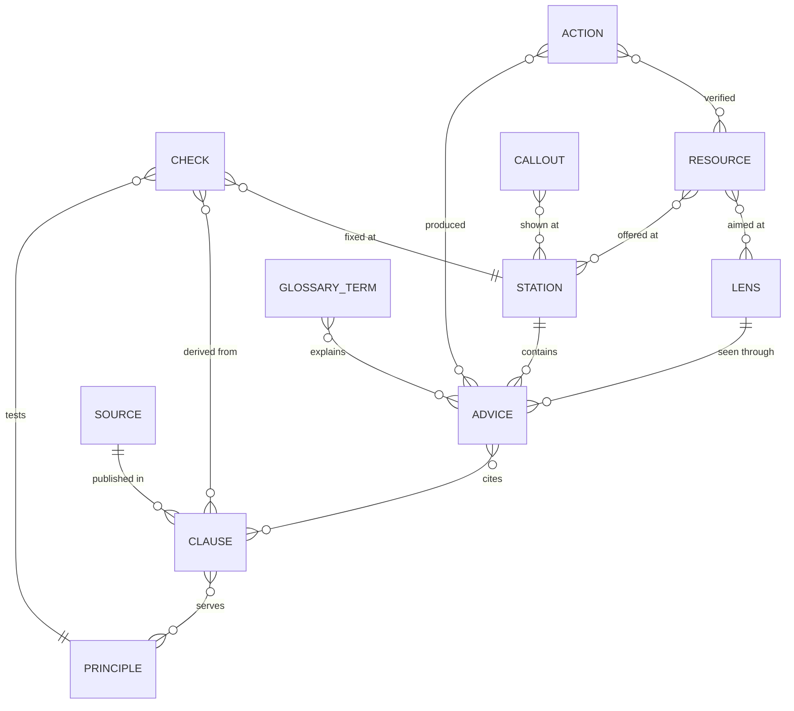

# Content model

The guide's content is authored in small TOML files under `content/`. A generator,
`scripts/build_crate.py`, turns them into the knowledge base `ro-crate-metadata.json` (RO-Crate 1.2) and the same
crate as scripts the page loads: `assets/data/kb.js` with what every view needs, and `kb-standards.js`, `kb-fips.js`
and `kb-pages.js` with the standards' requirements and guidance, the FIP Dashboard snapshot (profiles and resource
records) and the pages' text, loaded when a view first needs them; `scripts/build_site.py` writes them with the page and the
API into the site directory `_site/`, which is not committed. This document defines the entities and the rules every content file
follows. The design behind it is in [design.md](design.md).

## Entities

A **station** is one step of the path. It contains **advice items**; each item belongs to one **lens** and one
disclosure **level** and cites **clauses** of the ledger. Clauses come from published **sources** and serve
FAIR **principles**, identified by their published w3id IRIs. **Checks** test a principle, derive from
clauses and point to the station where a gap is fixed. **Resources** are offered at stations for given lenses,
carry a status with an as-of date and link to published FER or FAIRsharing identifiers. **Glossary terms**
come from Heslář. **Callouts** are shared notes reused across stations. **Provenance actions** record who
produced or verified an item, with which tool and from which sources.

| Entity | What it is |
| --- | --- |
| Station | One of nine steps: Plán, Práce, Repozitář, Popis, Licence a přístup, Publikace, Dohledatelnost, Citace a uznání, Kontrola |
| Lens | One of four audiences: `V` researcher, `DS` data steward, `SR` repository administrator or curator, `K` community and FIP |
| Level | `L0` one sentence and one action; `L1` steps; `L2` why (principles, requirements); `L3` sources and paradata |
| Advice item | A piece of advice for one station, lens and level |
| Clause | One requirement or statement from a published source, with a stable ID |
| Source | A published document, dataset or web page that clauses come from |
| Principle | A FAIR principle, identified by `https://w3id.org/fair/principles/terms/<ID>` |
| Check | A self-check item with a tier, a principle, a fix location and an owner |
| Resource | A service, tool, standard, guide or repository the guide recommends |
| Glossary term | A term from Heslář, with its label and link |
| Callout | A shared note (sensitive data, identifier verification), defined once and ordered by lens |
| Provenance action | A record of who changed which items, with which tool and from which sources |

## Rules for every content file

### Identifiers

Every entity has a stable `id`. IDs are never reused or renumbered; an entity that is no longer valid is
marked as superseded instead of deleted.

One real-world thing has one curated entry, which carries every role it plays: a service the guide recommends and
also cites is one `[[resource]]` with a `[resource.citation]` table, and a repository it recommends is one
`[[resource]]` with a `[resource.repository]` table. A curated entry that matches a snapshot record links it
(`fipDashboard`, `re3data`) instead of repeating it. The content checks enforce this: one ID names one entity, no two
curated entries share an address or a DOI, a curated resource or organisation that matches a FIP Dashboard record or
a re3data record links it, and entries nothing uses are reported as warnings.

### Languages

Every user-facing text is a table with a `cs` and an `en` value. Czech is the primary language. A text that
contains a phrase in another language marks it, so the page can set the right `lang` attribute.

### References in text

A text that names a resource, a source or a glossary term marks the name as a reference: `[[id|phrase]]`, where
`id` is the resource's or source's ID, `term:<id>` for a glossary term, `page:<id>` for a page of the guide,
`clause:<id>` for a ledger clause (such as a CoreTrustSeal requirement) or `profile` for the guide's profile, and
`phrase` is the words that name it
in that language, inflected as the sentence needs (`v [[nma|Národním metadatovém adresáři]]`). Mark the first
time a text names the entry; a button label is already a link and carries no reference. The Czech and the English
text of one item refer to the same entries. The generator writes the text without the markup and records each
entry as mentioned by the item; the page links the phrase quietly to the entry in the catalogue, or to the page. The content
checks refuse a reference that is not well formed, one to an unknown entry, and texts whose languages refer to
different entries.

### Sources

Every advice item and every check cites at least one clause ID in `sources`. Every clause names a published
source: an entry of `sources.toml`, or a resource that carries its citation. Unpublished working material is never
cited.

Clause ID prefixes:

| Prefix | Source |
| --- | --- |
| `A.<principle>.<kind><n>` | FAIR analysis, chapter 3 (principle table). Kinds: `N` NRP, `R` repository, `F` FIP, `X` other |
| `K2.*`, `K4.*`, `K5.*`, `K6` | FAIR analysis, other chapters |
| `P1` | FAIR analysis, appendix 1 |
| `S.MIN<n>`, `S.REC<n>` | FAIR analysis, summary: minimum and recommended steps |
| `C.M<n>`, `C.R<n>`, `C.ROLE.*`, `C.CS`, `C.EXT` | NRP conditions for creating repositories |
| `DOC.*` | NRP documentation |
| `E.*` | Other published papers, datasets and pages |
| `G` | Glossary of the FAIR analysis |

### Paradata

Every change to an advice item, check or resource is covered by a provenance action following the Process
Run Crate profile: `agent` (person, ORCID where available), `instrument` (tools, naming any AI model), `object`
(sources consulted), `result` (items produced or changed) and `endTime`.

### Statuses

A service or resource status uses the five-level vocabulary and always carries an `asOf` date:

| Value | Czech label | English label |
| --- | --- | --- |
| `operational` | provozní | operational |
| `pilot` | pilotní | pilot |
| `in-development` | ve vývoji | in development |
| `planned` | plánováno | planned |
| `prospective` | výhledové | prospective |

### Links and text

- Links use HTTPS, and prefer DOIs and other persistent identifiers.
- Text is plain text; raw HTML is not allowed.
- Live services are called only through the connectors, and only for hosts on the allowlist.

## Files

| File | Holds |
| --- | --- |
| `content/guide.toml` | Guide metadata, people, organisations, instruments, lenses, levels, stages, vocabularies, help routes, landing tasks |
| `content/principles.toml` | The fifteen FAIR principles with their CoreTrustSeal and CDIF links |
| `content/sources.toml` | Published sources |
| `content/ledger.toml` | Clauses |
| `content/stations/NN-<id>.toml` | One station and its advice items |
| `content/checks/<id>.toml` | One self-check and its items |
| `content/resources.toml` | Resources |
| `content/repositories.toml` | The curated repository list |
| `content/snapshots/*.toml` | Dated snapshots of sources a browser cannot query (re3data, Heslář) |
| `content/glossary.toml` | Glossary terms |
| `content/callouts.toml` | Shared callouts |
| `content/live.toml` | Connectors, the FAIR Champion test set and its health |
| `content/provenance.toml` | Provenance actions |
| `content/pages.toml` | About page, accessibility statement and the AI overview |
| `content/ui.toml` | Interface strings |
| `content/icons.toml` | Interface icons |

A bilingual text is written as an inline table: `text = { cs = "…", en = "…" }`. Paragraphs inside one text
are separated by a blank line (`\n\n`). Names and titles of external works are proper names, given in their
original language with `inLanguage`. Every name readers see has an English form: a name that is not
language-neutral (an organisation's Czech name, the title of a Czech work) is a table with both languages, in
which the work's own language holds its original title and the other a translation. In the other language the page
shows a work the guide only cites as its original title followed by the translation in brackets. A publisher that
is a curated organisation is cited by its ID. The content checks refuse a plain name with Czech letters and a
publisher named like a curated organisation.

### `guide.toml`

| Table | Field | Type | Meaning |
| --- | --- | --- | --- |
| `[guide]` | `version` | string | Semantic version, the same as in `CHANGELOG.md` and `CITATION.cff` |
| | `releaseStatus` | string | `testing` until EOSC CZ agrees the guide, then `released`; drives the testing-phase notice |
| | `testingNotice` | text | The notice shown on every view while the status is `testing` |
| | `datePublished` | date | Date of the version |
| | `name`, `description` | text | Name and description of the guide |
| | `keywords` | list of text | Keywords |
| | `url` | URL | Home of the guide |
| | `baseUrl` | URL | The one address the guide is published at. The build derives from it the page's address (named by exports and shared links from a local file), the namespace of the guide's own terms (`<baseUrl>terms#`, see *Crate mapping*) and the IRI of its RO-Crate profile (`<baseUrl>profile/<profileVersion>`), and writes it into the profile's shapes in `profile/fair-guide/`. `FAIR_GUIDE_BASE_URL` gives a build another address |
| | `profileVersion` | string | Version of the guide's RO-Crate profile; it ends the profile's IRI |
| | `doi` | string | The guide's DOI once it has one; the page head and the linkset then name it as `cite-as` |
| | `freshnessDays` | integer | Age after which a status is reported as stale |
| | `editors` | list of IDs | People who compile and develop the guide; the guide's citation names them as editors (at least one) |
| | `reviewers`, `contributors` | list of IDs | People who review the texts, and other contributors |
| | `publisher`, `funder` | ID | Organisations from `[[organization]]` |
| | `isBasedOn` | list of IDs | Sources the guide refreshes (the FAIR analysis) |
| | `acknowledgement`, `aiStatement` | text | Mandatory NRP acknowledgement; statement on AI use |
| `[[person]]` | `id`, `name`, `orcid`, `affiliation` | | A person; `orcid` is the full ORCID URL, `affiliation` a list of organisation IDs |
| `[[organization]]` | `id`, `name`, `url`, `ror`, `identifier`, `funder`, `fipDashboard` | | An organisation or project; all but `id` and `name` are optional; a Czech `name` is a table with its English name (from ROR where it has one); `fipDashboard` links the matching organisation of the FIP Dashboard snapshot |
| `[[instrument]]` | `id`, `name`, `version`, `url`, `kind` | | A tool used in provenance actions; `kind` is `ai-model`, `software` or `service` |
| `[[lens]]` | `id`, `name`, `description`, `icon` | | `V`, `DS`, `SR`, `K` |
| `[[level]]` | `id`, `name`, `description`, `icon` | | `L0`–`L3`; the icon leads the level's heading on a station |
| `[[stage]]` | `id`, `label`, `station`, `description`, `icon` | | An answer of the entry question, shown as a card, and the station it opens |
| `[[actor]]` | `id`, `name`, `role` | | Who a clause addresses (`role = "clause"`) or who fixes a gap (`role = "owner"`) |
| `[[status]]` | `id`, `name` | | The five-level status vocabulary |
| `[[tier]]` | `id`, `name`, `description` | | Self-check tiers; the description completes the first view's sentence on what its tier means |
| `[[resourceType]]` | `id`, `name` | | Resource types used by the finder |
| `[[repositoryKind]]` | `id`, `name` | | Repository kinds: domain, institutional, general-purpose |
| `[[help]]` | `id`, `name`, `url`, `lenses` | | Routes to human help shown on every station; `url` may be `mailto:` |
| `[[task]]` | `lens`, `label`, `href`, `icon` | | A shortcut on the landing view for one lens; `href` is an in-page target (`#station-<id>`, `#check-<id>`, `#page-<id>`, `#repositories`, `#resources`) or an HTTPS link. Tasks are listed in path order |

### `principles.toml`

`[[principle]]`: `id` (`F1` … `R1.3`), `statement` (text: the principle), `label` (text: a short label),
`cts` (list of CoreTrustSeal requirement numbers of the 2026–2028 edition, such as `R12`, each naming the ledger
clause `CTS.<number>`; the FAIR analysis numbers them mostly by the 2020–2022 edition, so each link follows what
the analysis says the requirement is about), `cdif` (list of CDIF 1.1 profiles, such as `Core`, each naming the
ledger clause `CDIF.<profile>`; the analysis names the 2023 CDIF recommendations, so each link follows what the
recommendation is about). The IRI is
`https://w3id.org/fair/principles/terms/<id>`.

### `sources.toml`

Published works the guide cites but does not recommend as a resource (a cited resource carries its citation in
`resources.toml`). `[[source]]`: `id`, `type` (`report`, `article`, `dataset`, `webpage`, `document`, `standard`, `software`,
`presentation`), `title` (a string, or a table whose `inLanguage` value is the original title), `short` (optional:
the short name shown where the source is named often, as next to each requirement it holds), `version`,
`inLanguage`, `url`, `doi` (without the resolver), `publisher` (an organisation ID, or a language-neutral name),
`authors`, `datePublished` or `dateAccessed`, `dateModified` (when the publisher records an update), `license`
(URL). An author is a person ID from `guide.toml`, which
puts the person (with their ORCID iD) into the crate, or a plain name.

### `ledger.toml`

`[[clause]]`: `id`, `source` (source ID), `locator` (chapter, table row or section), `principles` (list),
`actor` (actor ID with `role = "clause"`), `kind` (`requirement`, `recommendation`, `fulfilment`, `statement`),
`text`, `status` (`current`, `refresh`, `superseded`), `note` (text: what has changed since the source was
published), `noteSources` (clause or source IDs that support the note), `supersededBy` (clause or source ID),
`title` (text: a requirement's own title, when its source gives one) and `guidance` (a string: the guidance its
source publishes with it, quoted in English as published; paragraphs and `- ` lists as in page text). The
CoreTrustSeal Requirements 2026–2028 are clauses `CTS.R0` (the context an application gives) and `CTS.R01` to
`CTS.R16`, with the statement in English as published and in the guide's Czech translation. CDIF 1.1 is clauses
`CDIF.REQ1`–`REQ6`, `CON1`–`CON3`, `REC1`–`REC14` and `MET1`–`MET3` (the content requirements of the basic
discovery metadata content model, numbered by the guide in the book's order) and `CDIF.<profile>` for its nine
profiles, each with a title and short definition in English as published and in Czech, and its full text as
guidance.

### `stations/NN-<id>.toml`

`[station]`: `id`, `position`, `name` (short label), `title`, `icon` (shown in the station header and on the rail),
`principles`, `minutes`, `glossary` (term IDs).

`[[advice]]`:

| Field | Type | Meaning |
| --- | --- | --- |
| `id` | string | `<station>.<lens>.<level>[.<n>]`; `<lens>` is `all` for items shared by every lens |
| `lens` | string or list | One lens, a list of lenses, or `"*"` for all |
| `level` | string | `L0`, `L1` or `L2`; L3 is generated |
| `position` | integer | Order within the station, lens and level |
| `text` | text | The advice |
| `steps` | list of text | Sub-steps shown as a list under the item |
| `action` | table | L0 only: `label` (text) and `href`: an HTTPS URL, or an in-page target naming a crate entity (`#repositories`, `#ledger`, `#resources`, `#check-<id>`, `#station-<id>`, `#page-<id>`, `#resource-<id>`) |
| `kind` | string | `ai` for the AI-in-FAIRification overlay; `key` for the station's key point, its one core idea shown at the top of the how-to (an L1 item without steps whose ID ends in `key`, exactly one per station and lens); omitted otherwise |
| `check` | text | AI items only, required: what to check after following the tip |
| `prompt` | text | AI items only, required: a short prompt to copy; parts the reader fills in are written `[…]` |
| `sources` | list | Clause IDs; at least one |

### `checks/<id>.toml`

`[check]`: `id` (`dataset`, `gate`, `maturity`, `fip`, `institution`), `name`, `icon` (shown on its card in the
self-check overview), `description`, `lenses`, `minutes`, `modes` (dataset check: `before`, `after`),
`[[check.profile]]` (`id`, `label`; gate check: the deployment profiles; dataset check: the programme that funded the
output), `defaultProfile` (the profile a check starts with; dataset check: `none`, no programme; the profile question
then shows only in a mode where some item names profiles). `[[block]]` (`id`, `name`): the blocks a check is organised in,
in order; when a check declares blocks, every item names its `block`, and the list, summary and result group by
block instead of by principle or path step.

`[[item]]`:

| Field | Type | Meaning |
| --- | --- | --- |
| `id` | string | `D01`, `P01`, `O01` (dataset check: a funded output), `G01`, `S01`, `K01`, `I01`, `C01` (CoreTrustSeal), … |
| `requirement` | string | A ledger clause the item asks about; it supplies the statement, the first source and the principles the item does not state |
| `tier` | string | `minimum`, `recommended`, `advanced`; the gate uses `required` and `recommended`; the checks built on a standard start with `standard` (the CoreTrustSeal check has only that tier, the CDIF check adds `recommended` and `advanced`) |
| `principles` | list | Principle IDs; empty for gate items and for institution items that serve no single principle |
| `statement` | text | The statement the user answers |
| `help` | text | A short explanation |
| `sources` | list | Clause IDs; at least one |
| `fixAt` | string | Station ID where a gap is addressed |
| `owner` | list | Actor IDs (`role = "owner"`) who can fix a gap |
| `modes` | list | Dataset check: modes the item appears in |
| `profiles` | list | Gate and dataset check: profiles the item applies to |
| `providedByNrp` | list | Gate check: profiles for which NRP provides the item |
| `allowNotApplicable` | boolean | Whether "not applicable" is an allowed answer |
| `note` | text | An extra remark shown with the item |
| `prefill` | table | Sources that can answer the item: `datacite`, `nkr`, `re3data` (the re3data snapshot), `champion`, `fip` (lists of fields, tests or FIP questions), `resolver` (boolean). A field is `name`, `list[].name`, `list[key=value]`, `list[key=value].name`, or `name=value` for a list that contains a value (case-insensitive). `@steward` in `datacite` looks for the data steward the user names by ORCID iD among the record's creators and contributors: found answers yes, not found no; without an ORCID iD a data curator or data manager contributor answers partly |
| `prefillLevel` | string | `partly` when the evidence can only partly prove the statement; a pre-filled answer then never exceeds "partly" |
| `lookup` | string | Key of a link in `[links]` of `live.toml` where the user can find out the answer; shown with a "don't know" task |

### `resources.toml`

`[[resource]]`: `id`, `name` (text, or a string for a proper name), `description`, `url`, `type` (`service`,
`tool`, `registry`, `repository`, `guide`, `document`, `standard`, `vocabulary`, `community`, `project`,
`course`), `fipClass` (FAIR-enabling resource classes of the FIP ontology, such as `Identifier-service` or
`Metadata-schema`), `fipDashboard` (the resource's ID in the FIP Dashboard), `status`, `asOf`, `lenses`,
`stations`, `languages`, `sameAs` (FER nanopublication IRIs, FAIRsharing DOIs). A `course` at a station is that
step's training: the station lists it among the help routes as "Školení k tomuto kroku", not as a resource card.

`[resource.citation]` (when the guide also cites the resource): the fields of a `[[source]]` except `id` and `url`,
which come from the resource; `title` is the work's title as published and becomes the entity's `alternateName` when
it differs from the guide's name. `[resource.repository]` (for a resource of type `repository`): `kind`, `subjects`,
`re3data`, `nkr`, `fairsharing` and `pidTypes`, as in `[[repository]]`; the resource is then the repository the
finder lists.

The FIP Dashboard owns the facts about FAIR-enabling resources. For a resource it holds, the guide keeps only what
the path needs (name, link, lenses, stations) and shows the qualification from the dashboard snapshot.

### `repositories.toml` and `snapshots/`

Curated repositories the guide does not recommend as a resource. `[[repository]]`: `id`, `name`, `url`, `kind`
(`domain`, `institutional`, `general`), `subjects` (text),
`re3data` (re3data ID), `nkr` (NKR handle), `fairsharing` (DOI), `pidTypes`, `status`, `asOf`.

Snapshots are generated by `scripts/refresh_snapshots.py` and never edited by hand. Each has a `[snapshot]` table
with `source`, `url` and `retrieved` (and `license` where the source states one):

- `snapshots/re3data.toml` lists `[[repository]]` entries with `id`, `name`, `url` (the re3data record when the home
  page is not served over HTTPS), `kind`, `re3data`, `subjectsEn`, `pidTypes` and `languages`, and the facts the
  maturity check can be filled in from: `apis` (API types), `dataLicenses`, `certificates`, `metadataStandards`,
  `policies` (names, leaving out none, other and unknown), and `versioning` and `qualityManagement` (booleans);
- `snapshots/fip-dashboard.toml` adds `datasetName`, `datasetVersion`, `datasetUpdated` and, while the dashboard
  publishes one, `disclaimer`; it lists `[[resourceType]]`, `[[organization]]`, `[[resource]]` (with
  `verification`: verifier, level, date) and `[[fip]]` (with `declarations`: principle, resource, status, note).

### `glossary.toml`

`[glossary]`: `source`, `url`, `retrieved`, `license`. `[[term]]`: `id`, `label` (text), `url`, `heslarId`, and
`definition` (text) only where the source's licence permits copying.

### `callouts.toml`

`[[callout]]`: `id`, `title`, `intro`, `stations`, `order` (table: lens → list of item IDs). `[[callout.item]]`:
`id`, `text`, `url`, `lenses`.

### `live.toml`

`[[connector]]`: `id`, `name`, `origin` (scheme and host), `purpose`, and `browserAccess = false` for a service
whose API does not admit the guide's origin yet (the page then uses its snapshot). The page calls no other host, and
the Content Security Policy is generated from this list. `[links]`: base URLs the page builds links to (the FIP
Dashboard, the NMA search, NKR, the DataCite Commons record page a dataset's evidence links to, and the EOSC CZ and OP JAK sites the header
and footer logos link to; the
ministry's logo links to the funder's organisation `url`); the page scripts contain no URLs of their own. `[champion]`: `endpoint`, `maxParallel`, `timeoutSeconds`.
`[[champion.test]]`: `id`, `principle`, `label`, `health` (`available`, `degraded`, `unavailable`), `asOf`.
`[dmpStatus]`: `path` of the DMP.eosc.cz status summary on the status connector. `[nanopub]`: `path` of the SPARQL endpoint, `fipIri` (the IRI forms of a FIP, with `{code}` for the
nanopublication's trusty URI code) and `query` (with `{fips}` where the page puts those IRIs). `[fairsharing]`:
`prefix`, the DOI prefix of FAIRsharing records, which the page searches in DataCite by a repository's re3data record
and address (FAIRsharing's own API needs a login); `[links]` `fairsharing` is where a failed search sends the user.

### `provenance.toml`

`[[action]]`: `id`, `type` (`create`, `update`), `name`, `description`, `agent` (person ID), `instruments`
(instrument IDs), `objects` (clause and source IDs consulted), `results` (item IDs; a trailing `*` matches every
ID with that prefix), `endTime` (date-time with offset).

### `icons.toml`

Icons are [Font Awesome Free](https://fontawesome.com/) solid icons (CC BY 4.0), named by their Font Awesome
name. `[ui]` maps an interface role (`search`, `external`, `download`, `met`, `gap` and so on) to an icon; content
files name their own icons in `icon` fields. `scripts/vendor_icons.py` copies exactly the named icons from the
pinned npm package into `assets/icons/`, and the generator inlines them as one hidden SVG sprite. The content
check reports an icon that is named but not vendored.

### `pages.toml` and `ui.toml`

`[[page]]`: `id`, `title`, `menu` (`catalogue`, `tools` or `about`: the main-menu item the page sits under, or `header`: a
button with the page's title and icon beside the language switch, marked while the page is open; required, so every
page can be reached), `icon` and `description` (for a tools page, shown on its card in the tools view), `helper` (true
for a page that holds an interactive helper; until the page script provides it, the page says it is still being
built), `[[page.section]]` with `heading`, `body` (text; paragraphs are separated by a blank line, and a block
whose lines all start with `- ` is shown as a list, an item's short lead before a colon in bold), an optional `id` and an optional `action` (a `label` and an
`href`, as on an L0 advice item, shown as a button below the text); the section
`credits` on the about page carries the roles table, generated from the guide's metadata, and on the page for
machines `tasks`, `practice` and `endpoints` carry the table of what a reader wants and where it is, the guide's
own signposts and the API's endpoints; on the AI page `station-tips` gathers every station's AI tips. `ui.toml` holds interface strings
as nested tables of texts, for example `[nav] stations = { cs = "Zastávky", en = "Stations" }`. A text with a
count gives its plural forms separated by `|`: Czech one, few (2 to 4) and many, English one and other, for
example `{ cs = "{n} otázka|{n} otázky|{n} otázek", en = "{n} question|{n} questions" }`.

## Crate mapping

The generator writes a flattened JSON-LD graph that conforms to RO-Crate 1.2 and to the Process Run Crate
profile 0.5. Schema.org types and properties are used wherever they fit; the guide's own terms live under
`<baseUrl>terms#` and are defined in the graph as `rdf:Property` entities with a label and a comment.

| Content | `@type` | `@id` | Main properties |
| --- | --- | --- | --- |
| Guide | `Dataset` (root) | `./` | `name`, `description`, `version`, `datePublished`, `license`, `author`, `contributor`, `publisher`, `funder`, `isBasedOn`, `mainEntity`, `about`, `mentions`, `conformsTo` |
| Path | `HowTo` | `#path` | `step` |
| Station | `HowToSection` | `#station-<id>` | `name`, `headline`, `position`, `about`, `timeRequired`, `itemListElement`, `hasPart` (callouts), `mentions` (resources, terms) |
| Advice item | `HowToDirection` (L0, L1), `HowToTip` (L2, AI overlay) | `#advice-<id>` | `text`, `position`, `audience`, `disclosureLevel`, `citation`, `isPartOf`, `potentialAction`, `adviceKind`, `checkAfter`, `promptSample` |
| Lens | `Audience` | `#lens-<id>` | `name`, `audienceType` |
| Level, tier, status, actor, profile, mode | `DefinedTerm` | `#<set>-<id>` | `name`, `termCode`, `inDefinedTermSet` |
| Principle | `DefinedTerm` | w3id IRI | `termCode`, `name`, `description` |
| Source | `ScholarlyArticle`, `Report`, `WebPage`, `Dataset`, `CreativeWork` | DOI URL, or `#source-<id>` | `name`, `url`, `publisher`, `datePublished`, `license` |
| Clause | `CreativeWork` | `#clause-<id>` | `identifier`, `name` (title), `text`, `guidance`, `about`, `audience`, `isPartOf`, `clauseKind`, `creativeWorkStatus`, `note`, `citation` (note sources), `supersededBy` |
| Check | `Quiz` | `#check-<id>` | `name`, `description`, `audience`, `hasPart` |
| Check item | `Question` | `#item-<id>` | `text`, `description`, `about`, `citation`, `tier`, `fixAt`, `fixedBy`, `appliesTo`, `providedByNrpFor`, `allowsNotApplicable`, `additionalProperty` (pre-fill) |
| Resource | by `type` | `#resource-<id>` | `name`, `description`, `url`, `audience`, `additionalType` (FIP class IRIs), `resourceType`, `serviceStatus`, `statusAsOf`, `inLanguage`, `sameAs` |
| Repository | `DataCatalog` | `#repository-<id>` | `name`, `url`, `repositoryKind`, `identifier`, `sameAs`, `isBasedOn` (snapshot) |
| Glossary term | `DefinedTerm` | `#term-<id>` | `name`, `url`, `termCode`, `inDefinedTermSet` |
| Callout | `CreativeWork` | `#callout-<id>` | `headline`, `text`, `hasPart`, `lensOrder` |
| FER (FIP Dashboard snapshot) | `CreativeWork` with a FIP class as `additionalType` | `#fer-<id>` | `identifier`, `name`, `description`, `url`, `catalogueType`, `about`, `provider`, `review` (verifications as `Review`), `sameAs`, `isBasedOn` |
| FIP (FIP Dashboard snapshot) | `CreativeWork` with `additionalType` `fip:FAIR-Implementation-Profile` | `#fip-<id>` | `name`, `abstract`, `version`, `dateModified`, `creativeWorkStatus`, `author`, `review`, `hasPart` (declarations), `isBasedOn` |
| FAIR Champion test | `CreativeWork` with `additionalType` `ftr:Test` | `#test-<id>` | `identifier`, `url`, `about`, `healthStatus`, `statusAsOf` |
| Provenance action | `CreateAction`, `UpdateAction` | `#action-<id>` | `name`, `description`, `agent`, `instrument`, `object`, `result`, `endTime`, `actionStatus` |
| Instrument | `SoftwareApplication` | `#instrument-<id>` | `name`, `version`, `url`, `applicationCategory` |

Language-dependent values are JSON-LD value objects with `@language`. A property with one value holds it
directly; with several, a list. The page reads the graph directly; it does not need a JSON-LD processor.

`#ledger`, `#sources`, `#resources` and `#repositories` list their entries in `hasPart`. Every reference to one of
the crate's own entities names an entity the crate has; the content checks report one that does not.

The root declares conformance to Process Run Crate 0.5 and to the guide's own profile, whose identifier
(`<baseUrl>profile/<profileVersion>`) resolves: the build writes a landing page there that links the profile's
description, its shapes and its specification. `ro-crate-preview.html` is a
generated copy of `index.html`, so the page is the crate's HTML preview.

## Static API

`scripts/build_api.py`, part of the site build, makes a read-only API from the crate in the site directory: a
list per collection (`api/<collection>.json`), a record per entity (`api/<collection>/<id>.json`), the JSON-LD
context `api/context.jsonld`, `api/meta.json`, the OpenAPI 3.1 description `openapi.json`, and its documentation
`api/index.html`, which is the authored files in `api/` with the pinned Swagger UI package. In `build_crate.py`,
`api_records` decides what is published and under which ID, and `API_FILES` names the API's files; the page reads
both from `ui.js` for its links.

| Collection | Records | Record ID |
| --- | --- | --- |
| `principles` | FAIR principles | code (`R1.1`) |
| `stations` | stations, with their advice and its steps | station ID |
| `checks` | checks as FTR benchmarks (`Benchmark`, `hasAssociatedMetric`) | check ID |
| `metrics` | check questions as FTR metrics (`Metric`, `inDimension`, `hasBenchmark`, `hasImplementation`) | question ID |
| `tests` | each question's manual test (`Test`, `isImplementationOf`, `landingPage`) and the curated FAIR Champion tests | question or test ID |
| `resources` | curated resources, and the FIP Dashboard resources no curated resource stands for | resource ID |
| `sources` | cited works that are not also resources | source ID |
| `repositories` | the guide's repositories | repository ID |
| `clauses` | requirements and findings | clause ID |
| `terms` | glossary terms | term ID |
| `organizations` | curated organisations | organisation ID |
| `fips` | FIP profiles from the dashboard snapshot, with their declarations | profile ID |
| `changes` | provenance actions | action ID |

A record is its crate entity with language maps (`{"cs": …, "en": …}`) in place of value lists. Links to other
records are paths relative to the record. A part without a record of its own (advice and its steps, callouts, FIP
declarations) is given in full in the record of its whole, under its fragment (`plan.json#advice-plan.V.L0`). Small
terms (tiers, lenses, levels, actors, modes, profiles, organisations named in citations) are given in full; anything
else of the guide is named by its place in the crate, relative to the record (`../../ro-crate-metadata.json#tiers`),
and `sameAs` names the entity's own identifier the same way. No file of the API names the site's address, so the
site can move; only the context's vocabulary terms are absolute, as JSON-LD requires. A principle's record also lists
what is about it: `clauses`, the `advice` that cites them, `stations` and `metrics`, reverse properties in the
context. Paths follow the FIP Dashboard API's names where both describe the same thing, with `.json` because the site
is static, and path parameters are named like the dashboard's (`resource_id`). An exported self-check result names
each answer's test by the question's manual test record, at the address the page is served from. The `[api]` strings
in `ui.toml` title and describe the API, its collections and the manual tests: the OpenAPI description reads the
English, the machines page lists every collection in the reader's language.

The guide signposts itself (FAIR Signposting): `signposts` in `build_crate.py` is the one list of its links
(`describedby` the crate, `service-desc` and `service-doc` the API, `license`, `type`, `author` the editors,
`cite-as` the DOI once set, and `linkset`), written as link elements into the page head, as `linkset.json`
(RFC 9264, anchored at `./`) and into `ui.js` for the page for machines. Every view offers its content as data
under it where it has a record (a station, a principle, a check, the list of checks); a catalogue list saves as
CSV with each entry's record and as data in the shape of the API's lists (`ItemList` with the context, each
entry's record at the page's address). The whole crate is offered on the page for machines.
