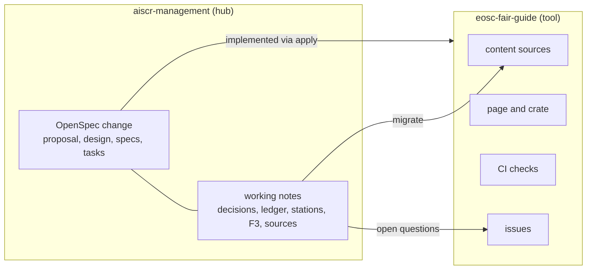
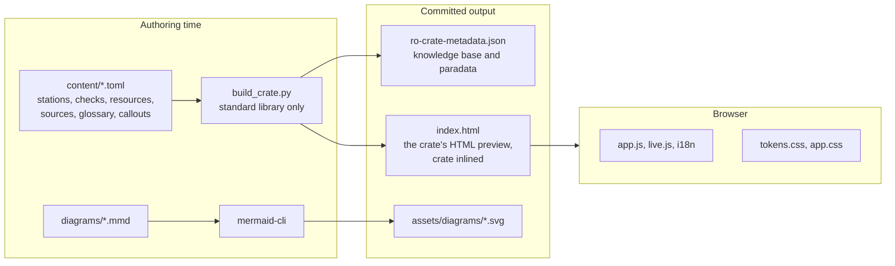
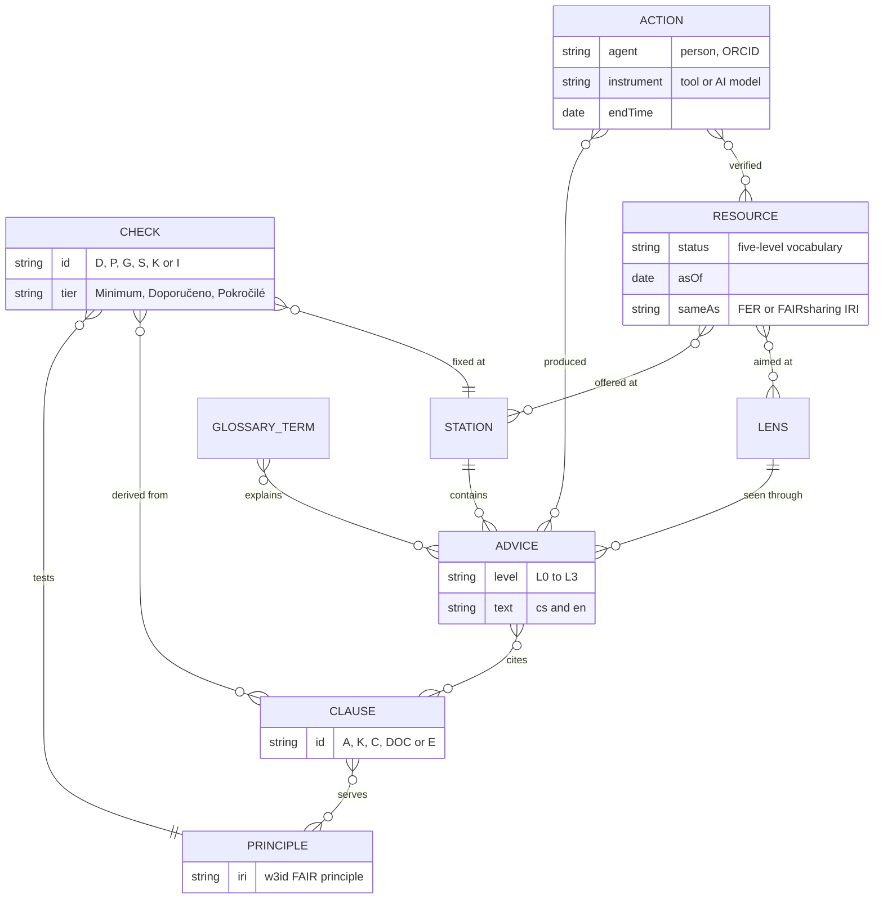
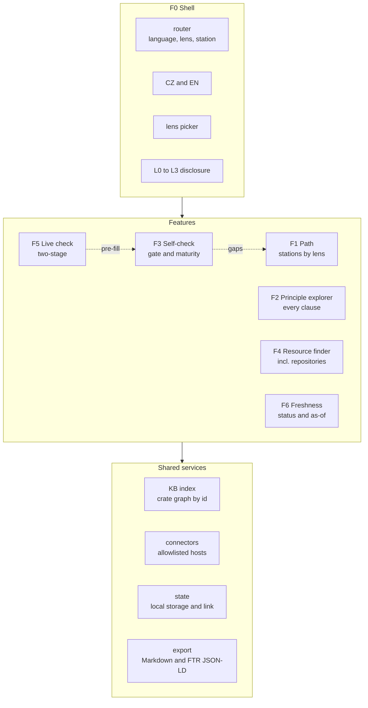
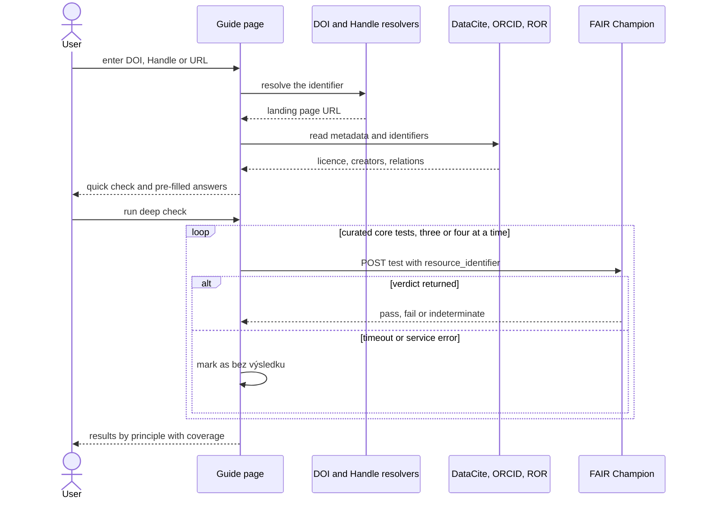
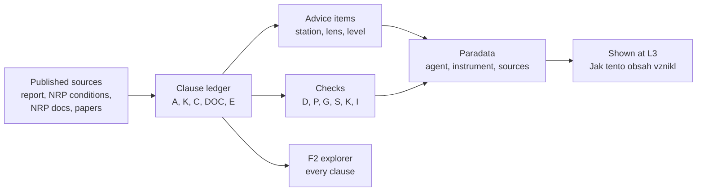

# Design

This document holds the design of the FAIR data guide: its goals, architecture, the decisions behind it with
the alternatives considered, and the dated decision log. The behaviour is specified in the planning record, the
OpenSpec change `eosc-fair-guide` in the AIS CR management hub; this document is the guide's own, maintained
copy of the design. Content rules are in [content-model.md](content-model.md).

## Goals

- A self-explanatory Czech and English guide that leads each role from its current stage to the next concrete
  action.
- Current, sourced advice, with every statement traceable to a published source.
- A self-check that tells repositories what NRP requires and tells everyone where their FAIR gaps are.
- Live checks that help without overstating what automated tests can prove.
- A repository the team can maintain through reviewed pull requests.

## Non-goals

- Certifying FAIRness or NRP compliance: the guide advises, and NRP decides.
- A backend, proxy or user accounts.
- Replacing the FAIR analysis as the normative reference: the guide cites it.
- A national FIP authoring tool or FER catalogue: planned national services cover these.

## Architecture

Every diagram is paired with prose that states the same meaning; the prose is normative and the diagrams
support it.

### At a glance

- A **static page** (HTML, CSS, light vanilla JS, no backend) that can be embedded in eosc.cz, hosted on GitHub Pages, or opened as a file.
- Content is an **RO-Crate 1.2 knowledge base** with **paradata**; the page itself is the crate's HTML preview.
- The main view is a **path of nine stations** seen through **four role lenses**, with detail revealed on demand in levels L0–L3.
- A **self-check** keeps two axes apart, the NRP onboarding gate and FAIR maturity, and never shows an overall score.
- **Live checks** are two-stage: a quick deterministic check, then an opt-in FAIR Champion deep check with coverage shown.
- Every change arrives as a **pull request** through layered CI checks and a code-owner review; scheduled jobs refresh snapshots by PR.
- **Two homes:** the OpenSpec change and working notes live in the hub; the product lives in this repository.

### System context

People in four roles use one static page. The page calls a few open APIs, but only when the user clicks:
DataCite, the DOI and Handle resolvers, ORCID, ROR, the NKR catalogue, the nanopublication query service
(published FIPs), FAIR Champion and the DMP status feed. National services such as NMA, DMP.eosc.cz and identifikatory.cz are linked, not called. Sources
that a browser cannot reach (re3data, Heslář, FER nanopublications, NMA facets, test health) are captured as
snapshots by a scheduled CI job that opens a pull request.

### Where things live

The management hub holds the OpenSpec change (proposal, design, specs, tasks) together with the working
notes: decision log, clause ledger, station inventory, self-check design and source inventory. Implementation
follows the hub's OpenSpec workflow and lands in this repository. The notes migrate into this
repository's content and design documents during the build-out, and the open questions become issues there.

### Authoring and build

Editors change small content source files: stations, checks, resources, sources, glossary and callouts. A
generator that needs only the Python standard library turns them into the RO-Crate knowledge base and inlines
the same crate into the page. Mermaid sources render to SVG. CI regenerates both and fails if the committed
output differs, so the browser never needs a build step and pull-request diffs stay readable.

### Content model

A station contains advice items; each item belongs to one lens and one disclosure level and cites
source clauses from the ledger. Clauses serve FAIR principles, identified by their published w3id IRIs.
Checks test a principle, derive from clauses and point to the station where a gap is fixed. Resources are
offered at stations for given lenses and carry a status, an as-of date and links to published FER or
FAIRsharing identifiers. Glossary terms come from Heslář. Paradata actions record who produced or verified
an item, with which tool and from which sources.

### Runtime structure

The shell provides routing by language, lens and station, the language switch, the lens picker, the
disclosure levels and the theme. Six features sit inside it: the path, the principle explorer, the
self-check, the resource finder, the live check and the freshness badges. They share four services: an
index over the crate, connectors limited to an allowlist of hosts, a state store (local storage plus a
shareable link) and export. Self-check gaps link back into the path, and the live check pre-fills
self-check answers.

### Two-stage live check

The user enters a DOI, Handle or URL. The page resolves it and reads DataCite, ORCID and ROR, which takes
seconds and pre-fills answers. Only when the user asks for the deep check does the page call the curated
FAIR Champion core tests, a few at a time. A test that times out or errors is shown as "bez výsledku" and never
counts as a failure. Results come grouped by principle, with the coverage stated.

### Change delivery

Every change arrives as a pull request: text polishing by the team, edits by a maintainer working with the
editing skill, or a scheduled data refresh. Seven check layers run in parallel and feed one summary with
previews, and a code owner approves before merge and deployment. Scheduled health checks for links, statuses
and external services open issues instead of changing anything.

### Traceability from source to screen

Published sources get ledger IDs: the report, the NRP conditions, the NRP documentation and published
papers. Advice items and checks cite those IDs, and the principle explorer shows every clause, so condensing
the path loses nothing. Each content change records a paradata action naming the person, the tool and the
sources, and the page shows it at level L3.

## Design decisions

1. **Static page, no backend.** It is portable to an eosc.cz page whose embedding rules are unknown, to GitHub
   Pages and to a local file, and nothing needs operating.
   *Alternatives:* a plugin for the eosc.cz CMS (MuniWeb; unknown and editor-dependent); a framework single-page
   app (a heavier build and harder for the team to maintain); a server application (needs an operator).
2. **The knowledge base is an RO-Crate 1.2, and the page is its HTML preview.** The content becomes a FAIR
   digital object itself, harvestable and standards-based, and provenance has a standard home.
   *Alternatives:* plain JSON (not linked data); a Markdown static-site generator (no machine-readable content
   model); a database (needs a backend).
3. **Content authored in TOML, crate generated by a standard-library script.** TOML is readable in
   pull-request diffs for the team's text work, is read by Python's standard library, and matches the hub's
   registry style. CI regenerates the crate and compares.
   *Alternatives:* hand-editing the JSON-LD crate (unreadable diffs, easy to break); YAML (needs a third-party
   parser); Markdown with front matter (structured fields such as tiers and prefill mappings become awkward).
4. **The crate is delivered standalone and inlined.** The inlined copy keeps the page working from a file and
   in an iframe; the standalone file serves harvesters.
   *Alternatives:* fetch only (breaks `file://` and some embeddings); inline only (not harvestable).
5. **The backbone is a stage-aware path with four role lenses and levels L0–L3; a principle explorer keeps
   every clause.** People think in their work stage, not in principles. Lenses let one path serve
   researchers, data stewards, repository administrators and communities. The explorer guarantees that
   condensing loses nothing.
   *Alternatives:* principle-first navigation (abstract for researchers); separate tools per role (duplicated
   content); a questionnaire first (no orientation before judgement).
6. **A clause ledger with a published-sources rule.** Every statement cites ledger IDs that point to published
   sources. Unpublished working material is never cited; its facts are traced to the published sources it relies on.
   *Alternatives:* free-form references (not checkable); citing unpublished working material.
7. **Paradata through Process Run Crate actions.** Who produced or verified content, with which tool
   (including AI), and from which sources is recorded per content batch and shown at level L3.
   *Alternatives:* git history only (not visible to readers and not linked to sources); a changelog (too coarse).
8. **The self-check keeps two axes (NRP gate, FAIR maturity) and shows no overall score.** The analysis warns
   that automated scores mainly reflect repository configuration and move a lot with small changes.
   *Alternatives:* one FAIR score or percentage (misleading); a maturity scale only (hides the binary NRP conditions).
9. **Live checks are two-stage, with FAIR Champion opt-in and governed by reliability rules.** The OSTrails CZ
   pilot (<https://doi.org/10.5281/zenodo.21726258>) found many calls without a verdict, a large share of
   indeterminate results and families that fail by construction. A quick deterministic stage gives instant
   value; the deep check reports coverage and never counts a service failure as a failed requirement.
   *Alternatives:* F-UJI (no browser access); always running the full Champion battery (slow, unreliable, heavy
   load); no live checks (loses a concrete, motivating feature).
10. **Sources a browser cannot reach enter as reviewed snapshots.** re3data, Heslář, FER lookups, NMA facets
    and test health refresh through scheduled pull requests.
    *Alternatives:* a proxy backend (contradicts decision 1); waiting for providers to enable CORS (tracked as
    issues, not relied on).
11. **The repository finder combines NKR live data, a re3data snapshot and a curated list.** NKR is the
    national source but has no registered repositories yet; its published schema maps onto FAIR principles,
    which also lets the repository-administrator self-check be pre-filled from an NKR record.
    *Alternatives:* NKR only (currently empty); re3data only (misses NRP pilot repositories).
12. **Diagrams are Mermaid sources pre-rendered to SVG,** following
    the AIS CR documentation visual conventions, paired with prose.
    *Alternative:* the Mermaid runtime in the browser (heavy JavaScript, flash of code).
13. **Layered pull-request checks plus code-owner review; scheduled jobs never commit.** Checks make an edit
    safe for the page and the data; humans judge correctness and tone.
    *Alternative:* lint only (does not protect content integrity or accessibility).
14. **Licensing: MIT for code, CC BY 4.0 for content, REUSE layout.** This matches EOSC CZ outputs.
    *Alternatives:* a single licence (wrong fit for code or for content); EUPL-1.2 (considered; MIT chosen).
15. **Planning lives in the AIS CR management hub; this repository has no OpenSpec tree.** The build-out
    followed the hub's OpenSpec change `eosc-fair-guide`; this repository keeps this design document and an
    agent guide.
    *Alternative:* OpenSpec in this repository (duplicates tooling for a small project).
16. **Visual identity: EOSC CZ, light theme, accessible tints.** Brand teal and pink are kept for accents and
    large text; darker tints carry body text to meet 4.5:1 contrast. The official logo packages are used.
    *Alternative:* raw brand colours for text (fails WCAG AA).
17. **AI tooling: `AGENTS.md` plus one editing skill mirrored for Claude Code.** It is enough for a future
    administrator to edit in line with the decisions.
    *Alternative:* the hub's generated multi-vendor trees (too much for this repository).
18. **The FIP completeness check is pre-filled from the community's published FIP.** FIP Wizard publishes a FIP
    as nanopublications that declare, per FIP question, which FAIR-enabling resources the community uses, and
    the nanopublication query service is callable from a browser. Reading a published FIP reuses the
    community's own declarations without a national FIP Wizard. Only declared resources pre-fill an answer; a
    question with no declaration stays open with a note, because a missing declaration does not prove a gap.
    *Alternatives:* manual answers only (ignores published work); a snapshot of all FIPs through scheduled CI
    (stale, and FIPs are few and changing).

## Spikes and findings

### RO-Crate validation (2026-10-08)

rocrate-validator 0.12.2 supports RO-Crate 1.2, Process Run Crate 0.5 and user profiles loaded with
`--extra-profiles-path`. It builds a profile's identifier from `prof:hasToken` and the version that ends the
profile IRI, so the guide's profile in `profile/fair-guide/` is `fair-guide-0.1`. The checks run as three
passes:

- RO-Crate 1.2, with every requirement level;
- Process Run Crate 0.5 with profile inheritance disabled (`-nh`), because the validator declares that profile on
  top of RO-Crate 1.1 and would otherwise require a 1.1 metadata descriptor;
- the guide's profile, also with `-nh`.

Required checks must pass. Recommended findings that remain are accepted:

- the validator does no subclass inference, so it reports `HowToDirection`, `Question` and `DataCatalog` results
  of provenance actions as not being `CreativeWork`, although schema.org defines them as subclasses;
- it expects `actionStatus` as a string, while Process Run Crate examples use the IRI
  `http://schema.org/CompletedActionStatus`, which the crate keeps;
- the guide's own `rdf:Property` terms have no schema.org type.

Two validator findings changed the model: every `SoftwareApplication` needs a `version`, so FAIR Champion tests
are `CreativeWork` entities typed `ftr:Test` through `additionalType`; and in-page action targets are references to
crate entities (`#repositories`, `#check-gate`) rather than plain strings.

### Paradata granularity (2026-10-08)

Process Run Crate 0.5 admits `CreateAction`, `ActivateAction` and `UpdateAction`; an action needs an
`instrument` that is a `SoftwareApplication`, `SoftwareSourceCode` or workflow, and should name an agent, a
result and an end time. The guide records one action per content batch: `create` for new items and `update` for
changed ones. A result pattern with a trailing `*` covers a whole station or ledger section. The AI model and
the assistant runtime are named as instruments; the generator is not, because it transforms content rather than
authoring it. With `--base <ref>`, `check_content.py` requires an action newer than that revision for every item
whose source changed.

## Decision log

Source: **U** = decision of the maintainer, **S** = proposal from analysis, agreed by the maintainer.

| ID | Date | Decision | Src |
| --- | --- | --- | --- |
| D-01 | 2026-10-07 | Refresh *Analýza FAIR NRP/NDI v1.2* into an interactive, self-explanatory CZ+EN guide for an eosc.cz page. Live demo, then handover to the team for polishing. | U |
| D-02 | 2026-10-07 | Backbone is a **stage-aware lifecycle path**: PLÁN → PRÁCE → REPOZITÁŘ → POPIS → LICENCE A PŘÍSTUP → PUBLIKACE → DOHLEDATELNOST → CITACE A UZNÁNÍ → KONTROLA. A one-question stage entry opens the path; earlier stations are collapsed, not hidden. | U |
| D-03 | 2026-10-07 | **Four role lenses** on the same path: researcher, data steward, repository admin/curator, community/FIP. The path is the most desired feature; data stewards and repository admins are the most common users and translators. | U |
| D-04 | 2026-10-07 | "Rich, but on demand": disclosure levels L0 (what to do now), L1 (how), L2 (why: principles, CTS, CDIF 1.1, NRP rules), L3 (sources, FER IRIs, paradata). | U |
| D-05 | 2026-10-07 | Features: F0 shell · F1 path · F2 principle explorer · F3 self-check per role (incl. NRP onboarding gate) · F4 resource finder · F5 live check · F6 freshness. Discussed one feature at a time. | U |
| D-06 | 2026-10-07 | Stack: static HTML + CSS + light, safe vanilla JS. No backend, no build step for the page. Portable to an iframe, an inline block or a standalone page (target page unknown). | U |
| D-07 | 2026-10-07 | Knowledge base is an **RO-Crate 1.2** (`ro-crate-metadata.json`); `index.html` doubles as `ro-crate-preview.html`. **Paradata** follows Process Run Crate (CreateAction: agent, instrument, object, result, endTime). | U+S |
| D-08 | 2026-10-07 | Reuse standard IRIs: FAIR principles `w3id.org/fair/principles/terms/*`, published FER nanopub IRIs, FAIRsharing DOIs, FIP ontology classes, schema.org / DCAT / SKOS / dcterms. | U |
| D-09 | 2026-10-07 | Live calls only on user action, with graceful fallback. OK: DataCite REST (metadata, citation), FAIR Champion, nanopub query, Upptime JSON. Not usable from a browser: FAIRsharing API (login), Heslář API (no CORS), F-UJI (no CORS). | S |
| D-10 | 2026-10-07 | No built-in NRP FAIR check. Use external tools, with **FAIR Champion preferred**. Present scores as feedback on repository setup, not as a judgement of the author (report §5.2.1). | U |
| D-11 | 2026-10-07 | Tone is advisory and matches EOSC CZ materials; no enforcement wording beyond the actual NRP conditions (v3.4). | U |
| D-12 | 2026-10-07 | Sensitive data gets a short callout ("FAIR ≠ otevřená") with a combination of pointers; the user chooses the target. | U |
| D-13 | 2026-10-07 | Station "CITACE A UZNÁNÍ" leads with citation practice. RIV result type T is a factual note, never hype. Includes a citation helper from a PID. | U |
| D-14 | 2026-10-07 | PIDs: DOI is the recommended, most instructive option, **not the only valid one**. Handle, ARK, URN:NBN and others are acceptable if persistent, resolvable and managed. | U |
| D-15 | 2026-10-07 | CCMM wording: NMA works with **1.1.0**; "podpora 2.0.0 se připravuje (2027)" (likely a v2→v1 XSLT; meeting info, not guaranteed). Forward-looking advice may reference 2.0.0. | U |
| D-16 | 2026-10-07 | FIP/FER: no separate national FIP Wizard. The FER catalogue is a closed pilot, so keep a **placeholder** (user will supply a link). NKR will host approved qualified FERs; each repository is described by its FIP. | U |
| D-17 | 2026-10-07 | **No licence-selector placeholder**; the DSW plugin in dmp.eosc.cz is the deliverable. | U |
| D-18 | 2026-10-07 | DMP is a cornerstone: dmp.eosc.cz with funder templates (GA ČR, TA ČR, AZV ČR, MŠMT, Horizon Europe, Science Europe) and the CCMM export template. | U+S |
| D-19 | 2026-10-07 | AI transparency in a footer, an "O průvodci" page and per-item paradata. "AI ve FAIRifikaci" is an overlay per station plus an overview page linking CERIT AIaaS. Guardrails: keep unpublished data on-premise, verify every identifier, declare AI use. | U |
| D-20 | 2026-10-07 | Accessibility: EU Web Accessibility Directive (EN 301 549 / WCAG 2.1 AA; CZ zákon 99/2019 Sb.); target **WCAG 2.2 AA**; publish an accessibility statement. | U |
| D-21 | 2026-10-07 | UX is critical. Anti-dropout patterns: one-question entry, next best action, one concrete action per station, time estimates, glossary popovers, an escape hatch, remembered progress. Test with EOSC CZ personas. | U |
| D-22 | 2026-10-07 | Visual identity: brand teal #008691 and pink #EB5D81 only for accents and large text; text tints #00737D and #C2264F (both ≥ 5.6:1 on white). Muni font only inside eosc.cz pages; Arial/Helvetica fallback. | S |
| D-23 | 2026-10-07 | Diagrams in **Mermaid**, and they must look good. Adopt the hub visual conventions: approved families only, every diagram paired with prose (doubles as the text alternative). | U |
| D-24 | 2026-10-07 | Paradata agents: David Novák (ORCID 0000-0001-6592-6291) as implementing author, others as contributors; reviewed later. Text polishing goes to the team. | U |
| D-25 | 2026-10-07 | Repo `github.com/motyc/eosc-fair-guide`: private now, public later. Admin waiver granted. Best-practice contents (README, licences, CITATION.cff, CONTRIBUTING, CHANGELOG…). Minimal hub-style AI tooling plus **one dedicated editing skill**; keep it light. | U |
| D-26 | 2026-10-07 | Not hosted on third-party AI artifact hosting (EOSC CZ branding). Preview locally until the repository is public, then use GitHub Pages or the target page. | S |
| D-27 | 2026-10-07 | Glossary source: **heslar.openscience.cz** (NTK), snapshotted at authoring time and linked back (licence to check). PID hub: **identifikatory.cz**. | U+S |
| D-28 | 2026-10-07 | Draft checklists and handbooks for repository administrators are supportive input only, not decisions. JSON-LD (schema.org) landing pages are desirable. | U |
| D-29 | 2026-10-08 | **CI must validate PR contents** so an edit is safe to accept once checks pass. Layers: structure, content contract, page integrity, accessibility, links, diagrams, repo hygiene, review aids. Hardened workflows. | U |
| D-30 | 2026-10-08 | Licences: **MIT** (code) + **CC BY 4.0** (content), REUSE layout. | U |
| D-31 | 2026-10-08 | README follows the hub pattern: Czech `README.md` + English operational `README_en.md`. | U |
| D-32 | 2026-10-08 | Light theme only for v1. | U |
| D-33 | 2026-10-08 | Sensitive-data callout uses **all five pointers** (data steward/DPO, Etické sedmero, Sensitive Cloud, sensitive-data AAI architecture, EOSC CZ WG), ordered as steps and filtered by lens, so it reads easily. | U |
| D-34 | 2026-10-08 | Repository discovery: **NKR connector** (Cordra REST at repo.cz, CORS ok, Repository schema published, no repositories registered yet) + **re3data** snapshot (no CORS; 14 CZ entries via `api/beta/repositories?countries[]=CZE`) + a curated layer (MBDB, datarepo…). Deduplicate via `relatedRegistry` and URL. | U+S |
| D-35 | 2026-10-08 | Branding from <https://www.eosc.cz/o-nas/sablony-eosc-cz> (logo zips, EU+MŠMT logolink; no design manual). Acknowledgement text from <https://www.eosc.cz/o-nas/acknowledgement> in the footer / about page. | U+S |
| D-36 | 2026-10-08 | Non-CORS sources (re3data, Heslář, FER lookups) and link health are refreshed by **scheduled CI jobs that open a PR** for human review, never by silently committing. | S |
| D-37 | 2026-10-08 | NKR Repository fields map onto FAIR principles, so the repository-admin lens can **pre-fill a self-check from the repository's NKR record** and show what is missing in that record. | S |
| D-38 | 2026-10-08 | The guide is an official **NRP KA 5.1** output, so the mandatory NRP acknowledgement (CZ/EN, CZ.02.01.01/00/23_014/0008787) goes in the footer and the "O průvodci" page. | U |
| D-39 | 2026-10-08 | Inventory method: a clause ledger (`content/ledger.toml`). The principle explorer (F2) is the lossless home for every report clause; path stations cite clause IDs; L2 is generated from the ledger. Report chapter IDs use a `K` prefix so they cannot be mistaken for principle names. | S |
| D-40 | 2026-10-08 | **Published sources only.** Unpublished working material is never cited or referenced; every fact taken from it is traced to the published source it relies on (ledger section `E.*`). | U |
| D-41 | 2026-10-08 | Outstanding open questions become **issues in this repository**, filed as one of the last steps, so they can be resolved there. | U |
| D-42 | 2026-10-08 | The AI warning is made helpful through a shared "Ověřte identifikátory" callout plus a light on-demand helper. The helper resolves ORCID, ROR, DOI and Handle in the browser and shows the name or title. Kept light; drop it if it grows. | U+S |
| D-43 | 2026-10-08 | NMA: the public REST API has no CORS, so "is my dataset in NMA?" is a pre-filled deep link into NMA search. The station explains the "Získat odkaz pro RIV" flow and states that **the RIV link never replaces the PID** (NRP docs). Anyone can create a manual NMA record. | U+S |
| D-44 | 2026-10-08 | The final text polishing is done by the team **via PRs on the live page**, after everything else is finished. | U |
| D-45 | 2026-10-08 | Live checks are **two-stage**. A deterministic quick check (DataCite, doi.org / hdl.handle.net, ORCID, ROR) comes first; FAIR Champion is an opt-in deep check limited to a curated core set, with gentle load, four outcome states and coverage always shown. A service failure never counts as a failed requirement. Grounded in the OSTrails CZ pilot (E.OSTRAILS-CZ). | U+S |
| D-46 | 2026-10-08 | F3 design: two axes (Brána NRP × Zralost FAIR), no overall score, gaps route back into path stations; pre-fill from NKR (repositories) and DataCite (datasets) with visible source chips; export as Markdown, print and an FTR `TestResultSet` in a small RO-Crate. | S |
| D-47 | 2026-10-08 | Gate profile (a), core NRP systems: G09 (security monitoring) and G10 (central logging) show as **„zajišťuje NRP“**. Confirmed by the user; the NRP repositories page states that NRP provides storage, repository software and the operating environment. | U |
| D-48 | 2026-10-08 | An optional **institution check** (data policy, DMP support, storage, OS III strategy) is included if it fits the scope; it is lower priority than the four lens checks. | U |
| D-49 | 2026-10-08 | **FIP pre-fill is in the first release:** the FIP completeness check (K) reads the community's published FIP nanopublication through the nanopub query service. Declared FERs pre-fill "ano"; questions with no declaration stay open with a note. | U |
| D-50 | 2026-10-08 | The repository is renamed to `motyc/eosc-fair-guide` so its name suits reuse; the vocabulary and profile IRIs follow the new name. | U |
