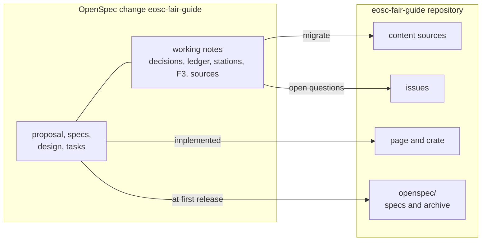
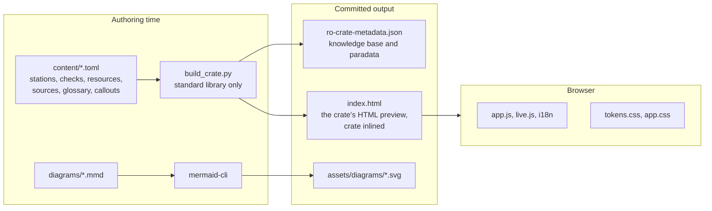
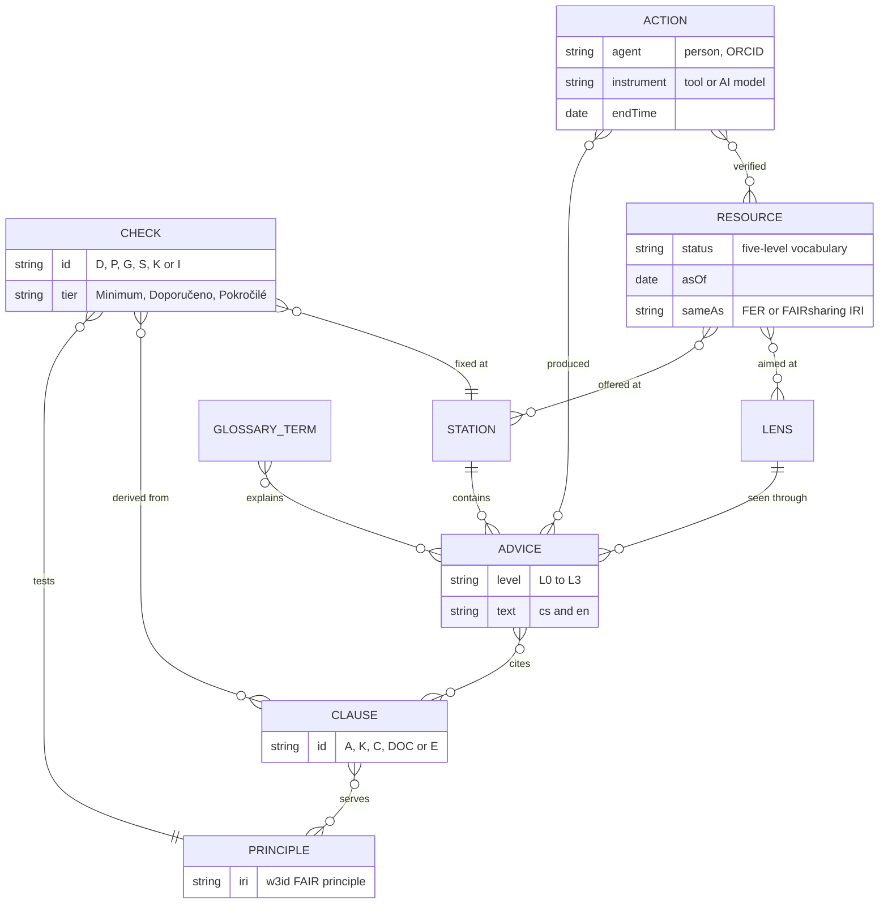
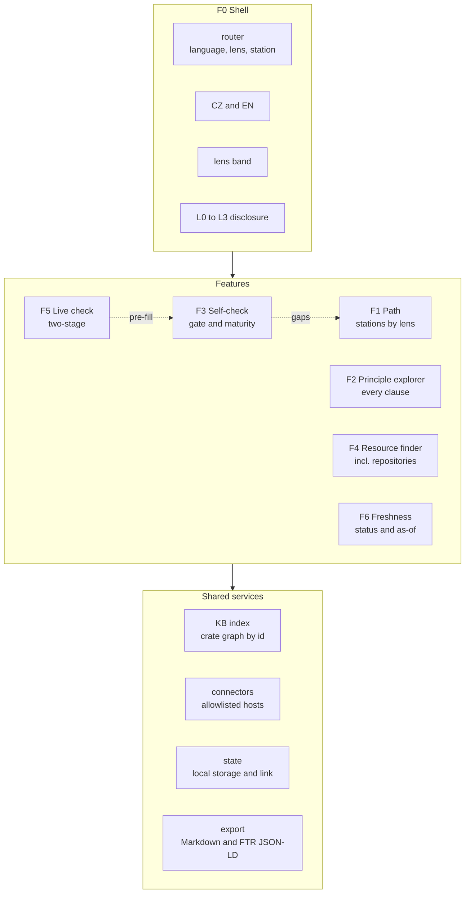
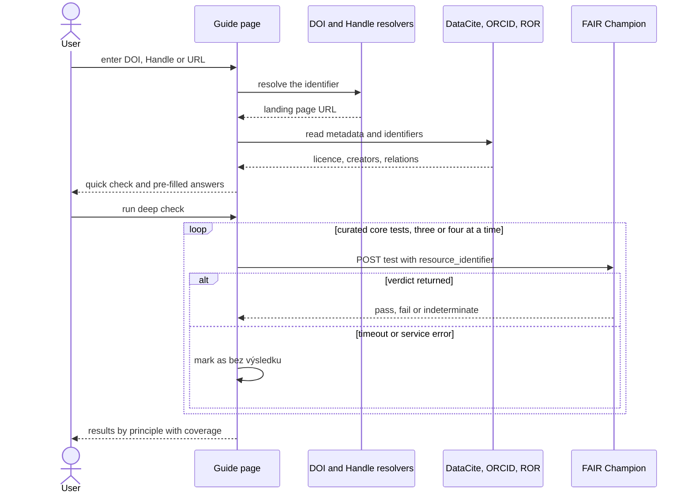
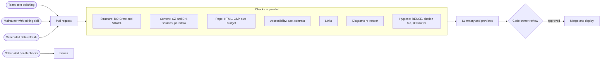
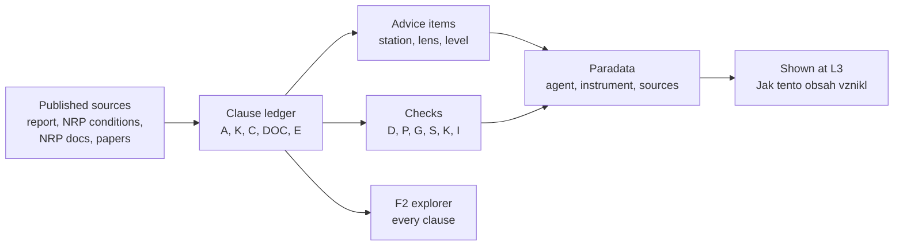

# Design

This document holds the design of the FAIR Data Guide: its goals, architecture, the decisions behind it with
the alternatives considered, and the dated decision log. The behaviour is specified in the OpenSpec change
`eosc-fair-guide`, which moves into this repository's `openspec/` tree at the first release; this document is the
guide's own, maintained account of the design. Content rules are in [content-model.md](content-model.md).

## Goals

- A self-explanatory Czech and English guide that leads each role from its current stage to the next concrete
  action.
- Current, sourced advice, with every statement traceable to a published source.
- A self-check that tells repositories what NRP requires and tells everyone where their FAIR gaps are.
- Live checks that help without overstating what automated tests can prove.
- A repository the team can maintain through reviewed pull requests.

## Non-goals

- Certifying FAIRness or NRP compliance: the guide advises, and NRP decides.
- A backend, proxy or user accounts.
- Replacing the FAIR analysis as the normative reference: the guide cites it.
- A national FIP authoring tool or FER catalogue: planned national services cover these.

## Architecture

Every diagram is paired with prose that states the same meaning; the prose is normative and the diagrams
support it.

### At a glance

- A **static page** (HTML, CSS, light vanilla JS, no backend) that can be embedded in eosc.cz, hosted on GitHub Pages, or opened as a file.
- Content is an **RO-Crate 1.2 knowledge base** with **paradata**; the page itself is the crate's HTML preview.
- The main view is a **path of nine stations** seen through **four role lenses**, with detail revealed on demand in levels L0–L3.
- A **self-check** keeps two axes apart, the NRP onboarding gate and FAIR maturity, and never shows an overall score.
- **Live checks** are two-stage: a quick deterministic check, then an opt-in FAIR Champion deep check with coverage shown.
- Every change arrives as a **pull request** through layered CI checks and a code-owner review; scheduled jobs refresh snapshots by PR.
- **OpenSpec-driven:** the guide is planned as an OpenSpec change, which moves into this repository at the first release.

### System context

People in four roles use one static page. The page calls a few open APIs, but only when the user clicks:
DataCite, the DOI and Handle resolvers, ORCID, ROR, the NKR catalogue, the nanopublication query service
(published FIPs), FAIR Champion and the DMP status feed. National services such as NMA, DMP.eosc.cz and identifikatory.cz are linked, not called. Sources
that a browser cannot reach (re3data, Heslář, FER nanopublications, NMA facets, test health) are captured as
snapshots by a scheduled CI job that opens a pull request.

```mermaid
flowchart LR
  accTitle: System context
  accDescr: Four kinds of users open the static guide page. The page calls a small set of open APIs only on click, links out to national services, and reads snapshots that a scheduled CI job refreshes.
  subgraph PEOPLE[People]
    direction TB
    V([Researcher])
    DS([Data steward])
    SR([Repository admin or curator])
    K([Community and FIP])
  end
  G["FAIR guide<br/>static page"]
  subgraph LIVE[Called live, on click]
    direction TB
    DC[DataCite REST]
    RES[doi.org and hdl.handle.net]
    OR[ORCID and ROR]
    NKR[NKR Cordra API]
    NPQ[Nanopub query, published FIPs]
    FC[FAIR Champion, opt-in]
    UP[DMP status feed]
  end
  subgraph LINK[Linked, not called]
    direction TB
    NMA[NMA search and RIV link]
    DMP[DMP.eosc.cz]
    PID[identifikatory.cz]
    MORE[FAIRsharing, FAIR-IMPACT,<br/>CERIT AI, NRP and e-INFRA docs]
  end
  subgraph SNAP[Snapshots by scheduled CI]
    direction TB
    R3[re3data]
    HES[Heslář]
    FER[FER nanopublications]
    NMAF[NMA facets]
    FCH[FAIR Champion test health]
  end
  PEOPLE --> G
  G -- fetch on click --> LIVE
  G -. link .-> LINK
  SNAP -- refresh by PR --> G
```

### Planning record

The guide is planned as an OpenSpec change: a proposal, five capability specs, a design and a task list, with
working notes (decision log, clause ledger, station drafts, self-check design and source inventory). During the
build-out the notes become this repository's content sources and design documents, and the open questions
become issues. At the first release the specs and the archived change move into `openspec/` here, so later
changes are planned in this repository.

### Authoring and build

Editors change small content source files: stations, checks, resources, sources, glossary and callouts. A
generator that needs only the Python standard library turns them into the RO-Crate knowledge base and inlines
the same crate into the page. Mermaid sources render to SVG. CI regenerates both and fails if the committed
output differs, so the browser never needs a build step and pull-request diffs stay readable.

### Content model

A station contains advice items; each item belongs to one lens and one disclosure level and cites
source clauses from the ledger. Clauses serve FAIR principles, identified by their published w3id IRIs.
Checks test a principle, derive from clauses and point to the station where a gap is fixed. Resources are
offered at stations for given lenses and carry a status, an as-of date and links to published FER or
FAIRsharing identifiers. Glossary terms come from Heslář. Paradata actions record who produced or verified
an item, with which tool and from which sources.

### Runtime structure

The shell provides routing by language, lens and station, the language switch, the lens band (shown on the path
and the self-check overview; in the catalogue the lens is a resource filter), the disclosure levels and the theme. Six features sit inside it: the path, the principle
explorer, the self-check, the resource finder, the live check and the freshness badges. They share four services:
an index over the crate, connectors limited to an allowlist of hosts, a state store (local storage plus a shareable
link) and export. Self-check gaps link back into the path, and the live check pre-fills self-check answers.

### Two-stage live check

The user enters a DOI, Handle or URL. The page resolves it and reads DataCite, ORCID and ROR, which takes
seconds and pre-fills answers. Only when the user asks for the deep check does the page call the curated
FAIR Champion core tests, a few at a time. A test that times out or errors is shown as "bez výsledku" and never
counts as a failure. Results come grouped by principle, with the coverage stated.

### Change delivery

Every change arrives as a pull request: text polishing by the team, edits by a maintainer working with the
editing skill, or a scheduled data refresh. Seven check layers run in parallel and feed one summary with
previews, and a code owner approves before merge and deployment. Scheduled health checks for links, statuses
and external services open issues instead of changing anything.

### Traceability from source to screen

Published sources get ledger IDs: the report, the NRP conditions, the NRP documentation and published
papers. Advice items and checks cite those IDs, and the principle explorer shows every clause, so condensing
the path loses nothing. Each content change records a paradata action naming the person, the tool and the
sources, and the page shows it at level L3.

## Design decisions

1. **Static page, no backend.** It is portable to an eosc.cz page whose embedding rules are unknown, to GitHub
   Pages and to a local file, and nothing needs operating.
   *Alternatives:* a plugin for the eosc.cz CMS (MuniWeb; unknown and editor-dependent); a framework single-page
   app (a heavier build and harder for the team to maintain); a server application (needs an operator).
2. **The knowledge base is an RO-Crate 1.2, and the page is its HTML preview.** The content becomes a FAIR
   digital object itself, harvestable and standards-based, and provenance has a standard home.
   *Alternatives:* plain JSON (not linked data); a Markdown static-site generator (no machine-readable content
   model); a database (needs a backend).
3. **Content authored in TOML, crate generated by a standard-library script.** TOML is readable in
   pull-request diffs for the team's text work, is read by Python's standard library. CI regenerates the crate and compares.
   *Alternatives:* hand-editing the JSON-LD crate (unreadable diffs, easy to break); YAML (needs a third-party
   parser); Markdown with front matter (structured fields such as tiers and prefill mappings become awkward).
4. **The crate is delivered standalone and inlined.** The inlined copy keeps the page working from a file and
   in an iframe; the standalone file serves harvesters.
   *Alternatives:* fetch only (breaks `file://` and some embeddings); inline only (not harvestable).
5. **The backbone is a stage-aware path with four role lenses and levels L0–L3; a principle explorer keeps
   every clause.** People think in their work stage, not in principles. Lenses let one path serve
   researchers, data stewards, repository administrators and communities. The explorer guarantees that
   condensing loses nothing.
   *Alternatives:* principle-first navigation (abstract for researchers); separate tools per role (duplicated
   content); a questionnaire first (no orientation before judgement).
6. **A clause ledger with a published-sources rule.** Every statement cites ledger IDs that point to published
   sources. Unpublished working material is never cited; its facts are traced to the published sources it relies on.
   *Alternatives:* free-form references (not checkable); citing unpublished working material.
7. **Paradata through Process Run Crate actions.** Who produced or verified content, with which tool
   (including AI), and from which sources is recorded per content batch and shown at level L3.
   *Alternatives:* git history only (not visible to readers and not linked to sources); a changelog (too coarse).
8. **The self-check keeps two axes (NRP conditions, FAIR maturity) and shows no overall score.** The analysis warns
   that automated scores mainly reflect repository configuration and move a lot with small changes.
   *Alternatives:* one FAIR score or percentage (misleading); a maturity scale only (hides the binary NRP conditions).
9. **Live checks are two-stage, with FAIR Champion opt-in and governed by reliability rules.** The OSTrails CZ
   pilot (<https://doi.org/10.5281/zenodo.21726258>) found many calls without a verdict, a large share of
   indeterminate results and families that fail by construction. A quick deterministic stage gives instant
   value; the deep check reports coverage and never counts a service failure as a failed requirement.
   *Alternatives:* F-UJI (no browser access); always running the full Champion battery (slow, unreliable, heavy
   load); no live checks (loses a concrete, motivating feature).
10. **Sources a browser cannot reach enter as reviewed snapshots.** re3data, Heslář, FER lookups, NMA facets
    and test health refresh through scheduled pull requests.
    *Alternatives:* a proxy backend (contradicts decision 1); waiting for providers to enable CORS (tracked as
    issues, not relied on).
11. **The repository finder combines NKR live data, a re3data snapshot and a curated list; FERs come from the
    FIP Dashboard.** NKR is the national source but has no registered repositories yet; its published schema maps
    onto FAIR principles, which also lets the repository-administrator self-check be pre-filled from an NKR record.
    Standards, vocabularies and other FERs are shown from the dashboard snapshot with their NRP/EOSC CZ
    qualification and a link to the dashboard record.
    *Alternatives:* NKR only (currently empty); re3data only (misses NRP pilot repositories); a FER list maintained
    in the guide (a second copy of facts the dashboard owns).
12. **Diagrams are Mermaid sources pre-rendered to SVG,** following documentation
    visual conventions: approved diagram families, each diagram paired with prose.
    *Alternative:* the Mermaid runtime in the browser (heavy JavaScript, flash of code).
13. **Layered pull-request checks plus code-owner review; scheduled jobs never commit.** Checks make an edit
    safe for the page and the data; humans judge correctness and tone.
    *Alternative:* lint only (does not protect content integrity or accessibility).
14. **Licensing: MIT for code, CC BY 4.0 for content, REUSE layout.** This matches EOSC CZ outputs.
    *Alternatives:* a single licence (wrong fit for code or for content); EUPL-1.2 (considered; MIT chosen).
15. **Planning and later changes are OpenSpec-driven.** The guide was planned as an OpenSpec change. At the first
    release its specs become this repository's capability specs under `openspec/specs/`, and the change is archived
    under `openspec/changes/archive/`. OpenSpec is a pinned development dependency, so later changes to the guide
    are proposed, validated and archived here.
    *Alternatives:* planning outside the repository (future contributors cannot see why the guide is as it is); a
    design document only (no testable requirements).
16. **Visual identity: EOSC CZ, light theme, accessible tints.** Brand teal and pink are kept for accents and
    large text; darker tints carry body text to meet 4.5:1 contrast. The official logo packages are used.
    *Alternative:* raw brand colours for text (fails WCAG AA).
17. **AI tooling: `AGENTS.md` plus one editing skill mirrored for Claude Code.** It is enough for a future
    administrator to edit in line with the decisions.
    *Alternative:* generated configuration trees for many assistants (too much for this repository).
18. **The FIP completeness check is pre-filled from the community's profile in the FIP Dashboard, with a
    published nanopublication as the fallback.** The dashboard holds national FIPs with declarations per principle
    and a status for each (in use, planned, under consideration, to be replaced); it is read from the snapshot and,
    once its API admits the guide's origin, live. FIP Wizard publishes FIPs as nanopublications that the
    nanopublication query service serves to browsers; this adapter covers profiles outside the dashboard and keeps
    the pre-fill working if the dashboard is unavailable, in the pilot and in production. A principle with no
    declaration stays open with a note, because a missing declaration does not prove a gap.
    *Alternatives:* manual answers only (ignores published work); the dashboard only (no fallback); nanopublications
    only (misses the national catalogue).
19. **The guide and the FIP Dashboard are two facets of one service.** The dashboard (the national FER catalogue,
    into which NKR-qualified FERs move, open to resources from anywhere) answers "which resources and profiles";
    the guide answers "what to do and why". They share principle IDs, CZ/EN texts and the FIP vocabulary, link to
    each other's records, and go through the same review round. The dashboard owns FER facts; the guide refers to
    them by dashboard ID.
    *Alternatives:* a link to the dashboard only (users stitch the two together themselves); copying FERs into the
    guide (two owners of one fact).
20. **A testing-phase notice is driven by the release status.** Until EOSC CZ agrees the guide, `content/guide.toml`
    carries the status "testing" and every view shows a notice. The release that records the agreement changes the
    status, which removes the notice.
    *Alternative:* a hard-coded banner (easy to forget when releasing).

## Spikes and findings

### RO-Crate validation (2026-10-08)

rocrate-validator 0.12.2 supports RO-Crate 1.2, Process Run Crate 0.5 and user profiles loaded with
`--extra-profiles-path`. It builds a profile's identifier from `prof:hasToken` and the version that ends the
profile IRI, so the guide's profile in `profile/fair-guide/` is `fair-guide-0.1`. The checks run as three
passes:

- RO-Crate 1.2, with every requirement level;
- Process Run Crate 0.5 with profile inheritance disabled (`-nh`), because the validator declares that profile on
  top of RO-Crate 1.1 and would otherwise require a 1.1 metadata descriptor;
- the guide's profile, also with `-nh`.

Required checks must pass. Recommended findings that remain are accepted:

- the validator does no subclass inference, so it reports `HowToDirection`, `Question` and `DataCatalog` results
  of provenance actions as not being `CreativeWork`, although schema.org defines them as subclasses;
- it expects `actionStatus` as a string, while Process Run Crate examples use the IRI
  `http://schema.org/CompletedActionStatus`, which the crate keeps;
- the guide's own `rdf:Property` terms have no schema.org type.

Two validator findings changed the model: every `SoftwareApplication` needs a `version`, so FAIR Champion tests
are `CreativeWork` entities typed `ftr:Test` through `additionalType`; and in-page action targets are references to
crate entities (`#repositories`, `#check-gate`) rather than plain strings.

### Paradata granularity (2026-10-08)

Process Run Crate 0.5 admits `CreateAction`, `ActivateAction` and `UpdateAction`; an action needs an
`instrument` that is a `SoftwareApplication`, `SoftwareSourceCode` or workflow, and should name an agent, a
result and an end time. The guide records one action per content batch: `create` for new items and `update` for
changed ones. A result pattern with a trailing `*` covers a whole station or ledger section. The AI model and
the assistant runtime are named as instruments; the generator is not, because it transforms content rather than
authoring it. With `--base <ref>`, `check_content.py` requires an action newer than that revision for every item
whose source changed.

### FIP declarations from a nanopublication (2026-10-08)

The fallback source for the FIP pre-fill is the nanopublication query service. A SPARQL query over
`https://query.knowledgepixels.com/repo/full` follows a FIP to its declaration index, from the index to each
declaration nanopublication, and from each declaration to the FIP question it answers and the resource it declares.
The service sends `Access-Control-Allow-Origin: *`, so the page can call it directly; for a published FIP (the
ADVANCE project's profile) it returned 27 declarations in about half a second. Findings that shaped the adapter:

- a FIP is published under three IRI forms, `https://w3id.org/np/<code>#fip`, `https://w3id.org/np/<code>/fip`
  and `http://purl.org/np/<code>#fip` (165, 31 and 39 of the 235 FIPs the service listed), so the query lists all
  three and the export names the one that matched; the page accepts the trusty URI code on its own or inside an
  address;
- 232 of those 235 FIPs have a declaration index; the query found declarations for every FIP in a sample of eight
  once it listed all three forms;
- questions are IRIs of the form `https://w3id.org/fair/fip/terms/FIP-Question-<question>`, where the question is
  the code that `prefill.fip` uses (`F1-D`, `A1.1-MD`, …);
- the relation carries the status: `declares-current-use-of` is "in use", `declares-planned-use-of` is "planned"
  and `declares-planned-replacement-of` is "to be replaced";
- declared resources use `http://purl.org/np/…` IRIs, which purl.org also serves over HTTPS, and a resource can
  carry several labels, so the page links the HTTPS form and lists each resource once.

The query lives in `content/live.toml`, not in the scripts, so it can change with the service without a code
change. The FIP Dashboard API, the primary source, answered only its own development origin in a cross-origin
check on the same day, so the page uses the dashboard snapshot until `browserAccess` is switched on.

### FAIR Champion and the NMA search link (2026-10-08)

FAIR Champion tests are called with `POST <endpoint>/<test>` and the body `{"resource_identifier": …}`, as each
test's OpenAPI description at `https://tests.ostrails.eu/tests/<test>/api` states. The service sends
`Access-Control-Allow-Origin: *`, also on its pre-flight answer, and returns JSON-LD whose `ftr:TestResult` carries
`prov:value` (`pass`, `fail` or `indeterminate`) and `ftr:log`. A probe of the ten curated tests with a Zenodo DOI
and a LINDAT Handle confirmed the pilot's reliability findings: the DOI got HTTP 500 from eight tests within a
second, the Handle got verdicts from nine tests in 0 to 54 seconds, and the author-affiliation test gave no verdict
for either. That test is marked `degraded` in the health snapshot; the others are `available`.

NMA's search page is `https://nma.eosc.cz/datasets/?q=…` (`/search?q=` redirects there). A DOI in quotes finds the
record when NMA holds it and shows an empty result otherwise, while the direct record address
`/datasets/records/doi/<doi>` answers 404 for a dataset NMA does not hold. The guide therefore links the search
with the quoted identifier.

## Review round 1

A review of the first working version (2026-10-08) reshaped the experience before the remaining live-check helpers
were built. A small throwaway prototype covered only the parts that needed a decision: the landing, one station and
the self-check. The decisions below record the maintainer's answers; the decision log carries the rows.

### Landing

- One search box leads. Results from the guide's own content appear while typing; the routes for an identifier
  (DOI, Handle, ORCID, ROR, URL) appear on Enter, because they lead to outside services, and a hint says so while
  the identifier is typed. Nothing is sent while typing.
- The stage is chosen from four cards with a short description each (planning, working with data, publishing,
  published), not from a strip of stations. Each card names the steps it covers, so the cards also show the whole
  journey. Once the visitor has chosen a stage, its card says "Selected" with the date of their last visit; before
  a choice no card is marked.
- The stage can be changed on the path itself, in a "Your stage" switch above the stations, because the choice
  decides where the menu's path item leads and which stations the rail shows as earlier.
- The main menu calls the path "Path to FAIR" ("Cesta k FAIR"); "Path" alone did not say where it leads. The
  landing is its own first menu item ("Úvod" / "Home"), and "Path to FAIR" opens the station the visitor was last
  at.
- The line on what the content is based on, the privacy promise and the date moves to the bottom of the landing,
  and names the FAIR analysis as a link.
- Task shortcuts follow the order of the path, then institution-level and community tasks:

  | Lens | Shortcuts, in this order |
  | --- | --- |
  | Researcher | Prepare a data management plan · Choose a repository · Choose a licence · Cite data · Check a dataset · Output for Open Science III or a minizáměr |
  | Data steward | DMP templates and the planning tool · Check a dataset with a researcher · Output for Open Science III or a minizáměr · Institution check (strategy, action plan, policy) · Training for the team · Data steward community and map |
  | Repository administrator | Found a repository in NRP · NRP conditions · Connect to NMA and register in NKR · Repository FAIR maturity · Deep check of sample records |
  | Community / FIP | Find the community's profile in the FIP Dashboard · FIP completeness · Create or update a FIP in FIP Wizard · Domain standards and vocabularies · EOSC CZ working groups |

### Station

- Principle tiles (a coloured F/A/I/R letter with the code and short title) stay as prototyped.
- The "what to do now" level is a lighter callout: no background, an accent line beside the text, and a smaller
  action button on the right, so it guides without dominating.
- Links in running text use a dotted underline that becomes solid on hover.
- Every link to an external URL opens in a new tab and says so to assistive technology; this includes the EOSC CZ
  logo in the header.
- The provenance line on a station says only what the content is based on, its date and a link to the details;
  the statement on AI use and human review lives in the details and on the about page.
- The footer gives the full citation of the guide as software (editor, title, version, year, publisher,
  repository) next to the credit for the analysis, instead of a bare "compiled by". The about page lists the roles
  (authors of the analysis, compilation and development, editorial review, tools, funding) in a table generated
  from the guide's metadata, and each station ends its levels with one sources line that opens the full detail.
- `CITATION.cff` credits the guide's software, with its author, because the format has no top-level editor role;
  its message points to the guide's citation with the editor role, and the analysis is listed under `references`.
- The station rail gets simple top and bottom rules so it does not float; the legend for the self-check marks is
  set apart and aligned with the icon column.

### Self-check

- The split view, the evidence line beside each criterion, the grid of principles in the result and the
  explanation of the basic tier stay as prototyped.
- Beside the questions on wide screens sits a short, sticky "result so far": progress, one chip per principle (or
  gate condition) that leads to its items, and the counts of gaps and things to find out that lead to the full
  result. It never scrolls on its own; a small icon collapses it, and the choice is remembered in the browser. The
  full result and the saving and loading actions follow the questions, so on narrow screens they simply come next.
- The extended check is an on/off switch in a control row with the grouping (by FAIR principle by default, or by
  path step, also remembered). Every item names the step where it is addressed; the tier badge shows only on items
  outside the first view's tier.
- The result covers the items the view shows, every item once the check is extended, and any item answered, so an
  answer to an extended item still counts after returning to the basic items.
- A pre-fill records the fields it read with the values found (at most three per field) and a link to the record:
  the DataCite Commons page, the resolved landing page, the NKR record or the FIP profile. The same evidence is in
  the Markdown summary and in each exported test result (its log and `prov:used`).
- Each identifier field has a clear control that removes the identifier with the answers it pre-filled and keeps
  the answers the user gave.
- The summary beside the questions mirrors the list: one chip per question in the list's groups (by principle, or
  by path step with the path's icons); the full result uses the same groups, opening with a headline of counts per
  state and cards for what is missing and what to find out; the check's controls sit in the summary on wide
  screens.
- Every identifier that resolves says what it is: for a DOI its title, first author, publisher, year and type; for
  a Handle the landing page's title; for an NKR, re3data or FIP record its name. The line appears under the field,
  the result names what is checked, and the exports carry it. This applies to every identifier helper.
- Exports carry their format (`eosc-fair-guide-result`, version 1) and the guide's version. Loading tells apart a
  file the guide did not make, a damaged file, a newer format and an unknown check; questions the current version
  does not know are skipped with a note, in files and shared links alike.
- The repository maturity check can be filled in from re3data: the field takes a re3data DOI (resolved through
  doi.org), an r3d identifier or the record's address. re3data does not admit browser requests, so the facts come
  from the reviewed re3data snapshot; a repository outside it is named and linked, not guessed.
- The check of the NRP conditions is called "Podmínky NRP" (NRP conditions); its identifiers stay `gate`.
- A check starts from public records or from a saved result: both are offered at the top under "Předvyplnit
  odpovědi" (pre-fill the answers). Before the mode or profile is chosen, and for a check without public records,
  the saved result alone is offered, as on the self-check overview; loading is not repeated among the saving
  controls.
- A station reads "Jak na to", "Proč", "AI ve FAIRifikaci", then "Zdroje a vznik obsahu"; the glossary terms follow
  the provenance line, above the callouts and the resources. Callouts keep their frame but stay closed until the
  reader opens them: their question says whether they apply.
- Findings of the visual pass over the other pages: before a principle is chosen, the explorer shows how many
  requirements each FAIR group holds by whom they address (on phones by the principle's letter); a page that holds
  a helper (`helper = true`) says the helper is still being built until the page script provides it; on phones the
  language switch shares the logo's row; cards keep even padding; stage-card descriptions are set in regular weight;
  the about page describes the station history as it is (sources and dates, with people and tools in the paradata).
- FAIRsharing's API needs a login, so the guide finds FAIRsharing records through their DataCite DOIs (prefix
  `10.25504`), whose metadata lists the described repository's addresses, including its re3data record. The
  repositories page loads them on request and links each to its repository; the maturity check answers "registered
  in re3data and FAIRsharing" from the re3data snapshot and the record found, and leaves it open when the lookup
  fails. A repository the search does not find may still be registered, and the page says so.
- Every page sits under a main-menu item, declared in its content (`menu`): "Nástroje" (tools) lists the helpers and
  the AI advice as cards and stays current on each of them; "O průvodci" covers the about page and the accessibility
  statement. The content checks refuse a page without a menu item.
- The catalogue ("Katalog") replaces the separate resource and repository menu items with one list narrowed by
  facets with counts. Kind (resources, repositories, requirements, check questions, glossary terms, FIP profiles,
  FAIR tests, content changes) is a facet in which one value stays selected; search, station and principle apply
  across kinds, and a kind without that dimension shows none and says why; facets of one kind are grouped under it.
  Resources and cited sources are one kind marked by usage (recommended by the guide, basis of the content, in the
  FIP Dashboard), with the dashboard's own resources folded in. The reader chooses the ordering and groups follow
  it; the whole state is part of the address, so a filtered list is a link, and older addresses select their kind.
  Content changes show date, kind and description and leave who and with which tool to the paradata. The lens is a
  facet of the resources that starts from the reader's lens and leaves works without an audience in. On phones the
  facets sit in a closed "Filtry" disclosure above the results. The page for machines ("Data pro stroje") sits under the
  catalogue, explains the knowledge base, its profiles and licence, and lists links read from the crate's root; the
  head carries the typed `describedby` link. Each item gets its JSON link once the API is published (task 8.16).
- Identifiers resolve to the catalogue. Wherever the guide cites a requirement or finding (the stations' "Proč", the
  explorer, a check question's basis), the text comes first and a quieter line follows with the identifier as a
  chip linking to its catalogue entry, and the source. The catalogue lists all of them under "Požadavky", grouped by
  source with kind, audience, principles, status and where they are used, and every check question under "Otázky
  kontrol" with the requirements it rests on. A link to one entry clears the filters, brings the entry to the middle
  of the view and marks it briefly. Search results for requirements lead there as well.
- One curated entry per real-world thing (task 8.27): a resource the guide also cites carries its citation, the
  catch-all repository is its resource with repository facts, curated organisations link the FIP Dashboard records
  they match, and the content checks enforce one ID per entity, no shared address or DOI, links to matching snapshot
  records and a warning for unused entries. Names the guide uses for publishers only as plain text are not yet
  matched against snapshot organisations.

### Answers that stay in the browser, and can travel

The self-check keeps answers only in the user's browser. The review asked that this be said clearly, understood at
a glance, and made useful:

- **Said where it matters:** each check and the self-check overview carry one short statement ("Your answers stay
  in this browser; you can move them as a file or a link") with a "how it works" disclosure: what is stored (the
  answers, the chosen mode or profile, the identifiers entered and the evidence found), where (this browser's
  storage for this site only; other browsers and devices do not see it, and private windows forget it), what is
  sent (nothing, except an identifier to the named service when the user starts a lookup), how to move it, and how
  to delete it.
- **Deletable:** one control removes everything the guide stores in the browser, after a confirmation.
- **Portable:** the JSON-LD export carries the native answers, the check, the mode or profile, the assessed target,
  every identifier entered with what it turned out to be, and the evidence, so a file can be loaded back; the
  Markdown summary ends with the same state, encoded in a comment a reader does not see, after the compact payload a
  shared link carries (which alone is enough for summaries from an earlier version). A file loaded into the guide opens as a preview, exactly
  like a shared link, and replaces the user's answers for that check only on request. Files the guide did not
  produce are refused with a message.
- **Readable by services:** the JSON-LD remains an FTR test result set in an RO-Crate, so other services can read
  the same file the guide reloads.

## Decision log

Source: **U** = decision of the maintainer, **S** = proposal from analysis, agreed by the maintainer.

| ID | Date | Decision | Src |
| --- | --- | --- | --- |
| D-01 | 2026-10-07 | Refresh *Analýza FAIR NRP/NDI v1.2* into an interactive, self-explanatory CZ+EN guide for an eosc.cz page. Live demo, then handover to the team for polishing. | U |
| D-02 | 2026-10-07 | Backbone is a **stage-aware lifecycle path**: PLÁN → PRÁCE → REPOZITÁŘ → POPIS → LICENCE A PŘÍSTUP → PUBLIKACE → DOHLEDATELNOST → CITACE A UZNÁNÍ → KONTROLA. A one-question stage entry opens the path; earlier stations are collapsed, not hidden. | U |
| D-03 | 2026-10-07 | **Four role lenses** on the same path: researcher, data steward, repository admin/curator, community/FIP. The path is the most desired feature; data stewards and repository admins are the most common users and translators. | U |
| D-04 | 2026-10-07 | "Rich, but on demand": disclosure levels L0 (what to do now), L1 (how), L2 (why: principles, CTS, CDIF 1.1, NRP rules), L3 (sources, FER IRIs, paradata). | U |
| D-05 | 2026-10-07 | Features: F0 shell · F1 path · F2 principle explorer · F3 self-check per role (incl. NRP onboarding gate) · F4 resource finder · F5 live check · F6 freshness. Discussed one feature at a time. | U |
| D-06 | 2026-10-07 | Stack: static HTML + CSS + light, safe vanilla JS. No backend, no build step for the page. Portable to an iframe, an inline block or a standalone page (target page unknown). | U |
| D-07 | 2026-10-07 | Knowledge base is an **RO-Crate 1.2** (`ro-crate-metadata.json`); `index.html` doubles as `ro-crate-preview.html`. **Paradata** follows Process Run Crate (CreateAction: agent, instrument, object, result, endTime). | U+S |
| D-08 | 2026-10-07 | Reuse standard IRIs: FAIR principles `w3id.org/fair/principles/terms/*`, published FER nanopub IRIs, FAIRsharing DOIs, FIP ontology classes, schema.org / DCAT / SKOS / dcterms. | U |
| D-09 | 2026-10-07 | Live calls only on user action, with graceful fallback. OK: DataCite REST (metadata, citation), FAIR Champion, nanopub query, Upptime JSON. Not usable from a browser: FAIRsharing API (login), Heslář API (no CORS), F-UJI (no CORS). | S |
| D-10 | 2026-10-07 | No built-in NRP FAIR check. Use external tools, with **FAIR Champion preferred**. Present scores as feedback on repository setup, not as a judgement of the author (report §5.2.1). | U |
| D-11 | 2026-10-07 | Tone is advisory and matches EOSC CZ materials; no enforcement wording beyond the actual NRP conditions (v3.4). | U |
| D-12 | 2026-10-07 | Sensitive data gets a short callout ("FAIR ≠ otevřená") with a combination of pointers; the user chooses the target. | U |
| D-13 | 2026-10-07 | Station "CITACE A UZNÁNÍ" leads with citation practice. RIV result type T is a factual note, never hype. Includes a citation helper from a PID. | U |
| D-14 | 2026-10-07 | PIDs: DOI is the recommended, most instructive option, **not the only valid one**. Handle, ARK, URN:NBN and others are acceptable if persistent, resolvable and managed. | U |
| D-15 | 2026-10-07 | CCMM wording: NMA works with **1.1.0**; "podpora 2.0.0 se připravuje (2027)" (likely a v2→v1 XSLT; meeting info, not guaranteed). Forward-looking advice may reference 2.0.0. | U |
| D-16 | 2026-10-07 | FIP/FER: no separate national FIP Wizard. The FER catalogue is a closed pilot, so keep a **placeholder** (user will supply a link). NKR will host approved qualified FERs; each repository is described by its FIP. | U |
| D-17 | 2026-10-07 | **No licence-selector placeholder**; the DSW plugin in dmp.eosc.cz is the deliverable. | U |
| D-18 | 2026-10-07 | DMP is a cornerstone: dmp.eosc.cz with funder templates (GA ČR, TA ČR, AZV ČR, MŠMT, Horizon Europe, Science Europe) and the CCMM export template. | U+S |
| D-19 | 2026-10-07 | AI transparency in a footer, an "O průvodci" page and per-item paradata. "AI ve FAIRifikaci" is an overlay per station plus an overview page linking CERIT AIaaS. Guardrails: keep unpublished data on-premise, verify every identifier, declare AI use. | U |
| D-20 | 2026-10-07 | Accessibility: EU Web Accessibility Directive (EN 301 549 / WCAG 2.1 AA; CZ zákon 99/2019 Sb.); target **WCAG 2.2 AA**; publish an accessibility statement. | U |
| D-21 | 2026-10-07 | UX is critical. Anti-dropout patterns: one-question entry, next best action, one concrete action per station, time estimates, glossary popovers, an escape hatch, remembered progress. Test with EOSC CZ personas. | U |
| D-22 | 2026-10-07 | Visual identity: brand teal #008691 and pink #EB5D81 only for accents and large text; text tints #00737D and #C2264F (both ≥ 5.6:1 on white). Muni font only inside eosc.cz pages; Arial/Helvetica fallback. | S |
| D-23 | 2026-10-07 | Diagrams in **Mermaid**, and they must look good. Follow documentation visual conventions: approved families only, every diagram paired with prose (which doubles as the text alternative). | U |
| D-24 | 2026-10-07 | Paradata agents: David Novák (ORCID 0000-0001-6592-6291) as implementing author, others as contributors; reviewed later. Text polishing goes to the team. | U |
| D-25 | 2026-10-07 | Repository `github.com/motyc/eosc-fair-guide`: private now, public later. Best-practice contents (README, licences, CITATION.cff, CONTRIBUTING, CHANGELOG…). Minimal AI tooling plus **one dedicated editing skill**; keep it light. | U |
| D-26 | 2026-10-07 | Not hosted on third-party AI artifact hosting (EOSC CZ branding). Preview locally until the repository is public, then use GitHub Pages or the target page. | S |
| D-27 | 2026-10-07 | Glossary source: **heslar.openscience.cz** (NTK), snapshotted at authoring time and linked back (licence to check). PID centre: **identifikatory.cz**. | U+S |
| D-28 | 2026-10-07 | Draft checklists and handbooks for repository administrators are supportive input only, not decisions. JSON-LD (schema.org) landing pages are desirable. | U |
| D-29 | 2026-10-08 | **CI must validate PR contents** so an edit is safe to accept once checks pass. Layers: structure, content contract, page integrity, accessibility, links, diagrams, repo hygiene, review aids. Hardened workflows. | U |
| D-30 | 2026-10-08 | Licences: **MIT** (code) + **CC BY 4.0** (content), REUSE layout. | U |
| D-31 | 2026-10-08 | README pair: Czech `README.md` and English operational `README_en.md`. | U |
| D-32 | 2026-10-08 | Light theme only for v1. | U |
| D-33 | 2026-10-08 | Sensitive-data callout uses **all five pointers** (data steward/DPO, Etické sedmero, Sensitive Cloud, sensitive-data AAI architecture, EOSC CZ WG), ordered as steps and filtered by lens, so it reads easily. | U |
| D-34 | 2026-10-08 | Repository discovery: **NKR connector** (Cordra REST at repo.cz, CORS ok, Repository schema published, no repositories registered yet) + **re3data** snapshot (no CORS; 14 CZ entries via `api/beta/repositories?countries[]=CZE`) + a curated layer (MBDB, datarepo…). Deduplicate via `relatedRegistry` and URL. | U+S |
| D-35 | 2026-10-08 | Branding from <https://www.eosc.cz/o-nas/sablony-eosc-cz> (logo zips, EU+MŠMT logolink; no design manual). Acknowledgement text from <https://www.eosc.cz/o-nas/acknowledgement> in the footer / about page. | U+S |
| D-36 | 2026-10-08 | Non-CORS sources (re3data, Heslář, FER lookups) and link health are refreshed by **scheduled CI jobs that open a PR** for human review, never by silently committing. | S |
| D-37 | 2026-10-08 | NKR Repository fields map onto FAIR principles, so the repository-admin lens can **pre-fill a self-check from the repository's NKR record** and show what is missing in that record. | S |
| D-38 | 2026-10-08 | The guide is an official **NRP KA 5.1** output, so the mandatory NRP acknowledgement (CZ/EN, CZ.02.01.01/00/23_014/0008787) goes in the footer and the "O průvodci" page. | U |
| D-39 | 2026-10-08 | Inventory method: a clause ledger (`content/ledger.toml`). The principle explorer (F2) is the lossless home for every report clause; path stations cite clause IDs; L2 is generated from the ledger. Report chapter IDs use a `K` prefix so they cannot be mistaken for principle names. | S |
| D-40 | 2026-10-08 | **Published sources only.** Unpublished working material is never cited or referenced; every fact taken from it is traced to the published source it relies on (ledger section `E.*`). | U |
| D-41 | 2026-10-08 | Outstanding open questions become **issues in this repository**, filed as one of the last steps, so they can be resolved there. | U |
| D-42 | 2026-10-08 | The AI warning is made helpful through a shared "Ověřte identifikátory" callout plus a light on-demand helper. The helper resolves ORCID, ROR, DOI and Handle in the browser and shows the name or title. Kept light; drop it if it grows. | U+S |
| D-43 | 2026-10-08 | NMA: the public REST API has no CORS, so "is my dataset in NMA?" is a pre-filled deep link into NMA search. The station explains the "Získat odkaz pro RIV" flow and states that **the RIV link never replaces the PID** (NRP docs). Anyone can create a manual NMA record. | U+S |
| D-44 | 2026-10-08 | The final text polishing is done by the team **via PRs on the live page**, after everything else is finished. | U |
| D-45 | 2026-10-08 | Live checks are **two-stage**. A deterministic quick check (DataCite, doi.org / hdl.handle.net, ORCID, ROR) comes first; FAIR Champion is an opt-in deep check limited to a curated core set, with gentle load, four outcome states and coverage always shown. A service failure never counts as a failed requirement. Grounded in the OSTrails CZ pilot (E.OSTRAILS-CZ). | U+S |
| D-46 | 2026-10-08 | F3 design: two axes (Brána NRP × Zralost FAIR), no overall score, gaps route back into path stations; pre-fill from NKR (repositories) and DataCite (datasets) with visible source chips; export as Markdown, print and an FTR `TestResultSet` in a small RO-Crate. | S |
| D-47 | 2026-10-08 | Gate profile (a), core NRP systems: G09 (security monitoring) and G10 (central logging) show as **„zajišťuje NRP“**. Confirmed by the user; the NRP repositories page states that NRP provides storage, repository software and the operating environment. | U |
| D-48 | 2026-10-08 | An optional **institution check** (data policy, DMP support, storage, OS III strategy) is included if it fits the scope; it is lower priority than the four lens checks. | U |
| D-49 | 2026-10-08 | **FIP pre-fill is in the first release:** the FIP completeness check (K) reads the community's published FIP nanopublication through the nanopub query service. Declared FERs pre-fill "ano"; questions with no declaration stay open with a note. | U |
| D-50 | 2026-10-08 | The repository is renamed to `motyc/eosc-fair-guide` so its name suits reuse; the vocabulary and profile IRIs follow the new name. | U |
| D-51 | 2026-10-08 | The FER catalogue is the **FIP Dashboard** (<https://fip-dashboard.dmp.eosc.cz>, API <https://fip-dashboard.dmp.eosc.cz/docs>). It will become the official national FER catalogue, into which NKR-qualified FERs move; it accepts resources from anywhere and marks some as NRP/EOSC CZ qualified. It goes through the same review round as the guide. | U |
| D-52 | 2026-10-08 | rocrate-validator 0.12.2 validates RO-Crate 1.2, Process Run Crate 0.5 (with inheritance disabled) and the guide's own profile; Process Run Crate admits `UpdateAction`, and paradata are recorded per content batch (see *Spikes and findings*). | S |
| D-53 | 2026-10-08 | The guide and the dashboard are **two facets of one service**; the dashboard owns FER facts and the guide links to its records with their qualification. Dashboard data (sample, v0.1.0) enter as a reviewed snapshot with the dashboard's own disclaimer shown while present; the API is used live once it admits the guide's origin. FIP pre-fill: dashboard profile first, published **nanopublication as the fallback** in the pilot and in production. | U+S |
| D-54 | 2026-10-08 | A visible **testing-phase notice** stays on every view until the guide is finished and agreed by EOSC CZ; it is driven by the release status in the content. | U |
| D-55 | 2026-10-08 | At the first release the OpenSpec change **moves into this repository** (specs to `openspec/specs/`, change to the archive); OpenSpec is a pinned development dependency, so later development is OpenSpec-driven. Nothing in this repository exposes local machine details or the planning environment's internals. | U |
| D-56 | 2026-10-08 | Self-check pre-fill uses **positive evidence only**: a field, declaration or resolution that is present answers yes (or partly when it proves the item only in part, `prefillLevel`); absence leaves the item open with a note, because a record that omits something does not prove it is missing. A pre-filled value never replaces an answer the user gave, each pre-fill shows its source and date, a changed answer stays marked, and choosing another dataset, repository or profile discards the previous one's evidence. The FIP nanopublication query is recorded in *Spikes and findings*. | S |
| D-57 | 2026-10-08 | Results export as Markdown, print and an FTR `TestResultSet` in a small RO-Crate (yes is `pass`, no is `fail`, partly and don't know are `indeterminate`; not applicable and items NRP provides are left out). The export is a valid RO-Crate 1.2; its licence is declared as not specified, because the person who saves the result decides on reuse. Exports and shared links name the published page (`pageUrl`), never a local file. A shared link carries only the mode, the profile and the answers, opens as a preview, and replaces the user's own answers only on request. "Don't know" names whom to ask and, where an item has one, a lookup link. | S |
| D-58 | 2026-10-08 | Live connectors: ORCID and ROR names, resolver titles, FAIR Champion tests (verdict and log; any failure to get a verdict is "no result") and the DMP.eosc.cz status page. The NMA deep link is the search page with the quoted identifier. Spikes in *Spikes and findings*. | S |
| D-59 | 2026-10-08 | A review of the first working version opens **review round 1** before the remaining live-check helpers; only the parts that need a decision are prototyped first (landing, one station, self-check). | U+S |
| D-60 | 2026-10-08 | The lens switch becomes a **band of four icon-and-label links** under the main menu, shown on the path, the self-check overview and the resource finder only; switching keeps open levels and the scroll position. | U |
| D-61 | 2026-10-08 | Visual anchors use **Font Awesome Free** (as eosc.cz does) and the **FIP Dashboard's F/A/I/R colours**, darkened only for contrast; principles always appear as code plus short title. | U+S |
| D-62 | 2026-10-08 | **Credit model:** the footer credits the FAIR analysis authors and gives the guide's own citation with its compiler as **editor**; the about page lists roles; each station shows one sources line without names; full paradata stay in the crate. | U+S |
| D-63 | 2026-10-08 | Self-check: **split view** with a live result, grouping **by FAIR principle** with a toggle to path steps, **evidence beside each criterion** (also in the exports), a clear control on identifier fields, and a stated meaning of the first-view tier. | U+S |
| D-64 | 2026-10-08 | One **catalogue** with a tab per entity type (the explorer stays separate), a **page for machines**, a JSON link on every item, **exports from every view**, and **links from text** through explicit references in the content files. | U+S |
| D-65 | 2026-10-08 | A **static read-only API** (OpenAPI 3.1, JSON with a JSON-LD context, paths aligned with the FIP Dashboard API, FTR definitions of the checks) with **Swagger UI**; the dashboard's next iteration is its first intended consumer. | U+S |
| D-66 | 2026-10-08 | **Generated files are built at deployment and never committed**; pull requests carry authored files only; reviewed snapshots stay committed. | U |
| D-67 | 2026-10-08 | The Swagger UI page is **waived from the WCAG gate** for this site and named in the accessibility statement. | U |
| D-68 | 2026-10-08 | The **institution check** follows the Open Science III minimum requirements for strategy, action plan and policy, detailed by the EOSC CZ policy manual and anchored in zákon č. 328/2025 Sb. § 83, plus a block on national infrastructure and people. | U+S |
| D-69 | 2026-10-08 | The dataset check gets a **funded-output profile with a programme picker** (Open Science III; Open Science II minizáměr); software and document outputs are a later idea. | U+S |
| D-70 | 2026-10-08 | **Sample NKR records** for testers come from public re3data facts and carry a sample label. | U |
| D-71 | 2026-10-08 | When the repository becomes public, the planning change moves in **redacted**: only its proposal, design, specs and tasks; no transcriptions or working notes. | U |
| D-72 | 2026-10-08 | An inventory of eosc.cz adds sources and resources, and a scheduled job **watches** the EOSC CZ pages the guide depends on. | U+S |
| D-73 | 2026-10-08 | The **landing leads with a universal search box** (identifiers to the dataset check or identifier helper, other text to a local bilingual search), followed by the stage choice, task shortcuts per lens and a resume line; the landing is the path's start. | U |
| D-74 | 2026-10-08 | **Prototype decisions** (see *Review round 1*): results after confirming the search; stage cards; shortcuts in path order; the trust line at the bottom with the analysis linked; a lighter "what to do now" callout; dotted links in text; no AI phrase in the station line; the guide's full citation in the footer; ruled rail with a set-apart legend; a collapsible result panel. | U |
| D-75 | 2026-10-08 | Answers stay in the browser, **said plainly and deletable**, and **portable**: the JSON-LD and Markdown exports can be loaded back, opening as a preview like a shared link. | U |
| D-76 | 2026-10-08 | **Search results while typing**: the guide's own content is searched as the user types (from the second character); the routes for an identifier appear on Enter, with a hint while it is typed. Reverses "results after confirming the search" in D-74, because waiting for Enter was hard to predict. | U |
| D-77 | 2026-10-08 | **Legible, linked logos**: a larger header logo; the funding logolink shown through two windows onto the published image, the EU and ministry pair kept whole and the EOSC CZ logo beside it or, on a phone, below it; each logo links to its owner (OP JAK, MŠMT, EOSC CZ). The stage cards name the steps they cover and mark the visitor's current stage, serving as the journey graphic. | U+S |
| D-78 | 2026-10-08 | The main menu item reads **"Cesta k FAIR" / "Path to FAIR"**; the stage card mark says **where the visitor was last** ("Naposledy u kroku 5") instead of "You are here", which read as marking the page shown. | U |
| D-79 | 2026-10-08 | The **landing is its own first menu item** ("Úvod" / "Home"); the path item opens the station the visitor was last at (the first station on a first visit). | U |
| D-80 | 2026-10-08 | The stage mark appears **only after a stage is chosen** and reads "Vybráno" with the date of the last visit; the stage can be **changed on the path** in a "Vaše fáze" switch above the stations, replacing the "Začít jinde" link, because the choice decides where the path menu item leads. | U |
| D-81 | 2026-10-08 | **Every external link opens in a new tab** (the header logo included, which previously replaced the embedding page); a page check enforces it on every view. | U |
| D-82 | 2026-10-08 | **Credit model implemented:** analysis authors as people with ORCID iDs on the analysis, the guide's editors and reviewers in its metadata, the crate's root naming editors and no author, a roles table on the about page and a sources line per station. `CITATION.cff` keeps the maintainer as the software's author, since the format has no top-level editor role, and its message points to the guide's citation. | U+S |
| D-83 | 2026-10-08 | **The result beside a check is a short summary**, not the whole result: a sticky panel with progress, principle chips and gap counts that never scrolls on its own and collapses to a small icon; the full result and saving follow the questions. The extended check is a **switch**, and the check page is calmer overall. | U |
| D-84 | 2026-10-08 | **A resolved identifier says what it is**: title, first author, publisher, year and type for a DOI, the landing page's title for a Handle, the record's name for NKR, re3data or a FIP profile; under the field, in the result and in the exports. A rule for every identifier helper. | U |
| D-85 | 2026-10-08 | The **repository maturity check fills in from re3data** (DOI, r3d identifier or record address); re3data admits no browser requests, so the facts come from the reviewed snapshot, extended for the purpose, and a repository outside it is named and linked. Exports declare their **format and the guide's version**, and broken, newer or foreign files get their own messages. | U+S |
| D-86 | 2026-10-08 | "Brána NRP" becomes **"Podmínky NRP"** (NRP conditions) in the interface; identifiers stay `gate`. | U |
| D-87 | 2026-10-08 | **Both exports load back completely**: the state names every identifier entered (DOI or Handle, NKR, re3data, FIP profile) with what it is, and the Markdown summary carries the same state as the JSON-LD, base64-encoded in a hidden comment, instead of only the shared link's answers. A summary from an earlier version still loads its answers. | U |
| D-88 | 2026-10-08 | **Loading a saved result is a way to start a check**: offered at the top under "Předvyplnit odpovědi" beside the public records, and on its own before the mode or profile is chosen; it leaves the saving controls. | U |
| D-89 | 2026-10-08 | Station order **how, why, AI, sources**; **glossary terms above** the callouts and resources; **callouts closed** until opened, keeping their frame. The AI part is to be developed with tool links, hints and prompt samples (task 8.21). | U |
| D-90 | 2026-10-08 | **FAIRsharing as a repository source**, found live through DataCite (FAIRsharing's API needs a login): records loaded on request on the repositories page, and the maturity check's registration question answered from re3data and FAIRsharing together. | U |
| D-91 | 2026-10-08 | **Every page is reachable from the main menu**: a "Nástroje" item with the helpers and the AI advice; "O průvodci" for the about page and the accessibility statement; enforced by the content checks. | U |
| D-92 | 2026-10-08 | **The catalogue** replaces the resource and repository menu items with tabs for resources, repositories, cited sources, glossary terms, FIP profiles, FAIR tests and content changes; the page for machines sits under it. Content changes name no people; the paradata keep them. | U+S |
| D-93 | 2026-10-08 | In the catalogue the **lens is a select box** among the resource filters (starting from the reader's lens), not the lens band, which stays on the path and the self-check overview. | U |
| D-94 | 2026-10-08 | **Requirement identifiers resolve to the catalogue**: text first, then the identifier as a linked chip and the source, wherever a requirement is cited; the catalogue gains the requirements and findings and the check questions, and a link to one entry lands on it. | U |
| D-95 | 2026-10-08 | **No credentialed FAIRsharing access**: FAIRsharing's facts sit behind a login and are CC BY-SA, and re3data already answers the same questions; the guide keeps the DataCite route (records and the registration question) and drops the snapshot task. | U |
