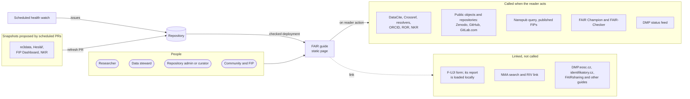
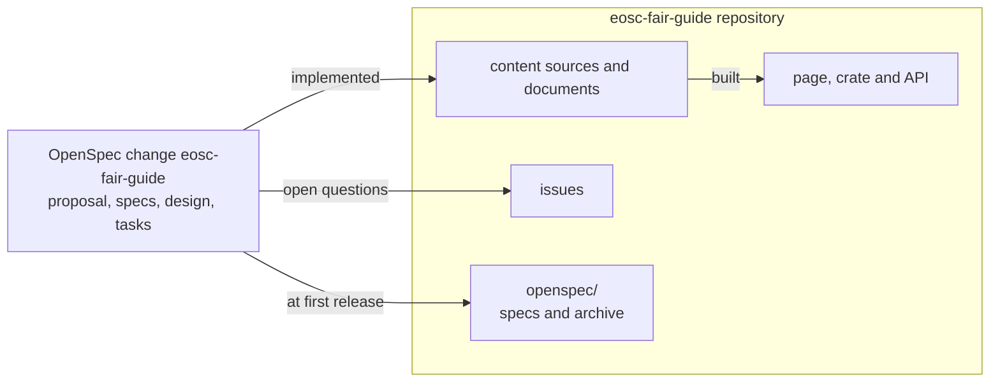
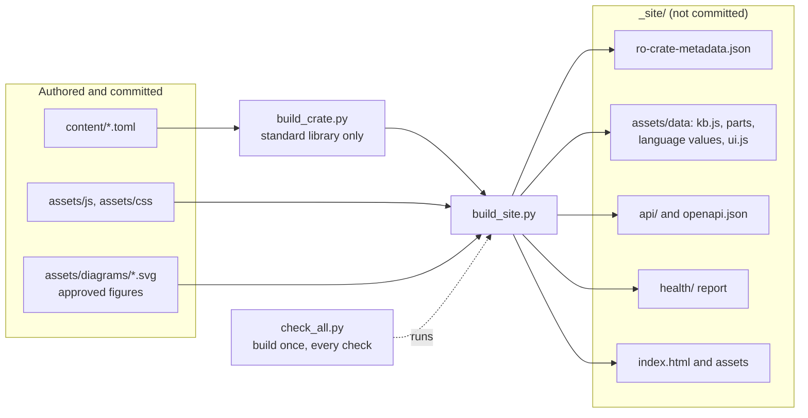
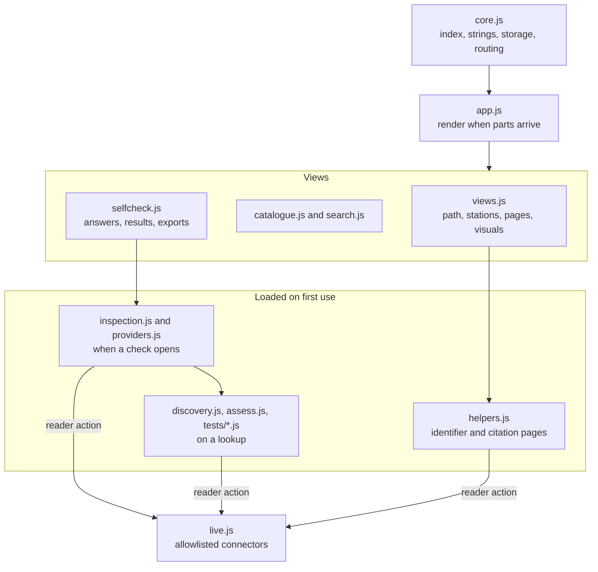
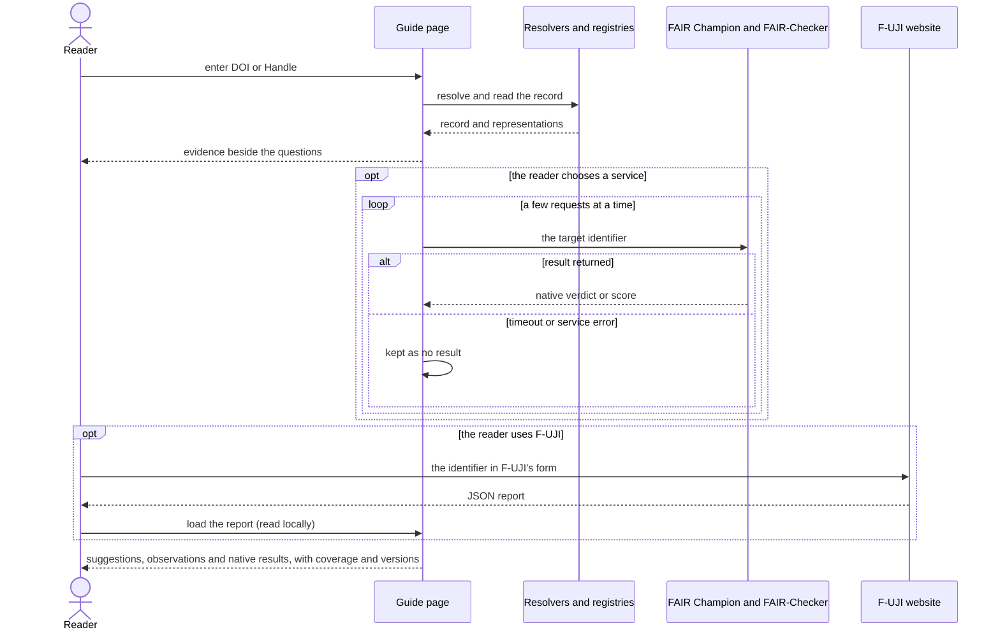
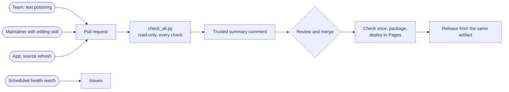
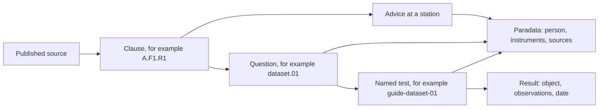

# Design

This document holds the design of the FAIR Data Guide: its goals, architecture, the decisions behind it with
the alternatives considered, and the dated decision log. The behaviour is specified in the OpenSpec change
`eosc-fair-guide`, which moves into this repository's `openspec/` tree at the first release; this document is the
guide's own, maintained account of the design. Content rules are in [content-model.md](content-model.md).

## Goals

- A self-explanatory Czech and English guide that leads each role from its current stage to the next concrete
  action.
- Current, sourced advice, with every statement traceable to a published source.
- A self-check that tells repositories what NRP requires and tells everyone where their FAIR gaps are.
- Live checks that help without overstating what automated tests can prove.
- A repository the team can maintain through reviewed pull requests.

## Non-goals

- Certifying FAIRness or NRP compliance: the guide advises, and NRP decides.
- A backend, proxy or user accounts.
- Replacing the FAIR analysis as the normative reference: the guide cites it.
- A national FIP authoring tool or FER catalogue: planned national services cover these.

## Architecture

Every diagram is paired with prose that states the same meaning; the prose is normative and the diagrams
support it.

### At a glance

- A **static page** (HTML, CSS, light vanilla JS, no backend) that can be embedded in eosc.cz, hosted on GitHub Pages, or opened as a file.
- Content is an **RO-Crate 1.2 knowledge base** with **paradata**; the page itself is the crate's HTML preview.
- The main view is a **path along the seven stages of the research data life cycle** (RDMkit), ending with a check,
  seen through **four role lenses**, with detail revealed on demand in levels L0–L3.
- A **self-check** keeps two axes apart, the NRP onboarding gate and FAIR maturity, and never shows an overall score.
- **Evaluations** are optional and started by the reader: quick discovery from public records, the curated FAIR Champion tests, FAIR-Checker's metrics and a locally loaded F-UJI report, with coverage and versions shown.
- Every change arrives as a **pull request** through the full check suite; scheduled jobs propose snapshot refreshes by PR and report source health as issues.
- **OpenSpec-driven:** the guide is planned as an OpenSpec change, which moves into this repository at the first release.

### System context

People in four roles use one static page. The page calls only the reviewed connectors in `content/live.toml`,
and only when the reader acts: DataCite, Crossref and the DOI citation formatter, the DOI and Handle resolvers, ORCID,
ROR, the NKR catalogue, the nanopublication query service (published FIPs), reviewed public object and software
origins (Zenodo, GitHub, GitLab.com), FAIR Champion, FAIR-Checker and the DMP status feed. F-UJI, NMA,
DMP.eosc.cz and identifikatory.cz are linked, not called; a F-UJI report the reader downloads is read locally.
Sources a browser cannot reach (re3data, Heslář, the FIP Dashboard while it does not admit the guide's origin, NKR
records) are kept as snapshots that a scheduled job proposes by pull request; another scheduled job watches links,
connectors, statuses and EOSC CZ pages and opens issues.

### Planning record

The guide is planned as an OpenSpec change: a proposal, five capability specs, a design and a task list. Its
decisions became this repository's content sources and design documents, and its open questions become issues.
At the first release the specs and the archived change move into `openspec/` here, so later changes are planned
in this repository.

### Authoring and build

Editors change small content source files under `content/`: stations, checks, resources, sources, the model,
live connectors and evaluators, provenance and interface strings. `build_crate.py`, which needs only the Python
standard library, turns them into the RO-Crate knowledge base and writes the same crate, with the interface
strings, as classic scripts the page loads: a core and parts loaded when a view first needs them, with language
values apart. `build_site.py` writes the page, those scripts, the static API (`build_api.py`), the published health
report (`check_health.py`) and the approved SVG figures into `_site/`, which is not committed. The page then runs
from the site directory, a web host or a local file without a build step. `check_all.py` runs the same build and
every check locally and in CI; Mermaid diagrams in the Markdown documents are checked to render.

### Content model

The entities and their relations are defined once, with the canonical entity-relationship diagram, in the
[content model](content-model.md#entities). In short: stations hold advice for lenses and levels; advice and
check questions cite clauses of published sources, which serve FAIR principles; a question names the station where
a gap is fixed; tests and external evaluators' criteria relate to questions through stated coverage; and paradata
actions record who produced or changed each item, with which instruments and from which sources.

### Runtime structure

`core.js` holds the crate index, interface strings, safe DOM building, browser storage and routing; `app.js` renders
a route once the knowledge-base parts it needs have loaded. The views are `views.js` (landing, path, stations and
pages, including the model and the reader visuals), `catalogue.js`, `search.js` and `selfcheck.js`. Code that only
some readers need loads on first use: `inspection.js` and `providers.js` when a check opens, `discovery.js`,
`assess.js` and `tests/*.js` on a lookup, and `helpers.js` on the identifier and citation pages. Every connector call
goes through `live.js`, limited to the allowlisted origins, and starts from a reader action. Self-check gaps mark
the path's stations, and pre-fill, tests and evaluators add evidence to the self-check.

### Evaluation sequence

The reader enters a DOI or Handle. Quick discovery resolves it and reads its registry record and declared
representations, which takes seconds and adds evidence to the questions. Each further evaluation starts only when
the reader chooses it: the curated FAIR Champion tests, FAIR-Checker's twelve metrics, or a F-UJI report the reader
runs on F-UJI's site and loads locally. A test or metric without a result never counts as a failure, a reader's
answer is never replaced, and coverage and versions are stated (see *Optional evaluators*).

### Change delivery

Every change arrives as a pull request: text polishing by the team, edits by a maintainer working with the
editing skill, or a source refresh proposed by the repository's App. The read-only PR workflow runs the complete
check suite (`check_all.py`: build, unit tests, content, page, accessibility, assessment, model, diagrams, API,
crate profiles and health) and publishes artifacts; a trusted default-branch workflow posts the bounded summary
comment. Review follows the gates in `CONTRIBUTING.md`, with code-owner approval required once an eligible reviewer
joins. A push to the default branch builds and checks once, packages that exact site and deploys it to Pages; a
release takes the same verified artifact. Scheduled health checks open issues instead of changing anything. The
workflows run once they are on the default branch; until then they are local preparation verified by fixtures.

### Traceability from source to screen

Published sources get clause IDs in the ledger. Advice and check questions cite those clauses, and the principle
explorer shows every clause, so condensing the path loses nothing. A question can have a named test that inspects
part of it; a result keeps the assessed object, observations and date. Each content change records a paradata
action naming the person, the instruments and the sources, shown with the content. The model page's worked example
follows the same chain for one requirement: `A.F1.R1`, question `dataset.01`, test `guide-dataset-01` and its
revision record.

## Design decisions

1. **Static page, no backend.** It is portable to an eosc.cz page whose embedding rules are unknown, to GitHub
   Pages and to a local file, and nothing needs operating.
   *Alternatives:* a plugin for the eosc.cz CMS (MuniWeb; unknown and editor-dependent); a framework single-page
   app (a heavier build and harder for the team to maintain); a server application (needs an operator).
2. **The knowledge base is an RO-Crate 1.2, and the page is its HTML preview.** The content becomes a FAIR
   digital object itself, harvestable and standards-based, and provenance has a standard home.
   *Alternatives:* plain JSON (not linked data); a Markdown static-site generator (no machine-readable content
   model); a database (needs a backend).
3. **Content authored in TOML, crate generated by a standard-library script.** TOML is readable in
   pull-request diffs for the team's text work, is read by Python's standard library. CI regenerates the crate and compares.
   *Alternatives:* hand-editing the JSON-LD crate (unreadable diffs, easy to break); YAML (needs a third-party
   parser); Markdown with front matter (structured fields such as tiers and prefill mappings become awkward).
4. **The crate is delivered standalone and as a generated classic script.** The script (`assets/data/kb.js`,
   with the interface strings in `ui.js`) keeps the page working from a file and in an iframe, keeps `index.html`
   small and readable, and lets the browser cache the data apart from the page; the standalone file serves
   harvesters, and the page head carries a short schema.org description for search engines. RO-Crate 1.2 no
   longer recommends a copy of the crate inside the preview. The script holds what every view needs; the
   standards' requirements and guidance, the FIP Dashboard snapshot (profiles and resource records) and the pages'
   text are parts of it that a view loads when it first needs them (`kb-*.js`), so the first download stays within
   the page budget as standards are ingested (D-125, D-128).
   *Alternatives:* fetch only (breaks `file://` and some embeddings); the crate inlined in the page (one large
   line in every page diff, no separate caching); every entity on demand (search, identifier chips and the
   catalogue reach nearly every entity, so only groups that few views need are parts).
5. **The backbone is a stage-aware path with four role lenses and levels L0–L3; a principle explorer keeps
   every clause.** People think in their work stage, not in principles. Lenses let one path serve
   researchers, data stewards, repository administrators and communities. The explorer guarantees that
   condensing loses nothing.
   *Alternatives:* principle-first navigation (abstract for researchers); separate tools per role (duplicated
   content); a questionnaire first (no orientation before judgement).
6. **A clause ledger with a published-sources rule.** Every statement cites ledger IDs that point to published
   sources. D-163 permits only the approved conceptual-model manuscript as in preparation; other unpublished
   material is not cited, and requirements remain traceable to their published sources.
   *Alternatives:* free-form references (not checkable); citing unpublished working material.
7. **Paradata through Process Run Crate actions.** Who produced or verified content, with which tool
   (including AI), and from which sources is recorded per content batch and shown at level L3.
   *Alternatives:* git history only (not visible to readers and not linked to sources); a changelog (too coarse).
8. **The self-check keeps two axes (NRP conditions, FAIR maturity) and shows no overall score.** The analysis warns
   that automated scores mainly reflect repository configuration and move a lot with small changes.
   *Alternatives:* one FAIR score or percentage (misleading); a maturity scale only (hides the binary NRP conditions).
9. **Evaluations are optional, started by the reader and governed by reliability rules.** The OSTrails CZ
   pilot (<https://doi.org/10.5281/zenodo.21726258>) found many calls without a verdict, a large share of
   indeterminate results and families that fail by construction. Quick discovery from public records gives instant
   value; the curated FAIR Champion tests, FAIR-Checker's metrics and a locally loaded F-UJI report are further
   choices, each reporting coverage and versions and never counting a service failure as a failed requirement
   (*Optional evaluators*).
   *Alternatives:* F-UJI's authenticated API (needs credentials and a proxy); always running every battery (slow,
   unreliable, heavy load); no live checks (loses a concrete, motivating feature).
10. **Sources a browser cannot reach, or that change slowly, enter as reviewed snapshots.** re3data, Heslář, the FIP
    Dashboard, NKR, FAIRsharing and the DataCite repositories of listed repositories refresh through scheduled pull
    requests, so the page asks none of them on demand; the health watch reports links, connectors and statuses as
    issues.
    *Alternatives:* a proxy backend (contradicts decision 1); waiting for providers to enable CORS (tracked as
    issues, not relied on).
11. **The repository finder combines the NKR, re3data, FAIRsharing and DataCite snapshots with a curated list;
    FERs come from the FIP Dashboard.** NKR is the national source but has no registered repositories yet; its published schema maps
    onto FAIR principles, which also lets the repository-administrator self-check be pre-filled from an NKR record.
    Standards, vocabularies and other FERs are shown from the dashboard snapshot with their NRP/EOSC CZ
    qualification and a link to the dashboard record.
    *Alternatives:* NKR only (currently empty); re3data only (misses NRP pilot repositories); a FER list maintained
    in the guide (a second copy of facts the dashboard owns).
12. **Diagrams are Mermaid sources pre-rendered to SVG,** following documentation
    visual conventions: approved diagram families, each diagram paired with prose.
    *Alternative:* the Mermaid runtime in the browser (heavy JavaScript, flash of code).
13. **Layered pull-request checks plus code-owner review; scheduled jobs never commit.** Checks make an edit
    safe for the page and the data; humans judge correctness and tone.
    *Alternative:* lint only (does not protect content integrity or accessibility).
14. **Licensing: MIT for code, CC BY 4.0 for content, REUSE layout.** This matches EOSC CZ outputs.
    *Alternatives:* a single licence (wrong fit for code or for content); EUPL-1.2 (considered; MIT chosen).
15. **Planning and later changes are OpenSpec-driven.** The guide was planned as an OpenSpec change. At the first
    release its specs become this repository's capability specs under `openspec/specs/`, and the change is archived
    under `openspec/changes/archive/`. OpenSpec is a pinned development dependency, so later changes to the guide
    are proposed, validated and archived here.
    *Alternatives:* planning outside the repository (future contributors cannot see why the guide is as it is); a
    design document only (no testable requirements).
16. **Visual identity: EOSC CZ, light theme, accessible tints.** Brand teal and pink are kept for accents and
    large text; darker tints carry body text to meet 4.5:1 contrast. The official logo packages are used.
    *Alternative:* raw brand colours for text (fails WCAG AA).
17. **AI tooling: `AGENTS.md` plus one editing skill mirrored for Claude Code.** It is enough for a future
    administrator to edit in line with the decisions.
    *Alternative:* generated configuration trees for many assistants (too much for this repository).
18. **The FIP completeness check is pre-filled from the community's profile in the FIP Dashboard, with a
    published nanopublication as the fallback.** The dashboard holds national FIPs with declarations per principle
    and a status for each (in use, planned, under consideration, to be replaced); it is read from the snapshot and,
    once its API admits the guide's origin, live. FIP Wizard publishes FIPs as nanopublications that the
    nanopublication query service serves to browsers; this adapter covers profiles outside the dashboard and keeps
    the pre-fill working if the dashboard is unavailable, in the pilot and in production. A principle with no
    declaration stays open with a note, because a missing declaration does not prove a gap.
    *Alternatives:* manual answers only (ignores published work); the dashboard only (no fallback); nanopublications
    only (misses the national catalogue).
19. **The guide and the FIP Dashboard are two facets of one service.** The dashboard (the national FER catalogue,
    into which NKR-qualified FERs move, open to resources from anywhere) answers "which resources and profiles";
    the guide answers "what to do and why". They share principle IDs, CZ/EN texts and the FIP vocabulary, link to
    each other's records, and go through the same review round. The dashboard owns FER facts; the guide refers to
    them by dashboard ID. While the dashboard's API does not admit the guide's origin (`browserAccess = false` on
    the `fip-dashboard` connector), the guide uses the snapshot, names its date and the dashboard's disclaimer where
    it is used, keeps the snapshot as the source when a live request fails, and receives refreshes as pull requests
    (*Snapshot refresh*); setting the connector to browser access makes the page read the dashboard live with the
    snapshot as its fallback.
    *Alternatives:* a link to the dashboard only (users stitch the two together themselves); copying FERs into the
    guide (two owners of one fact).
20. **A testing-phase notice is driven by the release status.** Until EOSC CZ agrees the guide, `content/guide.toml`
    carries the status "testing" and every view shows a notice. The release that records the agreement changes the
    status, which removes the notice.
    *Alternative:* a hard-coded banner (easy to forget when releasing).

## Spikes and findings

### RO-Crate validation (2026-10-08)

rocrate-validator 0.12.2 supports RO-Crate 1.2, Process Run Crate 0.5 and user profiles loaded with
`--extra-profiles-path`. It builds a profile's identifier from `prof:hasToken` and the version that ends the
profile IRI, so the guide's profile in `profile/fair-guide/` is `fair-guide-0.1`. The checks run as three
passes:

- RO-Crate 1.2, with every requirement level;
- Process Run Crate 0.5 with profile inheritance disabled (`-nh`), because the validator declares that profile on
  top of RO-Crate 1.1 and would otherwise require a 1.1 metadata descriptor;
- the guide's profile, also with `-nh`.

Required checks must pass. Recommended findings that remain are accepted:

- the validator does no subclass inference, so it reports `HowToDirection`, `Question` and `DataCatalog` results
  of provenance actions as not being `CreativeWork`, although schema.org defines them as subclasses;
- it expects `actionStatus` as a string, while Process Run Crate examples use the IRI
  `http://schema.org/CompletedActionStatus`, which the crate keeps;
- the guide's own `rdf:Property` terms have no schema.org type.

Two validator findings changed the model: every `SoftwareApplication` needs a `version`, so FAIR Champion tests
are `CreativeWork` entities typed `ftr:Test` through `additionalType`; and in-page action targets are references to
crate entities (`#repositories`, `#check-gate`) rather than plain strings.

### Paradata granularity (2026-10-08)

Process Run Crate 0.5 admits `CreateAction`, `ActivateAction` and `UpdateAction`; an action needs an
`instrument` that is a `SoftwareApplication`, `SoftwareSourceCode` or workflow, and should name an agent, a
result and an end time. The guide records one action per content batch: `create` for new items and `update` for
changed ones. A result pattern with a trailing `*` covers a whole station or ledger section. The AI model and
the assistant runtime are named as instruments; the generator is not, because it transforms content rather than
authoring it. With `--base <ref>`, `check_content.py` requires an action newer than the point where the branch
left that revision for every item whose source changed; `check_all.py` uses the remote's default branch unless told
otherwise, so a local run judges the same changes as the pull request. One list (`provenance_items`) names what
needs paradata: the guide's metadata, clauses, advice, questions, resources, tests, organisations and the model.
Every item on it must be covered by some action, and every changed item by a fresh one.

### FIP declarations from a nanopublication (2026-10-08)

The fallback source for the FIP pre-fill is the nanopublication query service. A SPARQL query over
`https://query.knowledgepixels.com/repo/full` follows a FIP to its declaration index, from the index to each
declaration nanopublication, and from each declaration to the FIP question it answers and the resource it declares.
The service sends `Access-Control-Allow-Origin: *`, so the page can call it directly; for a published FIP (the
ADVANCE project's profile) it returned 27 declarations in about half a second. Findings that shaped the adapter:

- a FIP is published under three IRI forms, `https://w3id.org/np/<code>#fip`, `https://w3id.org/np/<code>/fip`
  and `http://purl.org/np/<code>#fip` (165, 31 and 39 of the 235 FIPs the service listed), so the query lists all
  three and the export names the one that matched; the page accepts the trusty URI code on its own or inside an
  address;
- 232 of those 235 FIPs have a declaration index; the query found declarations for every FIP in a sample of eight
  once it listed all three forms;
- questions are IRIs of the form `https://w3id.org/fair/fip/terms/FIP-Question-<question>`, where the question is
  the code that `prefill.fip` uses (`F1-D`, `A1.1-MD`, …);
- the relation carries the status: `declares-current-use-of` is "in use", `declares-planned-use-of` is "planned"
  and `declares-planned-replacement-of` is "to be replaced";
- declared resources use `http://purl.org/np/…` IRIs, which purl.org also serves over HTTPS, and a resource can
  carry several labels, so the page links the HTTPS form and lists each resource once.

The query lives in `content/live.toml`, not in the scripts, so it can change with the service without a code
change. The FIP Dashboard API, the primary source, answered only its own development origin in a cross-origin
check on the same day, so the page uses the dashboard snapshot until `browserAccess` is switched on.

### FAIR Champion and the NMA search link (2026-10-08)

FAIR Champion tests are called with `POST <endpoint>/<test>` and the body `{"resource_identifier": …}`, as each
test's OpenAPI description at `https://tests.ostrails.eu/tests/<test>/api` states. The service sends
`Access-Control-Allow-Origin: *`, also on its pre-flight answer, and returns JSON-LD whose `ftr:TestResult` carries
`prov:value` (`pass`, `fail` or `indeterminate`) and `ftr:log`. A probe of the ten curated tests with a Zenodo DOI
and a LINDAT Handle confirmed the pilot's reliability findings: the DOI got HTTP 500 from eight tests within a
second, the Handle got verdicts from nine tests in 0 to 54 seconds, and the author-affiliation test gave no verdict
for either. That test is marked `degraded` in the health snapshot; the others are `available`.

NMA's search page is `https://nma.eosc.cz/datasets/?q=…` (`/search?q=` redirects there). A DOI in quotes finds the
record when NMA holds it and shows an empty result otherwise, while the direct record address
`/datasets/records/doi/<doi>` answers 404 for a dataset NMA does not hold. The guide therefore links the search
with the quoted identifier.

## Review round 1

A review of the first working version (2026-10-08) reshaped the experience before the remaining live-check helpers
were built. A small throwaway prototype covered only the parts that needed a decision: the landing, one station and
the self-check. The decisions below record the maintainer's answers; the decision log carries the rows.

### Landing

- One search box leads. Results from the guide's own content appear while typing and end with a link to the same
  search in the catalogue, which is the full results page. An identifier is routed by what it denotes: a re3data
  record (r3d identifier, record address or re3data DOI) and an NKR record lead to the maturity check, a FIP
  nanopublication or FIP Dashboard profile to the FIP check, a ROR ID to the institution check and an ORCID iD to the
  identifier helper. The guide's own identifiers (requirements, check questions) and addresses the catalogue lists
  lead to their catalogue entry and answer while typing, because nothing is sent. A generic DOI or Handle first
  offers "Zjistit, co to je": one lookup of the registration agency at doi.org and, for DataCite, the resource type,
  which says what the identifier denotes and where the answer came from, then leads to the dataset check (data, and
  software with a note), the citation (publications) or, for a FAIRsharing record naming a re3data record, the
  maturity check. The tools that suit any identifier (dataset check, citation, NMA search, identifier helper) stay
  beside it. Routes to outside services appear on Enter, with a hint while the identifier is typed; nothing is sent
  while typing.
- The landing shows the path as the RDMkit research data life cycle (RDMkit linked to its life-cycle page): a ring of
  the seven stages, each an arrow into the next and reuse leading back to planning, beside the same stages as a
  numbered list naming their steps. The stage colours make one turn of the colour wheel from the EOSC CZ teal at one
  lightness and chroma; the stage names are set in Plus Jakarta Sans. The stage of the step read last stands out of
  the ring and is marked in the list; a stage pointed at in the ring, or focused in the list, grows above its
  neighbours. The drawing is cut to what it shows, so it fills its column; on a phone the names are left to the list.
  Nothing is chosen up front: the stage a reader is in follows from the step they read.
- The main menu calls the path "Path to FAIR" ("Cesta k FAIR"); "Path" alone did not say where it leads. The
  landing is its own first menu item ("Úvod" / "Home"), and "Path to FAIR" opens the station the visitor was last
  at.
- The line on what the content is based on, the privacy promise and the date moves to the bottom of the landing,
  and names the FAIR analysis as a link.
- Task shortcuts follow the order of the path, then institution-level and community tasks:

  | Lens | Shortcuts, in this order |
  | --- | --- |
  | Researcher | Prepare a data management plan · Choose a repository · Choose a licence · Cite data · Check a dataset · Output for Open Science III or a mini-project |
  | Data steward | DMP templates and the planning tool · Check a dataset with a researcher · Output for Open Science III or a mini-project · Institution check (strategy and the research act; action plan, policy and infrastructure when extended) · Training for the team · Data steward community and map |
  | Repository administrator | Found a repository in NRP · NRP conditions · Connect to NMA and register in NKR · Repository FAIR maturity · Deep check of sample records |
  | Community / FIP | Find the community's profile in the FIP Dashboard · FIP completeness · Create or update a FIP in FIP Wizard · Domain standards and vocabularies · EOSC CZ working groups |

### Station

- Principle tiles (a coloured F/A/I/R letter with the code and short title) stay as prototyped.
- The "what to do now" level is a lighter callout: no background, an accent line beside the text, and a smaller
  action button on the right, so it guides without dominating.
- Links in running text use a dotted underline that becomes solid on hover.
- Every link to an external URL opens in a new tab and says so to assistive technology; this includes the EOSC CZ
  logo in the header.
- The provenance line on a station says only what the content is based on, its date and a link to the details;
  the statement on AI use and human review lives in the details and on the about page.
- The footer gives the full citation of the guide as software (editor, title, version, year, publisher,
  repository) next to the credit for the analysis, instead of a bare "compiled by". The about page lists the roles
  (authors of the analysis, compilation and development, editorial review, tools, funding) in a table generated
  from the guide's metadata, and each station ends its levels with one sources line that opens the full detail.
- `CITATION.cff` credits the guide's software, with its author, because the format has no top-level editor role;
  its message points to the guide's citation with the editor role, and the analysis is listed under `references`.
- The station rail gets simple top and bottom rules so it does not float; the legend for the self-check marks is
  set apart and aligned with the icon column.

### Self-check

- The split view, the evidence line beside each criterion, the grid of principles in the result and the
  explanation of the basic tier stay as prototyped.
- Beside the questions on wide screens sits a short, sticky "result so far": progress, one chip per principle (or
  gate condition) that leads to its items, and the counts of gaps and things to find out that lead to the full
  result. It never scrolls on its own; a small icon collapses it, and the choice is remembered in the browser. The
  full result and the saving and loading actions follow the questions, so on narrow screens they simply come next.
- The extended check is an on/off switch in a control row with the grouping (by FAIR principle by default, or by
  path step, also remembered). Every item names the step where it is addressed; the tier badge shows only on items
  outside the first view's tier.
- The result covers the items the view shows, every item once the check is extended, and any item answered, so an
  answer to an extended item still counts after returning to the basic items.
- A pre-fill records the fields it read with the values found (at most three per field) and a link to the record:
  the DataCite Commons page, the resolved landing page, the NKR record or the FIP profile. The same evidence is in
  the Markdown summary and in each exported test result (its log and `prov:used`).
- Each identifier field has a clear control that removes the identifier with the answers it pre-filled and keeps
  the answers the user gave.
- The summary beside the questions mirrors the list: one chip per question in the list's groups (by principle, or
  by path step with the path's icons); the full result uses the same groups, opening with a headline of counts per
  state and cards for what is missing and what to find out; the check's controls sit in the summary on wide
  screens.
- Every identifier that resolves says what it is: for a DOI its title, first author, publisher, year and type; for
  a Handle the landing page's title; for an NKR, re3data or FIP record its name. The line appears under the field,
  the result names what is checked, and the exports carry it. This applies to every identifier helper.
- Exports carry their format (`eosc-fair-guide-result`, version 1) and the guide's version. Loading tells apart a
  file the guide did not make, a damaged file, a newer format and an unknown check; questions the current version
  does not know are skipped with a note, in files and shared links alike.
- The repository maturity check can be filled in from re3data: the field takes a re3data DOI (resolved through
  doi.org), an r3d identifier or the record's address. re3data does not admit browser requests, so the facts come
  from the reviewed re3data snapshot; a repository outside it is named and linked, not guessed.
- The check of the NRP conditions is called "Podmínky NRP" (NRP conditions); its identifiers stay `gate`.
- A check starts from public records or from a saved result: both are offered at the top under "Předvyplnit
  odpovědi" (pre-fill the answers). Before the mode or profile is chosen, and for a check without public records,
  the saved result alone is offered, as on the self-check overview; loading is not repeated among the saving
  controls.
- A station reads, under its title and its place in the life cycle (the stage and, where the stage holds several
  steps, which of them it is): the key point, "Co udělat teď" with its actions, the Heslář terms, then "Jak na to",
  "Proč", "AI ve FAIRifikaci", the callouts and "Zdroje a vznik obsahu" with the provenance line, and last the
  resources as compact cards leading to their whole catalogue entries, the routes to advice and the pager. Authored
  explanations in "Proč" read as prose; one that names a service not yet in full operation is set apart as a status
  note. Callouts keep their frame but stay closed until the reader opens them: their question says whether they apply.
- Findings of the visual pass over the other pages: before a principle is chosen, the explorer shows how many
  requirements each FAIR group holds by whom they address (on phones by the principle's letter); a page that holds
  a helper (`helper = true`) says the helper is still being built until the page script provides it; on phones the
  language switch shares the logo's row; cards keep even padding; stage-card descriptions are set in regular weight;
  the about page describes the station history as it is (sources and dates, with people and tools in the paradata).
- FAIRsharing's API needs a login, so the snapshot refresh finds FAIRsharing records through their DataCite DOIs
  (prefix `10.25504`), whose metadata lists the described repository's addresses, including its re3data record. Each
  record found joins its repository at build time, among its identifiers and its sources; the maturity check answers
  "registered in re3data and FAIRsharing" from the re3data and FAIRsharing snapshots, and leaves it open without the
  FAIRsharing snapshot. A repository the search does not find may still be registered, and the page says so.
- A repository's sources ("Vychází z") lead to the sources' own catalogue entries (re3data, NKR, FAIRsharing,
  DataCite, the FIP Dashboard), and its record in each source is among its identifiers, shown as chips (D-185).
- DataCite describes a repository it registers DOIs for. The DataCite snapshot names the DataCite repository of each
  listed repository whose re3data record DataCite knows; the finder offers DataCite's figures only for repositories
  with a DataCite repository, curated or from that snapshot. It reads, on request, the number of its DOIs and the
  leading resource types, licences and metadata schema versions, dated, and links its DataCite Commons page and
  Metadata Dashboard. DataCite finds the repository by its re3data record's DOI (from the re3data snapshot) or by a
  reviewed DataCite repository ID (`datacite`). The maturity check draws its sample from the same API: records of the
  repository's datasets (or its most common resource type) at random, without records that are part of another, as a
  file Dataverse registers within its dataset is; the records are listed with titles before any test runs, each can be
  replaced, and the field stays editable. Citation, view and download counts are not shown, because zero there often
  means "not reported"; the Metadata Dashboard's completeness endpoint is linked, not called, while undocumented.
- Every page sits under a main-menu item, declared in its content (`menu`): "Nástroje a postupy" (Tools and guidance) lists the helpers and
  the AI advice as cards and stays current on each of them; "O průvodci" covers the about page and the accessibility
  statement. The content checks refuse a page without a menu item.
- The catalogue ("Katalog") replaces the separate resource and repository menu items with one list narrowed by
  facets with counts. Kind (resources, repositories, requirements, check questions, glossary terms, FIP profiles,
  FAIR tests, content changes) is a single choice that shows every kind with its count; search, station and
  principle apply across kinds and stay when the kind changes, and a kind without that dimension shows none and says
  why; a kind whose entries carry no station or no principle shows no such facet or order, FIP profiles take their
  principles from their declarations and content changes the stations and principles of what they changed; the
  facets of the chosen kind are grouped under it and reset when the kind changes.
  Resources and cited sources are one kind marked by usage (recommended by the guide, basis of the content, in the
  FIP Dashboard), with the dashboard's own resources folded in. The reader chooses the ordering and groups follow
  it; the whole state is part of the address, so a filtered list is a link, and older addresses select their kind.
  Content changes show date, kind and description and leave who and with which tool to the paradata. The lens is a
  facet of the resources that starts from the reader's lens and leaves works without an audience in. On phones the
  facets sit in a closed "Filtry" disclosure above the results. The page for machines ("Data pro stroje") sits in the
  header beside the language switch and the source repository (D-115) and teaches by example (D-114): a table of what a reader wants and where it is, how the guide applies its
  own advice with the signposts the head carries, and every API endpoint, the accessible counterpart of the API
  documentation. Each catalogue entry links to its record in the corner of its card, and each view offers its own
  content as data under it.
- Identifiers resolve to the catalogue. Wherever the guide cites a requirement or finding (the stations' "Proč", the
  explorer, a check question's basis), the text comes first and a quieter line follows with the identifier as a
  chip linking to its catalogue entry, and the source. The catalogue lists all of them under "Požadavky", grouped by
  source with kind, audience, principles, status and where they are used, and every check question under "Otázky
  kontrol" with the requirements it rests on. A link to one entry clears the filters, brings the entry to the middle
  of the view and marks it briefly. Search results for requirements lead there as well.
- One curated entry per real-world thing (task 8.27): a resource the guide also cites carries its citation, the
  catch-all repository is its resource with repository facts, curated organisations link the FIP Dashboard records
  they match, and the content checks enforce one ID per entity, no shared address or DOI, links to matching snapshot
  records and a warning for unused entries. Names the guide uses for publishers only as plain text are not yet
  matched against snapshot organisations.

### Answers that stay in the browser, and can travel

The self-check keeps answers only in the user's browser. The review asked that this be said clearly, understood at
a glance, and made useful:

- **Said where it matters:** each check and the self-check overview carry one short statement ("Your answers stay
  in this browser; you can move them as a file or a link") with a "how it works" disclosure: what is stored (the
  answers, the chosen mode or profile, the identifiers entered and the evidence found), where (this browser's
  storage for this site only; other browsers and devices do not see it, and private windows forget it), what is
  sent (nothing, except an identifier to the named service when the user starts a lookup), how to move it, and how
  to delete it.
- **Deletable:** one control removes everything the guide stores in the browser, after a confirmation.
- **Portable:** the JSON-LD export carries the native answers, the check, the mode or profile, the assessed target,
  every identifier entered with what it turned out to be, and the evidence, so a file can be loaded back; the
  Markdown summary ends with the same state, encoded in a comment a reader does not see, after the compact payload a
  shared link carries (which alone is enough for summaries from an earlier version). A file loaded into the guide opens as a preview, exactly
  like a shared link, and replaces the user's answers for that check only on request. Files the guide did not
  produce are refused with a message.
- **Readable by services:** the JSON-LD remains an FTR test result set in an RO-Crate, so other services can read
  the same file the guide reloads.

## Decision log

Source: **U** = decision of the maintainer, **S** = proposal from analysis, agreed by the maintainer.

| ID | Date | Decision | Src |
| --- | --- | --- | --- |
| D-01 | 2026-10-07 | Refresh *Analýza FAIR NRP/NDI v1.2* into an interactive, self-explanatory CZ+EN guide for an eosc.cz page. Live demo, then handover to the team for polishing. | U |
| D-02 | 2026-10-07 | Backbone is a **stage-aware lifecycle path**: PLÁN → PRÁCE → REPOZITÁŘ → POPIS → LICENCE A PŘÍSTUP → PUBLIKACE → DOHLEDATELNOST → CITACE A UZNÁNÍ → KONTROLA. A one-question stage entry opens the path; earlier stations are collapsed, not hidden. | U |
| D-03 | 2026-10-07 | **Four role lenses** on the same path: researcher, data steward, repository admin/curator, community/FIP. The path is the most desired feature; data stewards and repository admins are the most common users and translators. | U |
| D-04 | 2026-10-07 | "Rich, but on demand": disclosure levels L0 (what to do now), L1 (how), L2 (why: principles, CTS, CDIF 1.1, NRP rules), L3 (sources, FER IRIs, paradata). | U |
| D-05 | 2026-10-07 | Features: F0 shell · F1 path · F2 principle explorer · F3 self-check per role (incl. NRP onboarding gate) · F4 resource finder · F5 live check · F6 freshness. Discussed one feature at a time. | U |
| D-06 | 2026-10-07 | Stack: static HTML + CSS + light, safe vanilla JS. No backend, no build step for the page. Portable to an iframe, an inline block or a standalone page (target page unknown). | U |
| D-07 | 2026-10-07 | Knowledge base is an **RO-Crate 1.2** (`ro-crate-metadata.json`); `index.html` doubles as `ro-crate-preview.html`. **Paradata** follows Process Run Crate (CreateAction: agent, instrument, object, result, endTime). | U+S |
| D-08 | 2026-10-07 | Reuse standard IRIs: FAIR principles `w3id.org/fair/principles/terms/*`, published FER nanopub IRIs, FAIRsharing DOIs, FIP ontology classes, schema.org / DCAT / SKOS / dcterms. | U |
| D-09 | 2026-10-07 | Live calls only on user action, with graceful fallback. OK: DataCite REST (metadata, citation), FAIR Champion, nanopub query, Upptime JSON. Not usable from a browser: FAIRsharing API (login), Heslář API (no CORS), F-UJI (no CORS). | S |
| D-10 | 2026-10-07 | No built-in NRP FAIR check. Use external tools, with **FAIR Champion preferred**. Present scores as feedback on repository setup, not as a judgement of the author (report §5.2.1). | U |
| D-11 | 2026-10-07 | Tone is advisory and matches EOSC CZ materials; no enforcement wording beyond the actual NRP conditions (v3.4). | U |
| D-12 | 2026-10-07 | Sensitive data gets a short callout ("FAIR ≠ otevřená") with a combination of pointers; the user chooses the target. | U |
| D-13 | 2026-10-07 | Station "CITACE A UZNÁNÍ" leads with citation practice. RIV result type T is a factual note, never hype. Includes a citation helper from a PID. | U |
| D-14 | 2026-10-07 | PIDs: DOI is the recommended, most instructive option, **not the only valid one**. Handle, ARK, URN:NBN and others are acceptable if persistent, resolvable and managed. | U |
| D-15 | 2026-10-07 | CCMM wording: NMA works with **1.1.0**; "podpora 2.0.0 se připravuje (2027)" (likely a v2→v1 XSLT; meeting info, not guaranteed). Forward-looking advice may reference 2.0.0. | U |
| D-16 | 2026-10-07 | FIP/FER: no separate national FIP Wizard. The FER catalogue is a closed pilot, so keep a **placeholder** (user will supply a link). NKR will host approved qualified FERs; each repository is described by its FIP. | U |
| D-17 | 2026-10-07 | **No licence-selector placeholder**; the DSW plugin in dmp.eosc.cz is the deliverable. | U |
| D-18 | 2026-10-07 | DMP is a cornerstone: dmp.eosc.cz with funder templates (GA ČR, TA ČR, AZV ČR, MŠMT, Horizon Europe, Science Europe) and the CCMM export template. | U+S |
| D-19 | 2026-10-07 | AI transparency in a footer, an "O průvodci" page and per-item paradata. "AI ve FAIRifikaci" is an overlay per station plus an overview page linking CERIT AIaaS. Guardrails: keep unpublished data on-premise, verify every identifier, declare AI use. | U |
| D-20 | 2026-10-07 | Accessibility: EU Web Accessibility Directive (EN 301 549 / WCAG 2.1 AA; CZ zákon 99/2019 Sb.); target **WCAG 2.2 AA**; publish an accessibility statement. | U |
| D-21 | 2026-10-07 | UX is critical. Anti-dropout patterns: one-question entry, next best action, one concrete action per station, time estimates, glossary popovers, an escape hatch, remembered progress. Test with EOSC CZ personas. | U |
| D-22 | 2026-10-07 | Visual identity: brand teal #008691 and pink #EB5D81 only for accents and large text; text tints #00737D and #C2264F (both ≥ 5.6:1 on white). Muni font only inside eosc.cz pages; Arial/Helvetica fallback. | S |
| D-23 | 2026-10-07 | Diagrams in **Mermaid**, and they must look good. Follow documentation visual conventions: approved families only, every diagram paired with prose (which doubles as the text alternative). | U |
| D-24 | 2026-10-07 | Paradata agents: David Novák (ORCID 0000-0001-6592-6291) as implementing author, others as contributors; reviewed later. Text polishing goes to the team. | U |
| D-25 | 2026-10-07 | Repository `github.com/motyc/eosc-fair-guide`: private now, public later. Best-practice contents (README, licences, CITATION.cff, CONTRIBUTING, CHANGELOG…). Minimal AI tooling plus **one dedicated editing skill**; keep it light. | U |
| D-26 | 2026-10-07 | Not hosted on third-party AI artifact hosting (EOSC CZ branding). Preview locally until the repository is public, then use GitHub Pages or the target page. | S |
| D-27 | 2026-10-07 | Glossary source: **heslar.openscience.cz** (NTK), snapshotted at authoring time and linked back (licence to check). PID centre: **identifikatory.cz**. | U+S |
| D-28 | 2026-10-07 | Draft checklists and handbooks for repository administrators are supportive input only, not decisions. JSON-LD (schema.org) landing pages are desirable. | U |
| D-29 | 2026-10-08 | **CI must validate PR contents** so an edit is safe to accept once checks pass. Layers: structure, content contract, page integrity, accessibility, links, diagrams, repo hygiene, review aids. Hardened workflows. | U |
| D-30 | 2026-10-08 | Licences: **MIT** (code) + **CC BY 4.0** (content), REUSE layout. | U |
| D-31 | 2026-10-08 | README pair: Czech `README.md` and English operational `README_en.md`. | U |
| D-32 | 2026-10-08 | Light theme only for v1. | U |
| D-33 | 2026-10-08 | Sensitive-data callout uses **all five pointers** (data steward/DPO, Etické sedmero, Sensitive Cloud, sensitive-data AAI architecture, EOSC CZ WG), ordered as steps and filtered by lens, so it reads easily. | U |
| D-34 | 2026-10-08 | Repository discovery: **NKR connector** (Cordra REST at repo.cz, CORS ok, Repository schema published, no repositories registered yet) + **re3data** snapshot (no CORS; 14 CZ entries via `api/beta/repositories?countries[]=CZE`) + a curated layer (MBDB, datarepo…). Deduplicate via `relatedRegistry` and URL. | U+S |
| D-35 | 2026-10-08 | Branding from <https://www.eosc.cz/o-nas/sablony-eosc-cz> (logo zips, EU+MŠMT logolink; no design manual). Acknowledgement text from <https://www.eosc.cz/o-nas/acknowledgement> in the footer / about page. | U+S |
| D-36 | 2026-10-08 | Non-CORS sources (re3data, Heslář, FER lookups) and link health are refreshed by **scheduled CI jobs that open a PR** for human review, never by silently committing. | S |
| D-37 | 2026-10-08 | NKR Repository fields map onto FAIR principles, so the repository-admin lens can **pre-fill a self-check from the repository's NKR record** and show what is missing in that record. | S |
| D-38 | 2026-10-08 | The guide is an official **NRP KA 5.1** output, so the mandatory NRP acknowledgement (CZ/EN, CZ.02.01.01/00/23_014/0008787) goes in the footer and the "O průvodci" page. | U |
| D-39 | 2026-10-08 | Inventory method: a clause ledger (`content/ledger.toml`). The principle explorer (F2) is the lossless home for every report clause; path stations cite clause IDs; L2 is generated from the ledger. Report chapter IDs use a `K` prefix so they cannot be mistaken for principle names. | S |
| D-40 | 2026-10-08 | **Published requirement sources.** Every normative requirement is traced to its published source. D-163 introduces the sole, explicitly approved exception for the conceptual Layers-and-Seams manuscript, cited as in preparation without supplying ledger requirements. | U |
| D-41 | 2026-10-08 | Outstanding open questions become **issues in this repository**, filed as one of the last steps, so they can be resolved there. | U |
| D-42 | 2026-10-08 | The AI warning is made helpful through a shared "Ověřte identifikátory" callout plus a light on-demand helper. The helper resolves ORCID, ROR, DOI and Handle in the browser and shows the name or title. Kept light; drop it if it grows. | U+S |
| D-43 | 2026-10-08 | NMA: the public REST API has no CORS, so "is my dataset in NMA?" is a pre-filled deep link into NMA search. The station explains the "Získat odkaz pro RIV" flow and states that **the RIV link never replaces the PID** (NRP docs). Anyone can create a manual NMA record. | U+S |
| D-44 | 2026-10-08 | The final text polishing is done by the team **via PRs on the live page**, after everything else is finished. | U |
| D-45 | 2026-10-08 | Live checks are **two-stage**. A deterministic quick check (DataCite, doi.org / hdl.handle.net, ORCID, ROR) comes first; FAIR Champion is an opt-in deep check limited to a curated core set, with gentle load, four outcome states and coverage always shown. A service failure never counts as a failed requirement. Grounded in the OSTrails CZ pilot (E.OSTRAILS-CZ). | U+S |
| D-46 | 2026-10-08 | F3 design: two axes (Brána NRP × Zralost FAIR), no overall score, gaps route back into path stations; pre-fill from NKR (repositories) and DataCite (datasets) with visible source chips; export as Markdown, print and an FTR `TestResultSet` in a small RO-Crate. | S |
| D-47 | 2026-10-08 | Gate profile (a), core NRP systems: G09 (security monitoring) and G10 (central logging) show as **„zajišťuje NRP“**. Confirmed by the user; the NRP repositories page states that NRP provides storage, repository software and the operating environment. | U |
| D-48 | 2026-10-08 | An optional **institution check** (data policy, DMP support, storage, OS III strategy) is included if it fits the scope; it is lower priority than the four lens checks. | U |
| D-49 | 2026-10-08 | **FIP pre-fill is in the first release:** the FIP completeness check (K) reads the community's published FIP nanopublication through the nanopub query service. Declared FERs pre-fill "ano"; questions with no declaration stay open with a note. | U |
| D-50 | 2026-10-08 | The repository is renamed to `motyc/eosc-fair-guide` so its name suits reuse; the vocabulary and profile IRIs follow the new name. | U |
| D-51 | 2026-10-08 | The FER catalogue is the **FIP Dashboard** (<https://fip-dashboard.dmp.eosc.cz>, API <https://fip-dashboard.dmp.eosc.cz/docs>). It will become the official national FER catalogue, into which NKR-qualified FERs move; it accepts resources from anywhere and marks some as NRP/EOSC CZ qualified. It goes through the same review round as the guide. | U |
| D-52 | 2026-10-08 | rocrate-validator 0.12.2 validates RO-Crate 1.2, Process Run Crate 0.5 (with inheritance disabled) and the guide's own profile; Process Run Crate admits `UpdateAction`, and paradata are recorded per content batch (see *Spikes and findings*). | S |
| D-53 | 2026-10-08 | The guide and the dashboard are **two facets of one service**; the dashboard owns FER facts and the guide links to its records with their qualification. Dashboard data (sample, v0.1.0) enter as a reviewed snapshot with the dashboard's own disclaimer shown while present; the API is used live once it admits the guide's origin. FIP pre-fill: dashboard profile first, published **nanopublication as the fallback** in the pilot and in production. | U+S |
| D-54 | 2026-10-08 | A visible **testing-phase notice** stays on every view until the guide is finished and agreed by EOSC CZ; it is driven by the release status in the content. | U |
| D-55 | 2026-10-08 | At the first release the OpenSpec change **moves into this repository** (specs to `openspec/specs/`, change to the archive); OpenSpec is a pinned development dependency, so later development is OpenSpec-driven. Nothing in this repository exposes local machine details or the planning environment's internals. | U |
| D-56 | 2026-10-08 | Self-check pre-fill uses **positive evidence only**: a field, declaration or resolution that is present answers yes (or partly when it proves the item only in part, `prefillLevel`); absence leaves the item open with a note, because a record that omits something does not prove it is missing. A pre-filled value never replaces an answer the user gave, each pre-fill shows its source and date, a changed answer stays marked, and choosing another dataset, repository or profile discards the previous one's evidence. The FIP nanopublication query is recorded in *Spikes and findings*. | S |
| D-57 | 2026-10-08 | Results export as Markdown, print and an FTR `TestResultSet` in a small RO-Crate (yes is `pass`, no is `fail`, partly and don't know are `indeterminate`; not applicable and items NRP provides are left out). The export is a valid RO-Crate 1.2; its licence is declared as not specified, because the person who saves the result decides on reuse. Exports and shared links name the published page (`pageUrl`), never a local file. A shared link carries only the mode, the profile and the answers, opens as a preview, and replaces the user's own answers only on request. "Don't know" names whom to ask and, where an item has one, a lookup link. | S |
| D-58 | 2026-10-08 | Live connectors: ORCID and ROR names, resolver titles, FAIR Champion tests (verdict and log; any failure to get a verdict is "no result") and the DMP.eosc.cz status page. The NMA deep link is the search page with the quoted identifier. Spikes in *Spikes and findings*. | S |
| D-59 | 2026-10-08 | A review of the first working version opens **review round 1** before the remaining live-check helpers; only the parts that need a decision are prototyped first (landing, one station, self-check). | U+S |
| D-60 | 2026-10-08 | The lens switch becomes a **band of four icon-and-label links** under the main menu, shown on the path, the self-check overview and the resource finder only; switching keeps open levels and the scroll position. | U |
| D-61 | 2026-10-08 | Visual anchors use **Font Awesome Free** (as eosc.cz does) and the **FIP Dashboard's F/A/I/R colours**, darkened only for contrast; principles always appear as code plus short title. | U+S |
| D-62 | 2026-10-08 | **Credit model:** the footer credits the FAIR analysis authors and gives the guide's own citation with its compiler as **editor**; the about page lists roles; each station shows one sources line without names; full paradata stay in the crate. | U+S |
| D-63 | 2026-10-08 | Self-check: **split view** with a live result, grouping **by FAIR principle** with a toggle to path steps, **evidence beside each criterion** (also in the exports), a clear control on identifier fields, and a stated meaning of the first-view tier. | U+S |
| D-64 | 2026-10-08 | One **catalogue** with a tab per entity type (the explorer stays separate), a **page for machines**, a JSON link on every item, **exports from every view**, and **links from text** through explicit references in the content files. | U+S |
| D-65 | 2026-10-08 | A **static read-only API** (OpenAPI 3.1, JSON with a JSON-LD context, paths aligned with the FIP Dashboard API, FTR definitions of the checks) with **Swagger UI**; the dashboard's next iteration is its first intended consumer. | U+S |
| D-66 | 2026-10-08 | **Generated files are built at deployment and never committed**; pull requests carry authored files only; reviewed snapshots stay committed. | U |
| D-67 | 2026-10-08 | The Swagger UI page is **waived from the WCAG gate** for this site and named in the accessibility statement. | U |
| D-68 | 2026-10-08 | The **institution check** follows the Open Science III minimum requirements for strategy, action plan and policy, detailed by the EOSC CZ policy manual and anchored in zákon č. 328/2025 Sb. § 83, plus a block on national infrastructure and people. | U+S |
| D-69 | 2026-10-08 | The dataset check gets a **funded-output profile with a programme picker** (Open Science III; Open Science II minizáměr); software and document outputs are a later idea. | U+S |
| D-70 | 2026-10-08 | **Sample NKR records** for testers come from public re3data facts and carry a sample label. | U |
| D-71 | 2026-10-08 | When the repository becomes public, the planning change moves in **redacted**: only its proposal, design, specs and tasks; no transcriptions or working notes. | U |
| D-72 | 2026-10-08 | An inventory of eosc.cz adds sources and resources, and a scheduled job **watches** the EOSC CZ pages the guide depends on. | U+S |
| D-73 | 2026-10-08 | The **landing leads with a universal search box** (identifiers to the dataset check or identifier helper, other text to a local bilingual search), followed by the stage choice, task shortcuts per lens and a resume line; the landing is the path's start. | U |
| D-74 | 2026-10-08 | **Prototype decisions** (see *Review round 1*): results after confirming the search; stage cards; shortcuts in path order; the trust line at the bottom with the analysis linked; a lighter "what to do now" callout; dotted links in text; no AI phrase in the station line; the guide's full citation in the footer; ruled rail with a set-apart legend; a collapsible result panel. | U |
| D-75 | 2026-10-08 | Answers stay in the browser, **said plainly and deletable**, and **portable**: the JSON-LD and Markdown exports can be loaded back, opening as a preview like a shared link. | U |
| D-76 | 2026-10-08 | **Search results while typing**: the guide's own content is searched as the user types (from the second character); the routes for an identifier appear on Enter, with a hint while it is typed. Reverses "results after confirming the search" in D-74, because waiting for Enter was hard to predict. | U |
| D-77 | 2026-10-08 | **Legible, linked logos**: a larger header logo; the funding logolink shown through two windows onto the published image, the EU and ministry pair kept whole and the EOSC CZ logo beside it or, on a phone, below it; each logo links to its owner (OP JAK, MŠMT, EOSC CZ). The stage cards name the steps they cover and mark the visitor's current stage, serving as the journey graphic. | U+S |
| D-78 | 2026-10-08 | The main menu item reads **"Cesta k FAIR" / "Path to FAIR"**; the stage card mark says **where the visitor was last** ("Naposledy u kroku 5") instead of "You are here", which read as marking the page shown. | U |
| D-79 | 2026-10-08 | The **landing is its own first menu item** ("Úvod" / "Home"); the path item opens the station the visitor was last at (the first station on a first visit). | U |
| D-80 | 2026-10-08 | The stage mark appears **only after a stage is chosen** and reads "Vybráno" with the date of the last visit; the stage can be **changed on the path** in a "Vaše fáze" switch above the stations, replacing the "Začít jinde" link, because the choice decides where the path menu item leads. | U |
| D-81 | 2026-10-08 | **Every external link opens in a new tab** (the header logo included, which previously replaced the embedding page); a page check enforces it on every view. | U |
| D-82 | 2026-10-08 | **Credit model implemented:** analysis authors as people with ORCID iDs on the analysis, the guide's editors and reviewers in its metadata, the crate's root naming editors and no author, a roles table on the about page and a sources line per station. `CITATION.cff` keeps the maintainer as the software's author, since the format has no top-level editor role, and its message points to the guide's citation. | U+S |
| D-83 | 2026-10-08 | **The result beside a check is a short summary**, not the whole result: a sticky panel with progress, principle chips and gap counts that never scrolls on its own and collapses to a small icon; the full result and saving follow the questions. The extended check is a **switch**, and the check page is calmer overall. | U |
| D-84 | 2026-10-08 | **A resolved identifier says what it is**: title, first author, publisher, year and type for a DOI, the landing page's title for a Handle, the record's name for NKR, re3data or a FIP profile; under the field, in the result and in the exports. A rule for every identifier helper. | U |
| D-85 | 2026-10-08 | The **repository maturity check fills in from re3data** (DOI, r3d identifier or record address); re3data admits no browser requests, so the facts come from the reviewed snapshot, extended for the purpose, and a repository outside it is named and linked. Exports declare their **format and the guide's version**, and broken, newer or foreign files get their own messages. | U+S |
| D-86 | 2026-10-08 | "Brána NRP" becomes **"Podmínky NRP"** (NRP conditions) in the interface; identifiers stay `gate`. | U |
| D-87 | 2026-10-08 | **Both exports load back completely**: the state names every identifier entered (DOI or Handle, NKR, re3data, FIP profile) with what it is, and the Markdown summary carries the same state as the JSON-LD, base64-encoded in a hidden comment, instead of only the shared link's answers. A summary from an earlier version still loads its answers. | U |
| D-88 | 2026-10-08 | **Loading a saved result is a way to start a check**: offered at the top under "Předvyplnit odpovědi" beside the public records, and on its own before the mode or profile is chosen; it leaves the saving controls. | U |
| D-89 | 2026-10-08 | Station order **how, why, AI, sources**; **glossary terms above** the callouts and resources; **callouts closed** until opened, keeping their frame. The AI part is to be developed with tool links, hints and prompt samples (task 8.21). | U |
| D-90 | 2026-10-08 | **FAIRsharing as a repository source**, found live through DataCite (FAIRsharing's API needs a login): records loaded on request on the repositories page, and the maturity check's registration question answered from re3data and FAIRsharing together. | U |
| D-91 | 2026-10-08 | **Every page is reachable from the main menu**: a "Nástroje" item with the helpers and the AI advice; "O průvodci" for the about page and the accessibility statement; enforced by the content checks. | U |
| D-92 | 2026-10-08 | **The catalogue** replaces the resource and repository menu items with tabs for resources, repositories, cited sources, glossary terms, FIP profiles, FAIR tests and content changes; the page for machines sits under it. Content changes name no people; the paradata keep them. | U+S |
| D-93 | 2026-10-08 | In the catalogue the **lens is a select box** among the resource filters (starting from the reader's lens), not the lens band, which stays on the path and the self-check overview. | U |
| D-94 | 2026-10-08 | **Requirement identifiers resolve to the catalogue**: text first, then the identifier as a linked chip and the source, wherever a requirement is cited; the catalogue gains the requirements and findings and the check questions, and a link to one entry lands on it. | U |
| D-95 | 2026-10-08 | **No credentialed FAIRsharing access**: FAIRsharing's facts sit behind a login and are CC BY-SA, and re3data already answers the same questions; the guide keeps the DataCite route (records and the registration question) and drops the snapshot task. | U |
| D-96 | 2026-10-08 | **One curated entry per real-world thing**, enforced by the content checks: resource and source descriptions of one thing merge; curated entries link snapshot records; one identifier per entity, no shared address or DOI, unused entries reported. A general rule for all content. | U+S |
| D-97 | 2026-10-08 | **The catalogue is one faceted list**: search, station and principle are shared facets; checkbox facets with counts; reader-chosen ordering, groups follow it; the state in the address; resources and cited sources together, marked by usage. | U+S |
| D-98 | 2026-10-08 | **One linked search; identifiers routed by what they denote**: the catalogue is the landing search's results page; a re3data record leads to the maturity check, a nanopublication to the FIP check, a ROR ID to the institution check; a generic DOI or Handle offers an explicit "find out what it is" lookup first. | U+S |
| D-99 | 2026-10-09 | In the catalogue the **kind is a single choice** (a picker with every kind's count), not checkboxes; shared facets stay when the kind changes, the previous kind's own facets reset. | U |
| D-100 | 2026-10-09 | **The crate and the interface strings leave `index.html`** for generated classic scripts (`assets/data/kb.js`, `ui.js`): the page stays small and readable, the data is cached apart from it, a local file and an iframe still work; the head keeps a short schema.org description. Loading parts on demand is not worth it while search and the catalogue reach nearly every entity. | U |
| D-101 | 2026-10-09 | **Every name readers see has an English form**: Czech organisation names carry their English names (from ROR), publishers that are curated organisations are cited by ID, and a Czech work carries a translated title; in English a work the guide only cites shows its original title with the translation in brackets. The content checks refuse a plain Czech name and a publisher named like a curated organisation. | U |
| D-102 | 2026-10-09 | **A page size budget**: the build measures what the page downloads before any user action (the page, its scripts and stylesheets, gzip-compressed, read from the page's own tags) and warns above 300 KB, naming the largest parts, so that loading parts on demand is decided on a measurement. Mermaid renders the repository's diagrams in Chromium as a check. | U |
| D-103 | 2026-10-09 | **Exports under every view**: one "Uložit a sdílet" bar offers printing or a PDF and the whole crate, plus what the view registers: the catalogue's filtered list as CSV and JSON (in the order shown, with its filters and a link to each entry), a station as Markdown for the reader's lens and language; a single check keeps its own export area. Printing opens closed sections and prints addresses only for links in the content. | U |
| D-104 | 2026-10-09 | **References in text** are marked `[[id\|phrase]]` with the words each language uses, so inflected Czech names link too. The crate keeps the text clean and records the entry as mentioned; the phrase to link travels in the page's own data (`ui.js`), not as Web Annotation selectors in the crate, which would add entities for a presentation detail. One link per entry and text; button labels carry none. | U |
| D-105 | 2026-10-09 | **Finder orders, tags and sources**: resources order by type, status or the date their status was checked (oldest first), repositories by data source; cards carry principle tiles and lens icons; a repository's sources link to their records (re3data, NKR, FAIRsharing). A citation form that is also a resource type files under that type. **Sample NKR records** are offered once NKR, asked, lists no repository: three real Czech repositories with only their re3data values, labelled as samples. | U |
| D-106 | 2026-10-09 | **No facet with only zeros**: a catalogue kind shows the station and principle facets, and orders by them, only where its entries carry them (or a filter on them is active); FIP profiles take principles from their declarations and content changes the stations and principles of the items they produced. | U |
| D-107 | 2026-10-09 | **Content from a review of the eosc.cz website**: resources at the stations they serve, each checked at its address; EOSC CZ training by life-cycle phase as each step's training line among the help routes; the identifier callout leads with the helper and an AI-written script that resolves identifiers. Sources that serve only gate items, the institution check, the funded-output profile or the About page enter with the task that cites them; an internal developer tool is left out. The analysis version 1.2 keeps 2026-02-15 (maintainer). | U |
| D-108 | 2026-10-09 | **The institution check follows the Open Science III minimums** in four blocks: strategy, action plan and policy items follow the call's specific rules (chapter 5.7) and are its first view; the policy is detailed by the EOSC CZ manual and the access obligation cites section 83 of act 328/2025 (from 2027); a recommended block covers the national data infrastructure and the people it needs. A check may declare blocks, and every gap says what it is based on. | U |
| D-109 | 2026-10-09 | **What the guide keeps in the browser is explained on the About page**: the privacy section carries the local-data note and the delete-all control, the footer links to it, the self-check overview links there, and each check keeps the note and its control at hand. | U |
| D-110 | 2026-10-09 | **The basic institution check is the strategy and the research act** (maintainer's correction of D-108): only the strategy is the Open Science III precondition, so the basic check is the strategy's minimum content and the obligations of section 83 of act 328/2025, one requirement per paragraph; the call's minimums for an action plan and a policy apply when an institution prepares them and sit in the extended check with the national infrastructure block. The act's block comes first; each block says where its requirements come from and has an icon that marks it in the list and the summary (§ for the act). | U |
| D-111 | 2026-10-09 | **Funded output in the dataset check**: after publication the dataset check asks which programme funded the output, starting from none; for the Open Science III FAIR dataset or an Open Science II mini-project it adds the output requirements, those both programmes share (FAIR metadata, a persistent identifier, a repository deposit, a complete NMA record) and those only Open Science III sets (non-trivial FAIRification, a licence, a trustworthy repository, the data steward, key parameters), each citing the programme's rules or the Open Science III FAQ. The data steward is looked for by the ORCID iD the user gives among the DataCite record's creators and contributors. A gap says the dataset would not meet the programme's output requirement. Before publication the question does not show, since the requirements are about the published output. | U |
| D-112 | 2026-10-09 | **The static API** is a view over the crate built into `_site/`: a list per collection and a record per entity with language maps and a JSON-LD context, an OpenAPI 3.1 description with a relative server, and Swagger UI from the pinned package on its own page with its own content security policy, exempt from the accessibility check and named in the accessibility statement, while the machines page lists every endpoint. Checks are FTR benchmarks, questions metrics, and each question has a manual test that exported results name. Records link each other by relative paths and nothing names the site's address, so the guide can move (maintainer's requirement); links that leave the page take the address it is served from. Paths follow the FIP Dashboard API's names (its public description); every catalogue entry links to its record. Building it exposed two references to entities the crate lacked, now fixed and checked. | U |
| D-113 | 2026-10-09 | **One setting for the guide's address**: `baseUrl` in `guide.toml`, or `FAIR_GUIDE_BASE_URL` at build time, from which the build derives the page's address, the vocabulary of the guide's own terms and the profile IRI, and which it writes into the profile's shapes; a test builds at another address and finds the old one nowhere. The final stable address is an open question (maintainer). `scripts/serve.py` serves the built site and the repository on the local machine, so the API and its documentation, which a page cannot fetch from local files, work there too. | U |
| D-114 | 2026-10-09 | **The machine-readable side teaches by example**, for data stewards first and integrators second (maintainer's direction). The page for machines starts from what a reader wants (a task table leading to the guide's real data), shows how the guide applies its own advice (FAIR Signposting in the head and a linkset from one list, the RO-Crate and its profile, the licence, the paradata, FTR results, relative addresses) and lists every endpoint. Data has one home per level: the whole site on that page and in the head; a view's data under it as "as data" (its API record, or the filtered list in the API's list shape); an entry's record in the corner of its card; a check result in the check. The crate download leaves the export bar; the station's paradata line leads to its changes. | U |
| D-115 | 2026-10-09 | **The page for machines sits in the header** (maintainer's request): a button beside the language switch, with a GitHub icon link to the source repository; a page can sit in the header (`menu = "header"`), and its button, not a main-menu item, is marked while it is open. FAIR Testing Resources is a resource explained in the catalogue and linked where the guide relies on it, and texts spell out FTR. A station's heading is its title alone, since the path beside it names the step. A view's data links are buttons like the other exports. | U |
| D-116 | 2026-10-09 | **Alignment and collisions are enforced** (maintainer's requirement): the page checks measure every control in every view (icon and label on one middle line, an icon on a wrapping label's first line or whole label, equal space where a control centres its content) and report things drawn over each other or touching, at desktop width in every view and at 320 px in the main views; contact that is the design is marked `data-joined`, and something may lie over a field only within its padding. `AGENTS.md` states the GUI and UX principles. | U |
| D-117 | 2026-10-09 | **Contributors are recorded without effort** (maintainer's CI rule): every pull-request author ends up as a person (GitHub account, ORCID iD, no e-mail address), in `CITATION.cff` and as the agent of the provenance actions the pull request adds; AI co-authors are instruments. A script makes the additions, the editing skill runs it, the pull-request check fails with the ready-made change, and the content checks keep the records consistent; a contributor may decline being named, recorded on their entry. | U |
| D-118 | 2026-10-09 | **The site is built, not committed** (design decision 29): `scripts/build_site.py` builds the whole site into `_site/` with one command (the page with its blocks filled and its preview, the data scripts, the crate, the linkset, the profile at the guide's address, the static files and the API); the repository holds authored files only, the committed page keeps its generated blocks empty, and the content checks refuse build output. The comparison of committed and regenerated output is retired; the page, API and live checks and the crate validators run on the built site, and `scripts/serve.py` serves it. | U |
| D-119 | 2026-10-09 | **The AI part of each station** (task 8.21): every station has an AI tip for every reader, and some lenses have their own. Each tip says what to check afterwards and gives a short prompt to copy (`check` and `prompt`, required on AI items; `checkAfter` and `promptSample` in the knowledge base); the block ends with one reminder to verify the output and to keep unpublished, sensitive and personal data in services that keep them within the infrastructure, which come first (AI in e-INFRA CZ). The basis is the European Commission's living guidelines on the responsible use of generative AI in research (third version, May 2026), with five clauses in the ledger, and the AI page's rules follow them. The page checks open the AI block in every station view, so alignment and spacing cover it. | S |
| D-120 | 2026-10-09 | **Catalogue entries show their persistent identifiers** (maintainer's review): DOI, Handle, ARK, ROR, ORCID, re3data, nanopublication and other persistent IRIs (w3id, purl), recognised by address from the entry's own identifier, the identifiers it is the same as and its address, shown in full, linked and named by scheme; the guide's own entries show none while its address is open (Q-31). The stations and checks an entry names carry their icons, as in the path menu. The maturity check's description claims only the pre-fill that works: the re3data record, and the NKR record once NKR lists repositories; pre-filling from FAIR Champion tests over a sample of the repository's records is task 8.38. | U |
| D-121 | 2026-10-09 | **The AI page gathers the path's AI tips and leads to AI in e-INFRA CZ** (maintainer's review): it shows every station's AI tips for every view under their station, a tip for one view carrying its icon, and a section on AI in e-INFRA CZ (CERIT) read from CERIT-SC's documentation (chat, API, coding assistants, JupyterHub, access with a MetaCentrum account) with a button to the chat; a page section may carry an action. CERIT-SC's privacy policy does not admit sensitive, classified or personal data to the chat, so the guide's rule and the stations' reminder admit unpublished work to services within the infrastructure and keep sensitive and personal data out of AI chats. The catalogue's lens facet starts empty, like every facet. An identifier minted on plain HTTP on a resolver that also answers over HTTPS (purl.org, w3id.org, doi.org, Handle, identifiers.org, n2t) is shown as it is and linked over HTTPS, and a link whose address is refused is not a link rather than one leading back to the start; a page check refuses `href="#"` in every view. | U |
| D-122 | 2026-10-09 | **The checks run at once** (maintainer's request): `scripts/check_all.py` builds the site, then runs every check in its own process, as many at a time as the computer has cores, and reports each one's result and time (`--live` adds the network checks); the page checks run their independent sections, and the sweep of every view in four pages, at once. The full suite fell from about 140 s to about 30 s, bounded by the crate validations. Ruff is pinned in `requirements-dev.txt`. | U |
| D-123 | 2026-10-09 | **The gate's infrastructure questions and the About page cite their sources** (task 8.34): G06 cites NRP's AAI architecture and its integration documentation, G09 and G10 the Open Science II security monitoring report (a design still being implemented, which the clauses say) and the AAI architecture's incident rule, G17 NRP's support principles; the About page says why the guide exists, citing the EOSC CZ vision paper, the NDI architecture, the ERCIM News article, the national survey of research data management 2025 (no longer uncited) and the NRP service roadmaps. | S |
| D-124 | 2026-10-09 | **CoreTrustSeal requirements are records, and a readiness check asks about them** (task 8.35): the CoreTrustSeal Requirements 2026–2028 (v01.00, CC BY 4.0) are ledger clauses `CTS.R0` and `CTS.R01`–`CTS.R16`, read from the PDF's reading-order text and checked against it word for word, with the statement in English as published and in the guide's Czech translation and the guidance in English as published (maintainer's choice). Principles link them as clauses; the FAIR analysis numbers them mostly by the 2020–2022 edition although it cites 2023–2025, so each link follows what the analysis says the requirement is about (maintainer's choice), the analysis clauses link the numbers they name, and the explorer says so. A check item may name the requirement it asks about and take its question, source and principles from it; the CoreTrustSeal readiness check has one question per requirement in CoreTrustSeal's three areas, Yes standing for Implemented and Partly for In progress. Text may refer to a clause as `clause:<id>`. | U |
| D-125 | 2026-10-10 | **Parts of the knowledge base load when a view needs them** (maintainer's choice): `kb.js` holds what every view needs, and the requirement guidance, the FIP profiles and the pages' text are parts (`kb-guidance.js`, `kb-fips.js`, `kb-pages.js`) that the catalogue, the checks and a page load before they render, from a file as from a web host; kb.js and the parts together are the crate. The first download fell from 313 KB to about 288 KB, back within the 300 KB budget with room for CDIF. | U |
| D-126 | 2026-10-10 | **CDIF 1.1 requirements and profiles are records, and a CDIF check asks about them** (task 8.36, maintainer's choice of scope): the 26 content requirements of the basic discovery metadata content model (`CDIF.REQ`, `CON`, `REC`, `MET`, numbered by the guide in the book's order) and the nine profiles of version 1.1 (`CDIF.<profile>`, citing their 1.1.1 releases), read from the CDIF book's source at a fixed commit, with title and short definition in English as published and in Czech and the full text as guidance. The analysis's CDIF recommendations use the 2023 names, so the analysis clauses and the principles link the 1.1 profiles by meaning. The CDIF readiness check asks the required and conditional elements first, then the recommended elements, metadata management and the profiles. The standards' records load with the views that need them, keeping the first download within budget, and a tier named for what a standard requires replaces the NRP and analysis tiers in both standards' checks. | U |
| D-127 | 2026-10-10 | **The maturity check pre-fills from FAIR Champion tests over a sample of the repository's records** (task 8.38): the user gives one to five records by DOI or address, and the guide runs the FAIR Champion tests the check's questions name for each record, four at a time. A question is answered Yes when every record with a result passes its tests, Partly when some do and No when none do, and the answer's note says how many passed of those with a result. A test that gives no result is reported and never counts as failed, and a record without a result does not count. The sample is offered on checks about a repository, where no identifier of a single object is asked for; a check about one object tests that object. The hint says the FAIR Champion server sees the records' addresses. | U |
| D-128 | 2026-10-10 | **Catalogue cards carry less, and a link to one entry shows that entry alone** (maintainer's review): a resource's type, publisher, language, version and date are one quiet line under its name; badges stay for its status, verification and how the guide uses it; and where the guide uses it is one line, the stations by name, or by icon and number (named for screen readers) when there are more than three, then the checks. A requirement shows a title only when it has one besides its identifier, a term's record link sits in the corner without an empty line under it, and a FAIR Champion test names the questions it pre-fills. A kind's own facets order their values by number of records, most first; kind, station and principle keep the guide's order. While a filter of the chosen kind is on (the lens excepted), the other kinds count none, as for a station or principle they lack, and the kind picker says once that the filter applies to the chosen kind only. A link to one entry shows it alone, with a notice and a link to the whole kind, and an identifier the catalogue lacks shows the kind with a note. The FIP Dashboard's resource records join the FIP profiles in the `fips` part, keeping the first download at about 292 KB. | U |
| D-129 | 2026-10-10 | **FAIR Champion runs on a dataset as a deep check and on a repository's sample, with progress, pairing and retry** (maintainer's review; the deep stage of task 9.2): the dataset check offers, after the identifier is looked up, a second action that resolves the identifier again and only then runs the FAIR Champion tests its questions name, four at a time; the maturity check runs them over a sample of one to five records, each resolved first, and leaves out and reports an identifier that does not resolve. A test gets a DOI or Handle as its resolver address, since the service refused a bare DOI at once (HTTP 500) and processed the address in a probe on 2026-10-10. Each test ends pass, fail, indeterminate or no result; an indeterminate verdict or no result never answers a question or replaces another source's answer, the coverage is always stated, a retry runs only the tests without a result, and a dataset's test results join its exported result set. A bar shows how many tests have finished, beside a status that announces only the start and the end; a disclosure lists which tests run and which questions each answers, each test leading to its catalogue entry, and each pre-filled answer names its tests. While NKR lists no repository, the check says to use the re3data record, or to answer by hand, instead of offering sample records it cannot fill from, which only the catalogue shows. | U |
| D-130 | 2026-10-10 | **One card layout and one relation vocabulary across the guide** (maintainer's review; tasks 8.40 and 8.42): every catalogue card shows its own identifier in the head with what it is and how the guide uses it, then the title, one quiet line of details, the text, badges for state only, and relation rows in a fixed order with one label each (Principy, Pro koho, Vychází z, V průvodci, Identifikátory), each relation drawn one way everywhere; stations show as icon and name, never by number, which replaces D-128's numbered stations. The other views follow the same logic: a station's resource cards are the catalogue's card, a requirement shows one way wherever it appears with its source by short name, and "based on", "in the guide" and "where to fix it" keep one label each. | U |
| D-131 | 2026-10-10 | **A FAIR Champion test is shown at the questions it answers** (maintainer's review, option C; task 8.41): each such question carries a line naming its test, its state and a run for that question alone, a sample's verdicts record by record behind a disclosure, and a retry only for a test without a result; the pre-fill panel keeps only "test all" with its progress, the dataset's deep check is offered on the lookup result, and the list of tests with their questions is removed, which replaces that part of D-129. | U |
| D-132 | 2026-10-10 | **Each station offers each audience its next step and at most one related tool** (maintainer's review; task 8.44): the buttons were reshaped per station and audience from what the guide now offers (its checks and helpers, the data-steward community's README and ELN templates, NRP and e-INFRA CZ documentation, NMA's RIV verification, FAIR Signposting and the standards the steps rely on), the next step as a filled button and the related tool as a quieter one beneath it; the content check allows one or two actions per next step. The repository administrator meets the NRP conditions check at two stations instead of four, and the community audience has one FIP Dashboard link per station. Station 3's community view keeps Open Science II with the repository finder beside it, since the FIP Dashboard has no public address that lists repositories alone; the catalogue's FAIR Champion tests became a link target. | U |
| D-133 | 2026-10-10 | **Every station opens its how-to with a key point, and its reasons skip the principles** (maintainer's review; task 8.45): each station states its one core idea, for every audience, as a callout at the top of "Jak na to"; the content check requires exactly one per station and audience (advice kind `key`, an L1 item without steps whose ID ends in `key`). The metadata station's two levels of metadata and the repository station's "the repository's setup decides most FAIR test results" moved there from "Proč"; the other seven stations gained a key point each, taken from the requirements they cite. "Proč" no longer repeats the principles the station's header shows. | U |
| D-134 | 2026-10-10 | **The catalogue's categories are one vocabulary** (maintainer's review; task 8.46): the guide's resource types are the one list the catalogue sorts resources, cited sources and FIP Dashboard records by; each type in `guide.toml` names the FIP Dashboard types and citation forms it covers, the content check requires each of them to belong to exactly one type, and a cited source or dashboard record carries its type as `guideType`. Repositories and registries are one type, vocabularies and ontologies one, tools and software one, standards, schemas, protocols and provenance models one; publications, licences, policies and data joined, so the type facet has 14 values where it had 28. Category values read in lower case unless a name starts with an acronym (audiences, tiers, clause addressees included), and the requirements' sources are named by their short names. | U |
| D-135 | 2026-10-10 | **The guide's identifiers are set and kept for good** (maintainer's review; task 8.47): one rule for every kind, applied once before publication and kept from then on, with the register `content/identifiers.toml` and a content check that refuses a renamed, removed or reused identifier and an unregistered one. Identifiers nest and carry little meaning: advice is `<station>.<nn>`, a check question `<check>.<nn>` (shown by its number inside its check; letters such as D, P, O were dropped as too fragile), and lens, level, kind and tier live in fields. They adopt other registries' identifiers where those are consistent: a requirement is `<source code>.<local part>` with the source's own label where it labels its items consistently (`A.F1.N1`, `CTS.R06`, `NRP.M5`) and a serial otherwise; a record taken from another registry keeps that registry's identifier, nested under the registry's own catalogue entry so that it says whose it is however many vocabularies the guide adds (`re3data.r3d100013576`, `fip-dashboard.<id>`, `fair-champion.<test>`, `nkr.<id>`); the registries keep those identifiers, so they are not registered. A vocabulary's terms also say they are terms: `t.<keeper>.<ID>` (`t.ntk.87` for Heslář, which NTK keeps), since `heslar` named no keeper and said nothing about the kind. A curated entry links the registry records it matches (Zenodo carries its re3data record and its FIP Dashboard record, shown once), and those records' borrowed identifiers lead to it, so an address keeps working when a repository gains a re3data ID later (as MBDB may) or a registry record is taken into the guide's own list. Repositories have the guide's own names like resources, since not every repository the guide lists is in re3data (the NRP catch-all repository, MBDB); a re3data ID is one of their identifiers. Stations have English names, and the gate check's repository profiles are named (`core-system`, `nrp-infrastructure`, `independent`) instead of lettered; check modes and profiles are registered too, since share links carry them. Earlier decisions name questions by their former IDs: a check's letter and number became the check's ID and the same number (G09 is `gate.09`, S18 `maturity.18`), and the dataset check's P01–P05 and O01–O09 continue its series as `dataset.15`–`dataset.19` and `dataset.20`–`dataset.28`. | U |
| D-136 | 2026-10-10 | **No two entries describe one thing, as a check of its own** (maintainer's request; task 8.48): `scripts/check_duplicates.py` is a separate, blocking job of the check suite and of the pull-request workflow. It compares every entry with the others of its kind (curated resources, repositories and sources with the FIP Dashboard's and re3data's records; organisations with the dashboard's; terms; FIPs; tests; advice; each check's questions; requirements) by address, DOI, re3data, ROR and FIP Dashboard ID, identifier, name and text; a link (`fipDashboard`, `re3data`) makes a curated entry and a registry record one thing, and no two curated entries may link one record. A group kept apart on purpose, or listed twice by a registry itself, is accepted with its reason in `content/duplicates.toml`, and an accepted group that no longer occurs is an error. The content check's address and snapshot-match rules moved into it. Near-duplicate matching was tried and left out: on the content it found only false matches (OS2 and OS3, two training pages). It found the NRP organisation unlinked from the dashboard's, and two Heslář pairs with one label (accepted). | U |
| D-137 | 2026-10-10 | **Navigation follows the reader's task and the meaning of each entry** (maintainer's review; task 8.49): every view must make sense without knowing its source files, registries or implementation. Repositories and registries from all sources form one catalogue family with a function facet: depositing data or publications, finding metadata, standards, repositories or support. The data-repository chooser opens data deposit. Source, recommendation and verification are separate facts, and inclusion implies no NRP or EOSC CZ qualification. Reviewed ASEP and LINDAT links join their re3data and FIP Dashboard records; both borrowed addresses keep working, source claims stay attributable and name or host similarity alone never establishes identity. | U |

## Research practice decisions (2026-10-10)

D-138: Publishing research software receives a page and advisory check linked from work, publication,
licensing and citation. FAIR4RS/FRSM, CODE, Software Heritage and OpenSSF have different purposes; archival
references and voluntary self-certification are not independent FAIR certification.

D-139: Laboratory and field notebooks are one research-recording task. The OSII feasibility study,
sections 10.9.4-10.9.5, and EOSC CZ training anchor the national route. National integration plans are
distinguished from the availability of the underlying Kadi4Mat and eLabFTW software. Recommendations
start with EOSC CZ, then European EOSC, then other initiatives; original standard owners remain credited.

D-140: Provenance and paradata are a visible paired topic at work and metadata. The example connects
lineage with consequential reasoning and uncertainty. The teaching distinction allows disciplinary
overlap, and the guide's Process Run Crate makes no CPM/ISO conformance claim.

D-141: FDO guidance includes a separate readiness check against the version 3.0 Proposed Recommendation,
retaining all 34 requirement labels. Object, PID, FDO and resource/provider responsibilities remain
distinct; a DOI or RO-Crate alone is not conformance evidence.

D-142: The first official prerelease is the app's software-practice baseline. Development evidence
prepares that release, with public preservation and any OpenSSF self-certification pending. Software and
content have separate linked metadata. Human review has been continuous.

D-143: Repository task choices stay under the repositories-and-registries facet heading. The shared kind
picker keeps its position when readers switch families.

D-144: Advice is edited in the context of the whole station and the responsibility of each role. Shared
topic bullets are not a default: integrate existing steps, make additions conditional where appropriate,
and omit duplication. Software preservation accepts suitable repositories and code archives; Software
Heritage is an example, and an SWHID is relevant when that archive is used. Pages explain practical tasks
in readable Czech and equivalent English, with infrastructure detail disclosed on request.

D-145: The changelog is written from the complete, settled pull-request scope. Intermediate implementation
batches do not add their own changelog entries.

D-146: The public guide explains stable practices and relevant project information. Development plans,
first-prerelease assessment preparation and temporary source-verification commentary stay in maintainer
documentation. Inline station references open the lifecycle station and retain the language and lens.

D-147: The tools menu and overview are labelled "Nástroje a postupy" / "Tools and guidance" to cover
practical guidance alongside interactive helpers.

D-148: Public OS II guidance names the project and explains its contribution: research notebooks,
repository connections and provenance tracking. Administrative section and deliverable numbers belong
in source-tracing records, rather than explanatory pages or catalogue descriptions.

Verification for D-138–D-148: the complete 14-check suite passed, including live checks, 92 unit tests
and browser coverage of 138 views. Content and browser checks passed again after the tools introduction
was aligned with the new scope. The initial compressed download is 292.1 KB against the 300 KB budget.
Expanded pages, self-check answer/result states and affected station roles were captured in both
languages at desktop and phone widths; representative states were inspected visually. Deliberately
restoring each reported facet, padding and station-link defect made the browser checks fail, and the
generated files were restored byte for byte after those probes.

## Question and evidence decisions (2026-10-11)

D-149: Source meaning controls the question. Software and FDO wording retains the assessed subject,
conditions and recommendation strength. FRSM-11 follows its explicit API implementation condition.
FDO questions 09, 29 and 32 explain source context without creating obligations; their identifiers,
citations, positions and historical answers survive. Their API records also disclose this context.

D-150: Suitable originals are attributed once on their clauses and reused by every check and the
catalogue. They retain source language, version and reuse terms, separate from guide explanations.
The FRSM report is version 1.1 and the metric set is 1.0. The published analysis PDF's licence governs
its excerpts when the registry metadata differs. Passages without a suitable, permitted basis for
reuse are omitted.
Originals remain deferred and available in the complete crate and static API.

D-151: Object discovery follows resolver records, registry metadata and declared landing representations
on reviewed origins. It uses no hostname-specific repository behaviour or guessed API paths. JSON-LD
identity and vocabulary scope matter; declarations cannot establish profile conformance. Browser-access
limits leave evidence unverified with a manual route. CDIF, FDO, dataset and repository samples share
this flow; sample observations cannot establish repository-wide compliance. Deep tests remain separate.

D-152: Software pre-fill reads anonymous public GitHub.com or GitLab.com metadata and selected inert
files at an immutable commit. There is no institutional-host support, credential flow or code execution.
Suggestions distinguish complete and partial criteria. Filenames, a paper's DOI, repository history and
a root licence cannot establish tests, software identity, archival preservation or all bundled rights.

D-153: Shared questions put the criterion and useful explanation before native answers, followed by
labelled responsibility, lifecycle links and sources. Original wording and evidence use separate padded
disclosures. Context and NRP-provided variants keep explanations without editable answers. Imported
manual answers retain their authority without saying the current reader made someone else's edit.

D-154: Multiple observations retain their source, subject, date, representation, commit and scope.
Supporting values and per-record probe logs have explicit limits. The default display is shortened;
details disclose the retained text. Conflicts leave automatic suggestions open, manual answers survive,
and unavailable requests remain distinct from failed criteria. Portable version 2 accepts version 1;
exceptionally large snapshots disclose further bounds to remain loadable under the 2 MB file limit.

D-155: Software and FDO groups use existing meaningful icons in questions and both result views. Work,
metadata, licensing, publication and citation were reviewed as complete sequences in all four roles
and both languages. The topic additions are practical L1 advice with role-specific scope; the
maintainer's metadata and rights corrections remain. The changelog awaits the settled whole PR.

Initial verification for D-149–D-155: all 16 check groups passed after focused lint and page rechecks, including
live services, 97 unit tests and 138 rendered views. Additional fixtures cover conservative mappings,
generic discovery on unrelated origins, JSON-LD context and identity, public immutable software files,
manual-answer preservation, compatible saved results, multibyte export bounds and five-record logs.
Bilingual desktop/phone question states passed accessibility and reflow checks; expanded source,
evidence and probe states were inspected visually. Icons were checked in questions and both result views.
The initial compressed download is 299.9 KB against the 300 KB budget; lookup code stays deferred.
The original-coverage assertion checked each check rather than each question and missed unfinished
excerpts. The resumed verification below replaces that coverage claim.

D-156: Principles, path reasons and question sources share the catalogue's compact hierarchy:
identifier and kind, optional title, statement, any contextual note, labelled source, then the original
wording on request. Quiet metadata and separated rows remain the same across these contexts.
Quoted paragraphs keep their spacing. Editorial refresh status does not appear as an action badge;
source-update notes and warnings about superseded statements remain. Individual stations load the
originals and their bylines directly, without depending on an earlier catalogue or check visit.

Resumed source review completed 48 further original passages, bringing the ledger to 233 originals.
Coverage is now checked question by question: 211 of 214 have suitable originals; three practical
recommendations retain source links, with their dispositions in the content model. Review also removed
an unsupported request condition from the Act 328/2025 explanation and limited the Open Science III
mandatory staffing explanation to activities 1 and 2. Original conditions, database-rights exceptions
and the data steward role footnote remain intact.

Resumed verification: all 15 offline check groups passed with provenance freshness, 100 unit tests,
138 rendered views, the API and all three crate profiles. Browser coverage renders every question
in its applicable modes and profiles, all 15 principles and path reasons in all four roles, in both
languages. Representative expanded originals and shared rows were inspected at desktop and phone
widths; accessibility and reflow passed. Planted omission and paragraph-spacing regressions failed
their guards, and generated CSS was restored byte for byte. The initial download is 299.9 KB against
the 300 KB budget. Whole-store OpenSpec validation passed all 78 items. Existing effective-date
annotations for section 83 were confirmed against the promulgated act. The changelog remains reserved
for the complete PR.

D-157: The first download loads neutral structure and the selected language's UI and guide text.
Deferred parts have language patches too; switching or bilingual JSON export loads complete language
maps on demand. Original passages, source titles and short published glossary labels retain their
language. Compact aliases preserve offline cross-language search; the catalogue matches all query
words consistently with universal search. Missing language files leave the current view usable and
offer retry. Answers survive switching and full language/part reconstruction equals the original crate.

D-158: Each local automated criterion has its own issued test identity, bilingual description and
limitations, named callable selector, source and documentation. Shared pure object/software mappings
are attached as source files to the test records in RO-Crate; each observation identifies its test.
Questions link the test, code, documentation and function. External tests link their actual POST
endpoint and published documentation; executed requests preserve method, endpoint and target.
An unavailable response remains no result. The historical health snapshot is not silently re-dated
when documentation or endpoint metadata changes.

D-159: Generic discovery reads JSON-LD, Schema.org microdata and both standard linkset formats without
provider-specific endpoint guessing. Microdata item boundaries, itemref and URL values are respected;
unmatched subjects and detected but uninterpreted RDFa remain explicit. Equivalent failed reads from
file and local HTTP origins demonstrate that landing retrieval problems are not exclusive to file
previews; the browser cannot diagnose CORS versus network or redirect restrictions. Readable formats
and manual source links accompany explanations of unavailable evidence. Full retained values and logs
scroll vertically. Working observations have generous bounds; exceptional export limits remain
explicit and never promise that an omitted test log can be recovered from a source record.

D-160: Source coverage is measured for every question, station advice item and clause, including the
exact missing citations and source/locator/role. Only the three reviewed question omissions are
exempted; other gaps remain review information rather than invented exemptions or failed FAIR
requirements. Offline integrity checks cover each content kind. A check run emits JSON, HTML and
GitHub summary reports with actual passed, failed, blocked and unrun jobs and optional baseline trends.
The PR workflow is read-only, pins actions by commit and publishes health/preview artifacts even when
checks fail. Live source availability remains an explicitly separate observation, not inferred from
passing offline checks.
The health snapshot is also exposed as `api/health.json`, through API metadata, OpenAPI and the page
for machines. Initial builds report an inventory with no completed run; the runner replaces it with
actual outcomes after successful build and verification. A failed build does not rewrite stale site
results. Live inspection of the FIP Dashboard's OpenAPI confirmed `/health` returns service status
and collection counts; the static guide publishes its documented content/check-run scope instead.

D-161: Test documentation lists every local test under a heading with its issued identifier and
label in each language, generated from the same source as catalogue records. Links open that test's
heading in the selected language. The test catalogue offers execution location, supported check and
dated service-status facets. Local functions have no fabricated service status; filtering a service
status narrows the external tests only. Shared station and principle filters derive from the linked
questions and criteria.

D-162: Test and question records reuse the existing 15 FAIR principles, the shared catalogue
principle filter and its tiles. A question's `principles` links are inherited by its local tests
through the existing `about` relation in the crate and API, and appear in per-test documentation.
No categories, vocabulary, mapping property or FAIR facet are added. Existing source-linked
CDIF/CoreTrustSeal mappings are retained. Applicable software, FDO and CDIF questions link to the
existing principles by meaning; source requirement identifiers, wording and check grouping remain
intact. These links relate topics and do not rename FAIR4RS requirements as FAIR-data requirements.
Questions without an applicable link retain no principle tag. Test gaps and mapping validity will
be reviewed by the team against the first official prerelease baseline.

## Identifier verification

The identifier helper loads its local script only when opened. It finds candidates in pasted text and
checks ORCID's MOD 11-2 checksum and ROR's Crockford/MOD 97-10 checksum locally, following the
[ORCID identifier documentation](https://support.orcid.org/hc/en-us/articles/360006897674-Structure-of-the-ORCID-Identifier)
and the [ROR identifier pattern](https://ror.readme.io/docs/identifier). It keeps pasted text in memory,
outside saved guide state, and sends only selected identifiers to the existing public connectors after
an explicit lookup action. Search links carry the selected identifier into the helper without starting
a request. The helper recognises resolver links and bare ORCID/ROR/DOI candidates; Handle candidates
require their resolver link or an explicit `hdl:` prefix to avoid guessing fractions or paths. Text extraction is
bounded and cannot disambiguate every punctuation mark or Handle-like value in prose.

Checksum validity, record existence and correct attribution are separate. Results show the public name
or available resolver, DataCite or Crossref title and a record link; DOI metadata titles are used only
when their stated DOI matches the requested identifier. A record without a public name or title remains
resolved with that limitation stated. Network and service errors remain unavailable, with manual retry.
The shared lookup queue admits at most four simultaneous identifiers. Limits and resolver addresses
live in `content/live.toml`; bilingual interface strings live in `content/ui.toml`. The dataset-check
page opens the existing dataset self-check, where quick inspection and the separately requested FAIR
Champion tests share answers and evidence.

## Layers-and-Seams integration

D-163 (approved 11 October 2026): The updated manuscript may be cited as **in preparation** for its
conceptual model and scoped implementation examples. It creates no ledger requirements and receives
no invented DOI, publication date, publisher or licence. This is the sole exception to D-40.

The maintainer subsequently approved adapting the manuscript's Figures 1–3. Their geometry, labels,
layer colours and status/arrow distinctions remain consistent with the paper. Bilingual local SVG assets
add web fonts, accessible descriptions and equivalent adjacent prose. The maintainer confirmed October
2026 for the guide diagrams; source-scoped catalogue observations retain their documented dates.
This is an explicit exception to the Mermaid-only diagram convention.

`content/model.toml` maintains the six functional layers, the registered information hand-offs,
reviewed item associations and role-specific station explanations. A seam crosses a responsibility
boundary, including distinct functions within a layer. The layer order expresses a functional rationale;
planning, support and evaluation feed back throughout. Actors may work across several layers.
Reader lenses, disclosure levels and existing FAIR principles keep their separate purposes.

The catalogue reuses its card presentation and shared facets for model layers and connections. Tags
are linked to their definitions and shown on records as well as in filters. An explicit seam association
reuses its endpoint layers; associations are never propagated through broad citations or automatically
from questions to tests. A test is mapped according to its own observable scope. Definitions and full
associations load on demand and remain available in the complete crate, exports and static model API.

Station explanations appear in **Proč**, alongside the existing source requirements. Practical actions
remain in their current steps. Detailed schema requirements stay in profiles and schemas; a FIP records
selected FAIR-enabling resources and can refer to those profiles. Original source wording and issued
question identifiers remain intact.

Implementation examples carry their own precise scope, evidence and observation date. A component's
status does not establish the status of a connection or a later reuse step. Month-only observations
retain that precision. Maintaining actors are not silently presented as formally assigned interface
owners. An unavailable live response limits the inspection and does not prove a broken connection.
Assessment hand-over reuses the existing target, criterion, evidence, invocation, date and actor;
the guide's source-to-question-to-test-to-revision example demonstrates these transfers in practice.

## DOI citation helper

The helper accepts DataCite and Crossref DOIs, including the DOI handed over from search. Entry and
editing remain local; an explicit action retrieves the agency and matching metadata, then independently
requests APA, Czech ISO 690 author–date, BibTeX and RIS. The DOI Foundation formatter's published style
list confirms `apa` and `iso690-author-date-cs` before either is labelled. The earlier DataCite REST
spike's unknown-style fallback is unsuitable for the Czech style. The supported formatter removes
the need for a local ISO template.

The agency's documented direct representations supply BibTeX and RIS. All responses are anonymous,
bounded by time and size, and read without redirects through enrolled connectors. Export syntax and
DOI identity are checked. Outputs remain plain text with their exact response links, copy/download
controls and retrieval time; a failed format does not erase successful formats. The reader compares
authors, year, version and publisher with the landing page. No missing bibliographic field is invented.
Helper labels load with page data, preserving the initial-download budget and local-file operation.

Detailed provenance descriptions load with the catalogue's existing requirements part; the initial
data retains action identities, names, dates and links needed by credits. The complete crate and
API keep every description. The blocked-service suite covers every enrolled host under standalone
HTTP and local-file hosting in both languages, checking partial results, manual answers, retry and
honest failure states. A failed live FIP Dashboard request retains the snapshot's source and date.

## Champion selection and observation scope

The [selection record](champion/selection.md) documents the candidate inventory, three-record browser
measurement, original test/metric identities and the reasons for each association. The reusable probe
measures the core and candidates without editing the curated set. Service health is independent of
criterion validity. Questions with `championEvidenceOnly` treat the tests as covering only part of the
question: they suggest Partly when that part is met and No when it fails, and evidence about the whole question
from other sources outranks them; manual answers continue normally. Source descriptions and
question help identify the specific limit. Signposting remains a manual criterion because the reviewed
registry offers no suitable conformance test. Selection and health edits carry their own fresh provenance.

## Optional evaluators

Repository samples retain quick discovery and the existing FAIR Champion tests. FAIR-Checker and F-UJI
assess one object at a time; running them over every sample record is explicitly deferred follow-up work
(maintainer decision, 14 October 2026). The maturity check's evidence cards describe the supported sample
checks and do not promise that deferred batch evaluation.

A check about one object offers FAIR-Checker and F-UJI next to quick discovery and FAIR Champion. Each choice
states what the service assesses, which identifier it receives and where, and starts only when the reader chooses
it; nothing runs on entry, while typing, on quick lookup or on a report preview. FAIR-Checker runs from the browser
through its anonymous REST API (`api/check/metric_<id>?url=`), at most three of its twelve metrics at a time,
each response bounded in time and size. Its public check page is also linked; whether that page accepts a prefilled
identifier is not established, so the identifier is offered for copying. F-UJI is linked as its public form without
the `?pid` parameter, which starts an assessment, and its JSON report is loaded locally. The guide never uses
F-UJI's authenticated API, credentials, a proxy or a cross-origin download of the report.

One assessment record keeps each accepted assessment: provider, target, inspected subject and representation,
assessment and retrieval dates, supplied software, API, metric and specification versions, and every native result
with its identifier, wording, verdict, score, maturity, subtests, recommendation, comment and log. Questions refer
to the record by its identity instead of copying it. A F-UJI report's identity is the SHA-256 digest of its text, so
a duplicate is refused and two assessments of one object stay distinguishable by date and content. A FAIR-Checker
response does not always repeat its metric, so the requested metric is the identity; a different echoed metric is
recorded. FAIR-Checker's outcome is a score on its own 0 to 2 scale, which its interface shows in green (2), orange
(1) and red (0).

| Provider | Recognised | Mappings reviewed for |
| --- | --- | --- |
| FAIR-Checker | A response with an integer score within the metric's scale; the API version from its published description | API 1.0 (the interface reported 1.3.4 on 11 and 12 October 2026, a separate version concept) |
| F-UJI | A JSON object with a request and `FsF-` metric results | metric `metrics_v0.8` with specification 10.5281/zenodo.6461229 (software 3.5.0); metric `0.8` with specification 10.5281/zenodo.15045911 (software 3.5.1 and 4.0.1) |

Both F-UJI specifications list the same seventeen metric identifiers and names. A report with another
specification or metric version is recognised, kept with its complete native results and shown as unreviewed; it
suggests no answer. The test fixtures in `tests/fixtures/providers/` follow the structure of public reports for
both reviewed specifications without copying their subjects' metadata.

Each result is read as its provider presents it, checked against the provider's own code on 14 October 2026.
F-UJI's client (`simpleclient/index.php`) shows a metric as passed at its FAIR level from level 1 and as unknown at
level 0, whatever the report's `test_status`, which stays `fail` when unscored subtests fail; a subtest shows passed
or unknown by its own status. The guide reads level 3 (`maturityMax`) as met, levels 1 and 2 as partly met and level
0 as not established, names the levels as F-UJI does (incomplete, initial, moderate, advanced) and shows the
report's status where it differs. FAIR-Checker's check view colours 2, 1 and 0 green, orange and red; its metrics
give 2 for their strong evaluation, 1 for a weak one (only F1B has one) and 0 otherwise, and the guide reads them as
met, partly met and not met. An assessment in which every metric scored 0 decides nothing, since that usually means
the service read no metadata from the page.

A mapping (`live.toml`, `[[provider.mapping]]`) states whether a criterion covers a whole question or part of it.
For a reviewed version, whole coverage answers as the reading (Yes, Partly or No); partial coverage answers Partly
when its part is met, even in part, and No when it fails. A reading that is not established, an unavailable result
or an unreviewed version suggests nothing and says why. The same partial-evidence rule holds for FAIR Champion tests
that cover only part of a question and for samples in which some records gave no result. Evidence about the whole
question outranks partial evidence whatever their order; Yes against No, or No about the whole question against a
part found met, is a disagreement the reader settles. Each attached assessment is applied again once per visit and
after answers are adopted, so a result saved under an earlier reading follows the current one; the reader's own
answers stay. Evidence harvested by F-UJI is attributed to F-UJI and its assessment date, never to the browser. Licence statements stay with the harvested source that gave
them; no effective licence is derived from a combination.

Answers follow one ownership rule for every source. A reader's answer stays theirs through new observations,
completed or retried assessments, attachment, duplicate import and removal, and the result names the reader, not a
source, as its origin. Observations stay visible per source, newest useful first, so a later source never hides an
earlier fact. A run whose target or check state changes before it ends is discarded and sends no further request;
a retry asks only for the metrics without a result. Removing an assessment withdraws only its observations and the
suggestions that rested on it alone.

Original reports are kept once per digest in browser storage apart from the answers, all together within 4 MB, and
native logs are read from them rather than copied into the answers. The answers are saved before a report is kept.
When the browser refuses to save the answers, retained reports give way first: they are dropped from storage, kept
for the visit, and the overview says so; if the answers still cannot be saved, the local-data note says that too.
Deleting all local data also forgets the reports held for the visit. The summary and the JSON-LD result carry
assessments compactly, without logs, within the existing 384 KB portable budget. The complete evidence download adds
every retained original report unchanged and loads back like any saved result. An assessment read from a file is the
file's claim: a report it carries is kept only when its SHA-256 digest matches the record's identity, the record is
then rebuilt from that report, and a claim without a verified report is marked as such and never blocks importing the
real report. Report identity needs SubtleCrypto; without it the guide refuses the import instead of using a weaker
hash. A result with assessments is written as format revision 3; a result without them is still written as
revision 2, so earlier versions of the guide keep reading it, and revisions 1 and 2 remain readable here.

## Visual placement

The public model page uses the approved Figure 1 adaptation for the six functions and hand-offs, and
Figure 2 for the dated Czech infrastructure example. Data for machines uses Figure 3 for metadata
transfer and harvesting. Each of these three figures has a Czech and English SVG, accessible title and
description, linked manuscript attribution, full-size access and equivalent adjacent prose. The build
copies all six approved SVGs exactly; diagram and model browser checks verify their presence and meaning.

The whole guide was evaluated for further visuals on 12 October 2026, by reader question rather than by
the drawings that happened to exist. Each row names the route and lenses where the question arises, the
single place its facts are maintained, the smallest visual that helps, and the disposition. A reader visual
is semantic HTML (an ordered list of labelled steps with a shared icon and arrow style), so it reflows on a
phone, prints, reads in order with a screen reader and needs no diagram runtime. Its labels come from
`content/ui.toml` or from the catalogue record that already owns the fact. Mermaid stays in this
repository's Markdown for maintainers and is checked by `npm run check:diagrams`.

| Reader question | Route and lenses | Facts maintained in | Smallest useful visual | Disposition |
| --- | --- | --- | --- | --- |
| Where am I in the lifecycle, and what comes next? | Landing stage cards and the station rail; all lenses | Stage and station order in `guide.toml` and `content/stations/` | The existing rail and stage cards, with the chosen stage's steps marked on the rail | Reuse and improve; a second journey diagram would compete with the navigation |
| What do the PID, landing page, metadata and files each identify, and what can the browser read? | Identifier helper (`page/identifiers`) and the publication station; V, DS, SR | `ui.toml` (`visual.object.*`), provider-independent | Four steps: identifier, landing page, metadata record, files, each with its role and access limit | New, shared by both places |
| Who hands metadata to whom, and how does the NMA record link for RIV differ from the dataset's PID citation? | Findability and citation stations, Why (L2); V, DS, SR. Data for machines beside Figure 3 | The model's seam records (`model.toml`: sender, transfer, recipient, carrier) | The station context's seams as hand-over steps; the publication chain from PID registration through NMA harvesting to the reporting link | New, drawn from the seam records; registration, endpoint, harvest and reporting stay separate steps |
| How does evidence affect my answer? | Self-check start panel, evaluation choices and the assessment overview; all lenses | `ui.toml` (`visual.evidence.*`) | Five steps: observation, provider criterion, reviewed mapping, suggestion or your answer, follow-up | New; no score at any step |
| Which software version do I release, preserve and cite? | Software page (start and preserve) and the software check; V, DS, SR | `ui.toml` (`visual.software.*`) | Four steps: version, release, archive copy, citation, with more than one archive option | New; no service is mandatory |
| Is this an NRP condition or a FAIR maturity question, and whose work is it? | Self-check overview and the check header; SR, DS | Each check's lenses and purpose (`content/checks/`) | A labelled purpose and role line on each check card | Improve the existing cards; no numeric axes |
| How do layers and hand-overs relate? | Model page, Data for machines | The three approved figures and `model.toml` | The three figures | Reuse unchanged (October 2026 scope) |
| How did a published source become guidance and an inspected test? | Model page worked example, About | `model.toml` worked example | The existing worked example list | Reuse; the maintainer drawing below is simplified to the same steps |
| How is a contribution built, checked and delivered? | `README`, `CONTRIBUTING.md`, this document | Workflows and scripts | System context, authoring and build, and change delivery diagrams | Maintainer documentation, updated to the implemented code and workflows |
| How do the content entities relate? | [Content model](content-model.md), linked from here | `docs/content-model.md` | One entity-relationship diagram | Maintainer documentation; one canonical definition |
| Which runtime module owns a behaviour? | This document | `assets/js/` | Runtime structure diagram | Maintainer documentation, updated to the current modules |
| Where do planning and product files live? | None | None | None | Omitted: it shows private planning locations and serves no reader or contributor task |

The Architecture section's diagrams are maintained against the implemented code and workflows: the system
context, the planning record without private planning locations, authoring and build, the runtime modules, the
evaluation sequence (quick discovery, FAIR Champion, FAIR-Checker and a local F-UJI report), change delivery
and traceability. The entity-relationship diagram has one definition, in the content model.

## PR review publication

The PR workflow runs the complete offline check suite with read-only permissions and produces health,
preview and bilingual changed-content artifacts. Dependabot covers npm, Python tools and action pins.
A separate `workflow_run` workflow posts the review comment, as approved by the maintainer. It checks out
only default-branch code, reads bounded JSON data from that completed run without executing it, verifies
the current PR head and source repository, escapes names for Markdown and updates only its own bot comment.
Its only write permission is `pull-requests: write`; the PR workflow receives no write token or secrets.

The first official prerelease tag is `v1.0.0-alpha.1`. Application, package, lockfile and citation metadata
use `1.0.0-alpha.1`. The release process sets the actual release date and tag; testing status remains
until EOSC CZ agrees the guide. This official prerelease provides the baseline for the deferred team audit.

The review data is two files: `summary.json`, the first 200 changed items with the true total, which the
trusted comment reads, and `changes.json`, every changed item. The comment names the complete list only when the
artifact declares it.

## Deployment and release

`.github/workflows/deploy.yml` runs on every push to `main`. It builds and checks once with `check_all.py`, which
publishes the actual check results into the site's health API and dashboard. `scripts/package_site.py` then refuses
a site the build did not make or whose published run is not a completed pass, and writes a reproducible
`eosc-fair-guide-site-<version>-<commit>.tar.gz` with its SHA-256 and a manifest. The same `_site/` goes to Pages and
the same files are kept as the artifact `guide-site-<commit>`; nothing is rebuilt after the checks.
`.github/workflows/release.yml` runs when an authorized `v*` tag is pushed. It finds the successful deployment run of
exactly the tagged commit, downloads that artifact, checks its digest, commit, version and passed run, and drafts the
release with it. A draft makes publication the maintainer's explicit act. Both run only once they are on the
default branch, and Pages must be enabled with GitHub Actions as its source.

## Snapshot refresh

`scripts/refresh_snapshots.py` builds each replacement in memory and replaces a snapshot only when the response has
the expected shape, every required collection is nonempty, a paginated source was read to its reported total
within a fixed page bound, each response stays under the byte limit and no collection loses more than a quarter of
its records. Otherwise the snapshot stays and the source is reported as rejected; a broken write leaves the old file
and no partial one. A response that differs only in its retrieval date writes nothing, so an unchanged source makes
no pull request. The FIP Dashboard's collections refer to each other and are validated and replaced together. Each
run can write a JSON report of every source's outcome (changed, unchanged, empty, rejected or failed) for the trusted
publisher and the health report.

NKR listed no repository on 12 October 2026 or on 14 October 2026, so there is no NKR snapshot yet; the finder and the
repository check say so and link NKR. Once NKR lists repositories, they join the catalogue at build time and the
repository check pre-fills from their records. Its snapshot keeps the reviewed fields only: what identifies a repository (`repositoryName`, `mainUrl`, `type`, the keywords and
`relatedRegistry`) and each field a check pre-fills from NKR, derived from `content/checks`. Personal contact data
are never copied; a contact is recorded only as present. While NKR lists no repository, nothing is written.

### Publication through the source-refresh App

`.github/workflows/source-refresh.yml` runs weekly, on manual dispatch with a reviewed source key, or for a pull-request
comment that is exactly `/refresh <source>` from an account with current write access. Every job checks out the
default branch, so no pull-request code runs with the App's token, and comment text is parsed only by
`.github/scripts/source-publisher.cjs`. After `refresh_snapshots.py` validates the responses, the publisher handles
each changed source:

- it commits the new snapshot on the default branch's current head to the reserved branch `refresh/<source>` and
  opens one pull request per source. The FIP Dashboard's collections are one file, so they change in one commit;
- content already proposed is not proposed again, and content closed without merging is suppressed by its hash;
- a bot-owned proposal is refreshed from current main, but a branch with a commit from a person is left as it is,
  with a comment asking for reconciliation;
- it never writes the default branch and never merges, so review and the required checks decide.

The App is repository-scoped: install it on this repository only, with Contents and Pull requests read and write and
Metadata read. Store its ID as the repository variable `SOURCE_REFRESH_APP_ID` and its private key as the secret
`SOURCE_REFRESH_APP_PRIVATE_KEY`. The workflow narrows each token to `contents: write` and `pull-requests: write`.
Pull requests the App opens run the ordinary checks, unlike pull requests opened with the workflow token, which wait
for approval. Activation needs the workflow on the default branch and these settings; local fixture tests
(`tests/page/check_source_publisher.mjs`, `tests/test_workflows.py`) are not evidence of activation.

### Live watch

`.github/workflows/health-watch.yml` runs weekly and, for FAIR Champion remeasurement, monthly or on request. It is
separate from the deterministic pull-request checks. `scripts/watch_sources.py` checks every external link the
content uses and each connector's origin, lists dated statuses older than the freshness period and reads the main
content of the EOSC CZ pages in `content/live.toml` (`[[watch]]`), leaving out navigation, header and footer. It also
reads the output of `scripts/probe_champion.mjs`, which remeasures the core and the reviewed candidates with bounded
concurrency and time without changing the selection. Outcomes are kept apart: a broken link, a service that did
not answer, a stale dated status, a changed page item, a criterion verdict and an indeterminate verdict. None is a
failed FAIR requirement.

The previous run's state comes from the Actions cache. A link or service failure becomes an issue only after two
consecutive runs and is closed when it recovers. A changed page item opens one issue, or one per page above ten
items; the first run of a page records a baseline. A core Champion test whose measured health differs from its
dated record twice running opens an issue asking for an updated record with fresh provenance. A candidate that
answers for every reference record is proposed for the documented selection review, never selected automatically.
`.github/scripts/health-issues.cjs` keeps one issue per stable key (label `guide-health`), updates it rather than
opening another, closes it on recovery and writes at most 25 issues a run. The job's only write permission is
`issues: write`.

The published health report stays an offline inventory. Its dashboard shows the checked revision (linked to the
commit when the run is known), each item group's scope and live-availability state, and each item's recorded
status and date, which describe the source on that date, not today.
