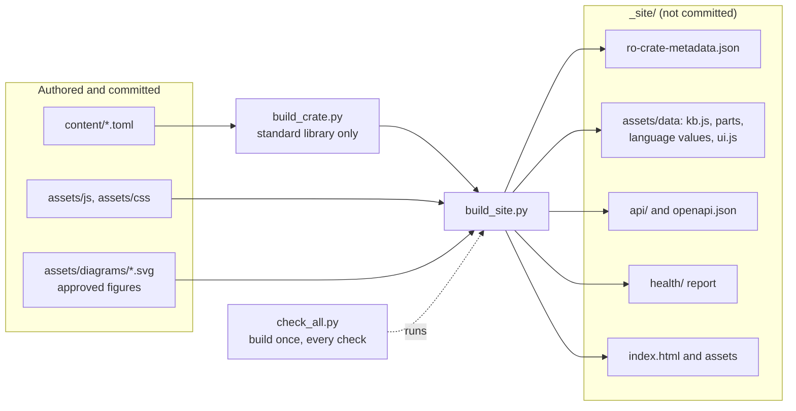
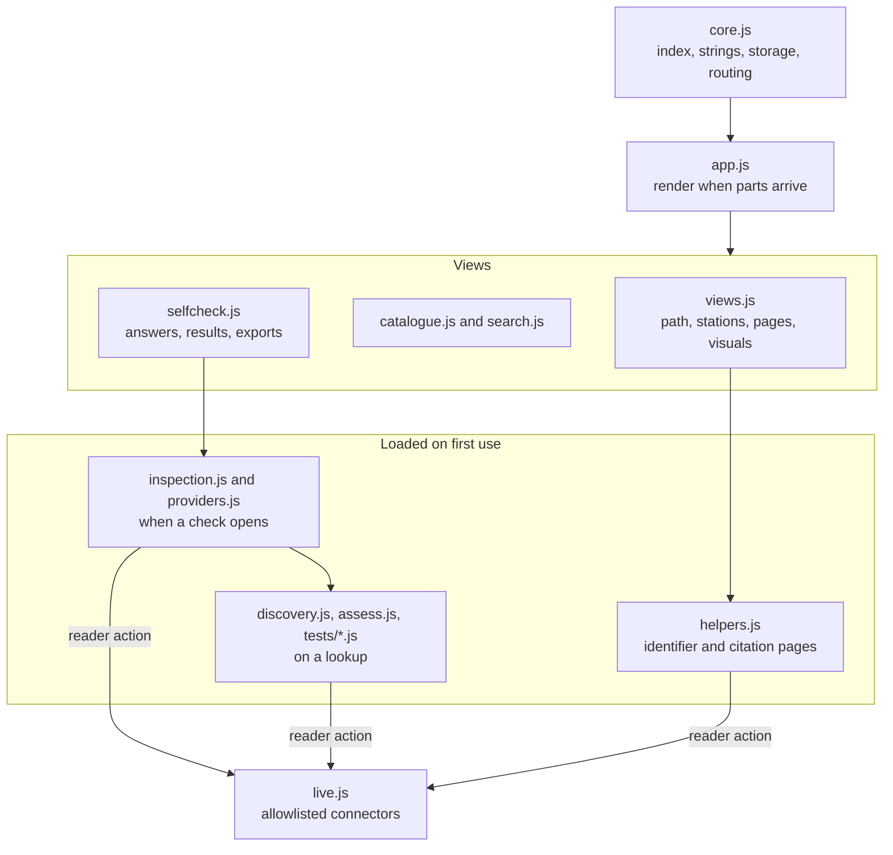
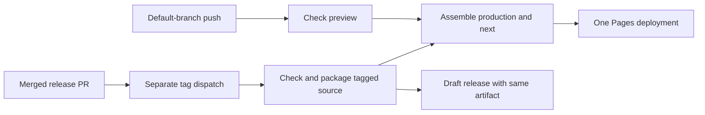

# Design

This document describes the current FAIR Data Guide and the principles that govern changes to it.
Each system area states its responsibility and the reason for its design. [AGENTS.md](../AGENTS.md)
sets editing invariants, [content-model.md](content-model.md) owns field-level contracts, and
[CONTRIBUTING.md](../CONTRIBUTING.md) owns contribution and review procedures. Source wording and
service observation dates belong in content records, rather than in an architectural history.

## Purpose and boundaries

The Guide turns published FAIR guidance into concrete actions along the research data life cycle,
in Czech and equivalent English. Researchers, data stewards, repository administrators or curators,
and communities see the same path through their responsibilities. The Guide advises; NRP admission,
certification and institutional decisions remain with their responsible bodies. Readiness checks
are neither certification nor an overall FAIR score.

**Published sources control meaning.** The FAIR analysis and other cited standards retain their
conditions, scope and recommendation strength. Planned national capabilities are distinct from
currently available tools. NRP obligations are named as such; other advice remains advisory.
DOI is an instructive recommended PID, while other persistent, resolvable, managed identifiers are
acceptable. Open access is distinct from FAIRness and from permission to reuse.

**Stable practices belong on public pages.** Development plans, assessment preparation and temporary
verification commentary belong in maintainer documents. Software preservation can use suitable
repositories or code archives; Software Heritage and its SWHID apply when that archive is chosen.
The first official prerelease is the Guide's software-practice baseline.
[software-practice.md](software-practice.md) distinguishes available evidence from release,
preservation and voluntary self-certification still to be completed. No archive PID or badge is invented.

## Static architecture

The application is static HTML, CSS and vanilla JavaScript, with no backend, accounts, analytics or
proxy. It runs on GitHub Pages, in an iframe or as a local file. Browser requests require an explicit
reader action. This keeps deployment portable and avoids sending content or answers by opening a view.
Static API retrieval and Swagger documentation require HTTP hosting; the application also works from files.
[scripts/serve.py](../scripts/serve.py) serves a local build for these HTTP features.

**The page and machine data share one model.** The complete RO-Crate 1.2 JSON-LD serves harvesters;
generated classic scripts serve the page and support file and iframe operation without fetching JSON.
The page is also `ro-crate-preview.html`. A short schema.org description in its head supports discovery.
`baseUrl` in Guide metadata, optionally overridden by `FAIR_GUIDE_BASE_URL`, owns the publication address,
vocabulary and profile IRIs; profile shapes derive from it. Relocation must leave no stale publication
address in generated records. Production and preview share canonical entity identities.

**The first download is bounded.** The build measures gzip bytes from the actual script and stylesheet
tags and selected-language data against the 300 KB budget. Neutral structure and one language load first.
Requirements, FIP records, page texts, detailed advice, provenance and language patches load when needed;
glossary source identifiers load with their definitions while primary IDs remain available for navigation.
Together they reconstruct the complete crate. Language changes preserve answers and view state.
Missing language files leave the usable view in place with retry. Originals, published titles and
vocabulary labels retain their languages. Compact aliases support local cross-language search.
L1-L3 advice text uses property patches; station views and the AI advice page wait for it. Text search waits
for requirements, questions and advice in the selected language before publishing a complete index.

## Authoring and build

Editors change small content source files under `content/`: stations, checks, resources, sources, the model,
live connectors and evaluators, provenance and interface strings. `build_crate.py`, which needs only the Python
standard library, turns them into the RO-Crate knowledge base and writes the same crate, with the interface
strings, as classic scripts the page loads: a core and parts loaded when a view first needs them, with language
values apart. `build_site.py` writes the page, those scripts, the static API (`build_api.py`), the published health
report (`check_health.py`) and the approved SVG figures into `_site/`, which is not committed. The page then runs
from the site directory, a web host or a local file without a build step. `check_all.py` runs the same build and
every check locally and in CI; Mermaid diagrams in the Markdown documents are checked to render.

**Generated output is replaceable; authored content is not.** `_site/` and its generated files are
not committed. Build replacement is limited to a validated site directory and refuses authored trees,
links and the repository root. A failed build does not relabel stale site health as a new successful run.

## Runtime responsibilities

`core.js` holds the crate index, interface strings, safe DOM building, browser storage and routing; `app.js` renders
a route once the knowledge-base parts it needs have loaded. The views are `views.js` (landing, path, stations and
pages, including the model and the reader visuals), `catalogue.js`, `search.js` and `selfcheck.js`. Code that only
some readers need loads on first use: `inspection.js` and `providers.js` when a check opens, `discovery.js`,
`assess.js` and `tests/*.js` on a lookup, and `helpers.js` on the identifier and citation pages. Every connector call
goes through `live.js`, limited to the allowlisted origins, and starts from a reader action. Self-check gaps mark
the path's stations, and pre-fill, tests and evaluators add evidence to the self-check.

**A view is addressable state.** Language, role, route, catalogue filters/ordering and a check's report
can be reopened from their addresses. Entity links
open that entity; topic links open a narrowed catalogue. Unknown entities receive an explanation.
Reader data enter public addresses only through explicit result sharing.

**Embedding exchanges only view and size.** Dependency-free host and child code in `assets/js/embed.js`
accepts configured exact origins and the expected sending window, bounds messages, reports height growth
and shrink, and mirrors the view into the host address so shared host links reopen it. Answers and
reports do not travel in this protocol. [embedding.md](embedding.md) owns the host snippet and contract.

## Reader navigation and presentation

**Start with the reader's task.** Labels, defaults and relations make sense without knowing files,
registries or implementation. Source, recommendation, service availability and verification are separate
facts. Catalogue inclusion implies no NRP or EOSC CZ qualification. Shared cards and relation labels
keep the same meaning across stations, requirements, questions and catalogue entries.

The landing leads with local search, the RDMkit life-cycle journey, role-specific task shortcuts and
resume. Local results appear while typing; nothing is sent externally. Identifiers route by what they
denote: repositories to maturity, FIPs to their check, institutions to the institution check, ORCID to
verification. A generic DOI or Handle offers an explicit lookup that names its object and source;
other suitable helpers remain available. The catalogue is the complete search-results view. Source
and privacy information remain visible without dominating entry.

The journey draws seven life-cycle stages as a cycle, reuse returning to planning, with a numbered
list of the same steps. Order and membership derive from content. No stage is chosen before the reader
acts. The last visited step supports resume. **Read marks belong to the reader:** each step in the
journey and rail has an independent keyboard-operable toggle; opening a step marks nothing. Marks can
be removed and survive navigation and role/language changes. Read marks, chosen stage and self-check
results are separate states. The rail can hide check badges without discarding answers. Phone navigation and role selection collapse above content, naming the current page/role. Stage names and definitions retain their stated RDMkit/KNAV source and translation.

**One path, four responsibilities, detail on demand.** Role switching preserves useful disclosure and
position. A station shows stage/title, key point, immediate action and at most one related tool,
glossary terms, how-to, reasons, AI advice, closed callouts, source/provenance details, related catalogue
records and next step. L0–L3 distinguish immediate action, practical steps, reasons and traceability.
Reasons do not repeat principle tiles. Read the whole station in each role: generic topic bullets are
not added where that role has no useful action. Each control acts or visibly explains what it needs first.

Home, Path to FAIR, Self-check, Principles, Catalogue, Tools and guidance, and About make every page
discoverable. Pages declare menu membership; Data for machines has its own header control. Explicit
`[[id|phrase]]` references link the words each language uses. Requirements show explanation before
quiet linked identifiers and sources, with originals in padded disclosures. External links open a new
tab and say so to assistive technology. Refused URLs are never replaced by `href="#"`.

## Knowledge base, identity and traceability

[content-model.md](content-model.md#entities) owns entity definitions and the one entity-relationship
diagram. Advice/questions cite ledger clauses, clauses cite published sources and FAIR principles,
and the explorer keeps every clause so condensing the path loses no requirement. Questions name where
gaps can be addressed. Tests and provider criteria record actual question coverage rather than inheriting
all citations. Standards retain native labels, conditions, ordering and recommendation strength.
FAIR links relate topics without renaming FAIR4RS or FDO requirements as FAIR-data requirements.

**One entry per thing, locally owned identities.** Records declare short Guide IDs. Imported rows retain
one primary `id` and the issued `guideRoute` across refresh independently of source IDs, names and URLs.
Genuine source identifiers live in typed `alternateIds`; obsolete Guide IDs are discarded before release. One build
projection emits compact catalogue/API addresses for all consumers; there is no parallel full-address register.
Chips display the compact record ID. Published source labels and authoritative IRIs remain metadata with their
actual roles. Before the first official release, IDs may change in place without compatibility routes or duplicate
API documents. After issue, names/classification may change while the address remains fixed. Reviewed joins
identify one described thing; ambiguous changes require review. Duplicate checks retain their current reasons.

**Originals and translations have separate purposes.** Permitted originals are attributed once on
clauses, with language, version, locator and reuse terms, and reused by stations, checks and catalogue.
Authored Czech and English remain equivalent and separate from quotations. No original is manufactured
to fill coverage. Published-source licensing governs excerpts when registry metadata differ. Reviewed
question omissions and their reasons are declared in the content contract, not silent blanket exemptions.

**Paradata records authorship and consequential changes.** Every compared content kind has an action
covering it, and changes against the PR merge base need fresh coverage. Actions identify responsible
person, instruments (actual AI tools when used), sources, results and end time. Generating the crate
does not make the generator the author. Reviewed identities, GitHub accounts and optional ORCID iDs
support credit; declined identifiers stay hidden and bots are not authors. Contributor suggestions do
not guess identities. Stations show a quiet source/date line; full people/tool detail stays in the crate
and About. The footer cites the Guide with its compiler as editor and credits analysis authors.
`CITATION.cff` credits software authors, points to the editor citation and keeps the analysis as a reference.

## Catalogue and infrastructure

The catalogue is one faceted list. Kind is a single choice with counts; search, station and principle
are shared facets, and kind-specific facets reset on kind change. Dimensions/orders apply only where
meaningful; absent dimensions are explained instead of showing all-zero controls. FIP principles derive
from declarations, change associations from their results. Ordering controls grouping, filters travel
in the address, and an entry link shows that entry with a route back to its kind. Phone filters sit in
a closed disclosure. Every matching card is present without a Show more step, and print lays all cards out. Long original definitions use disclosures,
with complete text retained in search and exports. One resource-type vocabulary classifies recommendations, citations and Dashboard
records rather than parallel taxonomies. Records expose source, use, qualification and identifiers separately.

**Registries keep their facts.** The Guide and FIP Dashboard are complementary facets: the Guide
explains what to do and why; the Dashboard owns profiles and FAIR-enabling-resource facts. They share
principle IDs and link to each other. Snapshots carry actual source/date and Dashboard disclaimer.
Configured live access retains snapshots as fallback without redating them on failure. FIP pre-fill
uses Dashboard profiles first and published nanopublications as fallback, preserving resource and
use/planning/replacement status. No declaration leaves a question open, not a proven gap.

Repository discovery combines curated entries with NKR, re3data, FAIRsharing and DataCite snapshots,
deduplicated through reviewed links. FAIRsharing uses DataCite DOI metadata, not its credentialed API;
not finding a record is not proof of non-registration. DataCite figures are requested only for reviewed
repository identities and are dated with record links. Samples expose titles, allow editing/replacement
and exclude subordinate file records; usage-count zero is not interpreted as measured quality.

**Empty and planned infrastructure is stated honestly.** Empty NKR results carry check time and a
catalogue link; sample records are not real NKR pre-fill. Available records retain only reviewed
identity, classification and check-relevant fields; personal contacts are never copied, only presence.
Czech names/abbreviations and English counterparts follow reviewed sources. Node membership, service
roles/milestones, operators, roadmap nodes and ERIC memberships remain separate source-scoped relations.
Operators are not inferred from developers, hosting or membership. Own service marks are preferred;
kind icons are the fallback. Funding/programme administrative detail belongs in source records while
public pages explain practical contributions.

## Self-checks and evidence

**Different checks answer different questions.** NRP conditions and FAIR maturity remain separate.
Dataset modes/funded-output programmes apply requirements in their stated context. Institution blocks
distinguish legal obligations, strategy and extended policy/action-plan/infrastructure work. Standards
retain required, conditional and recommended scope. Context-only or NRP-provided items keep help
without editable answers. Purpose and responsibility appear before answering. There is no overall score.

Each check has three named parts: evidence sources, answers and an addressable report. Evidence cards
state what leaves the browser, destination and duration. Question cards put criterion/help before native
answers, responsibility, path and source links. Technical detail/originals are disclosed. Basic/extended
scope and grouping by principle, step or declared block stay explicit. The short sticky running result
mirrors groups and links to items, never scrolls independently, and collapses compactly. Answers and Report
expose the same saved grouping choice per check, including native blocks where present. The report shows the
selected state breakdown and detailed groups; FAIR counts explain overlaps, while path/block views retain
unmapped questions under Other. The report includes the selected basic/extended scope, retains other saved
answers separately, names the object, separates gaps from unknowns and
links each gap to useful action or a responsible person.

**The reader owns an answer.** Manual answers survive pre-fill, new evidence, retry, import, attachment
and withdrawal. Imported answers retain their origin without saying the current reader authored them.
Observations keep source, target, subject, representation, date and scope; software reads also name an
immutable commit. Sources remain visible, newest useful first; bounded values/logs disclose limits.
Resolved identifiers say what they denote and link records; absent names/titles are stated, not invented.
Positive discovery suggests only what the observed fact proves; an absent field does not prove failure.
Whole-question evidence outranks partial evidence, while contradictions remain for the reader to settle.
Changing a target discards old-target evidence; a changed in-flight target/state stops further requests.
Clearing an identifier withdraws only its dependent evidence/suggestions, preserving manual answers.

## Champion selection and observation scope

The [selection record](champion/selection.md) documents the candidate inventory, three-record browser
measurement, original test/metric identities and the reasons for each association. The reusable probe
measures the core and candidates without editing the curated set. Service health is independent of
criterion validity. Questions with `championEvidenceOnly` treat the tests as covering only part of the
question: they suggest Partly when that part is met and No when it fails, and evidence about the whole question
from other sources outranks them; manual answers continue normally. Source descriptions and
question help identify the specific limit. Signposting remains a manual criterion because the reviewed
registry offers no suitable conformance test. Selection and health edits carry their own fresh provenance.

## Optional evaluators

Repository samples retain quick discovery and the existing FAIR Champion tests. FAIR-Checker and F-UJI
assess one object at a time; running them over every sample record is explicitly deferred follow-up work
. The maturity check's evidence cards describe the supported sample
checks and do not promise that deferred batch evaluation.

An object check offers an external evaluator only when its reviewed mappings cover at least one question in the
selected mode and tier scope. The current mappings support published-dataset questions; CDIF and FDO retain their
local checks without unrelated evaluator inputs. Accepted reports remain inspectable and exportable independently
of whether their input control is currently offered. Each offered choice
states what the service assesses, which identifier it receives and where, and starts only when the reader chooses
it; nothing runs on entry, while typing, on quick lookup or on a report preview. FAIR-Checker runs from the browser
through its anonymous REST API (`api/check/metric_<id>?url=`), at most three of its twelve metrics at a time,
each response bounded in time and size. Its public check page is also linked; whether that page accepts a prefilled
identifier is not established, so the identifier is offered for copying. F-UJI is linked as its public form without
the `?pid` parameter, which starts an assessment, and its JSON report is loaded locally. The guide never uses
F-UJI's authenticated API, credentials, a proxy or a cross-origin download of the report.

One assessment record keeps each accepted assessment: provider, target, inspected subject and representation,
assessment and retrieval dates, supplied software, API, metric and specification versions, and every native result
with its identifier, wording, verdict, score, maturity, subtests, recommendation, comment and log. Questions refer
to the record by its identity instead of copying it. A F-UJI report's identity is the SHA-256 digest of its text, so
a duplicate is refused and two assessments of one object stay distinguishable by date and content. A FAIR-Checker
response does not always repeat its metric, so the requested metric is the identity; a different echoed metric is
recorded. FAIR-Checker's outcome is a score on its own 0 to 2 scale, which its interface shows in green (2), orange
(1) and red (0).

Recognised report structures and reviewed metric/API/specification combinations are owned by
`content/live.toml`; fixtures preserve these structures without real subject metadata.

The reviewed F-UJI specifications list the same seventeen metric identifiers and names. A report with another
specification or metric version is recognised, kept with its complete native results and shown as unreviewed; it
suggests no answer. The test fixtures in `tests/fixtures/providers/` follow the structure of public reports for
both reviewed specifications without copying their subjects' metadata.

Each result is read as its provider presents it, with the reviewed interpretation embodied in the mappings and tests.
F-UJI's client (`simpleclient/index.php`) shows a metric as passed at its FAIR level from level 1 and as unknown at
level 0, whatever the report's `test_status`, which stays `fail` when unscored subtests fail; a subtest shows passed
or unknown by its own status. The guide reads level 3 (`maturityMax`) as met, levels 1 and 2 as partly met and level
0 as not established, names the levels as F-UJI does (incomplete, initial, moderate, advanced) and shows the
report's status where it differs. FAIR-Checker's check view colours 2, 1 and 0 green, orange and red; its metrics
give 2 for their strong evaluation, 1 for a weak one (only F1B has one) and 0 otherwise, and the guide reads them as
met, partly met and not met. An assessment in which every metric scored 0 decides nothing, since that usually means
the service read no metadata from the page.

A mapping (`live.toml`, `[[provider.mapping]]`) states whether a criterion covers a whole question or part of it.
For a reviewed version, whole coverage answers as the reading (Yes, Partly or No); partial coverage answers Partly
when its part is met, even in part, and No when it fails. A reading that is not established, an unavailable result
or an unreviewed version suggests nothing and says why. The same partial-evidence rule holds for FAIR Champion tests
that cover only part of a question and for samples in which some records gave no result. Evidence about the whole
question outranks partial evidence whatever their order; Yes against No, or No about the whole question against a
part found met, is a disagreement the reader settles. Each attached assessment is applied again once per visit and
after answers are adopted, so a result saved under an earlier reading follows the current one; the reader's own
answers stay. Evidence harvested by F-UJI is attributed to F-UJI and its assessment date, never to the browser. Licence statements stay with the harvested source that gave
them; no effective licence is derived from a combination.

Answers follow one ownership rule for every source. A reader's answer stays theirs through new observations,
completed or retried assessments, attachment, duplicate import and removal, and the result names the reader, not a
source, as its origin. Observations stay visible per source, newest useful first, so a later source never hides an
earlier fact. A run whose target or check state changes before it ends is discarded and sends no further request;
a retry asks only for the metrics without a result. Removing an assessment withdraws only its observations and the
suggestions that rested on it alone.

In the visible evidence panel, a source's attribution and observation share one badge when they name the same
source; different sources retain separate badges. Sources without a vendored favicon use the existing resource
icon, including resolver results and observations that suggest no answer. Decorative badges accompany source
names and never change who owns a manual answer.

Original reports are kept once per digest in browser storage apart from the answers, all together within 4 MB, and
native logs are read from them rather than copied into the answers. The answers are saved before a report is kept.
When the browser refuses to save the answers, retained reports give way first: they are dropped from storage, kept
for the visit, and the overview says so; if the answers still cannot be saved, the local-data note says that too.
Deleting all local data also forgets the reports held for the visit. The summary and the JSON-LD result carry
assessments compactly, without logs, within the existing 384 KB portable budget. The complete evidence download adds
every retained original report unchanged and loads back like any saved result. An assessment read from a file is the
file's claim: a report it carries is kept only when its SHA-256 digest matches the record's identity, the record is
then rebuilt from that report, and a claim without a verified report is marked as such and never blocks importing the
real report. Report identity needs SubtleCrypto; without it the guide refuses the import instead of using a weaker
hash. A result with assessments is written as format revision 3; a result without them is still written as
revision 2, so earlier versions of the guide keep reading it, and revisions 1 and 2 remain readable here.

## Identifier verification

The identifier helper loads its local script only when opened. It finds candidates in pasted text and
checks ORCID's MOD 11-2 checksum and ROR's Crockford/MOD 97-10 checksum locally, following the
[ORCID identifier documentation](https://support.orcid.org/hc/en-us/articles/360006897674-Structure-of-the-ORCID-Identifier)
and the [ROR identifier pattern](https://ror.readme.io/docs/identifier). It keeps pasted text in memory,
outside saved guide state, and sends only selected identifiers to the existing public connectors after
an explicit lookup action. Search links carry the selected identifier into the helper without starting
a request. The helper recognises resolver links and bare ORCID/ROR/DOI candidates; Handle candidates
require their resolver link or an explicit `hdl:` prefix to avoid guessing fractions or paths. Text extraction is
bounded and cannot disambiguate every punctuation mark or Handle-like value in prose.

Checksum validity, record existence and correct attribution are separate. Results show the public name
or available resolver, DataCite or Crossref title and a record link; DOI metadata titles are used only
when their stated DOI matches the requested identifier. A record without a public name or title remains
resolved with that limitation stated. Network and service errors remain unavailable, with manual retry.
The shared lookup queue admits at most four simultaneous identifiers. Limits and resolver addresses
live in `content/live.toml`; bilingual interface strings live in `content/ui.toml`. The dataset-check
page opens the existing dataset self-check, where quick inspection and the separately requested FAIR
Champion tests share answers and evidence.

## DOI citation helper

The helper accepts DataCite and Crossref DOIs, including the DOI handed over from search. Entry and
editing remain local; an explicit action retrieves the agency and matching metadata, then independently
requests APA, Czech ISO 690 author–date, BibTeX and RIS. The DOI Foundation formatter's published style
list confirms `apa` and `iso690-author-date-cs` before either is labelled. An unknown-style fallback is unsuitable for the Czech style. The supported formatter removes
the need for a local ISO template.

The agency's documented direct representations supply BibTeX and RIS. All responses are anonymous,
bounded by time and size, and read without redirects through enrolled connectors. Export syntax and
DOI identity are checked. Outputs remain plain text with their exact response links, copy/download
controls and retrieval time; a failed format does not erase successful formats. The reader compares
authors, year, version and publisher with the landing page. No missing bibliographic field is invented.
Helper labels load with page data, preserving the initial-download budget and local-file operation.

Detailed provenance descriptions load with the catalogue's existing requirements part; the initial
data retains action identities, names, dates and links needed by credits. The complete crate and
API keep every description. The blocked-service suite covers every enrolled host under standalone
HTTP and local-file hosting in both languages, checking partial results, manual answers, retry and
honest failure states. A failed live FIP Dashboard request retains the snapshot's source and date.

## Layers-and-Seams integration

The updated manuscript may be cited as **in preparation** for its
conceptual model and scoped implementation examples. It creates no ledger requirements and receives
no invented DOI, publication date, publisher or licence. This is the sole exception to the published-source rule.

The approved adaptations of the manuscript's Figures 1–3 preserve its geometry, labels,
layer colours and status/arrow distinctions remain consistent with the paper. Bilingual local SVG assets
add web fonts, accessible descriptions and equivalent adjacent prose. Source-scoped catalogue observations retain their documented dates.
This is an explicit exception to the Mermaid-only diagram convention.

`content/model.toml` maintains the six functional layers, the registered information hand-offs,
reviewed item associations and role-specific station explanations. A seam crosses a responsibility
boundary, including distinct functions within a layer. The layer order expresses a functional rationale;
planning, support and evaluation feed back throughout. Actors may work across several layers.
Reader lenses, disclosure levels and existing FAIR principles keep their separate purposes.

The catalogue reuses its card presentation and shared facets for model layers and connections. Tags
are linked to their definitions and shown on records as well as in filters. An explicit seam association
reuses its endpoint layers; associations are never propagated through broad citations or automatically
from questions to tests. A test is mapped according to its own observable scope. Definitions and full
associations load on demand and remain available in the complete crate, exports and static model API.

Station explanations appear in **Proč**, alongside the existing source requirements. Practical actions
remain in their current steps. Detailed schema requirements stay in profiles and schemas; a FIP records
selected FAIR-enabling resources and can refer to those profiles. Original source wording and issued
question identifiers remain intact.

Implementation examples carry their own precise scope, evidence and observation date. A component's
status does not establish the status of a connection or a later reuse step. Month-only observations
retain that precision. Maintaining actors are not silently presented as formally assigned interface
owners. An unavailable live response limits the inspection and does not prove a broken connection.
Assessment hand-over reuses the existing target, criterion, evidence, invocation, date and actor;
the guide's source-to-question-to-test-to-revision example demonstrates these transfers in practice.

## Local storage, portability and deletion

Answers, modes/profiles, identifiers and evidence stay in this browser's storage for this site;
other browsers/devices do not see them and private windows may forget them. Checks and About state
this plainly, with deletion at hand. Only chosen identifiers go to named services after a lookup.
Pasted helper text stays in memory outside saved state.

JSON-LD/FTR RO-Crate and Markdown exports carry reloadable state, Guide version, check, modes/profiles,
targets and evidence. Markdown's hidden comment restores full state; earlier answer-only summaries
remain readable. Shared links carry compact answers and open as previews. Files also preview before
replacing that check's answers on request. Foreign, damaged, newer-format and unknown-check files get
different explanations; unknown historical question IDs are skipped with notice. Public share links use
the publication address, never local files. Result reuse licensing is chosen by the person exporting,
not assigned by the Guide. Delete-all removes saved state and visit-only reports after confirmation.

## Visuals, accessibility and machine interfaces

**Visuals answer reader questions from maintained facts.** Journey navigation, PID/landing/metadata/files,
publication hand-over, software version/release/archive/citation, and evidence-to-answer sequences
reuse content records or `visual.*` labels. Semantic ordered lists reflow, print and read in order
without a diagram runtime. Approved manuscript SVGs preserve geometry, terms, colours and status/arrow
meanings, attribution, bilingual descriptions and adjacent equivalent prose. Maintainer Mermaid diagrams
have accessible titles/descriptions and equivalent prose; the entity diagram has one definition.

**Accessibility is correctness.** The app targets WCAG 2.2 AA with native keyboard controls, visible
focus, text/icon state cues, names, contrast and 320 px reflow. EOSC CZ brand colours are accents;
darker tints carry body text. The light theme, local fonts, vendored Font Awesome icons and reviewed
marks avoid external page-load requests. Funder/brand logos remain legible, linked and attributed.
Controls act or visibly say what they need, through the shared gate. Ordinary actions use the 44 px
minimum; inline chips and reader-owned read toggles have explicit compact sizes with at least 24 px
targets, and compact toggles stay square. Alignment, padding, separation and long identifiers are
checked across views. Measured rules need planted-regression proof and a visual pass through empty,
partial, complete, expanded and imported states in both languages at desktop/phone widths.

**The static API is a crate view.** `build_api.py` emits collection/entity JSON with language maps,
JSON-LD context, OpenAPI 3.1 and pinned local Swagger UI. Records link relatively. Checks are FTR
benchmarks, questions metrics, and named manual tests link exports to definitions. Paths align with
the Dashboard's published vocabulary. Data for machines teaches from real task-to-data links, FAIR
Signposting, profile, licensing, paradata and result examples. Head and linkset share one discovery list.
Views offer their own data, cards their record, checks their result; filtered exports retain order/filters.
Print exposes closed content and relevant addresses. Swagger UI is the explicit scoped accessibility
exception named in the public statement; the accessible machines page lists the same endpoints.

## Checks, automation and delivery

**PR code receives read-only checks.** `check_all.py` builds once and runs deterministic content,
fresh provenance, duplicates, metadata, unit/browser contracts, accessibility, API, diagrams, licensing,
assets and crate validators. Opt-in live checks stay separate. Health distinguishes passed, failed,
blocked and unrun jobs; offline success establishes no live availability. Initial builds are inventory;
completed runs expose their actual revision and outcomes through the dashboard and `api/health.json`.
PR CI uses `check_ci.py` to share one source/build/coverage manifest between a CPU lane and two balanced browser
lanes. The command inventory stays in `check_all.py`; nested scripts stay in `scripts/check_groups.json`.
Each lane checks its inputs and emits partial evidence. The required `checks` collector rejects missing,
duplicate, incomplete or mismatched work, reconciles station/PDF inventories and publishes one health snapshot.
It runs after failed lanes too. Source revision means the checked commit; trusted PR comments separately verify
the PR head. The local full-run command and all validator profiles remain available unchanged. On a failed
aggregate the collector names every failed check, not only the first, and appends a bounded output tail for each
to the CI summary. It copies the lane `logs/` and `details/` into the health artifact before publishing the
failure report, so the artifact contains the same evidence the lane produced. The summary and artifact also
carry the duplicate check's safe suggestions and point to `.cache/pr-review/suggestions.json`.
The suggestion artifact identifies the PR source head separately from `checkedRevision`, the merge revision
used for the build, so the trusted publisher can check freshness against the PR head.
Suggestions are admitted only from the reconciled lane owning the duplicate check. Rejected identity or
required evidence yields an empty suggestion payload; other incoming directories cannot supply suggestions.
The required report is emitted first; optional suggestion read/write/summary failures are warnings and do
not hide required diagnostics or change their outcome. Previous suggestion output is invalidated before
publication. A partial required result becomes a failed aggregate row with an incomplete-coverage explanation,
while its partial flag and native lane evidence remain available.
Suggestion upload uses the collector's successful current-run `suggestions_path` output. If invalidating a
previous artifact fails, its presence on disk cannot admit it to the uploaded review data.
Three validation passes cover RO-Crate 1.2, Process Run Crate and the Guide profile; inheritance is
disabled where an older crate descriptor would conflict. Known subclass inference, action-status IRI
and RDF-property recommendations do not waive required profile checks.

Browser installation and checks share `scripts/browser_env.mjs`: an explicit `PLAYWRIGHT_BROWSERS_PATH`
wins, otherwise the browser lives in the repository's `.cache/ms-playwright`. The runner separates its outer
job count from `--browser-workers`; browser groups share atomic case slots across Node processes, so inner pools cannot multiply the global limit. Station coverage
has one matrix over language, role, width and disclosure state. Closed guidance and expanded AI tips remain
distinct audit states. Navigation checks wait for the requested view's replacement and data; search waits for
the complete index before publishing results.
Frame-free whole-document accessibility checks reuse the pinned axe engine after completed layout, preserving
the same shared policy and full context. Frames and scoped checks retain the established Playwright adapter.
`CHECK_AXE_MODE=compare` verifies normalized rule/check/node outcomes against that adapter; `reference` selects
the reference throughout. A parity failure retains its diagnostic and fails verification.

The health artifact includes complete successful/failing logs, individual script and case timings, explicit
selected/skipped/aborted cases, unit-test timings and failure screenshots, route/heading/error records and traces.
A selected subset remains partial even when its executed cases pass. Reruns are separate attempts and never
erase an earlier failure. These checks establish their recorded scope, not complete visual or FAIR-semantic
correctness. Performance comparisons name their revision, environment, coverage and concurrency; local elapsed
time is not presented as measured hosted-runner cost.

A separate trusted `workflow_run` posts the PR summary from bounded JSON artifacts without executing
their code. It verifies current PR head/source repo, escapes Markdown and updates only its own bot
comment with narrow PR write access. The first-page summary states the true total and links the complete
changed-item list. When the duplicate check emitted a safe suggestion, the comment adds a bounded "Suggested
fixes" section with the exact file, table, field, value and reason; it never edits the repository. Reasons
render as inert code text in both the comment and CI summary. Artifact text cannot turn into
links, images or notifications. PR execution
has no secrets or delivery token. Dependency/action pins use Dependabot. Human/code-owner review follows
CONTRIBUTING; automated jobs never merge their own proposals.

### Snapshot refresh and source watch

`refresh_snapshots.py` serves sources the browser cannot read or should not query on entry. It checks
shape, completeness, pagination totals, response bounds and removal thresholds before replacing a file;
interdependent Dashboard collections move together. Invalid responses retain the old snapshot. Date-only
changes produce no PR. Reports distinguish changed, unchanged, empty, rejected and failed outcomes. Before
writing, a refresh reserves every primary and retired identifier owned outside the snapshot being replaced;
a new row whose derived slug is already taken receives a non-colliding suffix, and an identity collision that
still needs review rejects the replacement instead of writing it.

`source-refresh.yml` runs weekly, on dispatch or for an exact `/refresh <source>` PR comment from a
currently authorized writer. Trusted default-branch code parses the command and proposes one reserved
`refresh/<source>` branch per source through the repository-scoped App. Identical proposals are reused,
rejected content is not repeatedly proposed and human-edited branches are left for reconciliation.
Automatic replacement requires a complete nonempty commit inventory, the configured refresh App as every
author, and only the expected `Refresh the <source> snapshot` messages. Repairs made by the same App are
therefore protected too. Missing inventory or unknown authors/messages leaves the branch intact and reports
the need to reconcile it manually; the maintainer fix command remains available on eligible refresh PRs.
App settings and narrower per-job tokens are in [deployment.md](deployment.md#release-preparation-and-tagging).
Nothing writes the default branch or merges; fixtures do not establish remote activation.

### Duplicate suggestions and the maintainer fix

`check_duplicates.py` keeps its existing error text and adds a structured suggestion only for an unambiguous
group: one curated entry and one registry record, an authoritative shared key, a known link placement, no
conflicting link and no accepted exception. The suggestion names the file, table, field and value and is
written to `duplicates.json` under `CHECK_REPORT_DIR` or `--report`. `--fix` applies only safe suggestions to
the working tree, prints a unified diff and leaves the provenance action to the person running it. Neither path
edits `content/duplicates.toml` or accepts a lookalike group.
Safe ownership is checked across the full catalogue and suggestion set. Exact placement rules are shared by
Python consumers and checked for parity with the independent Node validator. The local batch validates TOML,
replaces targets atomically and rechecks duplicates before reporting success. Handled failures restore
original bytes; concurrently changed targets are refused and restoration failures are reported by path.
Rollback records the known replacement bytes immediately after the swap, before cleanup, without a
post-write discovery read; a cleanup failure therefore also restores the edited target.
Atomicity is per file; process termination is not a multi-file filesystem transaction.

`/fix-duplicates` is a separate trusted `issue_comment` workflow. It checks the commenter's current write
access, requires an open same-repository PR targeting the default branch with a non-default head, extracts the
PR content and its authored assets, profile and HTML with `git archive` (never executing them), applies only
safe suggestions, validates the fixed content,
re-reads the head and commits through the same repository-scoped App used by source refresh. The workflow
records the exact archived SHA before extraction and requires it to match the handler's first validated PR
head read, as well as retaining the final head recheck. It resolves the
commenter to an existing `[[person]]` by `github` and refuses if there is none; the action names that person,
the `duplicate-fix` instrument, the consulted registry source and the changed entry. It registers only the
new action ID before content validation and commits that register update with the link and provenance;
unrelated missing IDs still fail validation. The App secrets are
`SOURCE_REFRESH_CLIENT_ID` and `SOURCE_REFRESH_APP_PRIVATE_KEY`; without them the workflow fails before any
write. The command never runs on schedules or forks, never merges and never pushes the default branch. Rollback
is a revert of its commit or removal of the workflow; a stale head is a no-op. The local `--fix` remains the
fallback when the command is unavailable.
The App's diff and content-error comments use bounded, safely closed fences that contain authored Markdown,
including embedded fence delimiters; truncation retains the commit reference. An unexpected workflow failure
directs the maintainer to inspect the branch and run because the commit may have landed before its comment
failed. It does not imply an unchanged branch or automatically undo an already published repair.

`health-watch.yml` checks links, connectors, stale dates and watched EOSC CZ page content, excluding
navigation/header/footer. Champion remeasurement is monthly or requested. Repeated failures precede
issues; recovery closes them. Changed page items and core-test health changes have stable issue keys.
Candidates are proposed for review, never selected automatically. The issue publisher has narrow issue
write access and a per-run bound. Historical observations keep their source dates.

### Production, preview and release

[deployment.md](deployment.md) owns workflow details, local assembly and recovery. Production comes
only from a release tag's checked artifact. Every default-branch push rebuilds `/next/` in the same
Pages deployment while retaining production bytes. Every preview HTML page has `noindex` and a
prerelease notice; discovery introduces no preview URLs. Entity identity stays canonical while preview
Swagger uses its own relative API. Before a verified first release, the root explains that state and
links to the preview instead of presenting default-branch work as production.

`release_versions.py` is the standard-library owner of Guide/citation/npm/lockfile/Python versions and
release dates, and of the merged-PR changelog. Crate/API values derive from the Guide. Prose links to
metadata rather than restating a version. Prepare release opens a reviewed PR; Tag release is a separate
manual action after merge. A tag checks/packages once and its draft release attaches that same artifact
with health receipts. Failed new tags leave previous verified production available. Partial uploads
and same-run retries reuse checked bytes without overwriting assets or human edits. The testing notice
is driven by Guide release status until EOSC CZ agreement, independently of the preview notice.

**Delivery remains a maintainer act.** Prepared workflows and local fixtures do not establish App/Pages
configuration, dispatch authorization or published releases. The capability contracts and change artifacts
live under `openspec/` and are validated by the complete check (`npm run openspec:validate`); they are
installed repository functionality, not release preparation. Minimal agent tooling uses AGENTS and one
editing skill with an identical Claude copy. Behavior/data/API/CI changes follow the accepted planning
contract.

## Final candidate maintenance

Run the final review through architecture/data representation, bilingual text/source fidelity, UX/GUI/design
and code hygiene. Fix bounded defects and obsolete behaviour; module size alone does not justify a rewrite.
Evidence cards count potential coverage from registered mappings/local tests for the current scope; observed
results and reader answers remain separate. Advisory linking ranks specific names and authored language variants,
uses context and ambiguity checks, and provides an excerpt, location, proposed reference and reason without
rewriting prose or failing integrity checks. Document titles name the current page or entry.

Repository-owned OpenSpec contracts support team contributions. See [deployment guidance](deployment.md) for
publication rules. Track temporary implementation state and release-specific decisions in issues and OpenSpec
changes, keeping this document focused on the resulting design.
