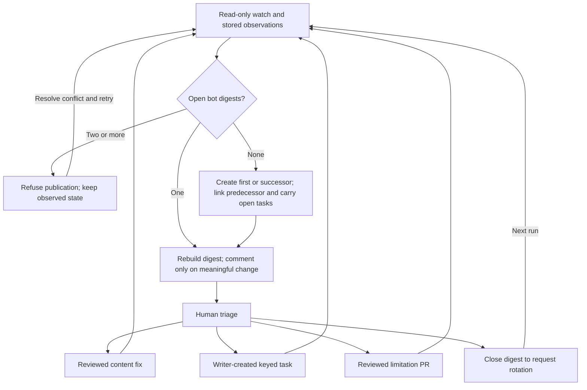

<!-- type: how-to -->
# Handle the maintenance digest

A maintainer reads the weekly maintenance digest on Monday morning in about fifteen minutes. Every finding then has
an owner: a fix, a tracked task or a reviewed limitation, and nothing waits unseen.

1. **Open the digest.**
   - **Where:** Issues → **Maintenance digest**, labelled `guide-health`; pinning is best effort, so search
     `is:issue is:open label:guide-health` if it is not pinned.
   - **Do:** read its newest comment, which lists what is new, changed, recovered or expired since the last run.
   - **Done when:** you know each finding under **Needs triage**.
   - **If it fails:** without a digest, open the latest **Live health and source watch** run; its publish job's
     summary names the reason.
2. **Triage each finding.**
   - **Where:** the **Needs triage** section.
   - **Do:** fix a really broken source in a content pull request; choose **Track as task** for work that waits; or
     paste the suggested entry into `.github/health-watch.toml` in a pull request when a service refuses automated
     requests. An entry such as "17 links on `host` did not answer" is one host's outage: its links are listed under
     it, and one task covers them.
   - **Done when:** the next run lists the finding as tracked or known, or no longer lists it.
   - **If it fails:** discuss the finding in a comment on the digest.
3. **Review sources, candidates and stale statuses.**
   - **Where:** the **Sources not refreshed**, **Source updates to review**, **Candidates to review** and
     **Stale statuses** sections.
   - **Do:** for a rejected source, read its reason and follow [refresh a source](refresh-a-source.md); one that was
     not retrieved needs nothing, as the next scheduled refresh retries it. Decide whether the Guide's advice follows
     a changed page; take a Champion candidate to the [selection review](../champion/selection.md); confirm a stale
     status and its as-of date in a content pull request.
   - **Done when:** each item has a pull request, a task or a decision not to act, said in a comment.
   - **If it fails:** leave the item listed; it stays until someone decides.
4. **Check the Project and settings section.**
   - **Where:** the digest's **Project and settings** section.
   - **Do:** use [audit settings](audit-settings.md) for drift. For an issue needing triage, set its Issue Type,
     area label, Priority and Effort, shape its body with `aiscr-plan-issue`, then set Ready once it meets the
     [definition](../maintenance.md#triage).
   - **Done when:** the next audit clears the addressed findings; unavailable reads remain labelled unavailable.
   - **If it fails:** an unavailable part needs a maintainer's own `python scripts/audit_repository.py` run.
5. **Rotate a long digest.**
   - **Where:** the digest issue.
   - **Do:** close it when its comments become hard to follow.
   - **Done when:** the next run opens a successor that links it and carries its open tasks.
   - **If it fails:** two open digests stop publication; close the one you no longer need.

Observation has no issue-write permission. The publisher rebuilds the single open digest and comments only on
meaningful change; two open bot digests refuse publication while preserving observed state. Human triage leads to
a content fix, a keyed task created by a repository writer, or a reviewed limitation. Closing the digest requests
a successor on the next run; the publisher links both issues and carries open tasks, resuming safely after interruption.

