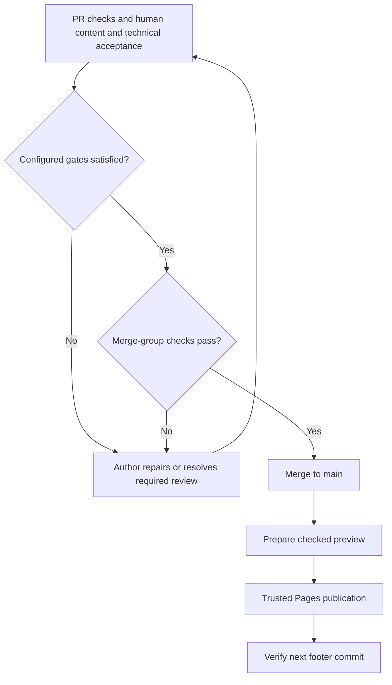

<!-- type: how-to -->
# Merge a pull request

A maintainer merges an approved pull request through the merge queue in a few minutes of attention and up to ten
of waiting. The queue checks the merged result again, so `main` and its `/next/` preview only receive checked bytes.

1. **Check the result.**
   - **Where:** the pull request's checks and its **Guide review** comment.
   - **Do:** confirm that `checks` passed, and read the comment's changed items and hints.
   - **Done when:** `checks` is green and every hint is addressed or deliberately left.
   - **If it fails:** the author fixes the failure; see [rerun a check](rerun-a-check.md).
2. **Review the change.**
   - **Where:** **Files changed**.
   - **Do:** follow the [review runbook](review.md): the relevant human collaborators judge content and source
     interpretation, and a technical code owner checks integrity, compatibility and fit with the Guide.
   - **Done when:** the pull request shows an approving code-owner review; when no independent eligible reviewer
     exists, the responsible maintainer's explicit acceptance is recorded, including acceptance before tagging a release candidate.
   - **If it fails:** recorded acceptance does not override an enforced GitHub review requirement. Ask an eligible
     reviewer or resolve the reviewer configuration through an approved settings change; use
     [emergency merge](emergency-merge.md) only for broken checking machinery.
3. **Queue it.**
   - **Where:** the pull request's merge box.
   - **Do:** choose **Merge when ready**.
   - **Done when:** the queue's check of the merged result passes and the pull request shows as merged.
   - **If it fails:** the queue removes a pull request whose merged result fails; fix it and choose **Merge when
     ready** again.
4. **Follow the deployment.**
   - **Where:** Actions → **Deploy the verified site**, then **Publish the verified site**.
   - **Do:** wait for both runs of the merge commit.
   - **Done when:** the `/next/` footer names the merge commit.
   - **If it fails:** the run summary's next step names the cause; a deployment that reused no queue result runs
     the full checks first.

Human content and technical acceptance precede queueing, together with every configured GitHub gate. A failed
merge-group check returns to the author for repair. After merge, preparation and trusted publication produce the
checked preview; production follows the separate [release procedure](release.md).

