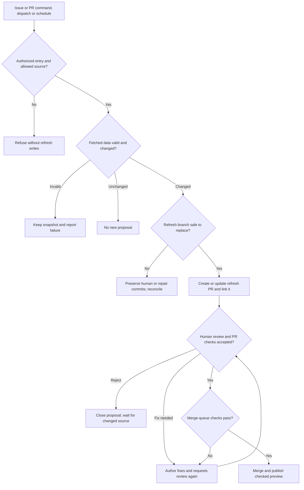

<!-- type: how-to -->
# Refresh a source snapshot

A maintainer refreshes a source when its data changed and the weekly refresh should not wait; starting it takes a
minute and reviewing its pull request a few more. Every refresh is validated and proposed as a pull request, so
nothing reaches the Guide unreviewed.

1. **Start the refresh.**
   - **Where:** Actions → **Source refresh** → **Run workflow**, or a comment `/refresh <source>` on an issue or pull request.
   - **Do:** choose the source (`heslar`, `re3data`, `fip-dashboard`, `nkr`, `knav-tools`, `fairsharing`,
     `datacite`). A comment accepts exactly one source key; the manual dispatch also offers `all`.
   - **Done when:** the run summary, or the reply in your initiating thread, lists each source's result and links
     its open proposal. An existing pull request is not needed to start.
   - **If it fails:** snapshots stay until a proposal merges. The run summary names each source's reason: **Act**
     (rejected, or a branch with someone's commits) fails the run; **Retry** is a warning, and the next scheduled
     refresh tries again.
2. **Review the refresh pull request.**
   - **Where:** the pull request "Refresh the `<source>` snapshot", labelled `source-refresh`.
   - **Do:** read the snapshot change as content and confirm that `checks` passed.
   - **Done when:** you approve it, or close it as wrong.
   - **If it fails:** a closed proposal is not offered again with identical content; the next real change is.
3. **Merge it.**
   - **Where:** the pull request's merge box.
   - **Do:** choose **Merge when ready**, as in the [merge runbook](merge.md).
   - **Done when:** the pull request shows as merged.
   - **If it fails:** a branch with someone else's commits is left for reconciliation by hand; close it so the
     next refresh starts from `main`.

The refresh entry checks authorization and the exact source key, then validates the response. Invalid data leaves
the snapshot unchanged; unchanged data opens no new proposal. Human or repair commits stop branch replacement.
Changed, valid data reaches the Guide only after human review and successful PR and merge-queue checks.

