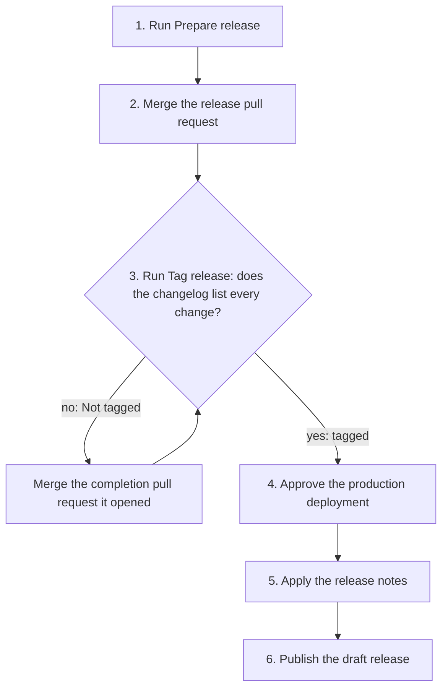

<!-- type: how-to -->
# Release the Guide

A maintainer releases the Guide in about an hour, most of it waiting for checks and deployment. Readers then get a
reviewed, archived version with its own DOI, and the preview at `/next/` keeps showing the newest default branch.

1. **Prepare the release.**
   - **Where:** Actions → **Prepare release** → **Run workflow**, on `main`.
   - **Do:** enter the version, for example `1.0.0-alpha.4`; a leading `v` is accepted.
   - **Done when:** the run summary links the release pull request `release/<version>`.
   - **If it fails:** the summary names the cause. A dispatcher without a reviewed `[[person]]` identity adds it in
     `content/guide.toml` through an ordinary pull request first; an edited proposal is reconciled by hand in its
     pull request.
2. **Merge the release pull request.**
   - **Where:** the release pull request.
   - **Do:** check the version, the dates and the changelog section, approve, then choose **Merge when ready**.
   - **Done when:** the queue merges it and **Publish the verified site** records `staging` for the merge commit.
   - **If it fails:** follow the [merge runbook](merge.md); a failed check is fixed on the release branch.
3. **Tag the release.**
   - **Where:** Actions → **Tag release** → **Run workflow**, on `main`.
   - **Do:** enter the same version and choose `release_status`: `testing`, or `production` only with the
     responsible maintainer's recorded approval.
   - **Done when:** the summary says the tag was created at the current commit.
   - **If it fails:** "Not tagged" means changes landed after preparation: merge the completion pull request it opened,
     then run Tag release again. "Still being deployed" names the run to wait for; "no successful deployment" asks
     you to run **Deploy the verified site** on `main` first.
4. **Approve production.**
   - **Where:** Actions → the **Deploy the verified site** run for `v<version>` → **Review deployments**.
   - **Do:** approve the `production` environment.
   - **Done when:** **Publish the verified site** succeeds, the site's footer shows `v<version>` and its summary
     reports no namespace notice.
   - **If it fails:** re-run the deployment run's failed jobs; verified bytes are reused without a second approval.
5. **Apply the release notes.**
   - **Where:** your checkout in an assistant with the native skill available, once **Release** has drafted the release.
   - **Do:** invoke `fair-guide-release-notes` for `v<version>` (in Claude Code, `/fair-guide-release-notes v<version>`),
     review the composed body and approve it.
   - **Done when:** the draft release shows the reviewed notes above its verification record.
   - **If it fails:** use the manual route in [prepare release notes](../how-to/release-notes.md).
6. **Publish the release.**
   - **Where:** Releases → the draft `v<version>` → **Edit**.
   - **Do:** keep **Set as a pre-release** for an alpha or beta, then choose **Publish release**.
   - **Done when:** the release is public and Zenodo lists the new version under the concept DOI.
   - **If it fails:** a missing Zenodo version is checked in the
     [citation metadata reference](../deployment.md#citation-and-zenodo-metadata).

For a removed historical tag after a failed deployment, use [historical tag recovery](recover-a-release-tag.md)
only when its prerequisites hold. For retrying publication, use the [deployment reference](../deployment.md#merge-queue-staging-and-production).
