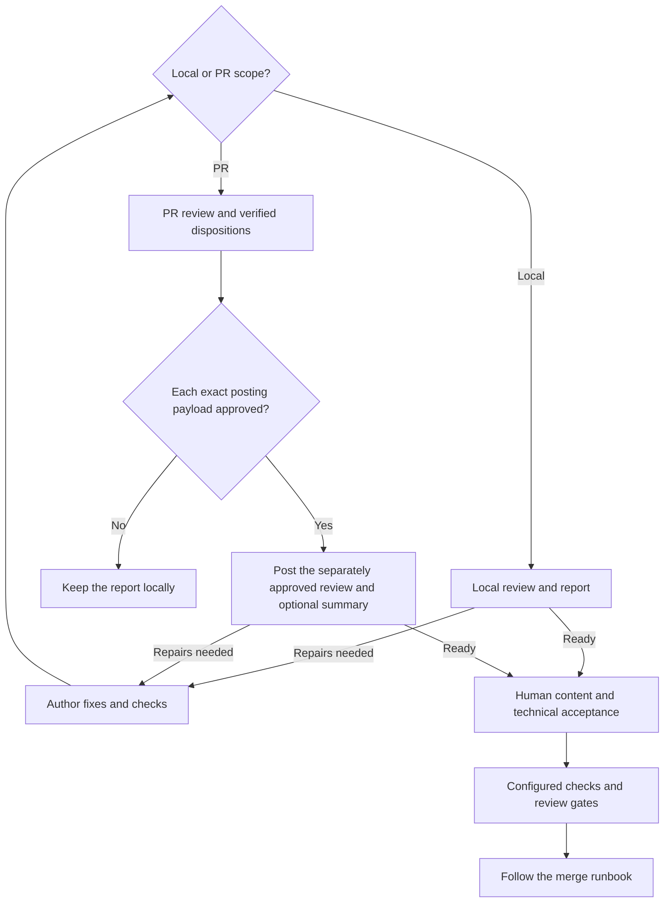

<!-- type: how-to -->
# Review a change

A contributor or maintainer uses `aiscr-review-pr` to find defects and prepare evidence for human review.
Allow 15-30 minutes for a small change and more for broad diffs or repair rounds.

1. **Choose the scope and baseline.**
   - **Where:** your checkout, PR and [agent-tooling entry](../agent-tooling.md#task-to-tool).
   - **Do:** select one scope: a PR number/URL; `--branch <ref> --base <ref>`; `--commit <sha>`;
     `--unpushed` with a configured upstream; `--staged`; or `--worktree`. The worktree scope compares against
     `HEAD`, including staged and untracked work. Confirm the repository and resolved base/head it reports.
   - **Done when:** the intended diff and baseline are explicit; a local scope stays a local review.
   - **If it fails:** supply the missing base or correct the selector. Do not infer a PR from a branch or count
     unreadable files as reviewed.
2. **Run the delivered review.**
   - **Where:** your client's `aiscr-review-pr` workflow, using the selected scope. Read the
     [delivered instructions](../../.agents/skills/aiscr-review-pr/SKILL.md) and the repository's review facts.
   - **Do:** let the workflow gather its evidence, select applicable tracks and verify findings. For a PR it
     accounts for prior marked AIS CR reviews; for a local scope it skips GitHub gathering and posting.
   - **Done when:** the report states coverage, verified findings and any missing evidence.
   - **If it fails:** resolve the missing inputs or retain the incomplete report and its reason; incomplete
     coverage cannot be reported as a clean review.
3. **Decide what each finding needs.**
   - **Where:** the report and, for a PR, its existing review threads.
   - **Do:** record a disposition and supporting evidence for each finding. Assign needed fixes to the author;
     review itself does not implement them. Keep unresolved findings visible.
   - **Done when:** each finding has an explicit decision or owner and no earlier finding silently disappears.
   - **If it fails:** narrow the investigation to the cited evidence, ask the relevant expert, or retain the
     uncertainty. Do not replace evidence with a green checklist.
4. **Approve any external posting separately.**
   - **Where:** the workflow's exact rendered approval view and digest; skip this step for local scopes.
   - **Do:** inspect the grouped review, event and disposition replies before approving that exact payload. A PR
     summary needs its own approval of the exact text and a choice of comment, description replacement or no post. Follow the delivered
     identity checks; the workflow handles posting and read-back.
   - **Done when:** only the approved payload is visible in GitHub, with the appropriate replies in existing threads.
   - **If it fails:** keep the run's artifacts, use the workflow's repair/reconciliation route and obtain fresh
     approval for changed output. Do not fall back to unreviewed comments or overwrite a changed description.
5. **Fix and re-review the new head.**
   - **Where:** the author's branch or local checkout, then the same review workflow.
   - **Do:** implement accepted fixes under the applicable editing/apply rules, run their checks, and review the
     changed scope again. For a PR, verify earlier findings against the newest marked review and current head.
   - **Done when:** repairs have evidence and all remaining findings have explicit dispositions.
   - **If it fails:** keep the finding open; a changed contract goes back through planning rather than an
     unapproved exception.
6. **Complete human acceptance.**
   - **Where:** the PR's human reviews and [contribution reference](../contribution-reference.md#review).
   - **Do:** obtain the appropriate content-team assessment and technical-owner acceptance, satisfy the configured
     checks/reviews, then follow [merge](merge.md). The sole-maintainer alpha fallback requires recorded explicit
     maintainer acceptance; it does not itself satisfy an enforced GitHub review requirement.
   - **Done when:** human decisions and configured gates support merge. The review workflow does not merge.
   - **If it fails:** find an eligible reviewer or resolve reviewer configuration through its approved settings
     process. AI findings and an author's own acceptance cannot stand in for a required independent approval.

Local reviews end as local reports. A PR review posts only after exact-payload approval; repairs lead to another
review of the new head. Human acceptance and the merge runbook remain the final gates.

