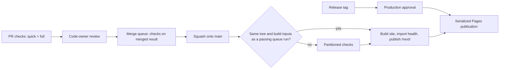
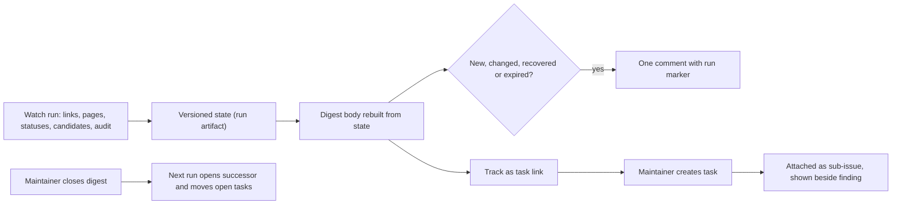

# Design

## Context

See `proposal.md` for the motivation. The baseline is `main` at `f0c09f9`. PR #102 is part of it and already
delivers atomic refresh-branch updates, complete provenance for the remote `/fix-duplicates` command and
reporting of every failed check. This change builds on those and does not repeat them.

The live state was read on 23–24 October 2026:

| Evidence | Observation | Consequence |
| --- | --- | --- |
| PR run 40022072478 | 6 min 20 s. Build 20 s; CPU lane 18 s setup + 119 s checks; browser-a 45 s + 187 s; browser-b 60 s + 226 s (critical path); collector 41 s | Shorten the critical lane and setup, not the build |
| Same run, lane evidence | Two browser slots per lane. Case `en/320` waited 62 s for a slot. Long single scripts: accessibility 67 s, sources 65 s, model 63 s; final cases at 1280 px about 60 s | More balanced lanes and case splits |
| Same run, unit timings | 470 tests, 105 s, run one after another; slowest test 7.8 s | Parallel shards |
| CPU lane | Three `rocrate-validator` profiles of about 110 s each overlap the unit tests | Measure alternatives |
| Deployment | Staging runs the full `check_all.py` (568 s in run 39224056433). Every deployment, staging included, waits for a named reviewer. On 23 October three merges cancelled two pending deployments | Reuse verified results; approve production only |
| Main ruleset | Squash only, branches must be up to date, code-owner review, required `checks`; administrators may bypass | A merge queue replaces the up-to-date rule |
| Comment workflows | `fix-duplicates.yml` and `source-refresh.yml` both start on every comment; workflow-level concurrency is taken before the job filter, and a new pending run cancels the waiting one | One filter-first command workflow |
| Health watch | 24 open per-finding issues; state in `actions/cache`, which drops entries unused for seven days, on a weekly schedule; only the first 600 of 673 URLs are checked | Digest, durable state, fair selection |
| Project #1 | 70 items; Status Needs triage, Ready, In progress, Review, Done; seven views; native automations with auto-close off and auto-archive on. Priority and Effort are organization issue fields that exist only on typed issues; 2 of 61 open issues are typed; no `area:*` labels exist yet | Audit, labels, typed templates, backfill |
| App registration | `fair-guide-actions` lists `organization_projects: write` and several permissions no workflow requests; installation acceptance is not readable with the maintainer's current token | Reviewed permission list; read-only audit |
| Issue shape | The delivered `aiscr-plan-issue` engine declares the issue shape and exposes `section_status()` and `readiness()` | Templates and audit reuse it |

The first hosted release rehearsal, on 25 October 2026, added this evidence:

| Evidence | Observation | Consequence |
| --- | --- | --- |
| #114 queue run 40153182976, deployment 40153496770 | Staging adopted the queue result in 26 s with no fallback; Tag release 40154472734 tagged `161994f`; the production build took 10 min 16 s and was approved in run 40154498215; publication and the draft release followed | The repaired reuse path works |
| Queue run 40151368869 | `guide` was rejected: the release action ended at 01:28:10 UTC and the base `7b3fa74` was committed at 01:36:37; re-preparation (`d6bd75f`) also added `7b3fa74` to the changelog | Freshness from history (16); release currency at Tag release (17) |
| `/next/` after tagging | Footer `v1.0.0-alpha.2+15 · 161994f` while production serves `v1.0.0-alpha.3` from the same commit | Release notice (19) |
| Environments | `github-pages` publishes both channels; the `production` record appeared at approval (02:37:46), before the bytes went live (02:38:45) | Channel records (20) |
| Schedules | Source refresh started at 10:52 for 05:17, health watch at 09:36 for 04:41; Dependabot uses its defaults | Monday-morning schedule (22) |
| Documentation | `docs/deployment.md`: 2,714 words, no numbered steps; `docs/maintenance.md`: none either; sentences up to 60–132 words | Documentation in one wave (23) |

Two baseline defects remain and are reproduced as follows. These describe the current behaviour, not the result
of this change's repairs.

- **G2, curated notes lost:** call `release_versions.changelog()` with an `[Unreleased]` note and one eligible
  merged PR. The output keeps the PR link and drops the note. `CHANGELOG.md` currently holds one Added and eight
  Fixed curated bullets that the next preparation would drop.
- **G4, known failure hidden:** use the fixture from `PartitionTests.fixture` in `tests/test_check_ci.py`, mark
  the CPU `content` result failed and delete `browser-a/lane.json`. `check_ci.collect()` returns 1 but the report
  contains only `aggregate`, because `reconcile()` raises on the missing lane after collecting the failure.

## Goals / Non-Goals

**Goals:**

- Simple operations stay simple: merge with one click, release with two dispatches and one approval, triage from
  one view, repair with one command.
- Machines check structure and consistency; people judge notability, semantics and priority.
- Every automated output says what happens next, and every setting has a reviewed expected state.
- Faster checks with exactly the same coverage.

**Non-Goals:**

- No bot writes to the Project and no bot administration rights.
- No PR-body parsing for policy decisions.
- No combined or skipped coverage to reach a time target, and no hard wall-clock gate.
- No new runtime dependency or service.

## Decisions

### 1. Waves and their order

The nine waves in the proposal map to the task groups: wave 1 to group 1, wave 2 to group 2, wave 3 to groups 3
and 4, wave 4 to group 5, wave 5 to group 6, wave 6 to group 7, wave 7 to group 8, wave 8 to group 9 and wave 9 to
group 10. Group 11 verifies the whole change. Correctness lands first because the next release would otherwise
lose notes. The settings audit (group 3) precedes the setting changes it verifies. Labels and templates precede
the digest because "Track as task" uses them. Group 8 may land before groups 6 and 7, because the next release uses
it; group 9 is independent; group 10 lands after groups 6–9, so the documentation describes their final behaviour
once.

Originally rejected: one large PR, because it would delay the urgent correctness fixes. The maintainer later
consolidated the remaining work on `agents/claude/ci-workflows-replan` (draft PR #116). The 26 October extension
uses groups 12-15 on that same branch: serving-location addressing, automation/settings, durable documentation,
then integrated acceptance. These are dependency groups rather than a new one-PR-per-group instruction.

### 2. Changelog from durable history; reviewed release bodies

`scripts/check_changelog.py` joins the offline inventory and the CPU lane. It checks one `[Unreleased]` section,
meaningful entries, unchanged released sections against the base and a complete release transition. It reads no
PR body text. `release_versions.py` reuses its parser: the `[Unreleased]` lines move unchanged into the new dated
section, followed by the generated "Merged pull requests" and "Direct commits" lists. Lines that use those
reserved headings are refused before any write.

`CHANGELOG.md` is permanent, so it stays mechanical. The generated lineage is the record. `[Unreleased]` holds a
single line only for a breaking change, a step people have to take or a security fix. Detail lives in commit
messages: they are durable, and squash merges keep every branch commit's message in the default branch (the
repository's `COMMIT_MESSAGES` squash setting). Pull-request descriptions are not a source, because review
workflows edit them and their shape varies.

The reader-facing account of a release belongs in its GitHub release body. The release workflow drafts the body
with a link to the release's changelog section and one marked verification record (commit, archive digest, image,
release status). At release time a maintainer runs the delivered `/aiscr-write-release-notes` in its report-only
mode. It reads merged PRs, commit messages and issue threads and groups them by `.github/release.yml`. The native
`scripts/release_body.py` then composes the body from the publishable report and the verification record, kept byte
for byte. It shows the result, and only `--apply` writes that reviewed composition to an unpublished draft. The
skill's own body update would replace the record, so it stays off; the skill itself is unchanged. Decision 21 joins
both steps in one native skill.

The trusted review comment shows an advisory line derived from the diff: "unpublished line added", "covered by the
generated lineage" for Dependabot and refresh PRs, or "commit messages feed the release notes; add a line only
for a breaking change, a required step or a security fix". `docs/changelog.md` documents this.

Alternatives rejected: a required note-or-reason gate read from the PR body. It reruns the full six-minute checks on
every body edit, needs bot exemptions and turns untrusted text into a policy input. Changelog fragment files were
also rejected; they add files without preventing the reproduced loss. Curated prose for every notable change was
tried and dropped: it duplicated the commit history and froze verbose text into every release. Release notes
built from PR descriptions were rejected because those descriptions are edited after merge.

### 3. Known failures survive incomplete evidence

`reconcile()` keeps the results of admitted lanes when a later lane is missing, unreadable or has the wrong
identity. The collector emits those known failures together with the evidence diagnostic and stays failed.
Rejected lanes contribute nothing, and optional suggestions stay unpublished as today.

### 4. Local duplicate repair matches the remote command

Local `--fix` writes the link, one provenance action and its identifier registration, then rechecks content and
duplicates with the existing atomic rollback. The responsible person comes from `--person`, or else from the single
reviewed person whose `github` or `commitNames` entry in `content/guide.toml` matches `git config user.name` or the
GitHub account. Unknown or ambiguous identities write nothing. The output states how the person was resolved, so a
wrong local Git identity is visible in the diff before commit. The provenance-writing code is shared with
`fix_duplicates.py`, so both routes produce the same records.

Alternative rejected: requiring `--person` always. It adds a step for every known contributor and gains nothing,
because the reviewed mapping already exists and the diff is reviewed.

### 5. One command workflow with `/help`

`commands.yml` is the only `issue_comment` workflow. A `parse` job runs default-branch code with no write
permission and no concurrency group, and it only starts for a comment that begins with `/`. It checks the syntax
against a registry (`/help`, `/fix-duplicates`, `/refresh <source>`). An `acknowledge` job checks the context and
the caller's current permission. Each command then runs in a job with job-level concurrency keyed to the resource
it changes and `queue: max`: `fix-duplicates-<pr>` per pull request, and one `source-refresh` group for every
refresh, because sources read each other's snapshots. GitHub allows up to 100 pending runs this way, and
`queue: max` cannot be combined with `cancel-in-progress`. `fix-duplicates.yml` becomes a called workflow, and
`source-refresh.yml` keeps its schedule and dispatch triggers and becomes callable too. Write-access,
default-branch execution, source allow-list and branch-preservation guards remain. Decision 26 extends refresh's
entry point to ordinary issues; duplicate repair remains restricted to eligible pull requests.

Accepted commands get an `eyes` reaction at once. They end with a `rocket` reaction, or with `confused` and a reply
naming the run, the result and the next step whenever nothing else explains the result; the handlers' own replies
also name their run. A command that must wait names the earlier run holding its resource, found through the run
title `Comment on #<n>`; a cancelled run, including a full queue, is answered with retry guidance.
`/help` maintains one marked comment per thread. It lists the applicable commands and the caller's eligibility from
the same eligibility functions the commands use, and offers "did you mean" for near-miss commands. Anyone may ask
for help; it only edits its own comment.

Alternatives rejected: one workflow per command with workflow-level groups (the current race) and a bot service
(no backend).

### 6. Faster checks with unchanged coverage

- **Quick feedback.** A `quick` job in `checks.yml` runs the cheap offline checks (content, duplicates, changelog,
  ruff, format, public-content, openspec, agent generation) next to the build. It is not required. Its failures
  also appear in the full `checks` result.
- **Measured partitions.** `scripts/ci_timings.py <run-id>` reads job and step timings and lane evidence (queue,
  setup, active time, slot waits). It suggests a lane assignment by longest-first packing. The assignment stays in
  its single committed owner and changes only through review. Expected outcome: three or four browser lanes of
  about 150 s each instead of two lanes of up to 226 s.
- **Case splits.** Browser scripts whose time excluding browser-slot waits exceeds about 45 s become named cases
  through the existing case mechanism, so slots fill evenly, and cases start longest first. The inventory still
  requires each case once. Case reports record a script's slot wait. Measured on 24 October 2026, accessibility,
  sources, model and citation took 3.7–13.9 s alone but 37–68 s in run 40022072478: their CI time was slot
  waiting, which separate lanes remove and splitting would not. No script currently qualifies.
- **Unit shards.** `profile_checks.py` runs deterministic shards in parallel processes, locally and in CI, and
  merges one timing report. Tests already use temporary fixtures. A shuffled-order run guards against hidden
  shared state.
- **Setup.** `setup-python` and `setup-node` use their pip and npm caches, keyed on `requirements-dev.txt` and
  `package-lock.json`. Browser lanes skip the Python validator stack when the lane runner needs only the standard
  library; the apply task verifies the import graph first. The collector drops installs it does not use.
- **Experiments kept only when measured.** One validator process for the three profiles, or keeping validators off
  the unit-shard cores. A Playwright browser cache, where restore plus system dependencies may cost as much as
  today's install. Outcome on 24 October 2026: the unit shards moved to a lane of their own, which took the CPU lane
  off the critical path. A single validator process and a browser cache were not adopted. The validators no longer
  set the elapsed time, and the browser download is 7.5 s of a 17.5 s install, a saving smaller than the reruns'
  own 7 s spread.
- **Acceptance.** Three reruns of a fixed PR commit before and after, reported by `ci_timings.py`: elapsed time,
  critical path, queue, setup and summed job time, with full case and validator coverage. Goals: full checks
  around 4–4.5 min and quick feedback around 1–1.5 min. Public-repository minutes are free; the real constraint is
  the organization's concurrent-job limit, which the receipt also reports.

Alternatives rejected: path-based skipping of browser lanes (it weakens the "every PR" checks). Caching built sites
or test results is deferred to the separately approved input-digest experiment.

### 7. Merge queue with PR checks kept

The main ruleset uses a merge-queue rule: squash method, all entries green, at most two groups building and up to
ten verified PRs per merge batch (decision 27), minimum one, no batching wait and a 30-minute check timeout. The up-to-date requirement is switched off because
the queue verifies the merged result. PR checks stay required before a PR can be queued, so contributors keep their
feedback, and Dependabot, refresh and human PRs follow the same path. `checks.yml` handles `merge_group`: it uses
the merge-group base, skips the quick job and the PR-only review-data steps and keeps read-only permissions.
Merge-group runs build the `preview` channel that staging deploys, so the bytes they verify are the staging bytes;
PR runs keep the local channel. `pr-summary.yml` ignores merge-group runs. Administrator bypass stays as the
documented break-glass route. Its commits simply do not match a queue result, so deployment runs the full checks.

The build, lane and collector jobs become one reusable workflow, called by PR, merge-group and
deployment-fallback checks, so the inventory and evidence rules are identical everywhere. A check run is named
after its job, so `checks.yml` keeps a top-level `checks` job that passes only when the reusable workflow passed;
the required context keeps its name.

### 8. Deployment: reuse, approval only for production, serialized publication

For a default-branch push, deployment builds the staging site in the `preview` channel, which takes seconds. It
then looks for a successful merge-group `checks` run of the same commit whose source files and build inputs equal
the fresh build's; the queue's tested commit becomes the default-branch commit. If one is found, it imports that
run's health snapshot after validating the identity fields and the health API schema, and names the run in the
summary. The build comparison excludes exactly the three files replaced by health publication (`api/health.json`,
`health/index.html`, `health/summary.md`), whose initial inventory names the producing run. Every other built file
must match. The adoption step preserves the Python exit status through its summary pipeline, so a rejected result
always selects full checks. Any unmatched or invalid result runs the reusable partitioned checks and states why.
The trust is the same as today: the code
that produced the reused result is the code being deployed, and a PR run never contributes to a deployment.

Approval moves from the `github-pages` environment to a new `production` environment with required reviewers. An
`approve-production` job runs only when a tag run built production bytes that no earlier run verified. A tag is
approved once its release assets are complete, its deployment run succeeded, or that run's production and approval
jobs succeeded, so staging never promotes an unapproved tag. Workflow concurrency is per ref: branch runs cancel
superseded preparation, tag runs are never cancelled by branch runs, and a cancelled run names its successor. Tag
runs prepare no staging site, and an existing preview artifact is never patched. Branch runs prepare no production
artifact: publication fetches production from its release assets or from the run that approved it. Until 28 October
every default-branch run copied the newest release into an artifact that nothing read, and its failure could block
the preview's publication.

The deployment run only prepares. Assembly and Pages publication run in a separate workflow, `publish.yml`,
started by every successful deployment run (`workflow_run`), so cancelling preparation can never interrupt a Pages
deployment. Each run that follows a successful deployment is the critical section (the workflow-level group
`pages-publish`; any other run gets a group of its own, and a newer waiting publication replaces an older waiting one,
publishing at least as much) and resolves the identities to publish when it starts. It decides in a job without an
environment, and only a publication that deploys enters `github-pages`, so no deployment record names a commit that
was not published. Production is the newest approved tag, fetched from its release assets or from the run that
approved it. GitHub records the Pages deployment against the default-branch head when the publication started, and
the tag ruleset and Tag release read that record, so a publication deploys only that commit's staging site. After a
default-branch deployment, publication takes that run's own checked staging site while its commit is still the
head; otherwise it publishes nothing and names the run for the head. After a tag deployment, it takes the head's
checked staging site beside the new production, so a tag approved after the branch moved on is still promoted;
while the head's own deployment is still preparing, it publishes nothing and the head's publication includes the
release. Since 28 October the two channels may name different namespaces until a release aligns them
(decision 28); the summary states both. Neither channel moves back, and
publishing the same identities again changes nothing. `github-pages`
accepts only the default branch. Release drafting and the image follow a publication that deployed the release, and
Tag release checks for a successful `github-pages` deployment of the current default-branch commit, as the tag
ruleset does, and otherwise names the run to wait for. Decision 20 moves that requirement to the `staging` record.

Alternatives rejected:

- Keeping one approval for all deployments. It makes every merge a two-person, two-step operation without protecting
  anything that the code-owner review does not already protect.
- Publishing nothing whenever a run's staging commit is stale. A tag approved after the branch moved on would stay
  unpromoted until some later deployment.
- Publishing inside the deployment run. Cancelling a superseded run would then cancel a Pages deployment already in
  progress.
- Cancelling only the preparation jobs through job-level groups. These cancel in order of arrival rather than run
  age, so an older run's late job could cancel a newer run's.

### 9. Settings as a reviewed expected state

`.github/repository.toml` records the main and tag rulesets including the merge-queue parameters, the
`github-pages` and `production` environments, the labels and their path rules, the Project's fields, options,
views and built-in automations, and the App's expected registration permissions. `scripts/audit_repository.py`
reads the live state and prints, for each difference, the setting, the expected and actual values, the UI path and
an equivalent `gh api` command. Settings it cannot read are "unavailable", never "matching". `--fix` is limited to
creating or updating declared labels and adding missing Project items with the operator's own token. No bot holds
administration rights; people apply setting changes, and the next audit confirms them.

The same script runs locally, by manual dispatch and weekly. The weekly run feeds the digest's "Project and
settings" section. A capability table in `docs/maintenance.md` records which token can read which section.

Alternatives rejected: a settings-sync bot with administration permission (too much power) and prose-only
checklists (they drift silently).

### 10. Project, labels and intake

The Project's native automations remain its only writers. Area is a label, because Project views can filter by
labels but cannot group by them:

| Label | Covers |
| --- | --- |
| `area:content` | advice, questions, glossary, model texts |
| `area:sources` | snapshots, refresh, registry data, ledger sources |
| `area:interface` | UI, accessibility, language, print |
| `area:evaluation` | live checks, evaluators, self-check |
| `area:delivery` | CI, release, deployment, tooling, dependencies |
| `area:maintenance` | the health digest and the tasks it spawns |
| `source-refresh` | PRs opened by the refresh publisher |

The trusted review publisher lists the PR's files through the GitHub API and maps paths to area labels with the
rules from `repository.toml`, using a standard-library Python helper. It only adds labels. It does not re-add a
label that the timeline shows a person removed. The refresh publisher adds `source-refresh`.

Status meanings: **Needs triage** is set by the item-added automation (PRs also receive it; the Triage view shows
issues only). **Ready** means triaged. **In progress** is set when a PR is linked. **Review** is set by hand when
the linked PR is ready for review. **Done** is set by closing or merging, and auto-archive applies after 14 days.
PRs are followed in the "PR - authored" and "PR - automated" views regardless of Status.

**Definition of Ready:** an Issue Type (Bug, Feature or Task), at least one `area:*` label, Priority and Effort
(Low, Medium or High), and a body that the delivered `readiness()` accepts. Priority and Effort are organization
issue fields available only on typed issues, which is why the type comes first.

`scripts/generate_issue_templates.py` imports the delivered shape constants and writes Czech and English Bug,
Feature and Task Markdown templates. Each template has the metadata table, `Problém`/`Problem`, the type block,
`Rozsah`/`Scope`, `Akceptační kritéria`/`Acceptance criteria` and `Otevřené otázky`/`Open questions`, plus guidance
comments that repeat the engine's rules. It omits the workflow-owned marker, reporter region and disclosure, and
sets the native issue type in front matter. `config.yml` keeps blank issues and links Discussions and the docs.
`--check` joins the offline suite. Markdown templates were chosen over issue forms because forms render every field
as a `###` heading and cannot produce the metadata table.

The Project audit reports:

- open issues or PRs missing from the Project;
- issues without a type, or a body `Typ`/`Type` row that differs from the native type;
- Ready issues failing the definition above;
- Needs triage older than 14 days;
- Urgent issues in Needs triage or Ready for more than three days;
- closed items not Done, or open items in Done;
- drift in automations and views.

The digest is public and may list Urgent items (confirmed by the maintainer). It shows no other Project field
values. Anything else that could disclose Project-only content is asked about before it is added. The checks that
read the Project's own Status (Ready, triage age, state mismatches) therefore appear in the digest as counts, and
the Project's views show the items; missing items, types and Urgent work are linked.

The weekly audit job reads the repository with its `GITHUB_TOKEN` (`actions: read`, `issues: read`) and only
Project #1 with the App token, as the audit's token table recorded. If that token cannot see the issues behind the
Project's items, the items are reported unavailable rather than missing or in order. The repository's logs and
artifacts are public and the Project is not, so the job publishes only the redacted section; the full report, which
names Project-only values, stays with a maintainer's local run.

The backfill assigns the Issue Type and area label of every open issue from a reviewed mapping file kept with this
change. It is applied with the audit's dry run first, after which people triage in the Triage view. Because GitHub
creates an unknown label when one is added to an issue, the backfill adds labels only once the declared labels
exist.

A template-born issue is not Ready by itself: `readiness()` requires the workflow-owned marker, reporter context and
disclosure, which `/aiscr-plan-issue` adds when a maintainer shapes it. A filled template therefore lacks only the
reporter context in `section_status()`.

### 11. One digest rebuilt from state

`health-issues.cjs` is replaced by a digest publisher. It finds the single open issue with the `guide-health`
label and the digest marker that was created by the workflow identity. If none exists, it creates one; if there
are two, it writes nothing and warns. The body is entirely automation-owned and says so, while discussion happens
in comments. Its sections are: needs triage, tracked, known limitations, source updates to review, candidates to
review, stale statuses, coverage, and Project and settings. Since 28 October (decision 29), link findings that
share a host and outcome form one entry that counts and names the affected records, so one outage is one line.
A section beyond its limit continues in a collapsed list inside the body, which stays within GitHub's limit; the
artifact keeps only the raw observations. A comment is posted only when the set of new, changed, recovered or
expired findings is nonempty. It carries the run ID, so a retry finds it instead of repeating it. Pinning is best
effort with a visible warning. Rotation is the maintainer closing the digest: the next run opens a successor,
posts the forward link on the predecessor and moves open sub-issues. Each step can be rerun until it is complete.

A finding's "Track as task" link opens a new issue prefilled with the Task shape, the finding key marker and
`area:maintenance`. The publisher adopts an open issue that carries a known key and was created by an account
with write access, attaching it as a sub-issue of the digest with `GITHUB_TOKEN` and `issues: write`. The native
auto-add-sub-issues automation then places it in the Project. A closed task keeps its disposition and its parent,
also across rotations, and is never attached later. Only a changed outcome returns its finding to triage.

### 12. Watch inputs, coverage and state

Outcomes are classified as broken (404/410), denied (401/403), rate limited (429) or unavailable (timeout, 5xx,
DNS), keeping the method, status and evidence. Selection is least recently attempted first under the global budget,
with a per-host cap and bounded `Retry-After` handling, and reports eligible, attempted, deferred and invalid
counts. State is a versioned JSON file uploaded as a run artifact with 90-day retention and downloaded from the
previous successful run. Version 1 state is migrated. Missing or malformed state produces a reset notice. A
target that content no longer names leaves the state on the next run: a link, a service, a watched page with its
baseline and unreviewed items, a Champion core test or a candidate. Content alone can therefore retire a finding.

`.github/health-watch.toml` holds reviewed limitations: exact key, outcome, reason, evidence, reviewer (person ID),
review date and review-by date. These entries are validated offline. For new denials and rate limits, the digest
offers a ready-to-paste entry. `content/link-reviews.toml` stays the separate mechanism for prose references.
Watched-page extraction ignores pagination and navigation such as #101. Champion candidates stay listed until a
maintainer decides, without automatic adoption.

The legacy migration selects every open `guide-health` issue that carries the legacy finding marker when it runs,
not a fixed list: the scheduled legacy publisher kept opening issues (#115, #118–#135) after the first list was
written. On 28 October none of the 43 open issues had a human comment, so the maintainer simplified the migration.
After the merge, a manual watch run publishes the first digest. The maintainer checks it and approves one closing
comment, and the absorbed issues close as "not planned" with the digest link. An issue that has gained human
discussion by then is summarised and linked from the digest before it closes. The per-finding publisher is
removed in the same PR, so the two publishers never run in parallel.

### 13. Self-explaining CI

The workflow catalogue block in `docs/ci.md` is generated from the YAML: triggers, permissions at each level,
concurrency, uploaded artifacts and retention. A small reviewed TOML file adds purpose, human entry point, next
actor and rerun route per workflow and artifact. `--check` fails on a missing entry or a stale block; generated
Copilot setup is included. The page opens with a cheat sheet: merge, release, refresh a source, fix a duplicate,
handle the digest and rerun a check. It also documents commands, `/help`, local reproduction (`check_all.py`, the
`check_ci.py` build/lane/collect steps, `ci_timings.py`) and the required context name `checks` as distinct from
the workflow name. CONTRIBUTING, `docs/agent-tooling.md` and `docs/deployment.md` link to it and keep their own
procedures. Decision 23 makes the cheat sheet the maintainer landing page: one line per task, linking its runbook.

All renderers share a "Next / If blocked / Done when" block: Python for the check summary and collector, JavaScript
for the trusted publishers. Representative output tests fail when an element is removed. The PR template asks for a
planning link and reminds authors that commit messages feed the release notes, in plain words; nothing parses it.

A run that a newer push cancels must not report an evidence failure for lanes that never finished. The evidence
collector therefore runs unless the run was cancelled (it still collects after a failed lane), while the required
`checks` gate keeps `always()` and fails such a run: a skipped required check would count as passing, so a cancelled
merge group must never report one. The first hosted
cancellation, on 24 October 2026, showed the collector failing inside a cancelled deployment run.

### 14. Crawler files (#83)

The build emits discovery files deterministically from the actual deployment origin and site path, resolved
before validation and packaging (decision 24). The sitemap lists the Guide root and `api/index.html`, with no
fragments, per-language duplicates or invented dates. The maintainer chose indexing at the current GitHub Pages
address; no custom hostname is assumed. DNS and custom-domain adoption stay with #15 and #32.

A robots file controls crawling only when served at the host root. A file beneath the project's site path does
not establish that policy. Preview HTML keeps `noindex` and remains crawlable where that directive supplies its
indexing exclusion; a robots disallow must not prevent the crawler from reading it. Any generated robots output
states the hosting mode it can actually support. Ordinary offline/file builds make no public-indexing claim and
do not perform network discovery. Assembly preserves verified production bytes; publishing never patches a
packaged artifact to change its address. Root/subpath, production/preview and alternate-origin tests exercise
the real builder and assembly. Separately indexable station/language documents remain a separate decision.

### 15. Permissions

The 24 October decision kept the then-current App registration, including `organization_projects: read` for the
audit. On 26 October the maintainer reported a pending installation request for Organization Issue Types read and
Organization Issue Fields read; the public registration already advertises `issue_types: read` and
`issue_fields: read`. This is registration evidence, not proof of installation acceptance or endpoint access.
Decision 26 extends only the audit's required read requests and routes organization REST calls to the appropriate
App credential. Repository reads keep their narrower existing credential. `.github/repository.toml` and offline
permission tests are updated with implementation; no job receives the entire registration. Denied parts remain
unavailable with their actual cause, while unrelated audit and publication results survive.

### 16. Paradata freshness from history

Freshness compared a covering action's `endTime` with the comparison base's commit time. That rule dates from the
first commit, when every PR was up to date with its base. With the merge queue and "up to date" off, the base moves
under a waiting PR: any content PR fails in the queue once anything lands on `main` after its action ended, while
its PR checks stayed green. The only remedy was a later `endTime`, which makes published paradata less true.

Freshness now reads history instead of the clock. An item that changed since the comparison base is covered by an
action that is absent at the base, or whose `endTime` is later than the same action's `endTime` at the base. The
second clause keeps the rule that extending an action means updating its end time, without comparing it with
anyone else's commit. `scripts/contributors.py` already finds actions added since the base by identifier; the
content check reads the base's actions the same way. Local, PR and merge-queue runs apply one rule. In a merge group
with several entries, each entry's items are covered by that entry's own new action.

Alternatives rejected: documenting "merge nothing during a release" (a conduct rule, and it covers release PRs
only); comparing against the PR's own fork point in the queue (a third comparison context); re-dating actions
automatically (it falsifies the record).

### 17. Release currency at Tag release

The time rule also did useful work by accident: alpha.3's forced re-preparation added `7b3fa74` to its changelog,
which would otherwise have shipped without it. Decision 16 removes that accident, so currency gets its own check.
Tag release is the right place: it is the last point before bytes freeze, and it tags the current default-branch
head, so changes can land after the release PR merged as well as before. Tag release compares the requested
section's lineage with the merged PRs and direct commits from the previous release tag to the commit it would tag,
using release preparation's own collection. The release's own proposal branch (`release/<version>`) is left out,
because a release never lists its own preparation. On a gap it creates no tag, names the missing changes and calls
Prepare release for the same version as a reusable workflow, so the maintainer who ran Tag release stays the
recorded actor: a dispatch would need `actions: write`, which the App lacks, and a `GITHUB_TOKEN` dispatch would run
as `github-actions[bot]`, which preparation refuses. Both workflows hold the `release-preparation` concurrency group
at job level, because a caller and its called workflow holding the same workflow-level group deadlock. The
maintainer then receives a PR to approve, not a puzzle. The changelog check lets the newest section gain generated
lineage entries only while its version has no tag.

Prepare release gains two routes. For an untagged version already on the default branch, it opens a completion PR
that adds only the missing lineage entries, extending the release's provenance action where the release-file
policy requires it. For an open proposal of its own whose every commit is the App's verified preparation, it
prepares again from the current head and updates that branch, so the PR keeps its number; source refresh already
replaces App-authored branches this way. An edited or closed proposal is never touched, and the dispatch names
the manual route. Together with decision 16 this removes two gaps the rehearsal found: there was no maintainer
route after a queue rejection, and "merge nothing during a release" was an unenforced rule. A repair that lands
after the release PR, which the existing re-issue requirement lets Tag release include, is one such change:
completion lists it before the tag, so the head then passes every requested-release check.

Alternatives considered: generating the lineage into the release body at draft time would be complete by
construction, but it reverses the complete-changelog decision (decision 2). Checking currency in the merge queue
misses changes that land between the merge and the tag.

### 18. Version input

Both dispatches strip surrounding whitespace and one leading `v` before the shared acceptance
(`release-version.cjs`, `release_version.py` and their shared fixtures), so a maintainer can type the tag form.
Every later use sees the bare version.

### 19. `/next/` when it equals the release

Tag release always tags a commit that staging already serves, so after every release `/next/` names the previous
tag plus a count for the commit production now serves, until the next push. Assembly already writes the preview
notice into every `/next/` page. When publication's staging commit equals the production release commit, assembly
writes a bilingual notice that the preview is identical to that release, with a link to the root, instead of
"Preview of the next release". The build identity stays as built: rewriting it would patch generated output, and the
notice removes the contradiction. A redirect was rejected: it would break `/next/` deep links and API paths and
would need a script or meta refresh.

### 20. Channel records: staging and production

`github-pages` is not a staging environment: its single publication job deploys the whole tree, production root
included. `production` is the approval gate, and its record appears at approval, before the bytes are live. Neither
says "this channel is live at this address". Renaming `github-pages` would mislabel it, and GitHub recommends
keeping that name for Pages.

After a publication that deploys, `publish.yml` records a `staging` deployment of the staging commit with the
`/next/` address and, when it published a release, a `production` deployment of the release with the root address.
A publication that deploys nothing records nothing. `github-pages` stays the publishing mechanism. The approval job
keeps `production` as its gate; where GitHub lets a job use an environment without creating a deployment, the gate
creates none, so `production` lists only live releases. Tag release requires a successful `staging` deployment:
tag only what was staged. The original ruleset target replaced `github-pages` with `staging` after the first
successful record. The maintainer's applied policy and the remaining target choice are recorded below and in
decision 27; task 8.7 now verifies the resulting hosted behavior.

The first open fact is verified: since GitHub's March 2026 update, a job's `environment` accepts `deployment: false`,
which keeps required reviewers but creates no deployment, so the approval job uses it. The second, whether a tag
ruleset's required deployments accept deployments created through the API, remains to be verified in task 8.7.
The original plan held the ruleset change until that proof; the applied gates below now stay in place while the
proof is gathered. `staging` keeps
the `main` branch policy of `github-pages`: without it, anyone holding `deployments: write`, including a workflow on a
pull-request branch, could create a successful record for an unreviewed commit, and the ruleset would then admit a
tag on it with only the production approval left in the way. Records therefore name the branch `main` and count
only when GitHub resolves them to the published commit; a record that resolves to a newer commit is left inactive.
Because the ruleset sees only that a successful record exists, Tag release also requires that a `publish.yml` run
on the default branch wrote it. Production records name the tag, which its `tag v*.*.*` policy admits.

Follow-up, 26 October 2026: the maintainer applied `staging` and the Actions `checks` requirement to tag protection.
Read-back shows that both `github-pages` and `staging` are required, with no `staging` deployment yet observed.
The maintainer chose to retain both deployment gates and `checks` in this apply session. Task 13.4
reconciles the declaration without removing either live gate; 8.7
remains open for a successful real staging record and audit evidence, not for a repeated request to add the gate.

### 21. One-invocation release notes

A native skill, `fair-guide-release-notes`, runs the whole route. It resolves the tag and the previous release tag,
including pre-releases, because the delivered workflow's default baseline skips them. It runs
`/aiscr-write-release-notes` report-only in English with those answers fixed, composes with `release_body.py`,
asks once for approval, applies and reads the body back. Publishing stays a separate click. The skill is
user-invoked only, because it writes to GitHub. Its upstream invocation-policy dependency has been delivered and
the native helper is generated locally; no delivered copy is patched here. Task 8.8 still needs the real draft
exercise, and 14.2 makes the native route discoverable in the tooling matrix. Release-notes reports remain
git-ignored, so the release body is the durable record.

### 22. A predictable weekly schedule

The schedule works backwards from Monday 08:00 in Prague: every scheduled job completes by Monday 06:00 UTC even
with a six-hour start delay and its full timeout. Source refresh runs first, then Dependabot, with day, time and
`Europe/Prague` set for each ecosystem, then health watch, so the digest reflects the week. The monthly Champion
remeasurement runs inside the first weekly health watch of a month instead of on its own cron. An offline test
computes the bound from the workflow and Dependabot files.

Manual health-watch runs choose the audit, the watch or both. An audit-only run writes nothing to issues or the
digest, so either part can be tested on demand, and 5.8's evidence can come from such a run.

### 23. Documentation in one wave

The documentation mixes three readers in one text: the person doing a task, the reviewer checking guarantees and
the implementer. It follows Diátaxis instead. Guide readers (both READMEs), contributors (CONTRIBUTING) and
maintainers (`docs/ci.md`'s cheat sheet) each have one landing page. Each document has one type: how-to guide,
reference, explanation, or a tutorial once a real newcomer need appears. A document declares its type in an HTML
comment on its first line, which `scripts/check_docs.py` reads.

Recurring maintainer tasks become runbooks under `docs/runbooks/`. One-time migration procedures remain complete
but move to their change-owned record under decision 25. A runbook opens with who acts, how long it takes and why,
in two sentences at most. Numbered steps then give **Where**, **Do**, **Done when** and **If it fails**, using the
same words as the automated outputs' "Next / If blocked / Done when" blocks (decision 13). A branching flow gets a
Mermaid diagram with `accTitle` and `accDescr`. The runbook owns the steps; reference and explanation link to it
and do not repeat them.

The reshape is one wave, not gradual. Diátaxis recommends small steps for human writers; an agent can rewrite the
whole set coherently, and the constraint becomes review. The review package:

- a section map, kept with this change, that gives every former section its new home or a removal reason, and a
  check that no former heading is unaccounted for;
- a facts check that every repository path, script, workflow and npm script a document names exists;
- the structure check above;
- an independent reader per audience: a fresh agent, not a fork of the writing session, that reads only the
  documents and their links, checks type fit and whether each step can be performed from the text alone, and
  samples moved facts against the map. It returns located findings or `NO_FINDINGS`, and the author fixes them.

A human review step was considered and deferred: real use will refine the documents. `AGENTS.md` and delivered or
generated surfaces are excluded; their owners govern them. The documentation rules join the native surface rule
(task 7.5), so later edits keep the shape.

The 25 October passes are scoped usability and moved-fact receipts. The 26 October follow-up requires a complete
section-by-section claim inventory for the existing long documents as well, with technical/source verification
in addition to fresh audience readers. It does not infer accuracy of unexamined material from a sampled pass.
Decision 25 defines the durable wording, namespace, role and diagram checks and moves the one-time legacy-issue
procedure into this change. A separate human review of this documentation wave remains deferred as agreed;
ordinary contribution review still distinguishes content expertise from technical ownership.

### 24. Guide-owned addresses follow the serving location

Confirmed on 26 October 2026: index the current GitHub Pages address, and align Guide-owned addresses to the
actual serving location rather than predicting `fair.eosc.cz`. The observed Pages URL is
`https://dsw-nrp.github.io/eosc-fair-guide/`, without a configured custom domain; the root returned 200 and both
the project and host-root robots files and the project sitemap returned 404. These are dated observations,
not durable assumptions about which hostname will always serve the Guide.

The address boundary has three parts:

- Browser navigation, API references and shared/exported links use relative references or resolve against the
  Guide document's actual site root. An iframe uses the Guide's location, not its parent's origin. Opening
  `index.html`, a subpath deployment or a local file must not require a predicted public hostname.
- Static metadata that requires an absolute address, including sitemap locations and publication metadata, takes
  the real deployment origin and site path before the build is validated and packaged.
  GitHub Pages exposes these as `base_url`, `origin` and `base_path`; other hosts supply their actual location.
  Offline/file builds retain resolvable relative references and make no invented public-location claim. The build
  does not discover a hostname by a network request, and publication never rewrites verified production bytes.
  Vocabulary/profile IRIs are the exception: since 28 October they come from the reviewed namespace setting of
  decision 28, so a hosting move does not rename them.
- Logical Guide record IDs, source IDs and external vocabulary IRIs retain their meaning. Removing the predicted
  hostname must cover all consumers of `baseUrl`, `pageUrl`, vocabulary and profile addresses rather than just
  replacing sitemap strings. Inventory already emitted absolute IRIs and record compatibility/migration effects
  before implementation. Preserve shared production/preview entity identities while preview navigation and API
  requests remain under `/next/`; do not leak filesystem paths into exported public metadata.

Tests build and consume the real outputs at unrelated origins and site paths, through production and preview,
in an iframe and from a local file. Expanded JSON-LD, RDF terms, profile declarations, exported references and
artifact identities are checked together. A failed address or identity probe blocks implementation acceptance;
it is not waived by passing link checks or by inventing an alias.

The sitemap's initial document scope remains the root and API documentation. Hash-route views do not become
separate crawlable pages by being listed. Additional static station/language views and custom-domain/DNS work
remain outside this extension. Relevant primary contracts:
[Pages URL outputs](https://github.com/actions/configure-pages/blob/main/action.yml),
[robots location](https://developers.google.com/crawling/docs/robots-txt/create-robots-txt),
[crawl access for noindex](https://developers.google.com/search/docs/crawling-indexing/block-indexing), and
[fragment URLs](https://developers.google.com/search/docs/crawling-indexing/url-structure).

### 25. Complete and durable documentation acceptance

Review every human document and every section of the long design/content references against a located source,
implementation contract or explicit current policy. Keep a claim inventory and dispositions with this change.
Source verification is distinct from the fresh audience readers' documentation-only usability check. Word count
alone does not require splitting; a split follows different reader needs. The prior section map and review
receipt remain historical evidence, not a claim that unchanged long text was fully verified.

Durable docs describe resulting behaviour and stable conditions. Active task numbers, rollout prerequisites,
completed DOI follow-ups, deferred-work narration and issue-number-specific migration steps belong in change
records. Preserve legitimate dated measurements, source observation dates and general conditions such as waiting
for a successful deployment. A contextual check and planted regressions enforce this distinction without banning
every use of words such as "once" or "pending". A one-time migration retains its entire procedure and evidence
under this change, while permanent navigation links recurring digest work instead.

Technical vocabulary mappings show qualified names, prefix IRIs and the actual expanded terms used by the crate
and API. Examples include `schema:Dataset`, `dcterms:publisher`, `prov:wasAttributedTo`, `ftr:Test` and
`sio:SIO_000233`. Short JSON keys and TOML fields are documented as serialization aliases when appropriate;
namespace annotation does not itself rename emitted fields or normalize distinct external IRIs. Ordinary
conceptual explanations cite their sources without turning every familiar word into a prefixed token.

Content correctness, wording and source interpretation are reviewed by the relevant human collaborators.
`CODEOWNERS` records technical owners responsible for integrity, compatibility and fit with the Guide; it is
not the content-review roster. GitHub's enforced approvals remain in force. A review runbook recommends
`aiscr-review-pr`, distinguishes local and PR scopes, exact-content posting approval, finding disposition,
fixes, re-review and the human merge decision. No delivered review workflow is edited or duplicated.

The task-to-tool table and release instructions prefer the native `fair-guide-release-notes` helper. Both README
languages welcome AI-assisted work under human oversight, keep people responsible and refer to item paradata for
instrument/source details rather than maintaining a vendor list. Named organization Projects use a title and an
explicit Project URL; bare `#N` is not a Project identifier. Actual issue and PR references use their own links.

Workflow diagrams accompany review, merge/publication, refresh and digest handling where they aid orientation.
Each has an accessible title/description and equivalent adjacent prose, and its transitions match the workflow
and runbook, including approval, publication, refusal and retry. For example, the current design's direct
production-preparation-to-draft arrow is replaced by the real publication dependency. Rendering alone is not
verification of those transitions.

Revised on 28 October 2026. Agent rules that point to the content model are checked against it: the native
content rule asked editors to mark language changes with a tag, while the content model states that no such markup
exists. The rule is reworded to state the current position, and inline language markup, if wanted, is its own
change. The maintainer has reviewed most documents, so the separate human documentation review is dropped.
Instead, the maintainer walks through each runbook while performing the remaining hand-offs, and any step that
does not read well is fixed within this change.

### 26. Issue-based refresh and scoped organization reads

An authorized maintainer can start `/refresh <source>` from an ordinary repository issue even before a refresh
pull request exists, or from a PR. Keep exact source-key parsing, current write-access checks, trusted
default-branch execution, the shared refresh queue, App scope and guarded proposal replacement. Replies and
`/help` describe the actual initiating thread and the resulting refresh proposal. `/fix-duplicates` retains its
open same-repository PR guards. Exercise the actual parser, eligibility, reusable workflow selection and reply
path together; changing only the help text or one `pull_request` condition is insufficient.

The App registration advertises the newly requested Issue Types and Issue Fields read permissions, while
installation acceptance is pending. Extend the audit's per-job read requests and choose credentials per endpoint:
organization reads use the suitably scoped App token, repository reads keep the existing repository token, and
Project queries remain read-only. Registration, installation acceptance, token issuance and actual endpoint
results are separate evidence. Narrow failures report the inaccessible part and cause without hiding the rest
of the audit or breaking the digest. Update the reviewed permission declarations, fixtures, capability reference
and public-safe receipt with the implementation. The hosted audit-only run writes no issue or digest.

### 27. Applied tag protections and queue decisions

Read-back on 26 October shows tag protection requiring both `github-pages` and `staging`, plus the `checks`
status from the GitHub Actions integration. Record the maintainer's already applied action once. Reconcile the
reviewed declaration and audit with that evidence; do not remove a live gate just because the older plan expected
only `staging`. The maintainer explicitly chose to retain both environments and `checks`; the declaration and
recorded audit fixture follow that choice. Verify a real successful staging record and that required
checks exist before tag creation, including the intended queue and administrator-fallback routes, before closing 8.7.

Queue limits control different things: build concurrency is two merge-group builds; the maximum merge batch was
initially three and the live read-back now reports ten, with a minimum of one and no batching wait. A larger merge batch does not combine
merge-group CI builds. Existing receipts measured six concurrent check lanes, which explains a conservative build
limit but does not establish an optimal merge batch. The maintainer explicitly selected ten in this apply session.
Task 13.5 records that choice, the fresh read-back and the waiting/runner evidence in `settings-evidence.md`.
The local declaration follows the existing live value; no remote settings write was performed. See the
[merge-queue semantics](https://docs.github.com/en/repositories/configuring-branches-and-merges-in-your-repository/configuring-pull-request-merges/managing-a-merge-queue).

### 28. The vocabulary namespace is a reviewed setting

**Revised on 28 October 2026.** On 26 October the maintainer chose to move production and preview to a new
namespace together at the next release, and group 12 implemented that as a verified pair. Every ordinary preview
deployment read the live production site and its release archive to learn which namespace to keep. A release
deployment then built a current-head preview after approval and refused to publish when `main` had moved. The
review on 28 October found this permanent machinery out of proportion to a one-time switch. It made every preview
deployment depend on the Pages API, the live site and the release lookups. It added a refusal mode to releases. It
also tied the Guide's RDF names to wherever the Guide is hosted. The harm it prevented was small: a `noindex` alpha
preview briefly naming terms that production's vocabulary file still defines under the old namespace. The
maintainer selected the simpler route. The live-production finding and the IRI inventory stay in
`address-inventory.md`.

**One reviewed value.** `content/guide.toml` declares the namespace from which the Guide vocabulary and profile
IRIs derive, separately from `baseUrl`, and sets it to the current Pages root. Like any content setting, it changes
only through a reviewed pull request. No deployment discovers it from the live site, the Pages API or a release
archive. The actual Pages location still drives navigation, the sitemap and page metadata (decision 24).

**Channels may differ until the next release.** From the merge of this change, previews carry the new namespace,
while production keeps the legacy one until the next release. Assembly accepts a production and a preview with
different namespaces, and the deployment summary states both values and that the next release aligns them.
Assembly still refuses sites built for different publication roots. The last check before deploying compares the
actual Pages root with the root stamped in the staging site, so a root that changed after the build refuses
publication instead of passing two reads made at publication time. A release publishes the tagged production
beside the latest checked staging site, as for any release. There is no paired preview, no head recheck for one and
no `pair-head` step.

**Identity still binds the namespace.** The namespace and profile remain part of the build and artifact identity,
so a result checked for one namespace is never reused for another. Existing releases and archives keep their bytes
and original contexts. Logical record IDs and exact external IRIs are unchanged. No alias, `sameAs`, redirect or
profile-version bump is invented. Before the release, reverting the setting is an ordinary reviewed revert; after
it, a further change needs another release.

**Deferred: a persistent namespace.** Because the namespace is now a setting, it can later move to a persistent
`w3id.org` IRI that redirects to wherever the Guide is served, as the FAIR principles and FIP vocabularies do. That
needs an external registration and another breaking change, so #136 tracks it outside this change.

### 29. Failures name who acts, in the place people look

Observed on 26–27 October 2026: the scheduled Source refresh could not download heslar and nkr and ended red with
only "See the refresh report", which points to a JSON artifact. The next morning the legacy watch run ended green
after opening 17 issues for the same unreachable host. The noisy signal was green and the actionable one was silent.

- **Red means a person acts.** A run fails only when a maintainer must do something. Its step summary says what
  happened, who acts and the next step, with the shared hand-off block. Information a person needs is in the
  summary, a reply or the digest. An artifact holds only raw evidence.
- **Scheduled refresh outcomes.** The scheduled refresh writes each source's outcome to its summary. A source
  that could not be retrieved is a warning, and the next run retries it. A response rejected by validation, or a
  failed publication, fails the run. The digest publisher reads the latest scheduled refresh report from run
  storage, as it reads the previous watch state. It lists the sources not refreshed with their outcome, date and run
  link, or says that the outcome is unknown.
- **One outage, one entry.** Decision 11's host grouping turns a host that fails for many links into one triage
  entry.
- **A pending permission hides only what it covers.** The audit requests separate App tokens for the accepted
  Project read and for the newly requested organization reads. A pending installation acceptance then leaves the
  Project section readable, as decision 26 requires. The single combined request did not.
- **Checks run where they are reported.** The quick job installs every third-party module its checks import. A
  test derives that set from the checks' own imports rather than from the install line, because a local
  environment with every requirement installed hid the hosted failure.
- **A retry names a route that works.** A hand-off names the documented retry. For publication that is running
  **Deploy the verified site** on the default branch; re-running a publish run would upload its fixed-name artifacts
  a second time.

### 30. A published release is never superseded; versions only increase

Added on 28 October 2026 from the pre-existing observations of the #116 review, with the maintainer's decision that
a published release keeps its draft.

**A release that reached Pages keeps its record.** Release drafting follows a publication that deployed the
release (decision 8). From then on the release receives its versioned image tag and its draft release, even when a
newer tag was approved while its image was built. Only the moving aliases follow precedence: `latest` moves to a
release only while it is the newest approved release, and `stable` only while it is the newest approved
non-prerelease. The image summary names the release that holds an alias it did not move. Release runs stay
serialized, so the newer release's own run moves the aliases, and neither alias moves back. Before this decision
the recheck failed the whole image job. That skipped the draft and left a release that readers had seen without a
GitHub release or Zenodo archive, and a re-run failed in the same way.

**Versions only increase.** Prepare release and Tag release refuse a version at or below the newest valid release
tag and name that tag, before any branch, pull request or tag is written. A lower tag would be permanent, because
the tag ruleset forbids deletion. It would never deploy, because only the newest tag may replace production. It
would also become the previous reachable tag for the next release, so the changes between it and the real newest
release would appear in no published changelog. Both dispatches use the precedence that deployment already
applies, moved into `release-version.cjs`.

**A dispatch fails where it cannot act.** A release dispatch on another branch fails in its first step, before any
checkout, and names the default branch. Previously every job was skipped, and the run ended with no tag and no
failure (decision 29: red means a person acts).

Alternatives rejected:

- Skipping the superseded release's draft, the previous behaviour. It loses the record of a version that was live.
- Moving the aliases to the older release and back. A reader of `latest` would briefly receive an older release.
- Checking the version order only at deployment. The tag exists by then and cannot be removed.

### Issue dispositions (refreshed 26 October 2026)

| Issues | Disposition |
| --- | --- |
| #83 | Initial generation is complete locally in group 7; current-host addressing, effective robots policy and preview indexing need group 12 before delivery acceptance |
| #84 | CI catalogue and navigation are complete locally; group 14 corrects durable claims, review responsibilities and full-document acceptance. This does not claim default-branch delivery |
| #59–#65, #85–#101 | Proposed dispositions and the complete one-time procedure live in [the change-owned migration record](legacy-health-migration.md); exact-payload approval and live-thread capture remain 6.10, and no closure is claimed here |
| #6 | Receives CI test and handoff evidence; stays open |
| #5–#33, #35–#38, #43, #80 | Unaffected; typed, labelled and triaged through the backfill. #14, #15, #25 and #32 stay external or separate decisions |
| PRs #39–#42, #70 | Unaffected; labelled and tracked in the Project |

## Risks / Trade-offs

- **Queue and PR checks double the runs per PR** → lanes become faster first (wave 2), and the queue builds at most
  two groups. Reuse of PR results inside the queue is part of the separately approved input-digest experiment.
- **The concurrent-job limit could queue runs** → `ci_timings.py` reports queue time, and the lane count is
  chosen from it.
- **Deployment reuse could import a forged snapshot** → only from merge-group runs with an identical tree and
  build inputs, with identity and schema validation. PR runs are never used. When in doubt, the full checks run.
- **A wrong setting could be applied** → each change is shown as the audit's expected-versus-actual diff before it
  is applied, then confirmed by a fresh audit. Each step has a recorded rollback.
- **Branch-run cancellation could leave a commit undeployed when a tag is requested** → Tag release names the run
  to wait for. The latest commit is always deployed by the latest run.
- **Issue-field values may not be readable with the App token** → those checks report "unavailable" and the
  rest of the audit still runs. The local audit with a maintainer token covers them.
- **The digest body could exceed limits** → bounded sections with counts and artifact links.
- **Removing the per-finding issues loses their notifications** → the digest comments on meaningful change, and
  people watch one issue instead of 24.
- **Local Git identity could be wrong** → the person is printed and visible in the diff; `--person` overrides it.
- **History-based freshness could accept an old action reused without new work** → an action counts only when it
  is new since the base or its `endTime` moved later.
- **Tag release's automatic re-preparation could surprise** → it only opens or updates a PR, never merges or tags,
  and its summary names the PR and the next action.
- **API-created deployment records might not satisfy the tag ruleset** → 8.7 verifies the actual applied gates
  against a real staging record before release acceptance; existing protections remain intact under decision 27.
- **A one-wave documentation reshape could drop or change a fact** → the section map, the facts check and the
  independent reader's sampling of moved facts.
- **A sampled review could leave old long-document errors untouched** → group 14 inventories and verifies every
  section, then reruns independent audience readers; earlier receipts stay historical.
- **Replacing the assumed hostname could change semantic identity or verified bytes** → group 12 inventories
  expanded IRIs and address consumers, keeps logical/external identities, and resolves absolute publication
  inputs before validation; production artifacts are never patched during publication. The namespace is a
  reviewed setting, so a hosting change alone never renames a term (decision 28).
- **Preview and production name different namespaces until the next release** → accepted for an alpha `noindex`
  preview; the deployment summary states both, and the next release aligns them.
- **Finishing through use could skip a check** → each hand-off keeps its runbook's "Done when" and the task
  records the run link; a check that cannot be made within this change is dropped explicitly, not left open.
- **A generated robots file could promise controls its host does not provide** → root/subpath tests and an
  explicit hosting policy, with crawl access retained for preview `noindex`.
- **The native release helper has not run against a real draft** → task 8.8 retains that proof even though its
  upstream dependency and local generation are complete.
- **A newer release could leave a published one without its draft, or a lower tag could block releases** →
  decision 30 keeps every published release's tag and draft, moves only the aliases by precedence, and refuses a
  version that does not increase before a tag exists.

## Migration Plan

1. Land groups 1 and 2 as normal PRs, with no settings changes.
2. Land the settings audit and record the live state (group 3). Land the merge-queue-ready workflows (group 4 code)
   while the old rules are still active; `merge_group` is unused until the queue is enabled.
3. After approval of the audit's exact expected-versus-actual diff, apply settings one at a time, rerunning the
   audit after each:
   - **Enable the merge queue.** Rollback: remove the rule.
   - **Switch off "up to date".** Rollback: switch it on.
   - **Create the `production` environment with reviewers and tag-only deployment.** Rollback: remove it and
     re-add the reviewer to `github-pages`.
   - **Remove the reviewer from `github-pages`.** Rollback: re-add it.

   A separately approved hosted rehearsal then merges one human PR and one grouped Dependabot PR and promotes one
   release.
4. Land labels, templates and the Project audit (group 5). After approval of the mapping, apply the backfill.
   The organization owner confirms required installation permissions. Project acceptance was confirmed;
   the newly requested organization reads and endpoint evidence remain under 13.2-13.3.
5. Land the digest with its migration (group 6). Run the dry run, approve the payloads, publish and reread.
6. Land the CI documentation, handoffs, hints, usage check and crawler files (group 7).
7. Land the release flow repairs (group 8), possibly before groups 6 and 7. The owner has already added tag
   deployment/check gates. Preserve them, reconcile the retained target in 13.4 and verify decision 20's remaining
   fact against a successful staging record in 8.7. Any further setting change has its own approved diff/rollback.
8. Land the schedule (group 9). Rollback: restore the previous cron entries and Dependabot defaults.
9. Land the documentation wave (group 10) after its review package passes.
10. The 26 October follow-up (groups 12-15) corrects the serving-location contract, command/permission routes,
    documentation and settings evidence on the same branch before renewed integrated acceptance.
    The 28 October finishing scope (group 16) replaces the namespace pair with a reviewed setting (decision 28)
    and adds the hand-off repairs of decision 29. The review repairs of 16.13-16.23, including decision 30, land
    in the same pull request before the merge.
11. After the merge, each step under its own approval and in this order: the audit-only run (13.3, closing 5.8
    and 5.9), the digest migration (6.10, 6.11), the first `staging` record (8.7), and the alpha.4 release, which
    doubles as the rehearsal (11.3) and the draft-helper exercise (8.8). This planning capture neither starts any of
    them nor authorizes a release.

Rollback for code is a reviewed revert. The digest publisher can be disabled while its state artifacts and
human comments remain. Completed repairs, notes and published releases are never rewritten.

## Open Questions

The settings decisions are settled: keep both tag-deployment environments and `checks` (13.4), and the live maximum
merge batch of ten with two concurrent builds, minimum one and no batching wait (13.5). Neither decision authorizes
a remote settings write. Additional indexable station/language pages and custom-domain
adoption are excluded; deciding to add them would require a further scope revision. The public-location direction
itself is settled: use the actual serving location and index the current GitHub Pages site.
The namespace is also settled: a reviewed setting (decision 28, revised on 28 October), with a persistent
`w3id.org` namespace tracked as a separate issue. No release version or execution approval follows from that
planning choice.

These can be answered during apply without changing the specs or the task breakdown:

- Which API path and App permission read organization issue-field values (Priority, Effort)? Answered on
  24 October 2026: `GET /orgs/{org}/issue-fields` needs the organization's Issue Fields read permission, and one
  issue's values come from `GET /repos/{repo}/issues/{number}/issue-field-values` with Issues read. The maintainer
  token received an empty list, so the audit reports the fields as unavailable until an owner confirms them.
- Do Markdown issue templates apply their `type` front matter? If not, triage sets the type and the audit lists
  untyped issues.
- Can prefilled new-issue links preset labels for all reporters? Adoption relies only on the finding key, so
  either answer works.
- Can `GITHUB_TOKEN` read rulesets and environments? Answered on 24 October 2026: rulesets need only Metadata
  read, but their bypass actors appear only with write access to the ruleset, and environments need Actions read.
  `docs/maintenance.md` records the capability table.
- Do the validator and Playwright-cache experiments pay off? Answered on 24 October 2026: neither was adopted
  (see the experiments in decision 6).
- Can a job use the `production` environment as an approval gate without creating a deployment record? Answered on
  25 October 2026: yes, with `deployment: false` (GitHub's March 2026 update); required reviewers still apply.
- Do a tag ruleset's required deployments accept deployments created through the API? Task 8.7 verifies the applied
  policy; if it does not work, present the exact recovery choice and diff rather than removing a gate implicitly.
