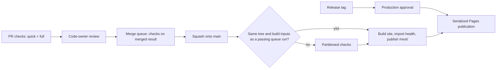
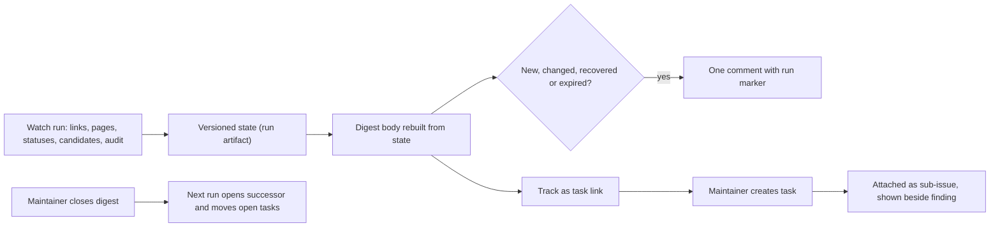

# Design

## Context

See `proposal.md` for the motivation. The baseline is `main` at `f0c09f9`. PR #102 is part of it and already
delivers atomic refresh-branch updates, complete provenance for the remote `/fix-duplicates` command and
reporting of every failed check. This change builds on those and does not repeat them.

The live state was read on 23–24 October 2026:

| Evidence | Observation | Consequence |
| --- | --- | --- |
| PR run 40022072478 | 6 min 20 s. Build 20 s; CPU lane 18 s setup + 119 s checks; browser-a 45 s + 187 s; browser-b 60 s + 226 s (critical path); collector 41 s | Shorten the critical lane and setup, not the build |
| Same run, lane evidence | Two browser slots per lane. Case `en/320` waited 62 s for a slot. Long single scripts: accessibility 67 s, sources 65 s, model 63 s; final cases at 1280 px about 60 s | More balanced lanes and case splits |
| Same run, unit timings | 470 tests, 105 s, run one after another; slowest test 7.8 s | Parallel shards |
| CPU lane | Three `rocrate-validator` profiles of about 110 s each overlap the unit tests | Measure alternatives |
| Deployment | Staging runs the full `check_all.py` (568 s in run 39224056433). Every deployment, staging included, waits for a named reviewer. On 23 October three merges cancelled two pending deployments | Reuse verified results; approve production only |
| Main ruleset | Squash only, branches must be up to date, code-owner review, required `checks`; administrators may bypass | A merge queue replaces the up-to-date rule |
| Comment workflows | `fix-duplicates.yml` and `source-refresh.yml` both start on every comment; workflow-level concurrency is taken before the job filter, and a new pending run cancels the waiting one | One filter-first command workflow |
| Health watch | 24 open per-finding issues; state in `actions/cache`, which drops entries unused for seven days, on a weekly schedule; only the first 600 of 673 URLs are checked | Digest, durable state, fair selection |
| Project #1 | 70 items; Status Needs triage, Ready, In progress, Review, Done; seven views; native automations with auto-close off and auto-archive on. Priority and Effort are organization issue fields that exist only on typed issues; 2 of 61 open issues are typed; no `area:*` labels exist yet | Audit, labels, typed templates, backfill |
| App registration | `fair-guide-actions` lists `organization_projects: write` and several permissions no workflow requests; installation acceptance is not readable with the maintainer's current token | Reviewed permission list; read-only audit |
| Issue shape | The delivered `aiscr-plan-issue` engine declares the issue shape and exposes `section_status()` and `readiness()` | Templates and audit reuse it |

Two baseline defects remain and are reproduced as follows. These describe the current behaviour, not the result
of this change's repairs.

- **G2, curated notes lost:** call `release_versions.changelog()` with an `[Unreleased]` note and one eligible
  merged PR. The output keeps the PR link and drops the note. `CHANGELOG.md` currently holds one Added and eight
  Fixed curated bullets that the next preparation would drop.
- **G4, known failure hidden:** use the fixture from `PartitionTests.fixture` in `tests/test_check_ci.py`, mark
  the CPU `content` result failed and delete `browser-a/lane.json`. `check_ci.collect()` returns 1 but the report
  contains only `aggregate`, because `reconcile()` raises on the missing lane after collecting the failure.

## Goals / Non-Goals

**Goals:**

- Simple operations stay simple: merge with one click, release with two dispatches and one approval, triage from
  one view, repair with one command.
- Machines check structure and consistency; people judge notability, semantics and priority.
- Every automated output says what happens next, and every setting has a reviewed expected state.
- Faster checks with exactly the same coverage.

**Non-Goals:**

- No bot writes to the Project and no bot administration rights.
- No PR-body parsing for policy decisions.
- No combined or skipped coverage to reach a time target, and no hard wall-clock gate.
- No new runtime dependency or service.

## Decisions

### 1. Waves and their order

The six waves in the proposal map to the task groups: wave 1 to group 1, wave 2 to group 2, wave 3 to groups 3
and 4, wave 4 to group 5, wave 5 to group 6 and wave 6 to group 7. Correctness lands first because the next
release would otherwise lose notes. The settings audit (group 3) precedes the setting changes it verifies.
Labels and templates precede the digest because "Track as task" uses them.

Alternative rejected: one large PR. It would be too big to review and would delay the urgent correctness fixes.

### 2. Changelog: strict structure, advisory notability

`scripts/check_changelog.py` joins the offline inventory and the CPU lane. It checks one `[Unreleased]` section,
meaningful entries, unchanged released sections against the base and a complete release transition. It reads no
PR body text. `release_versions.py` reuses its parser: the curated body moves unchanged into the new dated section,
followed by the generated "Merged pull requests" and "Direct commits" lists. Curated notes that use those reserved
headings are refused before any write.

Whether a PR deserves a release note is a human judgement. The trusted review comment therefore shows an advisory
line derived from the diff: "release note added", "covered by the generated lineage" for Dependabot and refresh
PRs, or "consider a note if readers or maintainers would notice". The release PR is where the curated notes are
reviewed as a whole. `docs/changelog.md` documents this.

Alternatives rejected: a required note-or-reason gate read from the PR body. It reruns the full six-minute checks on
every body edit, needs bot exemptions and turns untrusted text into a policy input. Changelog fragment files were
also rejected; they add files without preventing the reproduced loss.

### 3. Known failures survive incomplete evidence

`reconcile()` keeps the results of admitted lanes when a later lane is missing, unreadable or has the wrong
identity. The collector emits those known failures together with the evidence diagnostic and stays failed.
Rejected lanes contribute nothing, and optional suggestions stay unpublished as today.

### 4. Local duplicate repair matches the remote command

Local `--fix` writes the link, one provenance action and its identifier registration, then rechecks content and
duplicates with the existing atomic rollback. The responsible person comes from `--person`, or else from the single
reviewed person whose `github` or `commitNames` entry in `content/guide.toml` matches `git config user.name` or the
GitHub account. Unknown or ambiguous identities write nothing. The output states how the person was resolved, so a
wrong local Git identity is visible in the diff before commit. The provenance-writing code is shared with
`fix_duplicates.py`, so both routes produce the same records.

Alternative rejected: requiring `--person` always. It adds a step for every known contributor and gains nothing,
because the reviewed mapping already exists and the diff is reviewed.

### 5. One command workflow with `/help`

`commands.yml` is the only `issue_comment` workflow. A `parse` job runs default-branch code with no write
permission and no concurrency group, and it only starts for a comment that begins with `/`. It checks the syntax
against a registry (`/help`, `/fix-duplicates`, `/refresh <source>`). An `acknowledge` job checks the context and
the caller's current permission. Each command then runs in a job with job-level concurrency keyed to the resource
it changes and `queue: max`: `fix-duplicates-<pr>` per pull request, and one `source-refresh` group for every
refresh, because sources read each other's snapshots. GitHub allows up to 100 pending runs this way, and
`queue: max` cannot be combined with `cancel-in-progress`. `fix-duplicates.yml` becomes a called workflow, and
`source-refresh.yml` keeps its schedule and dispatch triggers and becomes callable too. Their trust guards do not change.

Accepted commands get an `eyes` reaction at once. They end with a `rocket` reaction, or with `confused` and a reply
naming the run, the result and the next step whenever nothing else explains the result; the handlers' own replies
also name their run. A command that must wait names the earlier run holding its resource, found through the run
title `Comment on #<n>`; a cancelled run, including a full queue, is answered with retry guidance.
`/help` maintains one marked comment per thread. It lists the applicable commands and the caller's eligibility from
the same eligibility functions the commands use, and offers "did you mean" for near-miss commands. Anyone may ask
for help; it only edits its own comment.

Alternatives rejected: one workflow per command with workflow-level groups (the current race) and a bot service
(no backend).

### 6. Faster checks with unchanged coverage

- **Quick feedback.** A `quick` job in `checks.yml` runs the cheap offline checks (content, duplicates, changelog,
  ruff, format, public-content, openspec, agent generation) next to the build. It is not required. Its failures
  also appear in the full `checks` result.
- **Measured partitions.** `scripts/ci_timings.py <run-id>` reads job and step timings and lane evidence (queue,
  setup, active time, slot waits). It suggests a lane assignment by longest-first packing. The assignment stays in
  its single committed owner and changes only through review. Expected outcome: three or four browser lanes of
  about 150 s each instead of two lanes of up to 226 s.
- **Case splits.** Browser scripts whose time excluding browser-slot waits exceeds about 45 s become named cases
  through the existing case mechanism, so slots fill evenly, and cases start longest first. The inventory still
  requires each case once. Case reports record a script's slot wait. Measured on 24 October 2026, accessibility,
  sources, model and citation took 3.7–13.9 s alone but 37–68 s in run 40022072478: their CI time was slot
  waiting, which separate lanes remove and splitting would not. No script currently qualifies.
- **Unit shards.** `profile_checks.py` runs deterministic shards in parallel processes, locally and in CI, and
  merges one timing report. Tests already use temporary fixtures. A shuffled-order run guards against hidden
  shared state.
- **Setup.** `setup-python` and `setup-node` use their pip and npm caches, keyed on `requirements-dev.txt` and
  `package-lock.json`. Browser lanes skip the Python validator stack when the lane runner needs only the standard
  library; the apply task verifies the import graph first. The collector drops installs it does not use.
- **Experiments kept only when measured.** One validator process for the three profiles, or keeping validators off
  the unit-shard cores. A Playwright browser cache, where restore plus system dependencies may cost as much as
  today's install.
- **Acceptance.** Three reruns of a fixed PR commit before and after, reported by `ci_timings.py`: elapsed time,
  critical path, queue, setup and summed job time, with full case and validator coverage. Goals: full checks
  around 4–4.5 min and quick feedback around 1–1.5 min. Public-repository minutes are free; the real constraint is
  the organization's concurrent-job limit, which the receipt also reports.

Alternatives rejected: path-based skipping of browser lanes (it weakens the "every PR" checks). Caching built sites
or test results is deferred to the separately approved input-digest experiment.

### 7. Merge queue with PR checks kept

The main ruleset gains a merge-queue rule: squash method, all entries green, up to three PRs per group, at most two
groups building, no minimum wait and a 30-minute check timeout. The up-to-date requirement is switched off because
the queue verifies the merged result. PR checks stay required before a PR can be queued, so contributors keep their
feedback, and Dependabot, refresh and human PRs follow the same path. `checks.yml` handles `merge_group`: it uses
the merge-group base, skips PR-only review-data steps and keeps read-only permissions. `pr-summary.yml` ignores
merge-group runs. Administrator bypass stays as the documented break-glass route. Its commits simply do not match
a queue result, so deployment runs the full checks.

The lane jobs become one reusable workflow, called by PR, merge-group and deployment-fallback checks, so the
inventory and evidence rules are identical everywhere.

### 8. Deployment: reuse, approval only for production, serialized publication

For a default-branch push, deployment builds the staging site, which takes seconds. It then looks for a successful
merge-group `checks` run whose head tree and build inputs equal the pushed commit's. If one is found, it imports
that run's health snapshot after validating the identity fields and schema, and names the run in the summary.
Otherwise it runs the reusable partitioned checks. The trust is the same as today: the code that produced the
reused result is the code being deployed, and a PR run never contributes to a deployment.

Approval moves from the `github-pages` environment to a new `production` environment with required reviewers. An
`approve-production` job runs only when a tag would publish production bytes that have not been published before.
Branch pushes select the latest tag whose verified release artifact already exists, so staging never promotes an
unapproved tag. Workflow concurrency is per ref: branch runs cancel superseded preparation, and tag runs are never
cancelled by branch runs. Assembly and Pages publication run as one job-level critical section, `pages-publish`
with `queue: max`. That section rechecks that its staging commit is still current and its production tag is still
the newest approved one; otherwise it publishes nothing and names the newer run. Tag release checks that the
current default-branch commit has a successful deployment, which the tag ruleset requires, and otherwise names the
run to wait for.

Alternative rejected: keeping one approval for all deployments. It makes every merge a two-person, two-step
operation without protecting anything that the code-owner review does not already protect.

### 9. Settings as a reviewed expected state

`.github/repository.toml` records the main and tag rulesets including the merge-queue parameters, the
`github-pages` and `production` environments, the labels and their path rules, the Project's fields, options,
views and built-in automations, and the App's expected registration permissions. `scripts/audit_repository.py`
reads the live state and prints, for each difference, the setting, the expected and actual values, the UI path and
an equivalent `gh api` command. Settings it cannot read are "unavailable", never "matching". `--fix` is limited to
creating or updating declared labels and adding missing Project items with the operator's own token. No bot holds
administration rights; people apply setting changes, and the next audit confirms them.

The same script runs locally, by manual dispatch and weekly. The weekly run feeds the digest's "Project and
settings" section. A capability table in `docs/maintenance.md` records which token can read which section.

Alternatives rejected: a settings-sync bot with administration permission (too much power) and prose-only
checklists (they drift silently).

### 10. Project, labels and intake

The Project's native automations remain its only writers. Area is a label, because Project views can filter by
labels but cannot group by them:

| Label | Covers |
| --- | --- |
| `area:content` | advice, questions, glossary, model texts |
| `area:sources` | snapshots, refresh, registry data, ledger sources |
| `area:interface` | UI, accessibility, language, print |
| `area:evaluation` | live checks, evaluators, self-check |
| `area:delivery` | CI, release, deployment, tooling, dependencies |
| `area:maintenance` | the health digest and the tasks it spawns |
| `source-refresh` | PRs opened by the refresh publisher |

The trusted review publisher lists the PR's files through the GitHub API and maps paths to area labels with the
rules from `repository.toml`, using a standard-library Python helper. It only adds labels. It does not re-add a
label that the timeline shows a person removed. The refresh publisher adds `source-refresh`.

Status meanings: **Needs triage** is set by the item-added automation (PRs also receive it; the Triage view shows
issues only). **Ready** means triaged. **In progress** is set when a PR is linked. **Review** is set by hand when
the linked PR is ready for review. **Done** is set by closing or merging, and auto-archive applies after 14 days.
PRs are followed in the Contributions and Automated updates views regardless of Status.

**Definition of Ready:** an Issue Type (Bug, Feature or Task), at least one `area:*` label, Priority and Effort
(Low, Medium or High), and a body that the delivered `readiness()` accepts. Priority and Effort are organization
issue fields available only on typed issues, which is why the type comes first.

`scripts/generate_issue_templates.py` imports the delivered shape constants and writes Czech and English Bug,
Feature and Task Markdown templates. Each template has the metadata table, `Problém`/`Problem`, the type block,
`Rozsah`/`Scope`, `Akceptační kritéria`/`Acceptance criteria` and `Otevřené otázky`/`Open questions`, plus guidance
comments that repeat the engine's rules. It omits the workflow-owned marker, reporter region and disclosure, and
sets the native issue type in front matter. `config.yml` keeps blank issues and links Discussions and the docs.
`--check` joins the offline suite. Markdown templates were chosen over issue forms because forms render every field
as a `###` heading and cannot produce the metadata table.

The Project audit reports:

- open issues or PRs missing from the Project;
- issues without a type, or a body `Typ`/`Type` row that differs from the native type;
- Ready issues failing the definition above;
- Needs triage older than 14 days;
- Urgent issues in Needs triage or Ready for more than three days;
- closed items not Done, or open items in Done;
- drift in automations and views.

The digest is public and may list Urgent items (confirmed by the maintainer). It shows no other Project field
values. Anything else that could disclose Project-only content is asked about before it is added.

The backfill assigns the Issue Type and area label of every open issue from a reviewed mapping file kept with this
change. It is applied with the audit's dry run first, after which people triage in the Triage view.

### 11. One digest rebuilt from state

`health-issues.cjs` is replaced by a digest publisher. It finds the single open issue with the `guide-health`
label and the digest marker that was created by the workflow identity. If none exists, it creates one; if there
are two, it writes nothing and warns. The body is entirely automation-owned and says so, while discussion happens
in comments. Its sections are: needs triage, tracked, known limitations, source updates to review, candidates to
review, stale statuses, coverage, and Project and settings. Overflow is collapsed into counts with an artifact
link, so the body stays within GitHub's limit. A comment is posted only when the set of new, changed, recovered or
expired findings is nonempty. It carries the run ID, so a retry finds it instead of repeating it. Pinning is best
effort with a visible warning. Rotation is the maintainer closing the digest: the next run opens a successor,
posts the forward link on the predecessor and moves open sub-issues. Each step can be rerun until it is complete.

A finding's "Track as task" link opens a new issue prefilled with the Task shape, the finding key marker and
`area:maintenance`. The publisher adopts an open issue that carries a known key and was created by an account
with write access, attaching it as a sub-issue of the digest with `GITHUB_TOKEN` and `issues: write`. The native
auto-add-sub-issues automation then places it in the Project. A closed task keeps its disposition. Only a changed
outcome returns its finding to triage.

### 12. Watch inputs, coverage and state

Outcomes are classified as broken (404/410), denied (401/403), rate limited (429) or unavailable (timeout, 5xx,
DNS), keeping the method, status and evidence. Selection is least recently attempted first under the global budget,
with a per-host cap and bounded `Retry-After` handling, and reports eligible, attempted, deferred and invalid
counts. State is a versioned JSON file uploaded as a run artifact with 90-day retention and downloaded from the
previous successful run. Version 1 state is migrated. Missing or malformed state produces a reset notice.

`.github/health-watch.toml` holds reviewed limitations: exact key, outcome, reason, evidence, reviewer (person ID),
review date and review-by date. These entries are validated offline. For new denials and rate limits, the digest
offers a ready-to-paste entry. `content/link-reviews.toml` stays the separate mechanism for prose references.
Watched-page extraction ignores pagination and navigation such as #101. Champion candidates stay listed until a
maintainer decides, without automatic adoption.

The legacy migration has two phases. First, a dry run maps every open `guide-health` issue (#59–#65, #85–#101) to
a digest entry, a retained task or a noise disposition, after refreshing each thread. Second, after approval of
that mapping and of the exact first digest body, one run publishes the digest, comments and closes the absorbed
issues as "not planned" with the digest link. The per-finding publisher is removed in the same PR, so the two
publishers never run in parallel.

### 13. Self-explaining CI

The workflow catalogue block in `docs/ci.md` is generated from the YAML: triggers, permissions at each level,
concurrency, uploaded artifacts and retention. A small reviewed TOML file adds purpose, human entry point, next
actor and rerun route per workflow and artifact. `--check` fails on a missing entry or a stale block; generated
Copilot setup is included. The page opens with a cheat sheet: merge, release, refresh a source, fix a duplicate,
handle the digest and rerun a check. It also documents commands, `/help`, local reproduction (`check_all.py`, the
`check_ci.py` build/lane/collect steps, `ci_timings.py`) and the required context name `checks` as distinct from
the workflow name. CONTRIBUTING, `docs/agent-tooling.md` and `docs/deployment.md` link to it and keep their own
procedures.

All renderers share a "Next / If blocked / Done when" block: Python for the check summary and collector, JavaScript
for the trusted publishers. Representative output tests fail when an element is removed. The PR template asks for a
release-note decision and a planning link in plain words; nothing parses them.

### 14. Crawler files (#83)

The build writes `robots.txt` and `sitemap.xml` from the configured base URL, including `FAIR_GUIDE_BASE_URL`
overrides, with a standard XML writer. The sitemap lists the Guide root and `api/index.html`, with no fragments,
per-language duplicates or invented dates. `robots.txt` points to the absolute sitemap and disallows the preview
path. Assembly preserves the production files byte-for-byte, and preview copies never advertise preview
documents. Tests use the real build and assembled tree. DNS and canonical-address adoption stay with #15 and #32.

### 15. Permissions

App registration target: `contents: write` and `pull_requests: write` (refresh, repair, release preparation, tag),
`organization_projects: read` (audit) and `metadata: read`. `issues`, `merge_queues`, `repository_projects` and the
read-only extras are removed by the owner. The public App endpoint lets the audit detect drift in this list. Every
App token request names only the permissions its job uses. An offline workflow test compares each job's requested
permissions with the reviewed list.

### Issue dispositions (refreshed 24 October 2026)

| Issues | Disposition |
| --- | --- |
| #83 | Delivered by group 7 |
| #84 | Its CI page, workflow and artifact facts, drift check, generated-setup ownership, local reproduction and cross-links are delivered by groups 2 and 7. The code repairs are this change's own scope |
| #59–#65 | Migrated to the digest's candidates section; no candidate selection is approved here |
| #85–#99 | Migrated to digest findings; triaged after migration |
| #100 | Migrated as a source update to review |
| #101 | Closed as noise after the pagination fix, within the approved migration |
| #6 | Receives CI test and handoff evidence; stays open |
| #5–#33, #35–#38, #43, #80 | Unaffected; typed, labelled and triaged through the backfill. #14, #15, #25 and #32 stay external or separate decisions |
| PRs #39–#42, #70 | Unaffected; labelled and tracked in the Project |

## Risks / Trade-offs

- **Queue and PR checks double the runs per PR** → lanes become faster first (wave 2), and the queue builds at most
  two groups. Reuse of PR results inside the queue is part of the separately approved input-digest experiment.
- **The concurrent-job limit could queue runs** → `ci_timings.py` reports queue time, and the lane count is
  chosen from it.
- **Deployment reuse could import a forged snapshot** → only from merge-group runs with an identical tree and
  build inputs, with identity and schema validation. PR runs are never used. When in doubt, the full checks run.
- **A wrong setting could be applied** → each change is shown as the audit's expected-versus-actual diff before it
  is applied, then confirmed by a fresh audit. Each step has a recorded rollback.
- **Branch-run cancellation could leave a commit undeployed when a tag is requested** → Tag release names the run
  to wait for. The latest commit is always deployed by the latest run.
- **Issue-field values may not be readable with the App token** → those checks report "unavailable" and the
  rest of the audit still runs. The local audit with a maintainer token covers them.
- **The digest body could exceed limits** → bounded sections with counts and artifact links.
- **Removing the per-finding issues loses their notifications** → the digest comments on meaningful change, and
  people watch one issue instead of 24.
- **Local Git identity could be wrong** → the person is printed and visible in the diff; `--person` overrides it.

## Migration Plan

1. Land groups 1 and 2 as normal PRs, with no settings changes.
2. Land the settings audit and record the live state (group 3). Land the merge-queue-ready workflows (group 4 code)
   while the old rules are still active; `merge_group` is unused until the queue is enabled.
3. After approval of the audit's exact expected-versus-actual diff, apply settings one at a time, rerunning the
   audit after each:
   - **Enable the merge queue.** Rollback: remove the rule.
   - **Switch off "up to date".** Rollback: switch it on.
   - **Create the `production` environment with reviewers and tag-only deployment.** Rollback: remove it and
     re-add the reviewer to `github-pages`.
   - **Remove the reviewer from `github-pages`.** Rollback: re-add it.

   A separately approved hosted rehearsal then merges one human PR and one grouped Dependabot PR and promotes one
   release.
4. Land labels, templates and the Project audit (group 5). After approval of the mapping, apply the backfill.
   The organization owner confirms the App installation and trims its registration.
5. Land the digest with its migration (group 6). Run the dry run, approve the payloads, publish and reread.
6. Land the CI documentation, handoffs, hints, usage check and crawler files (group 7).

Rollback for code is a reviewed revert. The digest publisher can be disabled while its state artifacts and
human comments remain. Completed repairs, notes and published releases are never rewritten.

## Open Questions

These can be answered during apply without changing the specs or the task breakdown:

- Which API path and App permission read organization issue-field values (Priority, Effort)? Until confirmed,
  the audit reports them as unavailable in CI.
- Do Markdown issue templates apply their `type` front matter? If not, triage sets the type and the audit lists
  untyped issues.
- Can prefilled new-issue links preset labels for all reporters? Adoption relies only on the finding key, so
  either answer works.
- Can `GITHUB_TOKEN` read rulesets and environments? If not, those sections are audited locally only.
- Do the validator and Playwright-cache experiments pay off? Each is measured and kept or dropped.
