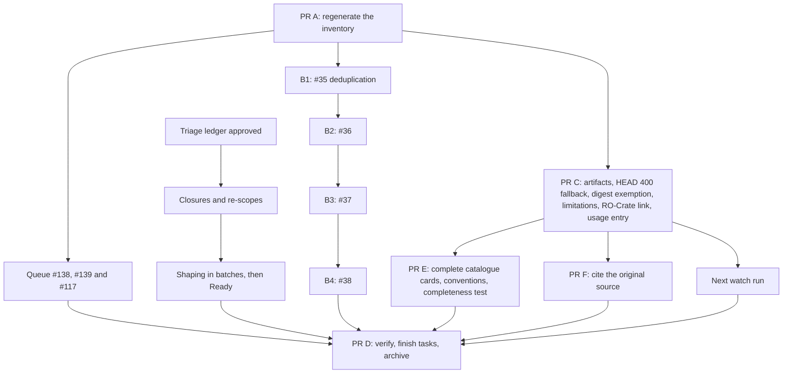

# Design

## Context

See proposal.md for the motivation. These constraints shape the approach:

- **Merge rules.** The `Main branch protection` ruleset requires an approving code-owner review, the `checks`
  status and the merge queue. `.github/CODEOWNERS` names only `@motyc`, and repository administrators may bypass the
  ruleset, by pull request only since D11. The code owner can approve the bot pull requests but not their own; #141
  and #143 were merged through the administrator bypass while review was still required.
- **Merge queue.** The queue checks `main` together with each pull request. Nothing queues successfully until the
  inventory row is regenerated.
- **Drafts.** #39–#42 have seven or eight commits each, dated 17–20 October, all authored as
  `Karel Berka <krapn@example.com>`, a placeholder address.
  - All four add the same 34-line `content/guide.toml` block.
  - Each appends to `content/identifiers.toml` and `content/provenance.toml`.
  - Their new advice IDs do not exist on `main`.
  - #39 rewrites and removes existing items in stations that the other three extend.
- **Content rule.** New advice under existing fields is content work: sources, bilingual text, paradata and the
  ordinary checks, with no OpenSpec change. The paradata check expects a provenance action, added since the merge
  base, that covers every changed item. Freshness is decided by history, not by the clock: an action added since the
  base covers its items whatever its `endTime` says (`fresh_actions` in `scripts/check_content.py`).
- **Credit.** `scripts/contributors.py` matches people only by a reviewed `github` login or exact `commitNames`. It
  reports an action whose agent made none of its commits, and suggests `CITATION.cff` contributors for the agents of
  a branch's actions.
- **Watch.** `fetch` in `scripts/watch_sources.py` repeats a HEAD request with GET only after 403, 405 or 501.
  `classify` maps the final status to an outcome. Addresses in imported snapshots are corrected upstream, not edited
  locally (`guide-delivery`, scenario "A failure concerns imported content").
- **Triage.** `docs/maintenance.md` defines Ready as an Issue Type, an `area:*` label, Priority, Effort and a body in
  the planned-issue shape. On 28 October 2026:
  - 38 issues were open, all with a type and an area label from the CI change's backfill;
  - none had Priority or Effort, and no body passed the planned-issue readiness check;
  - 34 were in Needs triage, 31 of them since 23 October, and the audit counts the 14 days from the Status change;
  - #35–#38 were In progress through the drafts.
- **Digest.** The publisher identifies its digest in `.github/scripts/health-digest.cjs`: an issue authored by
  `github-actions[bot]` whose body starts with `<!-- fair-guide-digest -->`. GraphQL returns that author as a `Bot`
  with the login `github-actions`; REST adds the `[bot]` suffix. The digest carries `guide-health` and
  `area:maintenance`; the tasks it adopts carry only `area:maintenance`.

## Goals / Non-Goals

**Goals:**

- Each step lands as its own reviewable pull request, in an order where no step waits on an unrelated failure.
- Every digest finding ends with an owner, as `docs/runbooks/handle-the-digest.md` defines.
- The rebuilt content passes today's checks and carries truthful paradata and credit.
- Every open issue ends Ready or closed, and the audit's triage checks can be satisfied for every issue it judges.
- The catalogue shows everything the knowledge base records about its entries, in the same place for every kind.

**Non-Goals:**

- Changing how redeliveries are received, how reviewers are configured or how the merge runbook treats a single code
  owner.
- Reworking the drafted advice beyond what review and today's checks require.
- Doing the work the triaged issues describe, or changing the definition of Ready.
- Adding detail to the stations or changing the About page's credits.

## Decisions

### D1. One change, delivered by nine pull requests and one triage pass

| Step | What it carries | When |
| --- | --- | --- |
| A | The regenerated inventory row only, without this change's artifacts, so the quick fix stays a one-row diff | First |
| #138, #139, #117 (bot) | Approval by the code owner, then the queue | After A |
| B1–B4 | Rebuilt content, one per issue, in issue order | After A, independent of the bot pull requests |
| C | The change branch `agents/claude/restore-main-and-triage-open-work`: this change's artifacts and triage ledger, the HEAD 400 fallback and the digest exemption with their tests, the limitations, the RO-Crate link fix and the usage entry; each behaviour change travels with its spec delta | After A |
| E | The complete catalogue of D8 with its tests and documentation, branched from `main` after PR C, which was already under review when the maintainer added this scope | After C |
| F | The original-source rule of D10: the content rule and its generated copies, the `guide-knowledge-base` delta, the content model and how-to, this change's artifact updates and the usage entry; also the record of D11 and its declared setting | After C, independent of E |
| Triage | The ledger on the change branch; its writes go to GitHub issues and the Project, not to a pull request | Now, independent of A |
| D | Verification after the next watch run and the triage, the final task and usage-entry updates, and the archive after approval | Last |

Alternatives considered:

- One pull request for everything: rejected. It mixes a quick fix, four content reviews and three behaviour changes,
  and keeps `main` red until all of them are reviewed.
- This change's artifacts in PR A: rejected, because it turns the quick fix into a planning review.

### D2. Merge route by author

**Bot pull requests** follow `docs/runbooks/merge.md`: the code owner approves them and chooses **Merge when ready**.

**The maintainer's own pull requests** (A, B1–B4, C, D, E and F) need the administrator bypass, as #141 and #143 did,
because no other eligible reviewer exists. Before each bypass:

- `checks` is green;
- the maintainer's acceptance is recorded in a pull-request comment.

After each merge, the deployment run for the merge commit is followed until its full checks pass.

This departs from step 2 of `merge.md`, which asks for an eligible reviewer or a reviewer-configuration change. This
change does not amend the runbook (see the proposal's exclusions), and the usage entry records the departure.

Alternative considered: adding a second code owner first. Rejected here because it is a settings and governance
change outside this scope; it remains the proper fix.

### D3. Rebuilding the drafts

- **What is kept:** each draft's station hunks only. Its `openspec/` files, its knowledge-base requirement and its
  usage log are dropped.
  - The usage logs describe archived changes that will not exist, so keeping them would record false history.
  - The drafts stay readable on their closed pull requests.
- **Identity:** the drafted advice IDs are kept (`plan.31`, `plan.32`, `collect.22`, `collect.23`, `licence.31`,
  `publication.30`, plus edits to existing items), since no release issued them. `python scripts/register_ids.py`
  registers new IDs and places removed ones as the check requires.
- **The author:** Karel Berka of Palacký University Olomouc wrote the drafts and is credited as their author.
  - B1 adds his person record as drafted: ORCID `https://orcid.org/0000-0001-9472-2589`, affiliation `upol` and
    `commitNames = ["Karel Berka"]`, plus `github = "KarelBerka"`. It also adds the `upol` organisation record with
    ROR `https://ror.org/04qxnmv42`. Both identifiers and the GitHub account were checked against ORCID, ROR and
    GitHub on 28 October 2026.
  - Each rebuilt commit that carries his text ends with `Co-authored-by: Karel Berka <karel.berka@upol.cz>`, in place
    of the placeholder address. `contributors.py` matches him by his commit name; GitHub links the commit to his
    account if that address is verified there.
  - B1 lists him under `[guide] contributors`, which the crate publishes as `schema:contributor`. `CITATION.cff`
    credits only the software's authors (`docs/design.md`), so the contributor entry `contributors.py` suggests
    there is not taken.
- **Instruments:** B1 adds the drafted instrument records for Antigravity and the Gemini models named in the drafts'
  usage logs.
  - `antigravity` points to `https://antigravity.google/`, Google's product page, instead of the draft's
    `https://github.com/google-deepmind`.
  - The Gemini records keep `https://deepmind.google/technologies/gemini/`, which lists both drafted models.
- **Paradata:** the actions follow who did the work.
  - Each rebuilt pull request adds Karel Berka's action: agent `karel-berka`, the instruments his draft used, the
    objects and results it covers, and the `endTime` of his draft. Because freshness follows history, his real time
    passes the check. In B1 its results also name `guide`, for the Guide metadata his records change.
  - A second action is added only when review changes what the Guide says: a claim reworded, dropped or re-sourced.
    Its agent is `david-novak`, its instruments are Claude Code and its model, and its `results` list exactly the
    changed items.
  - Technical work adds no action: applying the hunks, registering IDs, dropping the draft-only files, and correcting
    a record's address.
- **Review:**
  - Each claim is checked against its cited clause.
  - Czech and English say the same thing.
  - "musí" is used only for NRP conditions, and references resolve.
  - The claims citing Act No. 328/2025 Coll. are compared with their ledger clauses by a person:
    `LAW-328-2025.83` (#36), `.83.3` (#37) and `.83.5` (#38).
  - The built page is inspected in both languages, at phone width and in print.
- **Link inventory:** the watch's coverage test fixed the Guide's link count at 673, which any new record breaks.
  B1 derives its expectations from the per-host cap and the run budget instead, so B2–B4 do not repeat the fix.
- **Order:**
  - #35 (deduplication) goes first, because the others add text beside items it merges; then #36, #37 and #38.
  - Each next branch is rebuilt on the latest `main`, which avoids append conflicts in the registry and provenance.
  - Each pull request closes its issue with `Closes dsw-nrp/eosc-fair-guide#N`, and its draft is closed with a link.

Alternatives considered: rebasing the drafts, or one combined pull request. The maintainer chose one pull request per
issue. A single action per pull request naming both people's tools was rejected, because it would attribute the
rebuild's tools to the author.

### D4. Digest dispositions

| Finding | Owner of the address | Disposition |
| --- | --- | --- |
| `commons.datacite.org`, `ror.org` | Guide; `ror.org` also in the FIP Dashboard snapshot | Limitation `rate-limited` |
| `openai.com/codex`, `support.orcid.org` | Guide | Limitation `denied` |
| `v2.sherpa.ac.uk` Object Retrieval API page | Guide `sources[sherpa-object-retrieval-api]` | Source record moved to Open policy finder, because the page refuses people as well (#137) |
| `www.chemspider.com`, `www.hepdata.net` | KNAV tools snapshot | Limitation `denied` |
| `www.data.cam.ac.uk` notebooks page | Guide | Limitation `denied` |
| `events.eosc.cz` survey PDF | Guide | Resolved by D5; no limitation |
| `w3id.org/ro/crate/1.2` | Guide `resources[ro-crate]` | Reader link to `https://www.researchobject.org/ro-crate/specification/1.2/` |
| `data.narodni-repozitar.cz` | FIP Dashboard snapshot | Upstream report and tracked task |
| `dmeg.cessda.eu/Data-Management-Expert-Guide` | KNAV tools snapshot | Upstream report (the root address answers) and tracked task |
| `docs.it4i.cz/lumi/about/` | KNAV tools snapshot | Upstream report and tracked task |
| `tla.mpi.nl` ELAN | KNAV tools snapshot | Upstream report of the new address `https://archive.mpi.nl/tla/elan` |
| `asep.lib.cas.cz` (2 links) | FIP Dashboard and re3data snapshots | Decide after the next run; one host task if it persists |
| `data.eli-laser.eu` | re3data snapshot | Decide after the next run; limitation `unavailable` if it persists |

- **Limitation entries** take the digest's key, outcome and evidence. The reviewer is the maintainer's person ID,
  the review-by date is the one the digest offers, and the `reason` is written by the maintainer.
- **The crate's identifier stays:** `build_crate.py` keeps `https://w3id.org/ro/crate/1.2` as the crate's
  `conformsTo` value, because it identifies the profile and is not a reader link.
- **The Sherpa source moves:** the maintainer confirmed in a browser on 28 October that
  `https://v2.sherpa.ac.uk/api/object-retrieval.html` answers 403 to people too, so a limitation would only hide a
  link readers cannot open. Jisc combined the Sherpa services into Open policy finder in November 2024. The record
  keeps its ID and takes the page title "Object Retrieval API | Open policy finder" and its address.
- **Other digest sections:**
  - The next scheduled refresh retries heslar and nkr.
  - The two source updates (a job advert and a webinar date) get a digest comment recording the decision not to act.
  - The five Champion candidates get one tracked task for the selection review.
  - The `PR - authored` sort needs no setting change: #141 changed its expected sort to the live
    `Status asc, Title asc`, and a maintainer's project audit on 28 October found no drift.
  - The Issue Type lines for #115–#135 clear on their own, because those issues closed after the digest run and the
    audit skips closed issues.
- **Approval before writing:** every write to GitHub or upstream (tasks, comments, reports, issue bodies and fields,
  and the Project) is shown to the maintainer and approved before it is made.

### D5. Repeat a HEAD 400 with GET

Add 400 to the HEAD statuses that `fetch` repeats with GET. The observed case is the events.eosc.cz attachment, which
answers HEAD with 400 and GET with 200.

- **What stays the same:** `classify`, the stored state format, digest rendering, limitation matching and per-host
  throttling. The only cost is one extra request for each address whose HEAD returns 400.
- **Failure handling:** the GET answer is classified like any other answer. A failing GET keeps its own outcome, and
  the evidence names both methods.
- **Tests:** new tests patch `urllib.request.urlopen` for HEAD answers of 400, 403, 404 and 429. No test reaches the
  network.

Alternatives considered:

- A limitation for the PDF only: rejected, because it hides a checker error and needs renewal.
- Repeating every non-success HEAD except 429: rejected, because it doubles the requests for every broken or silent
  address, and nothing shows that is needed.

### D6. Triage every open issue

**End state.** When the change is archived, every issue that was open when the ledger was approved, and every task
this change opens, is Ready or closed. The digest is exempt (D7). #35–#38 close through B1–B4 and are not shaped.

**The ledger.** `triage.toml` in this change's directory is the batch's approval record, drafted as a task like
`backfill.toml` in `enhance-ci-and-repository-workflows` and reviewed once by the maintainer. No tool reads it, and
each write it leads to still shows its exact content before it is made. One `[[issue]]` entry per issue:

| Field | Values |
| --- | --- |
| `number` | The issue, with its title as a comment |
| `decision` | `keep`, `rescope`, `merge` or `close` |
| `into` | For `merge`: the issue that absorbs it |
| `reason` | For every decision except `keep` |
| `priority`, `effort` | The Project values, for `keep` and `rescope` |
| `milestone` | The milestone it stays in or moves to |
| `shape` | `full`, `light` (only the reporter region is missing) or `none` |
| `parent` | Optional: a parent issue to set, or `"none"` to remove one |

The draft proposes values from evidence: the issue's thread, the files it names and their history. The maintainer
sets the final values.

**Known inputs** from the exploration on 28 October:

- #15, #32 and #136 are re-scoped together. `content/guide.toml` now sets `baseUrl` and `namespace` to
  `https://dsw-nrp.github.io/eosc-fair-guide/`. #136 owns the persistent namespace, #15 the agreement on the address
  and #32 serving the site there.
- #80's body is only a URL, and its title says OSF where `bestpractices.dev` is the OpenSSF Best Practices badge.
- #137: the page refuses people as well as the watch, and the service now lives at Open policy finder. PR C moves
  the source record (D4) and closes the issue.
- #12 and #13 are sub-issues of the closed #2 and #3.
- #6 starts "after the first official prerelease", which needs a decision now that alpha.4 is released.
- #16 and #24 link the repository's former address `motyc/eosc-fair-guide`; shaping corrects the links.
- Fifteen issues in `v1.0.0` mostly wait on outside parties; the ledger decides whether each remains a release
  condition.

**Route.**

1. Draft and approve the ledger.
2. Apply closures, merges, parent changes and re-scopes. Each closure carries a comment with its reason and links
   its successor where one exists.
3. Shape the rest with `/aiscr-plan-issue`, in batches of about five. Each issue's original is archived and its new
   body posted after the maintainer approves both digests. A body keeps its language.
4. After an issue's body is posted, set its Priority, Effort and milestone, then its Status to Ready.
5. Tasks opened in 5.1 follow steps 3 and 4 when they are opened.
6. A maintainer's `python scripts/audit_repository.py --section project` confirms the end state.

**Timing.** Steps 1 and 2 finish before 6 November, and shaping aims to finish before the first weekly run after
that date. An issue still unshaped then appears as a triage finding until it is Ready. That is expected, recorded in
the usage entry and not suppressed.

Alternatives considered:

- Shaping only the next milestone's issues: rejected, because the rest would stay in Needs triage and the audit
  would report them for the life of the change.
- Extending `--backfill` to Priority, Effort and Status: rejected for a single pass. Weekly triage sets one issue at
  a time.

### D7. The digest is exempt from triage

The digest's body is automation-owned (requirement "One maintenance digest is rebuilt from current state"), so it can
never meet the planned-issue shape that Ready requires. The audit therefore stops judging it for triage.

- **Identification:** the audit applies the publisher's own rule. The Project items query adds the issue's author,
  and an item is the digest when it is an issue whose author is the `Bot` `github-actions` and whose body starts
  with `<!-- fair-guide-digest -->`.
- **What is skipped:** the 14-day triage check and the Ready check. Project membership, the Issue Type, the body's
  Type row, the state and Status consistency and the Urgent check still apply.
- **Why not the label:** anyone with triage permission can add `guide-health`, and a person's issue must still be
  triaged. Only the publisher writes as that bot with that marker.
- **The Triage view:**
  - Its filter becomes `is:issue status:"Needs triage" -label:guide-health`, so the digest no longer waits there;
    the Maintenance view still shows it.
  - A person's issue labelled `guide-health` is hidden there as well, but the audit still reports it.
    `docs/maintenance.md` and the label's description say the label is reserved for the digest.
  - A `[[pending]]` entry is reserved for the deployment steps in `docs/deployment.md`, and a test holds it to them.
    The maintainer therefore applies the filter and the label description live first, and PR C records both in
    `.github/repository.toml` and in the recorded audit fixture, as #141 did for the `PR - authored` sort. Until PR C
    merges, an audit of `main` reports the two as drift.
- **Tests:** fixtures in `tests/test_audit_repository.py` cover the digest waiting more than 14 days, the digest in
  Ready, a person's `guide-health` issue, and an issue whose body carries the marker but whose author is a person.

Alternatives considered:

- A Status convention, with a person setting each digest to In progress: rejected, because it is a conduct rule where
  a mechanism exists, and every successor would need it again.
- Exempting by label: rejected, for the reason above.

### D8. The catalogue hides nothing

**The rule.** Stations stay quiet: one source and date line without names, linking to the full detail (requirement
"Credit for content and compilation"). The catalogue is that full detail. Every catalogue entry shows every field its
record carries, or excludes it with a stated reason; a count never replaces the items it counts; a relation shows on
both of its ends. The catalogue's own labels do not address the reader, since it is not read in a role.

**What the catalogue hides today** (the built crate compared with each card's code on 29 October 2026):

| Kind | Hidden |
| --- | --- |
| Content changes (all) | the agent, the instruments, which items changed (a count only), consulted requirements (only cited sources survive the filter in `actionEntries`) |
| Check questions (214) | `fixedBy`, `appliesTo`, `allowsNotApplicable`, pre-fill sources and their limits, the explanation in `description`, `block`, `providedByNrpFor`, `mentions` |
| FIP profiles (6) | the declarations (a count only), the authoring community, keywords, status |
| FAIR-enabling resources (28) | FAIR data type, coverage, provider |
| Resources and sources (170 with a licence) | the licence, shown only on KNAV tool cards |
| Requirements (2 superseded) | `supersededBy` |

**Six conventions for every kind.** They make the existing requirement that fields appear "as labelled rows with
icons in a fixed order" concrete, and they change cards beyond the six above:

| # | Convention | Other cards it changes |
| --- | --- | --- |
| 1 | The byline names who made the work: the author or credit, a change's agent, a FIP's community. Rows name who runs or provides it: Operated by, Developed by, Provided by. | The infrastructure's host (`publisher`) moves from the details line to Operated by, as `operatorRow` already shows it for resources and repositories. |
| 2 | A work's own licence is a Licence row. The licence of a quoted text is one line beside the quote, named from the data. | KNAV tools, life-cycle stages, terms (today a fixed "CC BY 4.0" label) and requirement guidance share that line. |
| 3 | Dates sit in the details line; an "as of" date stays with its status badge. | None. |
| 4 | Status is one badge with icon, text and as-of date, from one helper. | Test health and FIP declaration status use it. |
| 5 | Qualified lists (item, qualifier, note) are relation rows, grouped by kind and folded when long. | Criterion mappings become a Covers row, life-cycle correspondences a Corresponds to row. |
| 6 | Relations show in both directions. | Pre-filled from and Pre-fills; Declarations and Declared in; Replaced by and Replaces; Changed, and on every entry a link in its corner that counts the changes that produced or altered it and leads to them in the catalogue's list of changes, so no entry grows with each change. |

**The cards.** What each affected kind gains:

- **Content change:**
  - the byline names the agent, with an ORCID link unless the person opted out;
  - the details line gives the end date and the counts, and the body the description;
  - no separate **Made by** row, which would repeat the byline (the maintainer's decision on 29 October 2026);
  - **Tools**: each instrument with its kind (software or AI model) and its recorded version, so an AI model
    appears as a tool and never as an author;
  - **Consulted** and **Changed**, grouped by kind, each group listing every item. A catalogue kind links to its
    entry; advice, callouts and pages link to their station or page.
- **Check question:**
  - the explanation (`description`) as a quiet paragraph under the question;
  - **Who puts it right** (`fixedBy`, at its station), named by role. The actor the self-check called "you" is
    named "researcher", with the ID `researcher` in place of `user`, everywhere, since "you" also misread in another
    lens and in a shared report; the chosen
    lens's badge still marks its own group (the maintainer's decision on 29 October 2026);
  - **Applies** (`appliesTo`, and whether "not applicable" is offered);
  - **Pre-filled from**, each source with "at most Partly" and "Champion evidence only" where set;
  - **Group** (`block`) and **For NRP profile** (`providedByNrpFor`) where set;
  - **Mentions**;
  - `assessmentContext`, `lookup` and `note` where present.
- **FIP profile:**
  - the byline names the authoring community, and the details line gives the status, version, date and keywords;
  - **Declarations**: a disclosure across the card's full width, summarised by status, holding a table of
    principle, enabling resource (linked to its entry), status badge and note; the same table also opens on a page of
    its own;
  - **Based on**: the snapshot and its date.
- **FAIR-enabling resource:** the FAIR data type and coverage in the details line; **Provided by**; **Declared in**
  (the FIP profiles that declare it).
- **Resources and sources:** a **Licence** row.
- **Requirement:** **Replaced by** and **Replaces**.

**Scale.** The initial-state action consulted 143 records and changed 1,374. Every list stays complete, inside a
per-kind disclosure that is built when it is first opened, so a long list costs nothing until a reader asks for it.

**Completeness as a mechanism.** Each kind declares the fields its card shows. A test reads the built crate and fails
when a property of a catalogue entity is neither declared shown by its kind nor on an exclusion list with a reason
(for example `catalogueAddress`, or `identifier`, which the ID chip shows). A page test renders one entry per kind and
checks that every declared field with a value produces visible text, so a declaration cannot drift from the card. On
today's code the test fails for the six kinds above, which is where the work starts.

**The design decision it replaces.** `docs/design.md` says full people and tool detail "stays in the crate and
About". It will say that stations stay quiet, the catalogue shows each change's people, tools, sources and items, and
About credits the roles.

Alternatives considered:

- One generic "All recorded details" disclosure on every card: rejected by the maintainer as insufficient. It lists
  fields without the meaning each kind needs, and leaves the conventions inconsistent.
- A separate OpenSpec change: rejected by the maintainer; the catalogue work belongs to this change.
- Adding detail to stations: out of scope; they stay quiet by design.

### D9. The digest shows an issue's Type row as inert text

The review of PR C found that the audit's digest line for a body type that differs from the Issue Type wraps the
body's value in a code span after stripping only its surrounding backticks. Anyone who opens an issue writes that
value. A backtick inside it ends the span, and what follows renders as Markdown in the public digest and the
workflow's step summary: a link, formatting or a mention that notifies.

- **The fix:** the line passes the value through the watch's `code()`, which the digest already uses for external
  text in code spans: one line, at most 300 characters, backticks replaced. The comparison with the Issue Type still
  reads the raw value.
- **One owner:** the audit imports `watch_sources`, as it already imports `plan_issue_shape`. It therefore also reads
  the renderer's `DIGEST_MARKER` instead of keeping its own copy, and a test compares the publisher's literals with
  the renderer's marker and the audit's bot login.
- **Tests:** a Type row carrying a backtick, a link and a mention appears in the digest as one closed code span.

Alternatives considered:

- Escaping in `plan_issue_shape.body_type`: rejected, because the comparison needs the value as written.
- A local helper in the audit: rejected, because it would give the escaping rule a second owner.

### D10. Cite the original source

The review of B2 (#147) found that its handover advice had no clause. The first fix cited the TU Delft Digital
Competence Centre's offboarding page, which summarises and links the offboarding checklist of Harvard's Longwood
Medical Area Research Data Management Working Group. The checklist is published on Zenodo with a DOI under CC BY
4.0, and it carries what the summary drops: who maintains the data next, and introducing the checklist when people
join. The data dictionary in the same advice followed the same path, from RDMkit to the UK Data Service page that
RDMkit links.

- **The rule:** a clause cites the published work that originally states it, with that work's title, version, DOI
  where it has one, wording and licence. A page that relays, summarises or links that work is cited only for what
  it adds itself. Advice is worded from the original.
- **Where it is stated:** the `guide-knowledge-base` requirement on published sources, the native content rule, the
  `sources.toml` section of the content model and step 4 of the content how-to.
- **Enforcement:** review only. No check can tell whether a page relays another work, so the reviewer follows a
  source's links before accepting it. This residual is recorded here rather than covered by more prose.
- **Scope:** clauses added or changed from now on. Existing clauses are revised when an edit touches them; this
  change does not audit the ledger.

Alternatives considered:

- A `basedOn` field linking a relaying source to its original: rejected. It adds a contract field and still needs a
  reviewer to find the original.
- An audit of every existing source in this change: rejected. It is separate work, which an issue can track.

**Quoting a source without a licence.** The review of #147 flagged a 151-word quote from a UK Data Service page
that records no licence, because the content model asked every quoted passage for permitted reuse and a licence.
Research quotes by right: § 31(1)(a) of the Copyright Act permits excerpts "v odůvodněné míře" with author, title
and source named, and § 3(a) leaves laws and other official works outside copyright. The maintainer asked for a
balance a review can apply without overstating it (29 October 2026).

- **The rule:** a passage carries the licence its source records and follows its terms. From a source that records
  no licence, a clause quotes what it needs, at most 200 words, with its source and locator and no licence claimed.
  A work outside copyright records the Public Domain Mark as its `license` and has no bound. Two sources do today:
  the Act on research (`law-328-2025`) and the Open Science III call rules (`os3-rules`), an administrative
  document the maintainer confirmed as an official work (29 October 2026).
- **The bound:** on `main` before this change, the longest quote from a source without a licence ran 139 words by the
  counter below (`LAW-328-2025.83.2`), from the Act this change exempts; the longest call-rules quote ran 122
  (`OS3-RULES.17`). With both exempt and the cited works' licences read, five bounded quotes remained, the longest
  19 words (`CORETRUSTSEAL.01`, `CAMBRIDGE-ERN.01`). Since #147 merged, its `UKDS-DATA-LEVEL.01` is a sixth and the
  longest, at 145 words (30 October 2026). 200 leaves room for one passage and stops a copied page.
- **Enforcement:** `scripts/check_content.py` counts a quote's words (letters and digits; a hyphenated word once,
  also across a line break; a bulleted or numbered list marker not at all), fails a clause over the bound and one
  without a locator, so the rule binds without review. A recorded licence must be the whole canonical address of one
  known licence or mark at Creative Commons, GNU, OSI or SPDX, so free text, a home page, another page on a
  licensing site or text after an address cannot lift the bound unseen. Known means a Creative Commons licence or
  public-domain tool, a GNU licence family (GPL, LGPL, AGPL, FDL), or another licence whose SPDX identifier is on a
  short list in the check, reviewed for the Guide's sources and extended through review. Canonical means one address
  per licence: a Creative Commons licence's address with its version, and its port where it has one, ending in a
  slash (not its deed or legal-code page) and never its SPDX entry; GNU's `.html` page on `www.gnu.org`; any other
  licence's OSI page or SPDX list entry. The crate records the value as the licence's identifier, so the same
  licence never appears under two addresses at one publisher; the check's message gives an example and says how to
  add a licence. The third review of PR F found that the rule's surfaces said only "the address", so they now say
  canonical; its fourth found that the pattern still accepted any page shaped like a licence, a versionless Creative
  Commons address (which two records used; both now record the CC BY 4.0 their sources state) and a case variant
  of SPDX's `.html`, and refused longer Creative Commons ports such as `igo`.
- **Cited works:** the licence check reads a resource's citation as well as a source. The review of PR F found four
  resources (`cessda-dmeg`, `coretrustseal`, `force11-citation`, `ostrails-cz-pilot`) whose authors, licence or
  version DOI sat in a second, nested citation that nothing read. Each now has one citation: FORCE11, the pilot's
  Zenodo record and CoreTrustSeal's About page (which its resource links and its clause quotes) were checked on 29
  October 2026; the CESSDA guide was offline for migration, so its values are those recorded on 11 October. The
  content check rejects a nested citation. The DataCite Metadata Schema, whose citation recorded no licence, now
  cites its version 4.7 documentation with the DOI, authors and CC BY 4.0 that DataCite records.

Alternatives considered: no bound, leaving "justified extent" to review (rejected: reviews would keep judging it
differently); 150 words (rejected: it would fail #147's quote, which the maintainer considers proportionate); a
new field for works outside copyright (rejected: the Public Domain Mark says it in the existing `license`).

### D11. Administrators bypass `main`'s protection only by pull request

On 30 October 2026 B3's commit `2ba195d` reached `main` without a pull request. Its branch had been created from
`origin/main` and kept it as its upstream, so a push from the editor sent the commit to `main`. The ruleset let it
through because administrators bypass it `always`, which includes direct pushes. The deployment published B3 to the
preview and closed #37; no release was made and no other branch contained the commit.

- **Restoring `main`:** `main` moves back to `bed3284` with a push leased on `2ba195d`, so it refuses if `main` has
  moved again. The maintainer runs it, because the agent's runtime refuses a force push. The deployment of
  `bed3284` restores the preview. #37 is reopened with a comment saying why, and B3 returns through its own pull
  request (#151), which closes #37 when it merges.
- **The setting:** the bypass of `Main branch protection` becomes **For pull requests only**
  (`RepositoryRole 5 pull_request`). An administrator must open a pull request, and can still merge it without
  waiting for the requirements. The merges of D2 and `docs/runbooks/emergency-merge.md` work unchanged, and so does
  the requirement "The merge queue verifies the merged result", which keeps an administrator's direct merge of a pull
  request possible. A direct push or a force push to `main` is refused.
- **Order:** the setting changes only after `main` is restored, because the restoring force push relies on the
  former bypass.
- **Recording:** the maintainer applies the setting live; it is then declared in `.github/repository.toml` and
  recorded in `tests/fixtures/repository-audit.json`, as D7 did for the Triage view. Its precondition and rollback
  are a row of the settings table in `docs/deployment.md`, which `docs/runbooks/rollback-a-setting.md` reads: the
  bypass returns to **Always allow** only for an approved repair push to `main`, and to pull requests only after it.
- **Verification:** the ruleset reports `current_user_can_bypass` as `pull_requests_only` for the maintainer, a
  maintainer's `python scripts/audit_repository.py --section rulesets` reports no drift, and
  `tests/test_audit_repository.py` fails when the recorded value is `always` again.
- **Direct-commit releases:** the release tooling still accepts direct commits as release input (requirement
  "Release changelogs cover PRs and direct commits without duplication"); the setting only stops an administrator
  from creating them without a pull request. `docs/contribution-reference.md` already makes such a commit subject to
  the configured protection, so no contribution document changes. A deliberate direct commit would need the setting
  rolled back through `docs/runbooks/rollback-a-setting.md` first, under the settings table's rollback.
- **Agent branches:** branches are created without an upstream and pushed with an explicit refspec, as earlier
  branches of this change were. This is conduct; the setting is the mechanism that holds when it is forgotten.

Alternatives considered:

- Removing the administrator bypass: rejected, because D2's merges and the emergency merge need it while one code
  owner cannot approve their own pull requests.
- A revert commit on `main` instead of moving it back: rejected by the maintainer; it would keep the unreviewed
  commit and its revert in `main`'s history.
- A separate OpenSpec change for the setting: rejected by the maintainer; it is recorded in this change.

### Accessibility and migration

- **Accessibility:** the rebuilt advice and the resource link use existing fields and rendering. The catalogue's new
  lists use native disclosures operable by keyboard, every status shows an icon and text, and every new row and label
  exists in Czech and English with its icon.
- **Migration:**
  - No stored format changes, and the watch state keeps its version. A link that now answers ends its failure streak
    and recovers on the next run.
  - The audit stores nothing; the exemption reverts with its pull request.
  - The Triage view filter and the label description are settings, reverted through
    `docs/runbooks/rollback-a-setting.md` together with their declaration.
  - The catalogue reads the crate as it is; no content, stored format or API record changes, and the cards revert
    with PR E.
  - The original-source rule changes no content and no stored format; it reverts with PR F.
  - The bypass mode is a setting, reverted through `docs/runbooks/rollback-a-setting.md` together with its
    declaration.

## Risks / Trade-offs

- [Bypass merges skip the merge queue] → Require green `checks` before each bypass and follow the deployment's full
  checks. If they fail, fix forward through a new pull request.
- [Sequential content pull requests conflict in `content/identifiers.toml` and `content/provenance.toml`] → Build
  each one on the latest `main` after the previous one merges.
- [Claims drafted with Antigravity may be inaccurate, notably the legal citations] → Check each claim against its
  clause. Change or drop a claim the clause does not support, and record that change in the reviewer's action.
- [Upstream sources may not fix their records] → The tracked tasks keep the findings visible. A limitation `broken`
  with a review date is the fallback.
- [The extra GET exposes another server quirk] → The outcome is still classified and shown, never hidden.
- [Shaping 33 issues strains the maintainer's review, and a lossy body slips through] → `verify-composition` checks
  every body against its sources before posting, the original is archived, and batches stay at about five.
- [The ledger goes stale while triage runs] → Each issue is gathered again before it is shaped; a decision its thread
  contradicts returns to the maintainer.
- [The exemption hides a broken digest] → Only triage age and Ready are skipped; the publisher's own refusals and the
  watch's step summary still report a failed publication.
- [Complete cards grow long in a list] → Long lists fold by kind and are built when opened; each card keeps its compact
  head, and the conventions keep the same field in the same place across kinds.
- [The completeness test turns brittle or is satisfied by exclusions] → Every exclusion carries a reason that review
  reads, and the page test checks that declared fields actually render.
- [Showing people by name in the catalogue] → Only reviewed identities appear, as the crate already publishes them; an
  ORCID iD the person opted out of stays hidden.
- [The original of a relaying page cannot be found or reached] → Cite the relaying page only for what it adds itself,
  and narrow the advice to that.
- [A pull request merged by the bypass still skips review] → D2's conditions still apply: green `checks` and the
  maintainer's recorded acceptance before each bypass merge. The setting ensures that every change to `main` has a
  pull request that shows them.

## Migration Plan

Merge in the D1 order. To roll back, revert a pull request through a new pull request. The HEAD fallback and the
digest exemption revert cleanly because they store nothing new. A limitation is removed by deleting its entry. A
closed issue can be reopened, and an archived original restores a reshaped body.

## Open Questions

None. The maintainer answered the earlier questions on 28 October 2026, and D3 records the answers.
